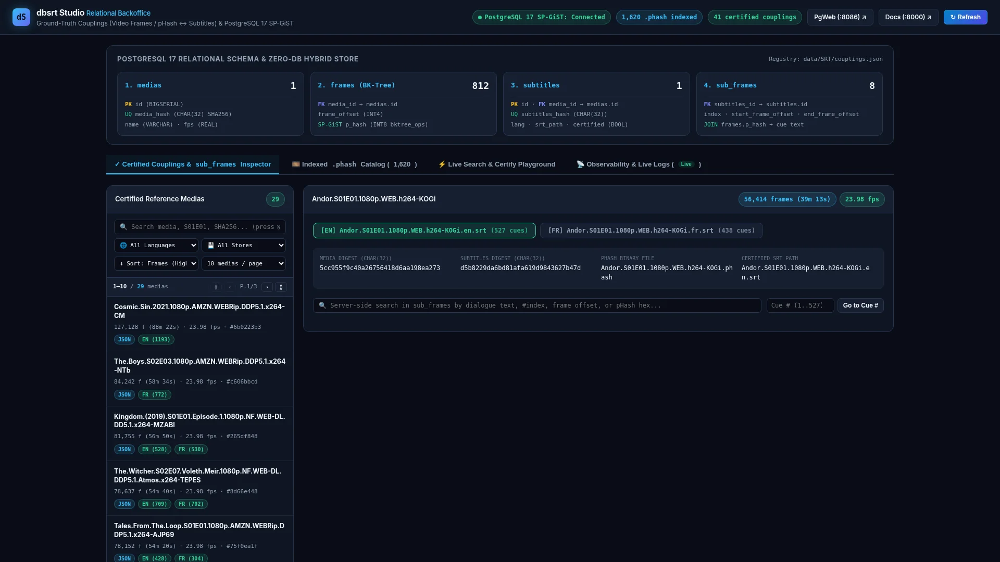
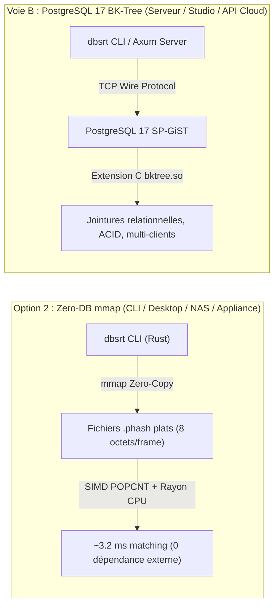
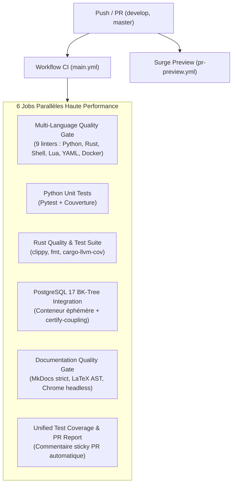
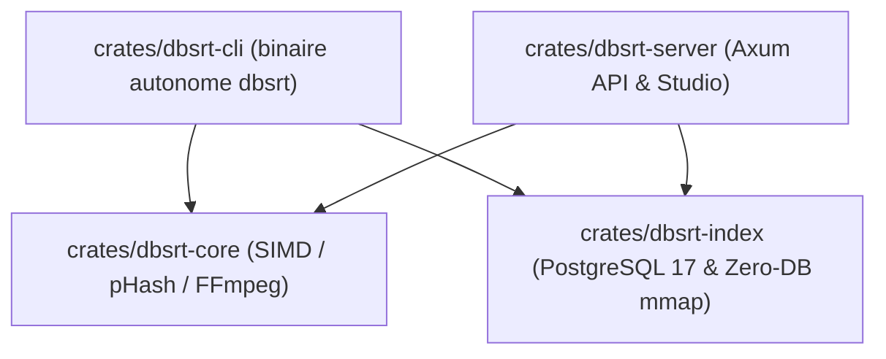
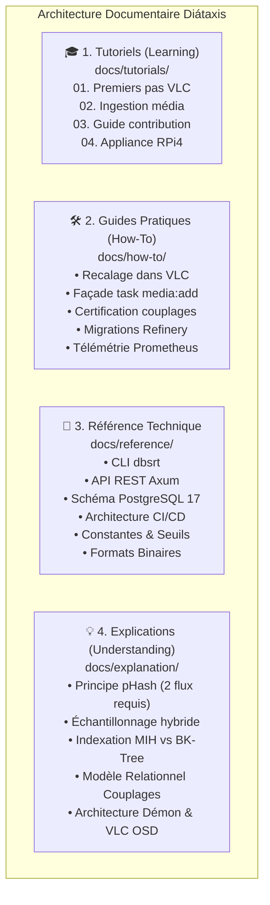

# pydbsrt & dbsrt-rs

> High-Performance Perceptual Hash (pHash) Video Frame Matching, SubRip (SRT) Subtitle Retargeting & Streaming Architecture.

[](https://github.com/yoyonel/pydbsrt/actions/workflows/main.yml)
[](https://github.com/yoyonel/pydbsrt/actions/workflows/pr-preview.yml)
[](https://yoyonel.github.io/pydbsrt/)
[](LICENSE)
[](https://www.rust-lang.org/)
[](https://github.com/astral-sh/uv)
[](https://www.postgresql.org/)

---

## 🚀 Présentation

`pydbsrt` est une suite logicielle haute performance conçue pour résoudre définitivement le problème de désynchronisation des sous-titres (`.srt`) entre différentes versions d'une même œuvre vidéo (Blu-ray, WEB-DL, HDTV, Remaster, DVD). Les variations de logos d'introduction, de cadences d'images (23.976, 24, 25, 29.97 fps) et de coupures de scènes rendent souvent inopérants les sous-titres récupérés sur Internet.

En calculant des empreintes perceptuelles compactes (**DCT pHash 64-bit**, 8 octets par image) sur les flux vidéo décodés, `pydbsrt` compare visuellement le média inconnu à un média de référence certifié, calcule un décalage temporel millimétrique par consensus de Hamming, et recalibre automatiquement les sous-titres sans intervention humaine.

La documentation technique interactive complète, structurée selon la méthodologie **[Diátaxis](https://diataxis.fr/)**, est disponible sur le **[Portail GitHub Pages du Projet](https://yoyonel.github.io/pydbsrt/)**.

---

## 🎥 Démonstrations & Preuves Vidéo

### 1. Recalage Temps Réel dans VLC Media Player (`vlsub_dbsrt.lua`)
Extension VLSub bonifiée connectée en tâche de fond au démon local Axum, avec téléchargement immédiat et affichage des décalages calculés sur l'OSD :

<figure markdown="1">
  <video autoplay loop muted playsinline width="100%">
    <source src="docs/assets/vlsub-dbsrt/vlsub_dbsrt_workflow_1080p.mp4" type="video/mp4">
  </video>
  <figcaption>Démonstration VLC : Recherche par pHash, recalage instantané (+1.5s visual shift) et notification OSD.</figcaption>
</figure>

### 2. Backoffice Visuel & Loupe Hamming (`dbsrt Studio`)
Interface web bicanale (`http://127.0.0.1:8765/studio`) permettant de confronter deux timelines vidéo, d'inspecter visuellement les matrices de Hamming 8x8 et d'auditer les couplages :

<figure markdown="1">
  
  <figcaption>Interface dbsrt Studio : Navigation comparative, loupe pHash et certification des couplages.</figcaption>
</figure>

---

## 🎯 Objectifs & Philosophie d'Ingénierie

- **Réalité Architecturale : Zéro Recalage Magique sans Référence Certifiée** : Un fichier `.srt` seul ne contient aucune information visuelle. `pydbsrt` ne prétend pas resynchroniser un sous-titre isolé sans disposer des pHashes certifiés du média source correspondant. Le recalage visuel opère strictement entre **deux flux vidéo** (source certifiée vs cible).
- **Vérité Terrain Relationnelle N:M** : Les associations certifiées entre vidéos, trames pHash et sous-titres sont scellées à la fois dans PostgreSQL 17 (`medias` ↔ `frames` ↔ `subtitles` ↔ `sub_frames`) et dans le registre portable Zero-DB `data/SRT/couplings.json`.
- **Zero Magic Constants** : Aucun chiffre magique, seuil arbitraire ou timeout non documenté dans le code. Toutes les constantes sont typées, nommées et centralisées dans [`docs/reference/constants.md`](docs/reference/constants.md).
- **Zéro Allocation en Chemin Chaud & SIMD** : Comparaisons de distance de Hamming accélérées par instructions matérielles CPU (`POPCNT`), projections mémoire `mmap` sans désérialisation, et représentations binaires compactes (8 octets / frame).
- **Ordonnancement Pur via Taskfile** : Zéro script shell inline complexe dans `Taskfile.yml`. Toutes les opérations récurrentes sont encapsulées dans des scripts modulaires sous `scripts/` et déclarées sous `taskfiles/`.
- **Fact-First Rigor & Preuves Empiriques** : Tout algorithme ou optimisation fait l'objet de benchmarks mesurés sur corpus réels (1 336 extraits vidéo, 5.08 millions de trames pHash sous `data/__PHASH__/`).

---

## 🧩 Fonctionnalités Clés

- **Façade Unifiée d'Ingestion Média (`task media:add`)** :
  - Auto-découverte des fichiers `.srt` sidecars homonymes.
  - Extraction automatique des pistes de sous-titres embarquées dans les conteneurs MKV / MP4 via FFmpeg.
  - Sondage FPS natif par `ffprobe` et identification ISO de langue.
  - Détection universelle des encodages (UTF-8, UTF-16LE/BE avec BOM, Windows-1252, ISO-8859-1) via `encoding_rs` et `chardetng`.
  - Rechargement atomique à chaud du catalogue en RAM sans arrêt de service (`zero-downtime hot reload`).
- **Deux Moteurs d'Indexation Complémentaires** :
  - **Zero-DB `mmap` (Option 2)** : Moteur autonome CLI / NAS sans dépendance, matching SIMD en **~3.2 ms** sur 5+ millions de frames.
  - **PostgreSQL 17 SP-GiST BK-Tree (Voie B)** : Extension native C `bktree.so`, indexation métrique SP-GiST, transactions ACID et requêtes multi-critères.
- **Microservice Axum & API REST (`dbsrt-server`)** :
  - API HTTP/JSON ultra-rapide (`/v1/search/phash`, `/v1/subtitles/sync`, `/v1/catalog/status`).
  - Index Multi-Index Hashing (MIH) en mémoire vive pour des recherches en sous-milliseconde.
  - Serveur web intégré pour `dbsrt Studio` (`/studio`).
- **Extension VLC Moderne & Protocole Local** :
  - Remplacement direct de VLSub (`vlsub_dbsrt.lua`) dialoguant avec le démon local.
  - Affichage direct des candidats avec leur distance de Hamming et application automatique du décalage calculé.
- **Observabilité & Télémétrie** :
  - Métriques Prometheus natives exposées par le serveur Axum (`/metrics`).
  - Dashboards Grafana provisionnés automatiquement sous `docker/grafana/`.

---

## 🏗️ Deux Moteurs Complémentaires

Le projet s'adapte aux contraintes d'infrastructure en proposant deux topologies d'exécution :



| Critère | Zero-DB `mmap` (Option 2) | PostgreSQL 17 SP-GiST BK-Tree (Voie B) |
| :--- | :--- | :--- |
| **Cas d'usage** | CLI local, appliance RPi4, NAS Synology, CI rapide | Serveur API d'équipe, backoffice Studio, catalogue multi-utilisateurs |
| **Dépendances** | **0 dépendance** (binaire autonome unique) | PostgreSQL 17 + extension `bktree.so` (Docker) |
| **Vitesse matching** | **~3.2 ms** (SIMD AVX2/NEON multi-cœur) | **~22.8 ms** (parcours d'index SP-GiST) |
| **Empreinte disque** | Compacte (8 octets par trame pHash) | Index relationnel SQL + tables de trames |
| **ACID / Concurrence** | Non (fichiers plats immuables) | Oui (transactions ACID, concurrence complète) |

---

## 🔄 Pipeline CI/CD & Assurance Qualité

Le dépôt implémente une politique d'intégrité logicielle stricte validée sur GitHub Actions :

- 📖 **[Consulter la Référence Technique Complète de l'Architecture CI/CD](docs/reference/ci-cd.md)**.



### Optimisations Majeures de Pipeline :
- **Installation FFmpeg Éclair via `AnimMouse/setup-ffmpeg@v1`** : Utilisation des builds statiques officiels [BtbN/FFmpeg-Builds](https://github.com/BtbN/FFmpeg-Builds/releases) servis par le CDN GitHub Releases. Temps d'installation réduit de **3m 55s (APT) à 13s** (gain de **94.5%**).
- **Mise en Cache Déclarative** : Caches Cargo (`Swatinem/rust-cache@v2`), cache d'environnements Python (`astral-sh/setup-uv@v5`) et caches d'images Docker.
- **Quality Gate Documentaire Diátaxis** : Vérification stricte sans avertissement (`task doc:check`), compilation vectorielle MathJax et smoke tests DOM via Headless Chrome.

---

## 🛠️ Prérequis & Installation

### Outils Recommandés :
* [Rust](https://rustup.rs/) (>= 1.80)
* [uv](https://github.com/astral-sh/uv) (gestionnaire Python ultra-rapide)
* [Taskfile](https://taskfile.dev/) (orchestrateur de commandes)
* FFmpeg (pour l'extraction de trames et sondage audio/vidéo)
* Docker & Docker Compose (uniquement pour le mode PostgreSQL 17 / Studio)

```bash
# 1. Cloner le dépôt
git clone https://github.com/yoyonel/pydbsrt.git
cd pydbsrt

# 2. Compiler l'ensemble des binaires Rust en release (dbsrt, dbsrt-server, dbsrt-index)
task build

# 3. Synchroniser l'environnement virtuel Python et installer les pre-commits
task sync
uv run pre-commit install
```

---

## ⚡ Quickstart & Scénarios Fréquents

### 1. Ingestion d'un Nouveau Média en 1 Commande
```bash
# Ingestion unifiée : calcule le pHash, auto-détecte le .srt sidecar, certifie le couplage et recharge la RAM
task media:add -- mes_videos/film.mkv

# Spécification manuelle du sous-titre et de la langue
task media:add -- mes_videos/film.mkv mes_subs/film.fr.srt --lang fr --fps 24.0
```

### 2. Démarrage de Toute la Stack Locale
```bash
# Démarre PostgreSQL 17 SP-GiST, PgWeb (:8086), dbsrt-server (:8765) et MkDocs (:8000)
task dev

# Afficher le tableau de bord de santé et compteurs relationnels
task status

# Ouvrir dbsrt Studio dans votre navigateur
task studio

# Arrêter proprement tous les services
task down
```

### 3. Recalage Standalone d'un Sous-Titre
```bash
# Recale un sous-titre désynchronisé contre un média ou son pHash en mode Zero-DB (en < 1 ms)
task demo:sync
```

### 4. Lancement de la Documentation Interactive
```bash
# Lance le serveur local avec rechargement à chaud automatique
task doc

# Valide l'intégrité Diátaxis (liens, formules LaTeX, terminaux Asciinema)
task doc:check
```

---

## 🏛️ Architecture Modulaire & SoC (Rust Workspace)

Le cœur de `pydbsrt` est découpé selon le principe de **Séparation des Responsabilités (SoC)** sous `crates/` :



| Crate | Responsabilités & Périmètre SoC |
| :--- | :--- |
| **[`crates/dbsrt-cli`](crates/dbsrt-cli/)** | **CLI Standalone & Dispatcher** : Point d'entrée de commande (`main.rs`), bibliothèque modulaire (`lib.rs`), sous-commandes dédiées dans `src/commands/` (`media_add`, `certify`, `export`, `import`, `recognize`, `retarget`, `scan`, `bench`, `migrate`). |
| **[`crates/dbsrt-server`](crates/dbsrt-server/)** | **Serveur REST Axum & Backoffice** : Handlers HTTP modulaires (`health`, `lookup`, `metrics`, `search`, `studio`, `sync`), indexation mémoire MIH et interface web `dbsrt Studio`. |
| **[`crates/dbsrt-index`](crates/dbsrt-index/)** | **Indexation & Persistance** : Modèle relationnel PostgreSQL 17 SP-GiST, gestionnaire de migrations versionnées Refinery (`embed_migrations!`), et moteur `mmap` Zero-DB (`.dbphash` / `.phash`). |
| **[`crates/dbsrt-core`](crates/dbsrt-core/)** | **Primitives Algorithmiques** : Calcul d'empreintes perceptuelles 64-bit DCT pHash, décodage FFmpeg HWAccel/SW, détection d'encodages de sous-titres et distance de Hamming SIMD (`popcnt`). |

---

## 📖 Documentation Diátaxis (4 Quadrants)

La documentation est structurée selon la norme **[Diátaxis](https://diataxis.fr/)** :



### Accès Rapide par Quadrant

| Quadrant | Intention | Liens Phares |
| :--- | :--- | :--- |
| **🎓 [Tutoriels](docs/tutorials/)** | Apprentissage guidé pas à pas pour débutants | [Premiers Pas VLC](docs/tutorials/01-premiers-pas-synchronisation-vlc.md) • [Ingestion Média](docs/tutorials/02-ingestion-et-certification-premier-media.md) • [Guide Contribution](docs/tutorials/03-environnement-developpement-et-contribution.md) • [Appliance RPi4](docs/tutorials/04-deploiement-appliance-rpi4.md) |
| **🛠️ [Guides Pratiques](docs/how-to/)** | Résolution concrète de tâches opérationnelles | [Synchroniser dans VLC](docs/how-to/synchroniser-sous-titres-vlc.md) • [Façade media:add](docs/how-to/ajouter-et-indexer-un-media.md) • [Certifier un couplage](docs/how-to/certifier-un-couplage.md) • [Migrer PostgreSQL](docs/how-to/migrer-schema-postgresql.md) • [Surveiller la stack](docs/how-to/surveiller-stack-telemetrie.md) |
| **📖 [Référence](docs/reference/)** | Description formelle des interfaces et de la machine | [CLI dbsrt](docs/reference/cli.md) • [API REST Axum](docs/reference/api-rest.md) • [Schéma PostgreSQL 17](docs/reference/schema-postgresql.md) • [Architecture CI/CD](docs/reference/ci-cd.md) • [Constantes & Seuils](docs/reference/constants.md) • [Catalogue Taskfile](docs/reference/taskfile.md) |
| **💡 [Explications](docs/explanation/)** | Clarification conceptuelle, théorique et choix d'architecture | [Principe pHash & 2 flux requis](docs/explanation/principe-fondamental-phash-et-retargeting.md) • [Échantillonnage hybride](docs/explanation/echantillonnage-hybride-cuts-et-1fps.md) • [MIH vs BK-Tree](docs/explanation/indexation-metrique-mih-vs-bktree.md) • [Vérité terrain & Modèle N:M](docs/explanation/modele-relationnel-couplages-certifies.md) |

---

## 📋 Catalogue des Commandes Clés (Taskfile)

| Commande | Action | Module |
| :--- | :--- | :--- |
| `task dev` | Démarre toute la stack de développement en arrière-plan | `Taskfile.yml` |
| `task down` | Arrête proprement tous les conteneurs et démons | `Taskfile.yml` |
| `task status` | Tableau de bord de santé et compteurs relationnels PostgreSQL 17 | `Taskfile.yml` |
| `task build` | Compile l'ensemble des binaires Rust en release | `Taskfile.yml` |
| `task media:add` | Façade unifiée d'ingestion média (pHash, sidecar, certification, reload) | `taskfiles/stack.yml` |
| `task coupling:certify` | Certifie les couples vidéo/sous-titres dans la base et dans JSON | `taskfiles/stack.yml` |
| `task demo:vlc` | Démonstration interactive VLC avec extension VLSub bonifiée | `taskfiles/demo.yml` |
| `task demo:studio` | Démarre l'interface web dbsrt Studio (`:8765/studio`) | `taskfiles/demo.yml` |
| `task lint` | Exécute l'ensemble des 9 linters polyglottes | `taskfiles/quality.yml` |
| `task test:rs` | Exécute la suite complète de tests Rust | `taskfiles/quality.yml` |
| `task ci:local` | Suite rapide de vérification pré-push (< 10 secondes) | `taskfiles/quality.yml` |
| `task coverage` | Rapport unifié de couverture de code (Rust + Python) | `taskfiles/quality.yml` |
| `task doc` | Serveur de documentation MkDocs Material avec rechargement en direct | `taskfiles/doc.yml` |
| `task doc:check` | Validateur strict de documentation (liens, LaTeX, AST, Headless Chrome) | `taskfiles/doc.yml` |

---

## 📄 Licence

Ce projet est distribué sous licence MIT. Consultez le fichier [LICENSE](LICENSE) pour plus de détails.
