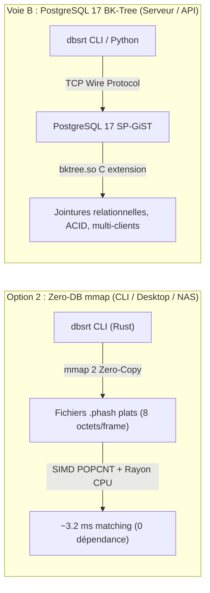

# pydbsrt & dbsrt-rs

> High-performance SubRip (SRT) subtitle synchronization and perceptual hash video frame matching.

Stack moderne propulsée par **Rust (`dbsrt-rs`)**, **PostgreSQL 17 (SP-GiST BK-Tree)**, **uv** et **Taskfile**.

---

## 1. Deux Approches Complémentaires

Le projet supporte deux moteurs d'indexation selon le cas d'usage :



| Critère | Zero-DB `mmap` (Option 2) | PostgreSQL 17 BK-Tree (Voie B) |
| :--- | :--- | :--- |
| **Cas d'usage** | CLI local, desktop, NAS, CI rapide, one-shot | Serveur API centralisé, multi-utilisateurs, catalogue partagé |
| **Dépendances** | **0 dépendance** (binaire autonome unique) | PostgreSQL 17 + extension `bktree.so`, Docker |
| **Vitesse matching** | **~3.2 ms** (~440x plus rapide que Python) | **~22.8 ms** (~15x plus rapide que Python) |
| **Stockage** | Fichiers `.phash` (8 Go / milliard de frames) | Table SQL `frames` avec index SP-GiST |
| **ACID / Transactions**| Non (fichiers immuables) | Oui (concurrence ACID complète) |

---

## 2. Prérequis & Installation

* [Rust](https://rustup.rs/) (>= 1.80)
* [uv](https://github.com/astral-sh/uv) (pour l'environnement Python legacy)
* [Taskfile](https://taskfile.dev/)
* Docker / Docker Compose (uniquement pour l'approche base de données PostgreSQL)

```bash
# Compiler le binaire release Rust dbsrt
task rs:build

# Installer l'environnement de développement et les pre-commits
task sync
uv run pre-commit install
```

---

## 3. Stack Unifiée, Backoffice `dbsrt Studio` & Démos

### Orchestration Complète de la Stack (`task up` / `task studio`)
```bash
# Démarrer toute la stack (PostgreSQL 17 SP-GiST + PgWeb + dbsrt-server + MkDocs + Seed Couplings)
task up

# Afficher l'état de tous les services et les compteurs relationnels (medias, frames, subtitles, sub_frames)
task status

# Ouvrir dbsrt Studio (http://127.0.0.1:8765/studio), PgWeb (:8086) et MkDocs (:8000)
task studio

# Certifier tous les couples (SRT <-> pHash) en base PostgreSQL 17 et dans data/SRT/couplings.json
task coupling:certify

# Arrêter proprement tous les démons et conteneurs
task down
```

### Approche 1 : Zero-DB `mmap` (Recommandé en local)
```bash
# Reconnaître une vidéo inconnue sans base de données (matching en ~3 ms)
task demo:recognize:mmap

# Scanner une bibliothèque de fichiers .phash
task demo:scan:rs

# Recaler et synchroniser des sous-titres SRT (en ~0.5 ms)
task demo:retarget:rs

# Compiler un catalogue unifié haute densité .dbphash (Hybride Cuts + 1 fps)
task demo:pack:rs

# Recherche sub-milliseconde sur le catalogue unifié .dbphash
task demo:scan:dbphash

# Inspecter les métadonnées et flux de sous-titres intégrés d'un média
task demo:inspect:rs
```

### Approche 2 : PostgreSQL 17 BK-Tree & Couplages Relationnels
```bash
# Démarrer le cluster PostgreSQL 17 + extension bktree + PgWeb
task db:up

# Reconnaître un média via la base de données
task demo:recognize:rs

# Lancer la démo Python legacy
task demo:recognize
```

---

## 4. Tâches de Tests & Qualité Code Multi-Langages

Toutes les suites de tests et de qualité code (`.rs`, `.py`, `.sh`, `.lua`, `.yml`, `.html`/`.js`, `.json`, `.md`) sont orchestrées via `Taskfile.yml` :

| Tâche | Description | Dépendances |
| :--- | :--- | :--- |
| **`task up` / `task down`** | Démarre / arrête toute la stack (`PostgreSQL 17`, `PgWeb`, `dbsrt-server`, `MkDocs`) | Docker |
| **`task status`** | Affiche l'état des services HTTP et les compteurs SQL (`medias`, `frames`, `subtitles`, `sub_frames`) | Aucune |
| **`task studio`** | Ouvre `dbsrt Studio` (`:8765/studio`), `PgWeb` (`:8086`) et `MkDocs` (`:8000`) | `task up` |
| **`task coupling:certify`** | Certifie et indexe tous les couples `(SRT <-> pHash)` dans PG17 et `couplings.json` | Aucune |
| **`task test:rs`** | Exécute **tous** les tests Rust (unitaires, intégration, API REST `/studio` & `/v1/*`) | Aucune |
| **`task test:rs:mmap`** | Teste le moteur Zero-DB `mmap` en mode autonome | Aucune |
| **`task test:rs:retarget`** | Teste la parité ISO du recalage de sous-titres SRT | Aucune |
| **`task test:rs:db`** | Teste l'intégration avec PostgreSQL 17 BK-Tree (démarre la DB auto) | Docker |
| **`task test:local`** | Exécute la suite de tests Python avec `uv` | Docker (`db:up`) |
| **`task fmt`** | Formate tout le dépôt (`ruff format`, `cargo fmt`, `shfmt`, `stylua`) | Aucune |
| **`task lint`** | Exécute tous les linters (`ruff`, `mypy`, `bandit`, `clippy`, `shellcheck`, `luac5.2`, `yamllint`, web AST, disk guard) | Aucune |
| **`task pre-commit`** | Exécute les `17/17` hooks pre-commit sur l'ensemble des fichiers suivis | Aucune |
| **`task doc:check`** | Valide le build strict MkDocs, l'AST HTML/LaTeX et le rendu Headless Chrome | Aucune |
| **`task doc:optimize-images`** | Convertit les captures lourdes PNG en WebP 720p optimisé (-91.5% payload) | Aucune |
| **`task disk:check`** | Vérifie les seuils d'espace disque disponible (> 10 Go) et de `target/` (< 4 Go) | Aucune |
| **`task clean`** | Purge unifiée des artefacts et caches (`cargo clean`, `.pytest_cache`, `.ruff_cache`, `__pycache__`) | Aucune |

---

## 5. Documentation & Rapports d'Architecture

Dossiers techniques détaillés disponibles dans le répertoire [`docs/`](docs) :

* [`docs/2026-10-20-dashboard-interactif-e2e-vlc-corpus-nas.md`](docs/2026-10-20-dashboard-interactif-e2e-vlc-corpus-nas.md) : Dashboard interactif sur 1 334 vidéos réelles (99.8% succès), navigation plein écran par flèches clavier, synchronisation bidirectionnelle du curseur et captures WebP 720p.
* [`docs/2026-10-20-architecture-retrait-invalidation-donnees-globales.md`](docs/2026-10-20-architecture-retrait-invalidation-donnees-globales.md) : Architecture de retrait et invalidation globale sur 5 paliers synchronisés (FS, Zero-DB JSON, PostgreSQL 17 `ON DELETE CASCADE`, `.dbphash` mmap).
* [`docs/2026-10-18-studio-backoffice-and-relational-couplings.md`](docs/2026-10-18-studio-backoffice-and-relational-couplings.md) : Architecture des couplages relationnels certifiés (`medias`/`frames`/`subtitles`/`sub_frames`), backoffice `dbsrt Studio` (`/studio`) + `PgWeb` (`:8086`), Taskfile déclaratif et pipeline qualité `17/17` hooks.
* [`docs/2026-10-18-e2e-phash-search-mechanics-and-roadmap.md`](docs/2026-10-18-e2e-phash-search-mechanics-and-roadmap.md) : Analyse mécanique E2E de `Search by pHash`, résolution prioritaire par couplages certifiés et certification `dbsrt certify-coupling`.
* [`docs/2026-10-18-vlsub-fork-and-restoration.md`](docs/2026-10-18-vlsub-fork-and-restoration.md) : Fork bonifié de VLSub (`vlsub_dbsrt.lua`), backend REST Axum et démonstration vidéo 1080p MP4.
* [`docs/2026-10-17-etude-comparative-identification-frames-cuts-keyframes-hybride.md`](docs/2026-10-17-etude-comparative-identification-frames-cuts-keyframes-hybride.md) : Étude empirique comparative (5M frames, 125 épisodes, 5 encodages) et validation du format Hybride v2.0.
* [`docs/2026-10-16-axe5-remote-subtitles-providers.md`](docs/2026-10-16-axe5-remote-subtitles-providers.md) : Spécification technique du moteur de récupération et d'agrégation de sous-titres distants.
* [`docs/2026-10-15-scaling-architecture-rust-mmap.md`](docs/2026-10-15-scaling-architecture-rust-mmap.md) : Étude d'ingénierie sur le passage à l'échelle (milliards de frames) et moteur `mmap`.
* [`docs/2026-10-15-rust-e2e-benchmarks-and-tradeoffs.md`](docs/2026-10-15-rust-e2e-benchmarks-and-tradeoffs.md) : Analyse comparative des performances Rust vs Python et compromis techniques.
* [`docs/2026-10-15-pg17-bktree-benchmark-migration.md`](docs/2026-10-15-pg17-bktree-benchmark-migration.md) : Migration de l'extension C BK-Tree sur PostgreSQL 17.
* [`docs/2026-10-15-audit-global.md`](docs/2026-10-15-audit-global.md) : Audit exhaustif du dépôt avant modernisation.
