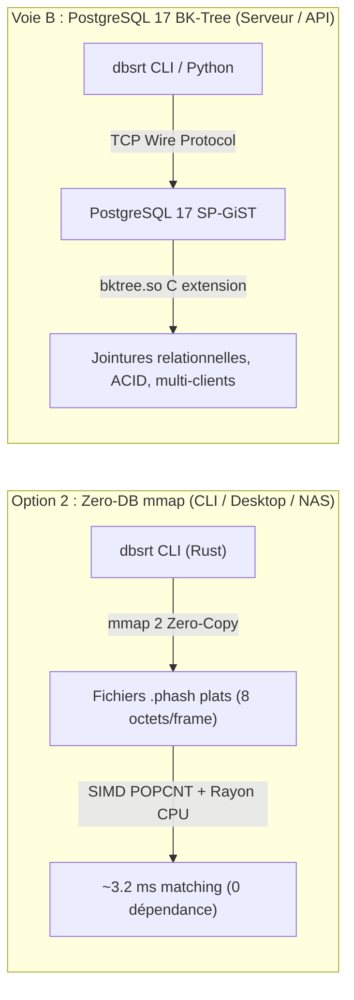

# pydbsrt & dbsrt-rs

> High-performance SubRip (SRT) subtitle synchronization and perceptual hash video frame matching.

Stack moderne propulsée par **Rust (`dbsrt-rs`)**, **PostgreSQL 17 (SP-GiST BK-Tree)**, **uv** et **Taskfile**.

---

## 1. Deux Approches Complémentaires

Le projet supporte deux moteurs d'indexation selon le cas d'usage :



| Critère | Zero-DB `mmap` (Option 2) | PostgreSQL 17 BK-Tree (Voie B) |
| :--- | :--- | :--- |
| **Cas d'usage** | CLI local, desktop, NAS, CI rapide, one-shot | Serveur API centralisé, multi-utilisateurs, catalogue partagé |
| **Dépendances** | **0 dépendance** (binaire autonome unique) | PostgreSQL 17 + extension `bktree.so`, Docker |
| **Vitesse matching** | **~3.2 ms** (~440x plus rapide que Python) | **~22.8 ms** (~15x plus rapide que Python) |
| **Stockage** | Fichiers `.phash` (8 Go / milliard de frames) | Table SQL `frames` avec index SP-GiST |
| **ACID / Transactions**| Non (fichiers immuables) | Oui (concurrence ACID complète) |

---

## 2. Prérequis & Installation

* [Rust](https://rustup.rs/) (>= 1.80)
* [uv](https://github.com/astral-sh/uv) (pour l'environnement Python legacy)
* [Taskfile](https://taskfile.dev/)
* Docker / Docker Compose (uniquement pour l'approche base de données PostgreSQL)

```bash
# Compiler l'ensemble du workspace Rust dbsrt en mode release
task build

# Installer l'environnement de développement et les pre-commits
task sync
uv run pre-commit install
```

---

## 3. Stack Unifiée, Backoffice `dbsrt Studio` & Démos

### Orchestration Complète de la Stack (`task dev` / `task up`)
```bash
# Démarrer toute la stack (PostgreSQL 17 SP-GiST + PgWeb + dbsrt-server + MkDocs + Seed Couplings)
task dev

# Astuce multi-projets : en cas de conflit sur le port 8086 (ex: pods/conteneurs professionnels déjà actifs)
# Surcharger simplement la variable sans impacter vos autres services :
PGWEB_PORT=8088 task dev

# Afficher l'état de tous les services et les compteurs relationnels (medias, frames, subtitles, sub_frames)
task status

# Ouvrir dbsrt Studio (http://127.0.0.1:8765/studio), PgWeb (:8086) et MkDocs (:8000)
task studio

# Certifier tous les couples (SRT <-> pHash) en base PostgreSQL 17 et dans data/SRT/couplings.json
task coupling:certify

# Arrêter proprement tous les démons et conteneurs
task down
```

### Démos Clés & Recalage Temps Réel
```bash
# Recaler et synchroniser des sous-titres SRT via le moteur Rust natif (en ~0.5 ms)
task demo:sync

# Démonstration interactive VLC avec extension VLSub bonifiée et affichage OSD
task demo:vlc

# Lancer dbsrt Studio (interface web bi-piste et loupe 8x8 pHash sur :8765/studio)
task demo:studio

# Tester le cycle de vie systemd et l'installation client en conteneur hermétique
task test:recipe:debian
```

---

## 4. Ordonnancement Modulaire Taskfile & Assurance Qualité

Le dépôt est orchestré par **[Taskfile (go-task)](https://taskfile.dev/)** découpé en modules spécialisés sous `taskfiles/` :

* 📚 **[Consulter le Tutoriel Développeur & Guide d'Ordonnancement Taskfile](docs/2026-10-21-tutoriel-orchestration-taskfile-et-guide-developpeur.md)** pour le guide pas à pas.

| Tâche | Description | Domaine (`taskfiles/`) |
| :--- | :--- | :--- |
| **`task dev` / `task down`** | Démarre / arrête toute la stack de dev en arrière-plan | `Taskfile.yml` |
| **`task status`** | Tableau de bord de santé unifié et compteurs PostgreSQL 17 | `Taskfile.yml` |
| **`task build`** | Compile tous les binaires Rust en release (`dbsrt-cli`, `dbsrt-server`, `dbsrt-index`) | `Taskfile.yml` |
| **`task test`** | Exécute l'ensemble des suites de tests Rust et Python | `Taskfile.yml` |
| **`task test:rs`** | Exécute tous les tests unitaires, d'intégration et E2E Rust | `taskfiles/quality.yml` |
| **`task test:recipe:debian`**| Teste la recette de déploiement client en conteneur Docker systemd isolé | `taskfiles/client.yml` |
| **`task fmt`** | Formate automatiquement le code (`cargo fmt`, `ruff`, `shfmt`, `stylua`) | `taskfiles/quality.yml` |
| **`task lint`** | Exécute les 9 linters (Rust, Python, Shell, Lua, Docker, YAML, web AST) | `taskfiles/quality.yml` |
| **`task typecheck`** | Vérifie le typage statique strict Python via Pyright | `taskfiles/quality.yml` |
| **`task coverage`** | Génère la couverture unifiée (1:1 parité CI GitHub Actions) | `taskfiles/quality.yml` |
| **`task ci:local`** | Suite rapide de validation pré-push (< 10s chrono) | `taskfiles/quality.yml` |
| **`task doc`** | Lance le serveur local de documentation MkDocs Material (`:8000`) | `taskfiles/doc.yml` |
| **`task doc:check`** | Validateur strict de documentation (liens, LaTeX, AST HTML, Chrome headless) | `taskfiles/doc.yml` |
| **`task vlc:install-plugin`** | Installe l'extension GUI VLSub et l'interface CLI dans le profil VLC | `taskfiles/vlc.yml` |
| **`task vlc:test`** | Exécute la pyramide complète de tests VLC (unitaires + cvlc + GUI E2E) | `taskfiles/vlc.yml` |
| **`task db:up` / `db:down`** | Démarre / arrête la base PostgreSQL 17 SP-GiST BK-Tree | `taskfiles/db.yml` |
| **`task rpi4:build`** | Cross-compile pour ARM64 / Raspberry Pi 4 | `taskfiles/rpi4.yml` |
| **`task sim:test`** / **`task sim:rpi4:test`** | Exécute la batterie de 6 tests API ARM64 en simulation QEMU (512 Mo RAM) | `taskfiles/rpi4.yml` |
| **`task clean`** | Purge unifiée des artefacts et caches (`target/`, `.pytest_cache`, `.ruff_cache`) | `Taskfile.yml` |

---

## 5. Documentation & Rapports d'Architecture

Dossiers techniques détaillés disponibles dans le répertoire [`docs/`](docs) :

* [`docs/2026-10-21-tutoriel-orchestration-taskfile-et-guide-developpeur.md`](docs/2026-10-21-tutoriel-orchestration-taskfile-et-guide-developpeur.md) : **Tutoriel Développeur & Guide d'Ordonnancement Taskfile** : Philosophie, modules `taskfiles/`, 4 workflows quotidiens et guide pas à pas pour ajouter une tâche.
* [`docs/2026-10-21-strategie-tests-infrastructure-et-recettes-systemd-hermetiques.md`](docs/2026-10-21-strategie-tests-infrastructure-et-recettes-systemd-hermetiques.md) : **Stratégie de Test d'Infrastructure & Recettes systemd Hermétiques** : Épreuve de déploiement en conteneur Docker cgroups v2 isolé sans toucher à la machine hôte.

* [`docs/2026-10-20-dashboard-interactif-e2e-vlc-corpus-nas.md`](docs/2026-10-20-dashboard-interactif-e2e-vlc-corpus-nas.md) : Dashboard interactif sur 1 334 vidéos réelles (99.8% succès), navigation plein écran par flèches clavier, synchronisation bidirectionnelle du curseur et captures WebP 720p.
* [`docs/2026-10-20-architecture-retrait-invalidation-donnees-globales.md`](docs/2026-10-20-architecture-retrait-invalidation-donnees-globales.md) : Architecture de retrait et invalidation globale sur 5 paliers synchronisés (FS, Zero-DB JSON, PostgreSQL 17 `ON DELETE CASCADE`, `.dbphash` mmap).
* [`docs/2026-10-18-studio-backoffice-and-relational-couplings.md`](docs/2026-10-18-studio-backoffice-and-relational-couplings.md) : Architecture des couplages relationnels certifiés (`medias`/`frames`/`subtitles`/`sub_frames`), backoffice `dbsrt Studio` (`/studio`) + `PgWeb` (`:8086`), Taskfile déclaratif et pipeline qualité `17/17` hooks.
* [`docs/2026-10-18-e2e-phash-search-mechanics-and-roadmap.md`](docs/2026-10-18-e2e-phash-search-mechanics-and-roadmap.md) : Analyse mécanique E2E de `Search by pHash`, résolution prioritaire par couplages certifiés et certification `dbsrt certify-coupling`.
* [`docs/2026-10-18-vlsub-fork-and-restoration.md`](docs/2026-10-18-vlsub-fork-and-restoration.md) : Fork bonifié de VLSub (`vlsub_dbsrt.lua`), backend REST Axum et démonstration vidéo 1080p MP4.
* [`docs/2026-10-17-etude-comparative-identification-frames-cuts-keyframes-hybride.md`](docs/2026-10-17-etude-comparative-identification-frames-cuts-keyframes-hybride.md) : Étude empirique comparative (5M frames, 125 épisodes, 5 encodages) et validation du format Hybride v2.0.
* [`docs/2026-10-16-axe5-remote-subtitles-providers.md`](docs/2026-10-16-axe5-remote-subtitles-providers.md) : Spécification technique du moteur de récupération et d'agrégation de sous-titres distants.
* [`docs/2026-10-15-scaling-architecture-rust-mmap.md`](docs/2026-10-15-scaling-architecture-rust-mmap.md) : Étude d'ingénierie sur le passage à l'échelle (milliards de frames) et moteur `mmap`.
* [`docs/2026-10-15-rust-e2e-benchmarks-and-tradeoffs.md`](docs/2026-10-15-rust-e2e-benchmarks-and-tradeoffs.md) : Analyse comparative des performances Rust vs Python et compromis techniques.
* [`docs/2026-10-15-pg17-bktree-benchmark-migration.md`](docs/2026-10-15-pg17-bktree-benchmark-migration.md) : Migration de l'extension C BK-Tree sur PostgreSQL 17.
* [`docs/2026-10-15-audit-global.md`](docs/2026-10-15-audit-global.md) : Audit exhaustif du dépôt avant modernisation.
