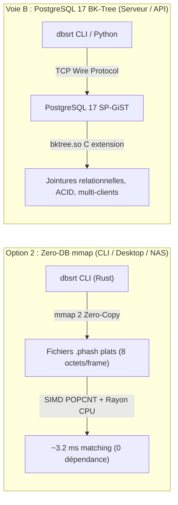

# pydbsrt & dbsrt-rs

> High-performance SubRip (SRT) subtitle synchronization and perceptual hash video frame matching.

Stack moderne propulsée par **Rust (`dbsrt-rs`)**, **PostgreSQL 17 (SP-GiST BK-Tree)**, **uv** et **Taskfile**.

---

## 1. Deux Approches Complémentaires

Le projet supporte deux moteurs d'indexation selon le cas d'usage :



| Critère | Zero-DB `mmap` (Option 2) | PostgreSQL 17 BK-Tree (Voie B) |
| :--- | :--- | :--- |
| **Cas d'usage** | CLI local, desktop, NAS, CI rapide, one-shot | Serveur API centralisé, multi-utilisateurs, catalogue partagé |
| **Dépendances** | **0 dépendance** (binaire autonome unique) | PostgreSQL 17 + extension `bktree.so`, Docker |
| **Vitesse matching** | **~3.2 ms** (~440x plus rapide que Python) | **~22.8 ms** (~15x plus rapide que Python) |
| **Stockage** | Fichiers `.phash` (8 Go / milliard de frames) | Table SQL `frames` avec index SP-GiST |
| **ACID / Transactions**| Non (fichiers immuables) | Oui (concurrence ACID complète) |

---

## 2. Prérequis & Installation

* [Rust](https://rustup.rs/) (>= 1.80)
* [uv](https://github.com/astral-sh/uv) (pour l'environnement Python legacy)
* [Taskfile](https://taskfile.dev/)
* Docker / Docker Compose (uniquement pour l'approche base de données PostgreSQL)

```bash
# Compiler le binaire release Rust dbsrt
task rs:build

# Installer l'environnement de développement et les pre-commits
task sync
poetry run pre-commit install
```

---

## 3. Démos & Exécution Rapide

### Approche 1 : Zero-DB `mmap` (Recommandé en local)
```bash
# Reconnaître une vidéo inconnue sans base de données (matching en ~3 ms)
task demo:recognize:mmap

# Scanner une bibliothèque de fichiers .phash
task demo:scan:rs

# Recaler et synchroniser des sous-titres SRT (en ~0.5 ms)
task demo:retarget:rs
```

### Approche 2 : PostgreSQL 17 BK-Tree
```bash
# Démarrer le cluster PostgreSQL 17 + extension bktree
task db:up

# Reconnaître un média via la base de données
task demo:recognize:rs

# Lancer la démo Python legacy
task demo:recognize
```

---

## 4. Tâches de Tests Simples

Toutes les suites de tests sont orchestrées via `Taskfile` :

| Tâche | Description | Dépendances |
| :--- | :--- | :--- |
| **`task test:rs`** | Exécute **tous** les tests Rust (unitaires, intégration, E2E) | Aucune |
| **`task test:rs:mmap`** | Teste le moteur Zero-DB `mmap` en mode autonome | Aucune |
| **`task test:rs:retarget`** | Teste la parité ISO du recalage de sous-titres SRT | Aucune |
| **`task test:rs:db`** | Teste l'intégration avec PostgreSQL 17 BK-Tree (démarre la DB auto) | Docker |
| **`task test:local`** | Exécute la suite de tests Python avec `uv` | Docker (`db:up`) |
| **`task rs:bench`** | Benchmark pHash SIMD (72 000 frames/s) | Aucune |
| **`task lint`** | Exécute ruff et cargo clippy sur tout le codebase | Aucune |

---

## 5. Documentation & Rapports d'Architecture

Dossiers techniques détaillés disponibles dans le répertoire [`docs/`](file:///home/latty/Prog/__PERSO__/pydbsrt/docs) :

* [`docs/2026-10-15-scaling-architecture-rust-mmap.md`](file:///home/latty/Prog/__PERSO__/pydbsrt/docs/2026-10-15-scaling-architecture-rust-mmap.md) : Étude d'ingénierie sur le passage à l'échelle (milliards de frames) et moteur `mmap`.
* [`docs/2026-10-15-rust-e2e-benchmarks-and-tradeoffs.md`](file:///home/latty/Prog/__PERSO__/pydbsrt/docs/2026-10-15-rust-e2e-benchmarks-and-tradeoffs.md) : Analyse comparative des performances Rust vs Python et compromis techniques.
* [`docs/2026-10-15-pg17-bktree-benchmark-migration.md`](file:///home/latty/Prog/__PERSO__/pydbsrt/docs/2026-10-15-pg17-bktree-benchmark-migration.md) : Migration de l'extension C BK-Tree sur PostgreSQL 17.
* [`docs/2026-10-15-audit-global.md`](file:///home/latty/Prog/__PERSO__/pydbsrt/docs/2026-10-15-audit-global.md) : Audit exhaustif du dépôt avant modernisation.
