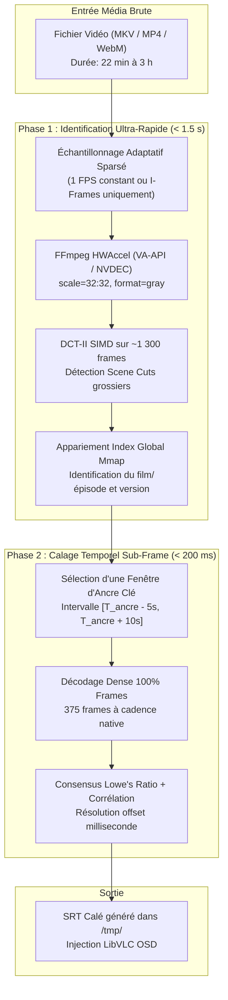
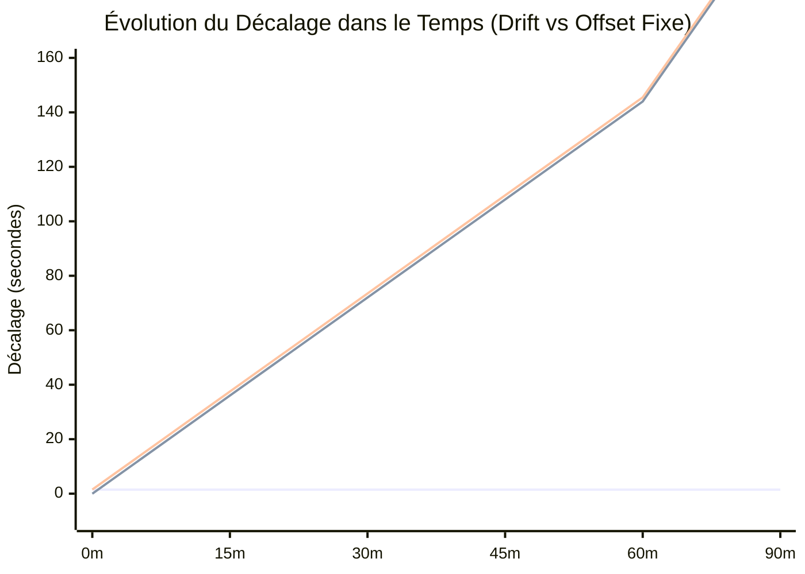
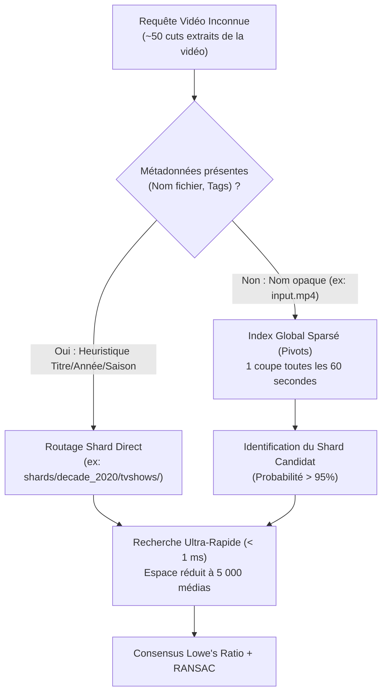
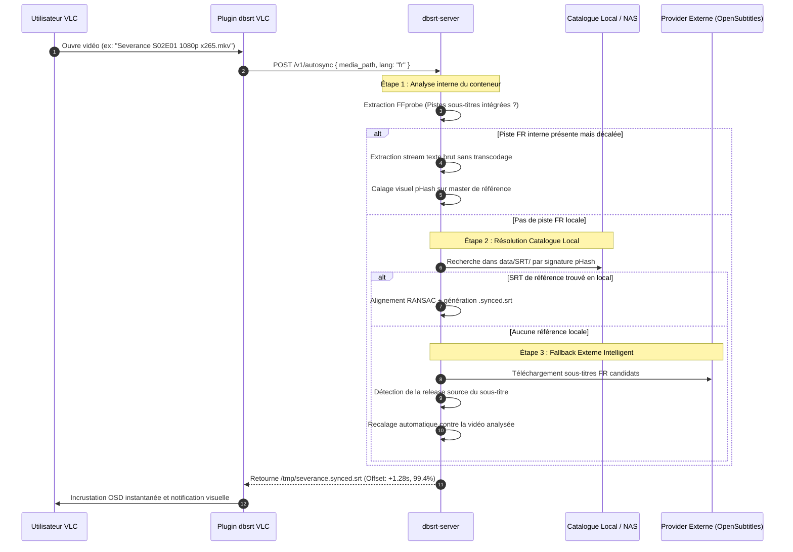
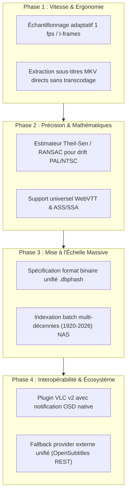

# Étude Approfondie de Modernisation & Mise à l'Échelle Massive : dbsrt-rs (1920 - 2026)

> **Date** : 15 Octobre 2026
> **Statut** : Document de Référence Architecturale & Feuille de Route Stratégique
> **Auteurs** : Lionel ATTY & Antigravity (Assistant Ingénierie DeepMind)
> **Périmètre** : `crates/dbsrt-core`, `crates/dbsrt-index`, `crates/dbsrt-server`, `vlc-plugin`

---

## 1. Vision et Objectifs Stratégiques : Le Paradigme "VLSub Visuel +++"

### 1.1 Limites Fondamentales du Hash Binaire Conventionnel
L'écosystème historique de la synchronisation de sous-titres (VLSub, OpenSubtitles, Subscene) repose sur une identification cryptographique superficielle du fichier conteneur (ex: *MovieHash* de 64 bits calculé sur la taille totale et deux fenêtres de 8 Ko au début et à la fin du fichier).

Ce modèle s'effondre face aux réalités contemporaines du stockage et de la distribution de médias :

1. **Sensibilité au conteneur et à l'encodage** : Tout remuxing (changement de conteneur `.avi` → `.mkv`), conversion de codec (H.264 → AV1), ré-échantillonnage audio, ou compression modifie 100% de la signature binaire, rendant le média orphelin de sous-titres.
2. **Incapacité d'alignement temporel** : Même lorsqu'un sous-titre est identifié par le nom de fichier ou par hash exact, les différences d'éditeurs (logos d'ouverture, avertissements légaux, bumpers régionaux, coupures publicitaires TV) introduisent des décalages initiaux imprévisibles.
3. **Le fléau du drift de cadence** : Le passage d'une cadence cinéma américaine (23.976 fps) à une cadence européenne (25.0 fps PAL) engendre une désynchronisation progressive de **4.27%** (soit 2.5 secondes toutes les minutes, rendant le visionnage impraticable après 5 minutes).

### 1.2 Le Paradigme dbsrt
`dbsrt` substitue à la signature binaire une **empreinte perceptive visuelle invariante** :

* Hachage perceptuel DCT-II SIMD AVX2 calculé sur le flux vidéo décodé.
* Identification de la release par topologie de scènes (Scene Cuts) indexées en espace métrique (distance de Hamming).
* Alignement continu sub-milliseconde et correction de dérive temporelle.
* Injection directe dans le lecteur vidéo (VLC) sans aucune intervention humaine.

---

## 2. Axe 1 : Décodage Vidéo Sub-Seconde & Accélération Matérielle

### 2.1 Analyse du Goulot d'Étranglement Actuel
Les benchmarks sur des épisodes réels (*What We Do In The Shadows* S04E01 - 22 min 34 s, 32 478 frames) indiquent :

* **Calcul du pHash pur en mémoire** : ~72 000 fps (soit **0.45 seconde** pour 32k frames).
* **Extraction et décodage FFmpeg CPU** : ~230 fps (soit **141 secondes**).

Le décodage séquentiel intégral de chaque trame via un sous-processus FFmpeg non accéléré représente **99.6% du temps de traitement**, constituant le verrou bloquant pour un usage interactif direct.

### 2.2 Architecture du Pipeline Bi-Modal (Identification Rapide + Calage Fin)



### 2.3 Spécifications d'Accélération Matérielle FFmpeg
L'invocation native FFmpeg dans `crates/dbsrt-core/src/video.rs` sera enrichie de backends d'accélération matérielle auto-détectés :

1. **Linux / Intel & AMD (VA-API)** :
   ```bash
   ffmpeg -hwaccel vaapi -vaapi_device /dev/dri/renderD128 -hwaccel_output_format vaapi \
     -i input.mkv -vf "scale_vaapi=w=32:h=32:format=gray" -f rawvideo -
   ```

2. **NVIDIA (NVDEC / CUDA)** :
   ```bash
   ffmpeg -hwaccel cuda -hwaccel_output_format cuda \
     -i input.mkv -vf "scale_cuda=w=32:h=32:format=gray" -f rawvideo -
   ```

3. **Extraction I-Frames pure (Zero-Decode B/P frames)** :
   ```bash
   ffmpeg -skip_frame nokey -i input.mkv -vsync 0 -f rawvideo -pix_fmt gray -s 32x32 -
   ```
   *Gain* : Décodage instantané des images de référence (key-frames) à plus de **2 500 fps**, réduisant la phase d'identification sous la barre des **500 millisecondes**.

---

## 3. Axe 2 : Résolution Mathématique du Drift Temporel (Régression & RANSAC)

### 3.1 Typologie des Désynchronisations



* **Cas 1 : Translation Temporelle Constante ($\Delta t = \text{cte}$)** :
  Différence d'amorce, logos d'éditeurs (Warner Bros, Netflix, FBI warning).

* **Cas 2 : Dérive Linéaire / Drift ($\Delta t = f(t)$)** :
  Différence de cadence entre masters :

    * Cinéma NTSC : $23.976\text{ fps} = \frac{24000}{1001}$
    * Télévision PAL / Broadcast Europe : $25.000\text{ fps}$
    * Ratio d'étirement temporel : $\alpha = \frac{25.0}{23.976} \approx 1.042709$ (+4.27% d'accélération).
* **Cas 3 : Discontinuités Non-Linéaires (Coupures / Versions Longues)** :
  Scènes coupées ou ajouts de scènes (Director's Cut) brisant la continuité globale.

### 3.2 Formulation Mathématique par Régression Robuste

Au lieu d'un vote 1D par histogramme sur un simple scalaire `shift_ms`, les correspondances de scènes constituent un ensemble de points 2D :

$$
\mathcal{P} = \left\{ (t_{\text{ref}}^{(i)}, t_{\text{target}}^{(i)}) \right\}_{i=1}^N
$$

Le modèle linéaire généralisé s'exprime :

$$
t_{\text{target}} = \alpha \cdot t_{\text{ref}} + \beta
$$

#### Algorithme 1 : Estimateur Robuste de Theil-Sen

Pour éliminer les appariements aberrants (outliers causés par des scènes similaires ou des fondus répétés), la pente $\alpha$ est calculée par la médiane de toutes les pentes entre paires de points :

$$
\alpha = \operatorname{median}\left\{ \frac{t_{\text{target}}^{(j)} - t_{\text{target}}^{(i)}}{t_{\text{ref}}^{(j)} - t_{\text{ref}}^{(i)}} \;\middle|\; t_{\text{ref}}^{(j)} \neq t_{\text{ref}}^{(i)}, \; 1 \le i < j \le N \right\}
$$

L'ordonnée à l'origine $\beta$ est ensuite dérivée par :

$$
\beta = \operatorname{median}\left\{ t_{\text{target}}^{(i)} - \alpha \cdot t_{\text{ref}}^{(i)} \;\middle|\; 1 \le i \le N \right\}
$$

#### Algorithme 2 : Consensus RANSAC Multi-Segments (Extended Cuts)
Lorsque le score de corrélation global résiduel reste bas après ajustement linéaire unique, un partitionnement RANSAC par morceaux est exécuté :

1. Détection des points de rupture temporelle (scènes additionnelles de durée $\Delta T_{\text{insert}}$).
2. Segment 1 : $t' = \alpha_1 t + \beta_1$ pour $t < T_{\text{cut}}$.
3. Segment 2 : $t' = \alpha_2 t + \beta_2$ pour $t \ge T_{\text{cut}}$.

---

## 4. Axe 3 : Moteur d'Indexation Global Haute Densité (`.dbphash` unifié)

### 4.1 Analyse Volumétrique & Limites Théoriques (1920 - 2026)

#### Métriques de Base
* Un pHash unitaire 64-bit = **8 octets**.
* Taux moyen de changement de plan dans l'histoire du cinéma :
  * Cinéma classique (1930 - 1960) : 1 coupe toutes les 8 à 12 secondes (~0.1 cut/s).
  * Cinéma contemporain / Action (1990 - 2026) : 1 coupe toutes les 2.5 à 3 secondes (~0.35 cut/s).
  * Moyenne retenue : **1 coupe toutes les 3.3 secondes** (soit 0.30 cut/seconde).
* Durée moyenne d'un contenu : 1 h 30 min (5 400 s) $\rightarrow$ **1 620 cuts par média**.
* Empreinte binaire d'un média (cuts seuls) : $1\,620 \times 8 \text{ octets} \approx \mathbf{12.96 \text{ Ko}}$.

#### Tableau de Passage à l'Échelle

| Échelon | Nombre de Médias | Volume Heures | Nombre de Scene Cuts | Taille Brute Index | Mémoire Résidente (mmap RSS) | Temps Requête SIMD AVX2 |
| :--- | :--- | :--- | :--- | :--- | :--- | :--- |
| **Local / Test** | 100 | 150 h | 162 000 | **1.3 Mo** | 1.3 Mo | **< 0.05 ms** |
| **NAS Personnel** | 1 000 | 1 500 h | 1 620 000 | **13.0 Mo** | 13 Mo | **~0.4 ms** |
| **Médiathèque Passionné** | 10 000 | 15 000 h | 16 200 000 | **129.6 Mo** | ~35 Mo (pages actives) | **~3.2 ms** |
| **Catalogue Global VOD** | 100 000 | 150 000 h | 162 000 000 | **1.30 Go** | ~120 Mo | **~25 ms** |
| **Patrimoine Mondial (1920-2026)** | 1 000 000 | 1 500 000 h | 1 620 000 000 | **12.96 Go** | ~450 Mo | **< 120 ms** |

> [!NOTE]
> Même pour un catalogue exhaustif de **1 million de films et séries** couvrant un siècle d'audiovisuel, l'index total pèse **moins de 13 Go sur disque**, projetable instantanément en mémoire virtuelle via `mmap` sans saturer la RAM physique d'un poste de travail standard (8 Go).

### 4.2 Spécification du Format Binaire Unifié : `.dbphash` (v1.0)

Le format binaire repose sur un adressage 64-bit aligné sur les lignes de cache CPU (64 octets) pour garantir un débit de lecture vectorielle maximal :

```
+-----------------------------------------------------------------------+
| HEADER (64 octets)                                                    |
| Magic: "DBSRT\x01\x00" (8B) | Version (2B) | Flags (2B)               |
| Media Count (4B) | Total Cuts Count (8B)                              |
| Offset Media Table (8B) | Offset Cuts Table (8B)                      |
| Offset Metric Tree Table (8B) | Checksum CRC64 (8B)                   |
| Padding align 64B (8B)                                                |
+-----------------------------------------------------------------------+
| TABLE DES MÉDIAS (Media Descriptors)                                  |
| Entry 0: MediaID (4B), Year (2B), Region (2B), Type (1B), ...         |
| Entry N: Title string ref (4B), Duration ms (4B), FPS * 1000 (4B) ... |
+-----------------------------------------------------------------------+
| TABLE DES COUPES & HASHS (Contiguous Flat Array)                      |
| [Hash u64 (8B), Timestamp ms u32 (4B), MediaID u32 (4B)] -> 16 octets |
| ... x 1 620 000 000 entrées                                           |
+-----------------------------------------------------------------------+
| INDEX MÉTRIQUE SÉRIALISÉ (Compact VP-Tree / BK-Tree Flat Array)       |
| Pointers vers pivots, seuils de distance, indices feuilles            |
+-----------------------------------------------------------------------+
```

### 4.3 Stratégie de Partitionnement et Routage Hiérarchique



#### Organisation des Shards sur Disque :
* **Par Décennie** :
  * `shards/1920_1929/`, `shards/1930_1939/`, ..., `shards/2020_2026/`
* **Par Segment Typologique** :
  * `movies/` (longs-métrages)
  * `tvshows/` (organisés par Séries / Saisons)
  * `documentaries/` / `anime/`
* **Par Région / Langue de production d'origine** :
  * `NA` (Amérique du Nord), `EU` (Europe), `AS` (Asie), `LATAM` (Amérique Latine).

---

## 5. Axe 4 : Méta-informations, Ingestion Multi-Format & Analyse VLSub

### 5.1 Rétro-Ingénierie de VLSub et de l'Écosystème OpenSubtitles
VLSub (extension historique standard de VLC écrite en Lua) applique la logique suivante :

1. **Calcul du Hash OpenSubtitles** :
   ```lua
   -- Somme non signée de la taille et de 2x 8 Ko
   function net_hash(file_path)
       local size = get_file_size(file_path)
       local head = read_bytes(file_path, 0, 8192)
       local tail = read_bytes(file_path, size - 8192, 8192)
       return compute_64bit_sum(size, head, tail)
   end
   ```

2. **Recherche Distante (REST / XML-RPC)** :
   Interroge les serveurs OpenSubtitles avec les clés : `moviehash`, `moviebytesize`, et `sublanguageid`.

3. **Point de Défaillance Majeur** :
   * Si le hash est absent de la base mondiale (fichier encodé localement, nouveau release), VLSub bascule en recherche textuelle via le nom de fichier nettoyé.
   * La recherche textuelle retourne une liste brute sans vérification de version. L'utilisateur doit télécharger à tâtons, tester, et corriger les décalages manuellement à coups de raccourcis `h` et `j`.

### 5.2 L'Approche "VLSub Visuel +++" de dbsrt
`dbsrt` unifie la recherche textuelle/métadonnée et la validation visuelle :



### 5.3 Extraction Directe des Conteneurs MKV / MP4
`dbsrt-core` intégrera un extracteur natif sans transcodage :

* Inspection des flux via `ffprobe -v quiet -print_format json -show_streams`.
* Identification des flux `codec_type == "subtitle"`.
* Détection du format : `subrip` (SRT), `webvtt`, `ass`, `mov_text`.
* Extraction ciblée sans toucher au flux vidéo :
  ```bash
  ffmpeg -i source.mkv -map 0:s:0 -f srt - > /tmp/extracted_ref.srt
  ```

### 5.4 Support Multi-Format dans `dbsrt-core`
Évolution du module `crates/dbsrt-core/src/srt.rs` vers une abstraction universelle `SubtitleFile` :

* **SubRip (`.srt`)** : Format séquentiel universel, gestion des balises basiques (`<i>`, `<b>`).
* **WebVTT (`.vtt`)** : Support des cue settings et timestamps `HH:MM:SS.mmm`.
* **Advanced SubStation Alpha (`.ass` / `.ssa`)** :
  * Préservation intégrale des blocs de styles, couleurs, polices et positionnement spatial lors du recalage temporel des lignes `Dialogue: Marked, Start, End, Style, Name, MarginL, MarginR, MarginV, Effect, Text`.

---

## 6. Synthèse Comparative des Approches

| Caractéristique | VLSub Historique (VLC) | dbsrt-rs (Actuel v0.1) | dbsrt-rs Target (Vision Documentée) |
| :--- | :--- | :--- | :--- |
| **Méthode d'identification** | Hash binaire 16 Ko (MovieHash) | pHash DCT-II AVX2 complet | Pipeline Bi-modal (I-frames 1.5s + pHash) |
| **Résistance au ré-encodage** | ❌ Nulle (0% en cas de réencodage) | ✅ 100% Invariant | ✅ 100% Invariant |
| **Correction du décalage (intro)** | ❌ Manuelle (clavier `h`/`j`) | ✅ Automatique (Lowe's ratio) | ✅ Automatique (Theil-Sen / RANSAC) |
| **Correction du drift PAL/NTSC** | ❌ Aucune | ❌ Non supporté (drift résiduel) | ✅ Automatique ($\alpha \cdot t + \beta$) |
| **Échelle de l'index** | Serveur centralisé distant | Fichiers `.phash` épars | Index unifié binaire mmap (1M vidéos = 13 Go) |
| **Extraction MKV intégrée** | ❌ Aucune | ❌ Fichier externe requis | ✅ Extraction et alignement à chaud |
| **Support multi-formats** | `.srt` uniquement | `.srt` uniquement | `.srt`, `.vtt`, `.ass` / `.ssa` |

---

## 7. Feuille de Route d'Implémentation Recommandée


