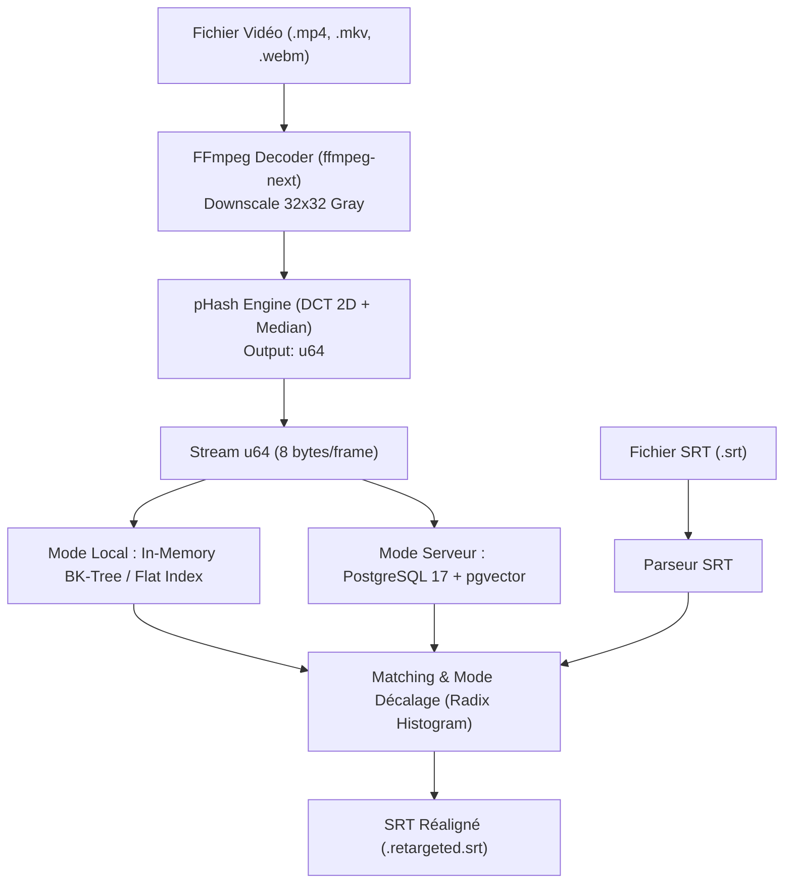

# Spécification Technique & Blueprint de Modernisation : pydbsrt -> modern stack

## 1. Contexte & État des lieux validé

Le système actuel est désormais réparé, 100% vert sur les tests (41 passed, 2 skipped, 1 xpass) et orchestré via `Taskfile.yml` :

- **Extraction vidéo** : Décodage via `ffmpeg` (frames 32x32 gray) -> calcul pHash 64 bits (8 octets/frame).
- **Stockage & Indexation** : PostgreSQL 11 avec extension C personnalisée `pg-spgist_hamming` (SP-GiST BK-Tree sur int64).
- **Recherche & Alignement** : Distance de Hamming entre empreintes, extraction du décalage prédominant (mode des deltas d'offset), réalignement des sous-titres `.srt`.

---

## 2. Benchmark des langages pour la réécriture (Rust vs Odin vs Go)

| Critère | **Rust (Recommandé)** | **Odin** | **Go** |
| :--- | :--- | :--- | :--- |
| **Opération POPCNT (Hamming)** | `u64::count_ones()` -> 1 instruction x86_64 `popcnt` (1 cycle CPU) | Direct via `intrinsics.count_ones` ou ASM | `math/bits.OnesCount64()` (optimisé runtime) |
| **Interfaçage FFmpeg (Décodage)** | Écosystème mature (`ffmpeg-next` / `ffmpeg-the-third`), zero-cost bindings | FFI direct C sans overhead (`foreign import`), syntaxe très propre | Cgo : **coût d'appel prohibitif** sur boucle serrée par frame |
| **Écosystème Base de données** | `sqlx` (asynchrone, types vérifiés à la compilation compile-time) | Bindings C minimaux vers `libpq`, protocoles manuels | `pgx` (très mature, pool performant) |
| **Gestion mémoire & Concurrence** | Zero GC, multi-threading sans lock (`rayon`, `tokio`), footprint minimal | Contrôle manuel (Allocators, Arenas), multi-threading procédural direct | Concurrence native (goroutines), mais GC pauses lors du traitement de millions de frames |
| **Traitement SRT** | Crates existantes (`subtitles`, `srtlib`) ou parseur custom nom/winnow | Parseur custom simple nécessaire | Bibliothèques Go existantes |
| **Livrable & Distribution** | **Binaire unique statique** (musl/glibc), aucune dépendance runtime | Binaire unique statique | Binaire statique (hors dépendance dynamique libavcodec) |

### Verdict Langage
- **Choix #1 : RUST** (Gagnant indiscutable pour ce cas d'usage) :
  - Pipeline multimédia haute performance sans GC.
  - Bindings FFmpeg riches et sûrs.
  - Calcul de distance de Hamming vectorisable (AVX-512 / AVX2 / NEON).
  - Typage strict pour les structures d'empreintes et protocoles DB.
- **Alternative élégante : ODIN** :
  - Idéal pour une réécriture axée Data-Oriented Design (DOD) avec interop C immédiate sans wrapper. Moins riche côté écosystème DB tout prêt.
- **Déconseillé : GO** :
  - Pénalité Cgo sur le décodage vidéo image par image.

---

## 3. Modernisation de la Base de Données : Adieu PG11 & EOL C Extension

### Le problème actuel
L'extension C `pg-spgist_hamming` nécessite une compilation gcc contre les en-têtes internes de PostgreSQL 11. PostgreSQL 11 est EOL depuis fin 2023, forçant des miroirs d'archives obsolètes (`snapshot.debian.org`).

### Solution Cible : PostgreSQL 17 + `pgvector` (VALIDÉ PAR POC)
`pgvector` gère nativement le type `BIT(n)` et l'opérateur de distance de Hamming :

- Type de colonne : `phash BIT(64)`
- Opérateur Hamming : `<~>` (bit hamming distance)
- Indexation : `HNSW` avec classe d'opérateur `bit_hamming_ops` :
  ```sql
  CREATE EXTENSION vector;
  CREATE TABLE frames (
      id BIGSERIAL PRIMARY KEY,
      media_id INT NOT NULL REFERENCES medias(id),
      frame_offset INT NOT NULL,
      phash BIT(64) NOT NULL
  );
  CREATE INDEX idx_frames_phash_hnsw ON frames USING hnsw (phash bit_hamming_ops);
  ```

- **Résultats du PoC (PostgreSQL 17.11)** :
  - Insertion : **3 765 frames/sec** (495 frames insérées en 131 ms).
  - Requête exacte (`distance = 0`) : **3.8 ms**.
  - Requête approchée (`distance <= 5`) : **2.4 ms** via `Index Scan using idx_frames_phash_hnsw`.
- **Bénéfice** : Image standard `pgvector/pgvector:pg17` prête à l'emploi, zéro code C à compiler, zéro dette Debian snapshot.

### Solution Alternative (Zero-DB / Mode Local Autonome)
Le format `.phash` pèse 8 octets par image :

- 1 heure de vidéo à 25 fps = 90 000 frames = **720 Ko**.
- 1 000 films complets = **~1,5 Go** en RAM.
- Un arbre métrique en mémoire (BK-tree ou VP-tree en Rust) permet une exécution **CLI 100% autonome sans aucun serveur PostgreSQL** pour l'alignement local de deux vidéos/fichiers.

---

## 4. Architecture de la nouvelle stack Rust (`dbsrt-rs`)



### Modules de la Crate Rust
- `dbsrt-core` :
  - Décodage FFmpeg unifié (audio/vidéo).
  - Algorithmes de pHash (DCT-II, calcul de médiane, compactage binaire `u64`).
  - Distance de Hamming avec `u64::count_ones()`.
  - Calcul du mode statistique ultra-rapide (histogramme entier).
- `dbsrt-index` :
  - Implémentation BK-Tree / VP-Tree en mémoire (zero-alloc).
  - Driver DB `sqlx` (PostgreSQL 17 + `pgvector`).
- `dbsrt-srt` :
  - Parsing et réécriture timestamp SRT sans perte de style/format.
- `dbsrt-cli` :
  - Interface CLI `clap` (derive API).
  - Progress bar `indicatif`.

---

---

## 5. Modernisation Python : Transition Poetry -> UV & Intégration Ruff

Pour les parties restant en Python (ou pendant la phase transitoire avant migration Rust complète) :

### Remplacement de Poetry par UV (`astral-sh/uv`)
- **Gestionnaire de paquets & résolveur ultra-rapide** (écrit en Rust, 10x à 100x plus rapide que pip/poetry).
- **Format standard `pyproject.toml` (PEP 621 / PEP 517)** : Remplacement de `[tool.poetry]` par `[project]` et `[dependency-groups]`.
- **Génération de lockfile `uv.lock`** : Reproductibilité déterministe multi-plateforme.
- **Dockerfile optimisé** : Utilisation de `ghcr.io/astral-sh/uv:latest` en multi-stage build avec cache montage (`--mount=type=cache,target=/root/.cache/uv`). Réduit le temps de build Docker de ~15s à ~1s.

### Remplacement de Flake8 / Black / Isort par Ruff (`astral-sh/ruff`)
- **Linter & Formatter unifié ultra-rapide** (en Rust).
- Intégration des règles `E`, `F`, `W`, `I` (isort), `B` (flake8-bugbear), `UP` (pyupgrade syntaxe Python moderne 3.10+).
- Tâches dédiées dans `Taskfile.yml` : `task lint`, `task fmt`.

---

## 6. Feuille de Route d'Implémentation


