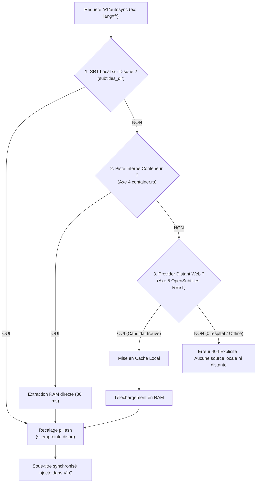

# 🌐 Spécification Axe 5 : Providers Distants & Fallback Web

> **Statut** : Spécifié / Prêt pour Implémentation
> **Auteur** : Lionel ATTY & Antigravity (DeepMind)
> **Dépendances** : Axe 4 (Extraction de Métadonnées Typées) $\rightarrow$ Axe 5 $\rightarrow$ Axe 1 (Recalage Visuel)
> **Composant Cible** : `crates/dbsrt-core/src/providers/` & `crates/dbsrt-server`

---

## 1. Contexte & Justification du Besoin

### 1.1 Le Problème du "Zéro Sous-Titre Local"
Jusqu'à l'Axe 4, `pydbsrt` résout deux cas locaux majeurs :

1. **Cas 1 (Disque)** : Un fichier `.srt` existe déjà dans le répertoire de sous-titres (`subtitles_dir`).
2. **Cas 2 (Conteneur MKV/MP4)** : Le fichier vidéo contient déjà une piste de sous-titre intégrée (extrait par `container.rs` en mémoire RAM).

Cependant, dans un scénario réel de visionnage :

- L'utilisateur télécharge une release vidéo brute sans sous-titre interne.
- Aucun fichier `.srt` correspondant n'existe en local.
- **Résultat actuel** : Échec total avec code HTTP 404 dans `/v1/autosync`.

### 1.2 Pourquoi VLSub Legacy Échoue
Le plugin historique VLSub de VLC repose sur deux approches déficientes :

- **Approche 1 (MovieHash)** : Calcule une empreinte binaire sur les 64 premiers et derniers Ko du fichier vidéo. Dès que la vidéo est réencodée, tronquée de 1 seconde ou remuxée, le hash binaire change $\rightarrow$ **0 résultat trouvé**.
- **Approche 2 (Recherche par nom)** : Envoie une chaîne non nettoyée en Lua (`Silicon.Valley.S02E01.1080p.AMZN.WEB-DL-SiGMA.mkv`). L'API renvoie des faux positifs ou oblige l'utilisateur à ressaisir manuellement le titre.

### 1.3 La Solution Axe 5
Axe 5 exploite le parser d'Axe 4 (`crates/dbsrt-core/src/metadata.rs`) pour construire des requêtes d'API REST propres et structurées, récupérer automatiquement un sous-titre brut sur le Web, puis l'acheminer vers le moteur de recalage visuel pHash.

---

## 2. Chaîne de Résolution Prioritaire

Pour garantir la plus faible latence et économiser la bande passante et les quotas d'API, `/v1/autosync` applique la hiérarchie stricte suivante :



---

## 3. Architecture Technique Rust

### 3.1 Trait Asynchrone `SubtitleProvider`

Le module `crates/dbsrt-core/src/providers/` introduit une abstraction unifiée :

```rust
use anyhow::Result;
use async_trait::async_trait;
use serde::{Deserialize, Serialize};
use crate::metadata::MediaMetadata;

#[derive(Debug, Clone, Serialize, Deserialize)]
pub struct RemoteSubtitleCandidate {
    /// Identifiant du provider d'origine (ex: "opensubtitles", "subdl")
    pub provider: String,
    /// ID unique du sous-titre sur la plateforme
    pub subtitle_id: String,
    /// Nom de release associé au sous-titre (ex: "WEB-DL", "BluRay-ROVERS")
    pub release_name: Option<String>,
    /// Code langue normalisé ISO 639-1 (ex: "fr", "en")
    pub language: String,
    /// URL de téléchargement du fichier SRT
    pub download_url: String,
    /// Sous-titre pour sourds et malentendants (SDH)
    pub hearing_impaired: bool,
    /// Framerate nominal si indiqué par le fournisseur
    pub fps: Option<f64>,
    /// Score heuristique de correspondance avec la release locale (0.0 à 1.0)
    pub match_score: f32,
}

#[async_trait]
pub trait SubtitleProvider: Send + Sync {
    /// Nom lisible du fournisseur
    fn name(&self) -> &'static str;

    /// Recherche les sous-titres candidats à partir des métadonnées typées
    async fn search(
        &self,
        meta: &MediaMetadata,
        language: &str,
    ) -> Result<Vec<RemoteSubtitleCandidate>>;

    /// Télécharge le contenu SRT directement en mémoire
    async fn download(&self, candidate: &RemoteSubtitleCandidate) -> Result<String>;
}
```

---

## 4. Fournisseurs à Implémenter

### 4.1 `OpenSubtitlesProvider` (REST API v1)

- **Endpoint de Recherche** : `GET https://api.opensubtitles.com/api/v1/subtitles`
- **En-têtes requis** : `User-Agent: dbsrt v0.2.0`, `Api-Key: <TOKEN>`
- **Paramètres de requête construits depuis `MediaMetadata`** :
  - Séries TV : `?query={clean_title}&season_number={season}&episode_number={episode}&languages={lang}&order_by=download_count`
  - Films : `?query={clean_title}&year={year}&languages={lang}&order_by=download_count`
- **Algorithme de Scoring Local** :
  - $+0.4$ si le `release_group` correspond (ex: `SiGMA`).
  - $+0.3$ si la source correspond (ex: `WEB-DL` vs `BluRay`).
  - $+0.2$ si la résolution correspond (ex: `1080p`).
  - Classement décroissant : le meilleur candidat est téléchargé en priorité.

### 4.2 `MockSubtitleProvider` (Testabilité Hermétique)

- Ne fait aucun appel réseau externe.
- Utilisé dans `cargo test` pour valider :
  - Le parsing des réponses JSON complexes.
  - La gestion des erreurs HTTP (401 Bad API Key, 404 Not Found, 429 Rate Limited, 503 Maintenance).
  - Le respect strict des timeouts.

---

## 5. Résilience, Quotas et Mode Déconnecté

### 5.1 Cache Disque Transparent
Afin de ne pas gaspiller les quotas journaliers (généralement 20 téléchargements/jour pour un compte gratuit OpenSubtitles) :

- Répertoire de cache : `~/.cache/dbsrt/subtitles/<clean_title>/`
- Clé de cache : `<clean_title>.<sXXeXX>.<lang>.<subtitle_id>.srt`
- Si la clé existe sur disque $\rightarrow$ zéro appel réseau émis.

### 5.2 Timeouts et Protection de l'Interface VLC
- Timeout réseau strict : **1 500 ms** maximum pour la recherche, **2 000 ms** pour le téléchargement.
- Si le serveur distant ne répond pas dans ce délai, fallback immédiat avec log d'avertissement.
- Aucun blocage perceptible de l'interface utilisateur de VLC.

---

## 6. Plan d'Implémentation Détaillé

| Jalon | Tâche | Fichiers Cibles | Critères d'Acceptation |
| :--- | :--- | :--- | :--- |
| **5.1** | Types et Abstractions | `crates/dbsrt-core/src/providers/mod.rs` | Définition du trait `SubtitleProvider` et struct `RemoteSubtitleCandidate`. |
| **5.2** | Client OpenSubtitles | `crates/dbsrt-core/src/providers/opensubtitles.rs` | Client REST `reqwest` asynchrone avec gestion d'erreurs et mapping structuré. |
| **5.3** | Cache Local & Mock | `crates/dbsrt-core/src/providers/cache.rs` | Mise en cache fichier + suite de tests unitaires sans réseau via `MockProvider`. |
| **5.4** | Intégration Daemon & CLI | `crates/dbsrt-server/src/lib.rs`<br/>`crates/dbsrt-cli/src/main.rs` | Étape 3 dans `/v1/autosync` + commande CLI `dbsrt fetch-subtitles`. |
| **5.5** | Tests E2E Mockés | `crates/dbsrt-server/tests/test_remote_providers.rs` | Validation E2E complète du fallback web sous mock HTTP. |
