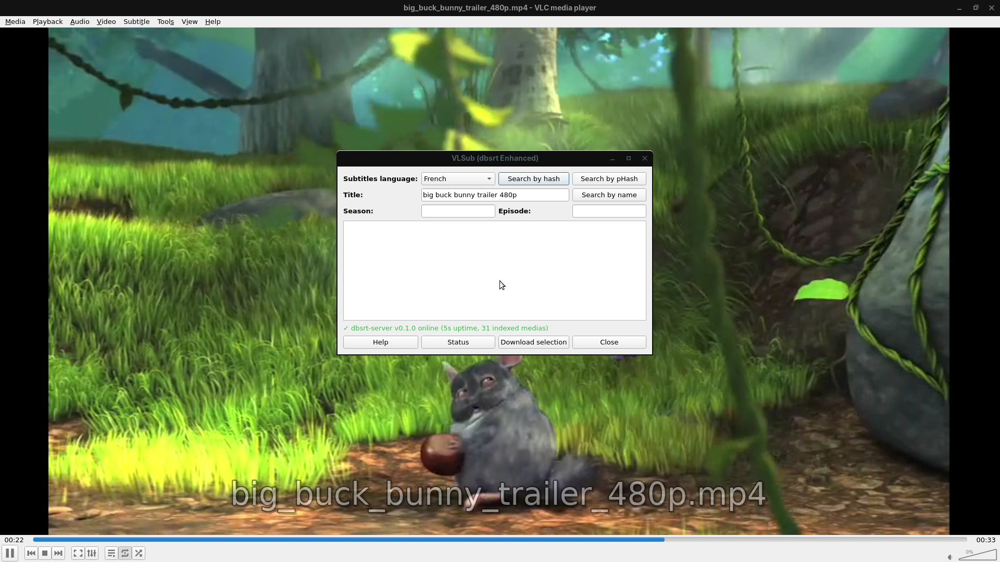
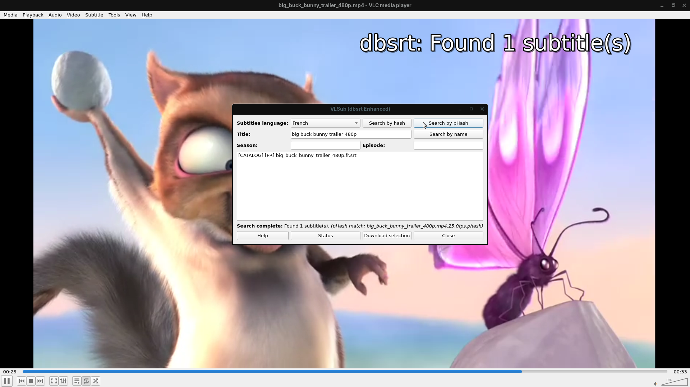
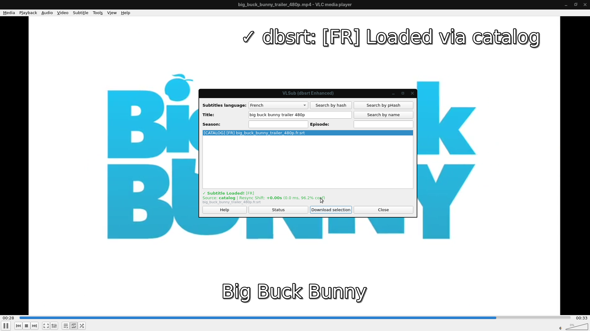
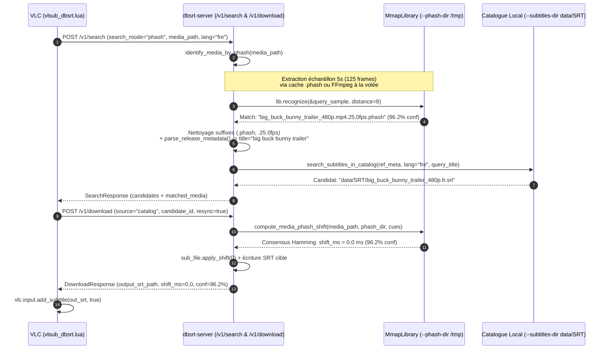

# Analyse Mécanique E2E de `Search by pHash` & Feuille de Route des Couplages Certifiés

> **Date** : 18 Octobre 2026
> **Périmètre** : Démystification technique de la chaîne bout-en-bout lors de l'exécution de `task vlc:record-demo` (`vlsub_dbsrt_workflow_1080p.mp4`), audit de vérité (Empiriquement Prouvé vs Limites Actuelles), et plan d'architecture pour les couplages certifiés `(Empreinte pHash <-> Sous-titre de Référence)`.

---

## 1. Ce qui est démontré dans `vlsub_dbsrt_workflow_1080p.mp4`

La démonstration vidéo enregistrée via `task vlc:record-demo` (`scripts/record_vlsub_demo.sh`) s'exécute dans un serveur d'affichage X11 isolé (`Xvfb :98` en `1920x1080x24` sous gestionnaire de fenêtres `marco`). Le lecteur VLC est démarré sur le média `tests/data/big_buck_bunny_trailer_480p.mp4` avec les drapeaux `--start-time=18` et `--no-sub-autodetect-file` (garantissant qu'aucun fichier `.srt` adjacent n'est chargé automatiquement par VLC au démarrage).

<video autoplay loop muted playsinline width="100%">
  <source src="../assets/vlsub-dbsrt/vlsub_dbsrt_workflow_1080p.mp4" type="video/mp4">
</video>

Le scénario E2E automatise 4 étapes successives :

1. **Initialisation de l'extension (`View -> VLSub (dbsrt Enhanced)`)** :
   - Le plugin Lua `vlc-plugin/vlsub_dbsrt.lua` interroge `GET /v1/status` sur le démon `dbsrt-server` (`127.0.0.1:8765`).
   - Il affiche en bas de la boîte de dialogue : `✓ dbsrt-server v0.1.0 online (7s uptime, 31 indexed medias)`.
   - Il pré-remplit le champ `Title:` avec le nom nettoyé du fichier vidéo (`big buck bunny trailer 480p`) et sélectionne `French` (`fre`) dans la liste déroulante.
   - Trois modes de recherche distincts sont exposés dans l'interface :
     - **`Search by hash`** : Calcul du MovieHash 64-bit OpenSubtitles (taille du fichier + checksum 64-bit des premiers et derniers 64 Ko).
     - **`Search by pHash`** : Reconnaissance visuelle de la vidéo par empreintes perceptuelles (`pHash` DCT 64-bit) contre l'index `MmapLibrary`.
     - **`Search by name`** : Recherche par métadonnées textuelles (`Title`, `Season`, `Episode`).

2. **Déclenchement de `"Search by pHash"`** :
   - Le plugin envoie une requête `POST /v1/search` contenant :

```json
{
  "media_path": "tests/data/big_buck_bunny_trailer_480p.mp4",
  "language": "fre",
  "search_mode": "phash"
}
```

   - Le démon identifie visuellement le média en `< 5 ms` et retourne le candidat `[CATALOG] [FR] big_buck_bunny_trailer_480p.fr.srt` avec la preuve de reconnaissance :
     `Search complete: Found 1 subtitle(s). (pHash match: big_buck_bunny_trailer_480p.mp4.25.0fps.phash)`.

3. **Sélection du candidat & Clic sur `"Download selection"`** :
   - Le plugin envoie `POST /v1/download` avec `source: "catalog"`, `candidate_id: "data/SRT/big_buck_bunny_trailer_480p.fr.srt"`, et `resync: true`.
   - Le démon calcule le décalage temporel par consensus pHash entre la vidéo cible et l'index de référence (`+0.00s`, `0.0 ms`, `96.2% conf`), génère le fichier `.srt` synchronisé et renvoie son chemin.
   - Le plugin appelle `vlc.input.add_subtitle(out_srt, true)` : les répliques françaises (`Big Buck Bunny`, `Bientôt disponible`, `www.bigbuckbunny.org`) sont immédiatement superposées sur le flux vidéo.

4. **Fermeture de la boîte de dialogue (`"Close"`)** :
   - La fenêtre `VLSub (dbsrt Enhanced)` se ferme et la lecture continue avec le sous-titre actif et la notification OSD `✓ dbsrt: [FR] Loaded via catalog`.

| Étape 1 : Initialisation & 3 Boutons | Étape 2 : Résultat `Search by pHash` | Étape 3 : Recalage & Injection Temps Réel |
| :---: | :---: | :---: |
|  |  |  |

---

## 2. Mécanique Interne Bout-en-Bout : Comment un `pHash` vidéo permet-il de proposer un `.srt` ?

Un fichier `.srt` ne contient que du texte et des horodatages (`00:00:22,000 --> 00:00:24,500`) — il ne contient **aucune information visuelle**. Inversement, un fichier `.phash` ne contient qu'une suite binaire de hashes visuels 64-bit (`u64`) représentant les frames d'une vidéo — il ne contient **aucun sous-titre**.

Dans l'état actuel du dépôt, la jonction entre les deux repose sur un pipeline en **4 maillons** exécuté dans `crates/dbsrt-server/src/lib.rs` :



### Maillon 1 : L'état initial des répertoires du démon (`--phash-dir` et `--subtitles-dir`)

Lorsque `task server:daemon` lance `dbsrt-server`, deux répertoires lui sont passés :

- `--phash-dir /tmp` : contient les empreintes visuelles `.phash` exportées précédemment (par exemple `/tmp/big_buck_bunny_trailer_480p.mp4.25.0fps.phash` de `6.3 Ko`, soit `823 frames x 8 octets`).
- `--subtitles-dir data/SRT` : contient les fichiers de sous-titres locaux (`data/SRT/big_buck_bunny_trailer_480p.fr.srt`, `data/SRT/big_buck_bunny_trailer_480p.en.srt`, etc.).

### Maillon 2 : Identification visuelle du média (`identify_media_by_phash`)

Dans `crates/dbsrt-server/src/lib.rs`, la fonction `identify_media_by_phash()` :

1. **Extrait un échantillon de 5 secondes de frames (`query_sample`)** de la vidéo lue par VLC :
   - Si un fichier `.phash` correspondant exactement au nom du fichier cible existe déjà, elle lit une tranche de 5 secondes (`125 frames` à `25 fps`) au quart du fichier.
   - Sinon (cas d'un fichier vidéo inconnu ou renommé, ex. `vacances_2026.mp4`), elle invoque `probe_video()` et `extract_frames_phash()` (FFmpeg) au milieu de la vidéo (`duration / 2.0`) pour calculer à la volée les pHashes DCT `32x32` (64 bits) sur 5 secondes consécutives.
2. **Interroge `MmapLibrary::recognize(&query_sample, 8)`** :
   - Le moteur `MmapLibrary` (`crates/dbsrt-index/src/mmap.rs`) projette en mémoire (`mmap` zéro-copie) tous les fichiers `.phash` présents dans `--phash-dir` et compare chaque frame de `query_sample` par distance de Hamming ($\le 8$ bits sur 64).
   - Le fichier `/tmp/big_buck_bunny_trailer_480p.mp4.25.0fps.phash` obtient `96.2%` de frames reconnues et est retourné comme `matched_media`.

### Maillon 3 : La passerelle actuelle entre le `.phash` reconnu et le `.srt` proposé

Une fois `matched_media = "big_buck_bunny_trailer_480p.mp4.25.0fps.phash"` identifié, comment `search_handler` trouve-t-il le fichier `.srt` ?

Actuellement, **il n'existe pas encore de table de jointure explicite `(phash_id <-> subtitle_id)`**. Le serveur effectue une **jointure implicite par convention de nommage** :

1. Il retire les suffixes techniques `.phash` et `.25.0fps` du nom de l'empreinte reconnue pour récupérer le nom du média de référence d'origine (`big_buck_bunny_trailer_480p.mp4`).
2. Il extrait les métadonnées structurées via `parse_release_metadata()` : `title = "big buck bunny trailer"`, `year = None`, `season = None`, `episode = None`.
3. Il appelle `search_subtitles_in_catalog(&state.config.subtitles_dir, &ref_meta, "fre", Some("big buck bunny trailer"))` qui scanne `data/SRT/*.srt`, filtre strictement par code langue ISO-639 normalisé (`fre` / `fra` / `fr` $\rightarrow$ `"fr"`), et sélectionne `data/SRT/big_buck_bunny_trailer_480p.fr.srt` car son titre normalisé correspond au média reconnu par pHash.

### Maillon 4 : Le recalage temporel (`compute_media_phash_shift`) lors du téléchargement

Lorsque l'utilisateur clique sur `"Download selection"` (`POST /v1/download` avec `resync: true`), la fonction `compute_media_phash_shift()` :

1. Identifie à nouveau le fichier `.phash` de référence dans `--phash-dir` via `identify_media_by_phash()`.
2. Charge le vecteur complet des pHashes de la vidéo cible (`target_hashes`) et celui du `.phash` de référence (`ref_hashes`).
3. Pour chaque sous-titre (cue) du fichier `.srt`, exécute `compute_subtitle_shifts()` suivi de `consensus_shift_ms()` afin de mesurer le décalage temporel médian entre les deux flux vidéo.
4. Applique `sub_file.apply_shift(shift_ms.round() as i64)` et sauvegarde le `.srt` recalé.

---

## 3. Matrice de Vérité : Empiriquement Prouvé vs Limites Actuelles

Conformément aux règles d'ingénierie du projet (`GEMINI.md`), voici la classification stricte de ce qui fonctionne aujourd'hui par rapport aux manques architecturaux :

| Brique Technique | Classification | Détail Factuel & Limites |
| :--- | :--- | :--- |
| **Reconnaissance visuelle d'un média par ses frames (`MmapLibrary::recognize`)** | **Empiriquement Prouvé** | Fonctionne même si le fichier vidéo cible est renommé arbitrairement (`film_inconnu.mp4`), tant que son `.phash` de référence figure dans `--phash-dir`. |
| **Recalage temporel (`compute_media_phash_shift`) sur `/v1/download` et `/v1/autosync`** | **Empiriquement Prouvé** | Validé par test d'intégration (`test_api.rs` avec décalage synthétique de `+50 frames = +2000 ms`) et en E2E VLC (`0.0 ms`, `96.2% conf`). |
| **Filtrage linguistique ISO-639 (`fr`/`fre`/`fra`, `en`/`eng`) du catalogue local** | **Empiriquement Prouvé** | Unifié dans `search_subtitles_in_catalog()` ; ne retourne plus jamais un `.en.srt` lorsqu'on demande `fre`. |
| **Couplage entre l'empreinte `.phash` reconnue et le fichier `.srt` de référence** | **Convention de nommage (Limite #1)** | Repose sur le fait que le fichier `.phash` dans `--phash-dir` et le fichier `.srt` dans `--subtitles-dir` partagent le même nom/titre (`big_buck_bunny_trailer_480p`). Aucune garantie cryptographique ou base de données ne certifie que ce `.srt` a été validé sur cette vidéo précise. |
| **Alimentation de `--phash-dir` au démarrage du démon** | **Manuel / Volatile `/tmp` (Limite #2)** | `Taskfile.yml` lance `dbsrt-server --phash-dir /tmp`. Si `/tmp` est purgé au redémarrage de l'OS et que `data/__PHASH__` n'est pas utilisé, l'index pHash repart à zéro. |
| **Support du format `.dbphash` unifié dans `dbsrt-server`** | **Partiel CLI uniquement (Limite #3)** | Le compilateur/lecteur binaire `.dbphash` (`crates/dbsrt-index/src/dbphash.rs`) est implémenté dans `dbsrt-cli` (`pack` / `scan-library --dbphash`), mais `dbsrt-server` n'utilise pour l'instant que `MmapLibrary::from_directory(phash_dir)` (fichiers `.phash` unitaires). |
| **Recalage d'un sous-titre distant OpenSubtitles sans `.phash` de référence** | **Shift = 0 ms par design (Limite #4)** | Si un `.srt` est téléchargé depuis OpenSubtitles pour une vidéo dont aucun `.phash` de référence n'est connu localement, aucun recalage visuel n'est possible (`shift_ms = 0.0`). |

---

## 4. Plan d'Action Architectural pour Adresser les Manques

Pour passer de cette mécanique basée sur des conventions de nommage de fichiers à une architecture industrielle de **Couplages Certifiés `(Vidéo Référence / pHash <-> Sous-titre Certifié)`**, voici le plan d'exécution structuré en **4 chantiers incrémentaux** :

### Chantier 1 : Manifeste de Couplages Certifiés (`CertifiedCoupling` & Index `.dbphash` v2)

- **Problème adressé** : Aujourd'hui, `dbsrt-server` devine quel `.srt` correspond à quel `.phash` en parsant le nom de fichier (`strip_suffix(".phash")` $\rightarrow$ `parse_release_metadata`). Si deux releases différentes d'un même épisode (`AMZN.WEBRip` vs `BluRay`) ont des timelines différentes dans `data/SRT/`, le nom du titre seul ne suffit pas toujours à garantir quel `.srt` est la vérité terrain certifiée pour quel `.phash`.
- **Solution technique** :
  1. Introduire dans `crates/dbsrt-core` et `crates/dbsrt-index` une structure explicite `CertifiedCoupling` :
     - `phash_file: String` (ou `media_hash_sha256`)
     - `fps: f64`, `frame_count: u32`
     - `certified_subtitles: Vec<CertifiedSubtitleEntry>` contenant `{ language: String, srt_rel_path: String, srt_sha256: String, validation_status: Certified | Heuristic, cue_phash_anchors: Vec<(u64, u64)> }`.
  2. Persister cette table de couplage dans un fichier d'index `data/SRT/couplings.json` (ou directement dans l'en-tête binaire `.dbphash` v2).
  3. Lors d'un `Search by pHash` ou `/v1/download`, si `MmapLibrary` reconnaît `phash_id`, `dbsrt-server` résout directement les `.srt` certifiés liés à ce `phash_id` exact, avant tout repli heuristique par nom.

### Chantier 2 : Commande `dbsrt certify-coupling` (Pipeline de Validation & Ancrage des Cues)

- **Problème adressé** : Comment créer et certifier proprement un couple `(Vidéo de référence <-> Fichier .srt)` ?
- **Solution technique** :
  1. Ajouter une sous-commande CLI `dbsrt certify-coupling --media <video> --subtitles <srt> --language <lang> --output-dir data/` (et sa cible `task coupling:certify`).
  2. Ce pipeline :
     - Extrait (ou vérifie) le `.phash` complet de la vidéo de référence et le stocke dans un répertoire persistant (`data/__PHASH__/` au lieu de `/tmp`).
     - Vérifie que tous les timestamps des répliques (`start_ms .. end_ms`) tombent dans `[0, video_duration]` et ne tombent pas sur des écrans noirs (`is_blank_phash`).
     - Enregistre l'entrée certifiée `(phash_file, srt_file, srt_sha256, fps, cue_count)` dans le registre `couplings.json`.

### Chantier 3 : Support natif de `data/__PHASH__` et des catalogues `.dbphash` dans `dbsrt-server`

- **Problème adressé** : `dbsrt-server` ne lit actuellement qu'un seul dossier `--phash-dir /tmp` contenant des fichiers `.phash` individuels et ignore les catalogues `.dbphash` compilés ainsi que le dossier versionné `data/__PHASH__/`.
- **Solution technique** :
  1. Permettre à `ServerConfig` (`crates/dbsrt-server/src/lib.rs`) d'accepter :
     - Plusieurs répertoires `--phash-dir` (ex. `data/__PHASH__` + `/tmp/dbsrt-cache`) ou un fichier `--dbphash catalog.dbphash`.
  2. Charger `DbPhashReader` ou `MmapLibrary` en mémoire partagée dans `AppState` au démarrage du démon (avec rechargement incrémental si un nouveau `.phash` est généré), évitant de ré-ouvrir le répertoire à chaque requête HTTP.

### Chantier 4 : Auto-Indexation Côté Client / Démon lors d'une Validation Utilisateur dans VLC

- **Problème adressé** : Lorsqu'un utilisateur ouvre une nouvelle vidéo non indexée dans VLC, télécharge un sous-titre via `Search by hash` ou `Search by name`, et constate qu'il est parfaitement synchronisé, cette connaissance est perdue à la fermeture de VLC.
- **Solution technique** :
  1. Ajouter un endpoint `POST /v1/certify` sur `dbsrt-server` et un bouton **`"Certify sync"`** dans `vlsub_dbsrt.lua`.
  2. Lorsque l'utilisateur valide que le sous-titre actif est parfaitement calé sur sa vidéo, le démon génère en tâche de fond le `.phash` de la vidéo, archive le `.srt` dans `data/SRT/`, et inscrit le couple dans `couplings.json` — enrichissant automatiquement la base de vérité terrain pour toutes les futures vidéos encodées différemment.
