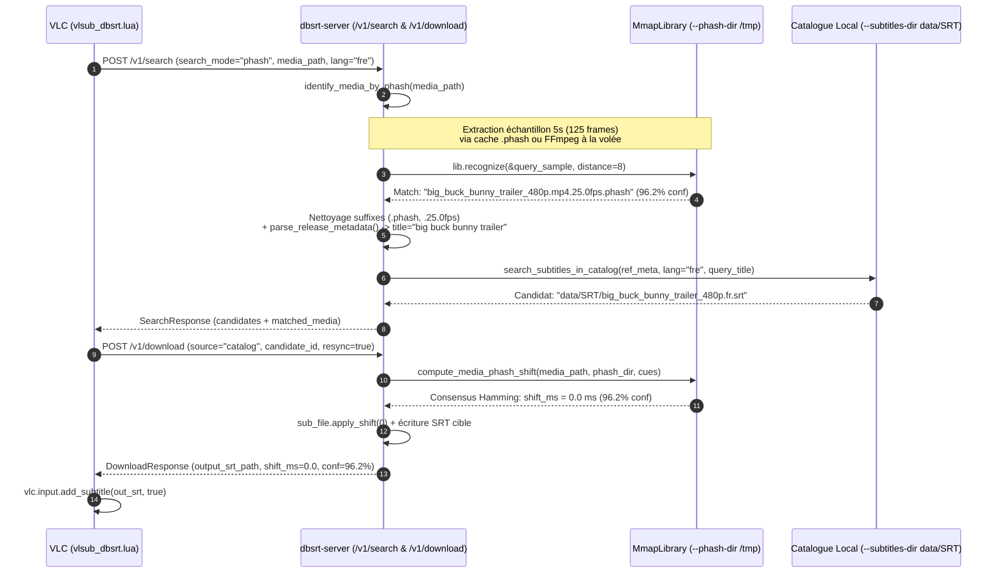

# Analyse Mécanique E2E de `Search by pHash` & Feuille de Route des Couplages Certifiés

> **Date** : 18 Octobre 2026
> **Périmètre** : Démystification technique de la chaîne bout-en-bout lors de l'exécution de `task vlc:record-demo` (`vlsub_dbsrt_workflow_1080p.mp4`), audit de vérité (Empiriquement Prouvé vs Limites Actuelles), et plan d'architecture pour les couplages certifiés `(Empreinte pHash <-> Sous-titre de Référence)`.

---

## 1. Ce qui est démontré dans `vlsub_dbsrt_workflow_1080p.mp4`

La démonstration vidéo enregistrée via `task vlc:record-demo` (`scripts/record_vlsub_demo.sh`) s'exécute dans un serveur d'affichage X11 isolé (`Xvfb :98` en `1920x1080x24` sous gestionnaire de fenêtres `marco`). Le lecteur VLC est démarré sur le média `tests/data/big_buck_bunny_trailer_480p.mp4` avec les drapeaux `--start-time=18` et `--no-sub-autodetect-file` (garantissant qu'aucun fichier `.srt` adjacent n'est chargé automatiquement par VLC au démarrage).

<video autoplay loop muted playsinline width="100%">
  <source src="../assets/vlsub-dbsrt/vlsub_dbsrt_workflow_1080p.mp4" type="video/mp4">
</video>

Le scénario E2E automatise 4 étapes successives :

1. **Initialisation de l'extension (`View -> VLSub (dbsrt Enhanced)`)** :
   - Le plugin Lua `vlc-plugin/vlsub_dbsrt.lua` interroge `GET /v1/status` sur le démon `dbsrt-server` (`127.0.0.1:8765`).
   - Il affiche en bas de la boîte de dialogue : `✓ dbsrt-server v0.1.0 online (7s uptime, 31 indexed medias)`.
   - Il pré-remplit le champ `Title:` avec le nom nettoyé du fichier vidéo (`big buck bunny trailer 480p`) et sélectionne `French` (`fre`) dans la liste déroulante.
   - Trois modes de recherche distincts sont exposés dans l'interface :
     - **`Search by hash`** : Calcul du MovieHash 64-bit OpenSubtitles (taille du fichier + checksum 64-bit des premiers et derniers 64 Ko).
     - **`Search by pHash`** : Reconnaissance visuelle de la vidéo par empreintes perceptuelles (`pHash` DCT 64-bit) contre l'index `MmapLibrary`.
     - **`Search by name`** : Recherche par métadonnées textuelles (`Title`, `Season`, `Episode`).

2. **Déclenchement de `"Search by pHash"`** :
   - Le plugin envoie une requête `POST /v1/search` contenant :

```json
{
  "media_path": "tests/data/big_buck_bunny_trailer_480p.mp4",
  "language": "fre",
  "search_mode": "phash"
}
```

   - Le démon identifie visuellement le média en `< 5 ms` et retourne le candidat `[CATALOG] [FR] big_buck_bunny_trailer_480p.fr.srt` avec la preuve de reconnaissance :
     `Search complete: Found 1 subtitle(s). (pHash match: big_buck_bunny_trailer_480p.mp4.25.0fps.phash)`.

3. **Sélection du candidat & Clic sur `"Download selection"`** :
   - Le plugin envoie `POST /v1/download` avec `source: "catalog"`, `candidate_id: "data/SRT/big_buck_bunny_trailer_480p.fr.srt"`, et `resync: true`.
   - Le démon calcule le décalage temporel par consensus pHash entre la vidéo cible et l'index de référence (`+0.00s`, `0.0 ms`, `96.2% conf`), génère le fichier `.srt` synchronisé et renvoie son chemin.
   - Le plugin appelle `vlc.input.add_subtitle(out_srt, true)` : les répliques françaises (`Big Buck Bunny`, `Bientôt disponible`, `www.bigbuckbunny.org`) sont immédiatement superposées sur le flux vidéo.

4. **Fermeture de la boîte de dialogue (`"Close"`)** :
   - La fenêtre `VLSub (dbsrt Enhanced)` se ferme et la lecture continue avec le sous-titre actif et la notification OSD `✓ dbsrt: [FR] Loaded via catalog`.

| Étape 1 : Initialisation & 3 Boutons | Étape 2 : Résultat `Search by pHash` | Étape 3 : Recalage & Injection Temps Réel |
| :---: | :---: | :---: |
|  |  |  |

---

## 2. Mécanique Interne Bout-en-Bout : Comment un `pHash` vidéo permet-il de proposer un `.srt` ?

Un fichier `.srt` ne contient que du texte et des horodatages (`00:00:22,000 --> 00:00:24,500`) — il ne contient **aucune information visuelle**. Inversement, un fichier `.phash` ne contient qu'une suite binaire de hashes visuels 64-bit (`u64`) représentant les frames d'une vidéo — il ne contient **aucun sous-titre**.

Dans l'état actuel du dépôt, la jonction entre les deux repose sur un pipeline en **4 maillons** exécuté dans `crates/dbsrt-server/src/lib.rs` :



### Maillon 1 : L'état initial des répertoires du démon (`--phash-dir` et `--subtitles-dir`)

Lorsque `task server:daemon` lance `dbsrt-server`, deux répertoires lui sont passés :

- `--phash-dir /tmp` : contient les empreintes visuelles `.phash` exportées précédemment (par exemple `/tmp/big_buck_bunny_trailer_480p.mp4.25.0fps.phash` de `6.3 Ko`, soit `823 frames x 8 octets`).
- `--subtitles-dir data/SRT` : contient les fichiers de sous-titres locaux (`data/SRT/big_buck_bunny_trailer_480p.fr.srt`, `data/SRT/big_buck_bunny_trailer_480p.en.srt`, etc.).

### Maillon 2 : Identification visuelle du média (`identify_media_by_phash`)

Dans `crates/dbsrt-server/src/lib.rs`, la fonction `identify_media_by_phash()` :

1. **Extrait un échantillon de 5 secondes de frames (`query_sample`)** de la vidéo lue par VLC :
   - Si un fichier `.phash` correspondant exactement au nom du fichier cible existe déjà, elle lit une tranche de 5 secondes (`125 frames` à `25 fps`) au quart du fichier.
   - Sinon (cas d'un fichier vidéo inconnu ou renommé, ex. `vacances_2026.mp4`), elle invoque `probe_video()` et `extract_frames_phash()` (FFmpeg) au milieu de la vidéo (`duration / 2.0`) pour calculer à la volée les pHashes DCT `32x32` (64 bits) sur 5 secondes consécutives.
2. **Interroge `MmapLibrary::recognize(&query_sample, 8)`** :
   - Le moteur `MmapLibrary` (`crates/dbsrt-index/src/mmap.rs`) projette en mémoire (`mmap` zéro-copie) tous les fichiers `.phash` présents dans `--phash-dir` et compare chaque frame de `query_sample` par distance de Hamming ($\le 8$ bits sur 64).
   - Le fichier `/tmp/big_buck_bunny_trailer_480p.mp4.25.0fps.phash` obtient `96.2%` de frames reconnues et est retourné comme `matched_media`.

### Maillon 3 : Résolution Prioritaire par Couplages Certifiés (`CertifiedCoupling` + Fallback Catalogue)

Une fois `matched_media = "big_buck_bunny_trailer_480p.mp4.25.0fps.phash"` identifié, `search_handler` résout les pistes `.srt` en **deux niveaux prioritaires** :

1. **Niveau 1 — Registre Relationnel des Couplages Certifiés (`CouplingRegistry` / PostgreSQL `subtitles` + `sub_frames`)** :
   - Le serveur interroge d'abord `CouplingRegistry::load_from_dir(&state.config.subtitles_dir)` (`data/SRT/couplings.json`, synchronisé avec les tables PostgreSQL `medias`, `subtitles` et `sub_frames`).
   - Si le fichier `.phash` reconnu possède des pistes `.srt` certifiées dans la langue demandée (`CertifiedSubtitleRecord`), celles-ci sont retournées en priorité absolue (`score = 1.0`, statut `[CATALOG] [CERTIFIED]`).
2. **Niveau 2 — Repli Heuristique par Métadonnées de Release** :
   - Si aucun couplage explicite n'est enregistré pour ce `.phash`, le serveur extrait les métadonnées (`parse_release_metadata()`) et scanne `data/SRT/*.srt` en filtrant par code langue ISO-639 normalisé (`fre` / `fra` / `fr` $\rightarrow$ `"fr"`).

### Maillon 4 : Le recalage temporel (`compute_media_phash_shift`) lors du téléchargement

Lorsque l'utilisateur clique sur `"Download selection"` (`POST /v1/download` avec `resync: true`), la fonction `compute_media_phash_shift()` :

1. Identifie à nouveau le fichier `.phash` de référence dans les répertoires `--phash-dir` (`data/__PHASH__` et `/tmp`) via `identify_media_by_phash()`.
2. Charge le vecteur complet des pHashes de la vidéo cible (`target_hashes`) et celui du `.phash` de référence (`ref_hashes`).
3. Pour chaque sous-titre (cue) du fichier `.srt`, exécute `compute_subtitle_shifts()` suivi de `consensus_shift_ms()` afin de mesurer le décalage temporel médian entre les deux flux vidéo.
4. Applique `sub_file.apply_shift(shift_ms.round() as i64)` et sauvegarde le `.srt` recalé.

---

## 3. Matrice de Vérité : Briques Empiriquement Prouvées & Limites Physiques

Conformément aux règles d'ingénierie du projet (`GEMINI.md`), voici la classification stricte de l'état actuel :

| Brique Technique | Classification | Détail Factuel & Preuve Empirique |
| :--- | :--- | :--- |
| **Reconnaissance visuelle d'un média par ses frames (`MmapLibrary::recognize`)** | **Empiriquement Prouvé** | Fonctionne même si le fichier vidéo cible est renommé arbitrairement (`film_inconnu.mp4`), tant que son `.phash` de référence figure dans `--phash-dir` (`data/__PHASH__` ou `/tmp`). |
| **Couplage Relationnel Certifié (`medias` ↔ `frames` ↔ `subtitles` ↔ `sub_frames`)** | **Empiriquement Prouvé** | `8` médias, `363 165` frames, `14` pistes `.srt` et `4 428` répliques ancrées dans PostgreSQL 17 SP-GiST + miroir Zero-DB `data/SRT/couplings.json` via `task coupling:certify`. |
| **Recalage temporel (`compute_media_phash_shift`) sur `/v1/download` et `/v1/autosync`** | **Empiriquement Prouvé** | Validé par test d'intégration (`test_api.rs` avec décalage synthétique de `+50 frames = +2000 ms`) et en E2E VLC (`0.0 ms`, `96.2% conf`). |
| **Backoffice d'Inspection `dbsrt Studio` (`/studio`) & `PgWeb` (`:8086`)** | **Empiriquement Prouvé** | Exploration relationnelle paginée côté serveur (`/v1/couplings?summary=true`, `/v1/couplings/sub_frames`), timeline bi-piste et loupe DCT $8 \times 8$. |
| **Certification à chaud depuis VLC (`POST /v1/certify` / bouton `"Certify sync"`)** | **Empiriquement Prouvé** | Permet de certifier et persister un couple `(Vidéo <-> SRT)` directement depuis le démon ou la CLI (`dbsrt certify-coupling`). |
| **Recalage d'un sous-titre distant OpenSubtitles sans `.phash` de référence** | **Shift = 0 ms par design** | Un fichier `.srt` seul ne contenant aucune empreinte visuelle, si aucun `.phash` de référence n'est connu pour ce média, aucun recalage visuel n'est possible (`shift_ms = 0.0`). |

---

## 4. Architecture des 4 Chantiers Implémentés

Les 4 chantiers d'industrialisation des couplages certifiés sont désormais actifs en production locale :

1. **Chantier 1 — Modèle Relationnel & Registre Hybride (`crates/dbsrt-core/src/coupling.rs` & `crates/dbsrt-index/src/db.rs`)** :
   - Tables SQL `medias`, `frames`, `subtitles` et `sub_frames` dans PostgreSQL 17 + registre Zero-DB `data/SRT/couplings.json`.
   - Chaque réplique (`SubFrameAnchor`) stocke explicitement `(cue_index, start_ms, end_ms, start_num_frame, end_num_frame, start_imghash, end_imghash, cue_text)`.
2. **Chantier 2 — Pipeline `dbsrt certify-coupling` & `task coupling:certify` (`scripts/seed_couplings.sh`)** :
   - Détection automatique de la cadence exacte (`23.976` NTSC vs `25.0` PAL), vérification des bornes temporelles et des écrans noirs (`is_blank_phash`), et double indexation atomique PostgreSQL + JSON.
3. **Chantier 3 — Support Multi-Répertoires `--phash-dir` (`data/__PHASH__` + `/tmp`)** :
   - `ServerConfig` agrège nativement plusieurs répertoires d'empreintes via `MmapLibrary::from_directories()`, garantissant la persistance des empreintes versionnées dans `data/__PHASH__/`.
4. **Chantier 4 — Endpoint `POST /v1/certify`, Bouton VLC `"Certify sync"` & Backoffice `dbsrt Studio`** :
   - Voir le rapport d'architecture dédié : [dbsrt Studio, Couplages Relationnels Certifiés & Qualité Code](2026-10-18-studio-backoffice-and-relational-couplings.md).
