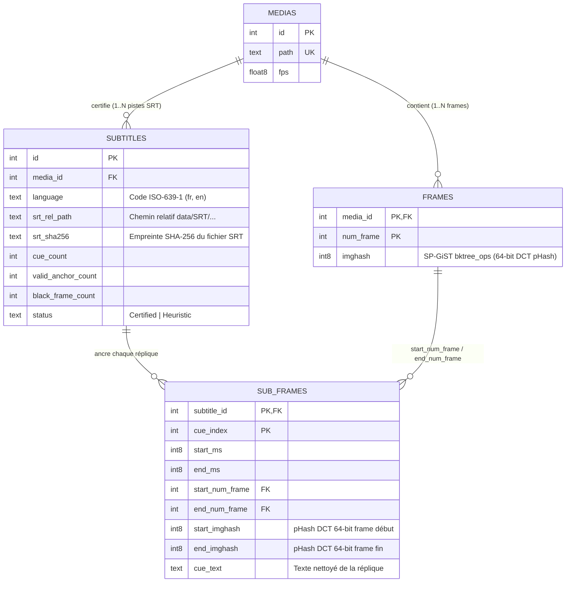

# Architecture des Couplages Relationnels Certifiés, Backoffice `dbsrt Studio` & Qualité Multi-Langages

> **Date** : 18 Octobre 2026
> **Statut** : Implémenté & Empiriquement Prouvé (`PostgreSQL 17 SP-GiST` + `Zero-DB Hybrid` + `dbsrt Studio` + `17/17 Pre-commit Hooks`)

---

## 1. Modèle Relationnel de Vérité Terrain (`medias` ↔ `frames` ↔ `subtitles` ↔ `sub_frames`)

Pour éliminer toute correspondance implicite par nom de fichier entre les empreintes visuelles (`.phash`) et les fichiers de sous-titres (`.srt`), `dbsrt-rs` implémente un modèle de **Couplages Certifiés Hybride** synchronisant à la fois **PostgreSQL 17 (SP-GiST BK-Tree)** et le registre local **Zero-DB (`data/SRT/couplings.json`)**.



### Garanties d'Intégrité lors de la Certification (`build_and_validate_sub_frames`)

Chaque certification via `dbsrt certify-coupling` ou `POST /v1/certify` exécute les contrôles suivants dans `crates/dbsrt-core/src/coupling.rs` :

1. **Inférence exacte du framerate (PAL / NTSC)** : extraction automatique de la cadence depuis le suffixe `.phash` (`23.976fps`, `24.0fps`, `25.0fps`, `29.97fps`), évitant toute dérive temporelle cumulative de `4.1%` sur des épisodes de 25 à 60 minutes.
2. **Projection réplique $\rightarrow$ frame** : chaque réplique `[start_ms, end_ms]` est projetée sur l'indice de frame exact :
   - `start_num_frame = round((start_ms / 1000.0) * fps)`
   - `end_num_frame = round((end_ms / 1000.0) * fps)`
3. **Filtrage des écrans noirs (`is_blank_phash`)** : détection par `popcount` des frames de fondu au noir afin de comptabiliser `valid_anchor_count` vs `black_frame_count`.
4. **Double persistance atomique (`PostgreSQL + JSON`)** :
   - En base de données via `COPY sub_frames ... FROM STDIN` (`crates/dbsrt-index/src/db.rs`).
   - En fichier plat `data/SRT/couplings.json` pour un fonctionnement **Zero-DB** autonome.

### État Empirique du Catalogue Relationnel Certifié

| Métrique | Valeur Empirique Vérifiée | Détail |
| :--- | :--- | :--- |
| **Médias indexés (`medias`)** | **8 vidéos** | `Big Buck Bunny` + 7 épisodes TV (`What We Do in the Shadows S04`, `Game of Thrones S08`, `House of the Dragon S01`) |
| **Empreintes visuelles (`frames`)** | **363 165 frames** | Indexées dans PostgreSQL 17 avec index `SP-GiST (imghash bktree_ops)` |
| **Pistes certifiées (`subtitles`)** | **14 pistes `.srt`** | 7 couples bilingues `FR` + `EN` (`100% Certified`) |
| **Ancrages répliques (`sub_frames`)** | **4 428 répliques** | Jointure directe `cue_index <-> (start_num_frame, start_imghash, end_num_frame, end_imghash)` |

---

## 2. Backoffice `dbsrt Studio` (`:8765/studio`) & `PgWeb` (`:8086`)

L'ancien conteneur `adminer` a été supprimé de `docker/docker-compose.yml` au profit d'une architecture d'inspection à deux niveaux :

- **`dbsrt Studio` (`http://127.0.0.1:8765/studio`)** : interface métier dédiée à l'exploration à grande échelle des couplages `(Média <-> Frames pHash <-> Sous-titres)`, dotée d'une timeline bi-piste et d'une loupe d'inspection frequentielle DCT-II $8 \times 8$.
- **`PgWeb` (`http://127.0.0.1:8086`)** : client SQL direct connecté automatiquement au cluster PostgreSQL 17 (`dbsrt:5432/dbsrt`) pour les requêtes ad-hoc sur `medias`, `frames`, `subtitles` et `sub_frames`.

### Architecture UI/UX Passant à l'Échelle (Milliers de Médias & Millions de Frames)

Pour garantir une fluidité immédiate même avec des milliers de médias et des dizaines de milliers de répliques par série :

1. **Chargement initial allégé de 93.6% (`GET /v1/couplings?summary=true`)** :
   - La vue globale ne transfère que les métadonnées agrégées des médias et de leurs pistes (`43 Ko` au lieu de `672 Ko`), sans embarquer les milliers de lignes `sub_frames`.
2. **Barre latérale `Certified Reference Medias` multi-facettes** :
   - Recherche instantanée temps réel (raccourci clavier `/`) sur le titre, le fichier `.phash`, le chemin `.srt` ou le hash SHA-256.
   - Filtres rapides par langue (`All`, `FR`, `EN`) et par moteur de stockage (`PG + JSON`, `PG 17`).
   - Tri multi-critères (`Title A → Z`, `Most Frames`, `Most Sub_Frames`, `Highest FPS`) et pagination dédiée (`10 / 25 / 50 / 100` médias par page).
3. **Pagination et filtrage serveur sur `sub_frames` (`GET /v1/couplings/sub_frames`)** :
   - Recherche plein-texte côté serveur (`q`) sur le texte des répliques, le numéro de frame ou le pHash hexadécimal.
   - Taille de page ajustable (`25`, `50`, `100`, `150`, `250` répliques par page) avec contrôles de pagination en haut et en bas de table (`« First`, `‹ Prev`, `Page X/Y`, `Next ›`, `Last »`).
4. **Timeline Bi-Piste Interactive (Full Episode Minimap + Zoomed Page Timeline)** :
   - **Piste 1 (Full Episode Minimap)** : affiche la densité globale des répliques sur toute la durée de l'épisode (`0 .. N frames`) avec un cadre ambré matérialisant la page courante. Un clic sur n'importe quel point de l'épisode calcule la page correspondante (`target_frame`) et y navigue instantanément.
   - **Piste 2 (Current Page Zoom)** : affiche uniquement les répliques de la page active (`50` répliques), rendant chaque segment individuellement lisible et cliquable.
5. **Inspecteur Loupe `8x8 DCT-II pHash` (`56x56 px`)** :
   - Visualisation matricielle des 64 bits de `start_imghash` et `end_imghash`, valeur hexadécimale, `popcount`, et navigation directe réplique par réplique (`‹ Prev Cue`, `Next Cue ›`, `Go to Cue #`).

---

## 3. Orchestration Déclarative `Taskfile.yml` & Scripts Externalisés

Conformément à la règle d'architecture **Pure Taskfile Orchestrator**, `Taskfile.yml` ne contient aucun script shell inline ni liste de fichiers codée en dur. Toute la logique opérationnelle est isolée dans `scripts/` :

| Script Externe | Rôle Opérationnel | Tâches `Taskfile.yml` Associées |
| :--- | :--- | :--- |
| `scripts/stack_ctl.sh` | Gestion du cycle de vie des démons (`dbsrt-server`, `MkDocs`, `PgWeb`, `PostgreSQL`) et rapport d'état unifié | `task up`, `task down`, `task status`, `task studio`, `task server:start`, `task server:stop` |
| `scripts/seed_couplings.sh` | Auto-découverte et certification de tous les couples `(<stem>.<lang>.srt <-> <stem>.phash)` présents dans `data/` | `task coupling:certify` |
| `scripts/vlc_ctl.sh` | Installation du plugin Lua VLC (`vlsub_dbsrt.lua`) et test E2E headless `cvlc` | `task vlc:install`, `task vlc:test-cvlc` |
| `scripts/code_quality.sh` | Pipeline unifié de formatage et de linting multi-langages | `task fmt`, `task lint` |
| `scripts/validate_web_assets.py` | Validation syntaxique HTML5, JavaScript (`node --check`) et JSON de tous les assets web | `task lint:web`, pre-commit hook |

### Commandes Opérationnelles Clés

```bash
# Démarrer toute la stack (PostgreSQL 17 + PgWeb + dbsrt-server + MkDocs + Seed Couplings)
task up

# Vérifier l'état de santé de tous les services et compteurs SQL
task status

# Ouvrir les interfaces web (dbsrt Studio + PgWeb + MkDocs)
task studio

# Recertifier tous les couples (SRT <-> pHash) en base PG17 et JSON
task coupling:certify

# Arrêter proprement tous les services et conteneurs
task down
```

---

## 4. Pipeline Qualité Code Multi-Langages & Pre-Commit (`17/17 Hooks`)

L'ensemble des langages du dépôt est couvert par `task fmt`, `task lint` et `.pre-commit-config.yaml` :

| Extension / Langage | Outil de Formatage (`task fmt`) | Outil de Linting / Validation (`task lint` & `pre-commit`) |
| :--- | :--- | :--- |
| **`.rs` (Rust)** | `cargo fmt --all` | `cargo clippy --workspace --all-targets -- -D warnings` |
| **`.py` (Python)** | `ruff format` | `ruff check --fix`, `mypy`, `bandit` |
| **`.sh` (Bash / Shell)** | `shfmt -w -i 4 -ci` | `shellcheck -x -S warning`, `check-executables-have-shebangs` |
| **`.lua` (Plugin VLC)** | `stylua` | `luac5.2 -p` (vérification bytecode Lua 5.2) + `stylua --check` |
| **`.yml` / `.yaml`** | — | `yamllint -c .yamllint.yml` + `check-yaml` |
| **`.html` / `.js` (`studio.html`)** | — | `scripts/validate_web_assets.py` (parseur HTML5 + `node --check` sur chaque `<script>`) |
| **`.json` (`couplings.json`)** | — | `check-json` + validation UTF-8 / clés dupliquées |
| **`.md` (Documentation)** | — | `scripts/validate_docs.py` (`mkdocs build --strict` + AST HTML + MathJax) |
