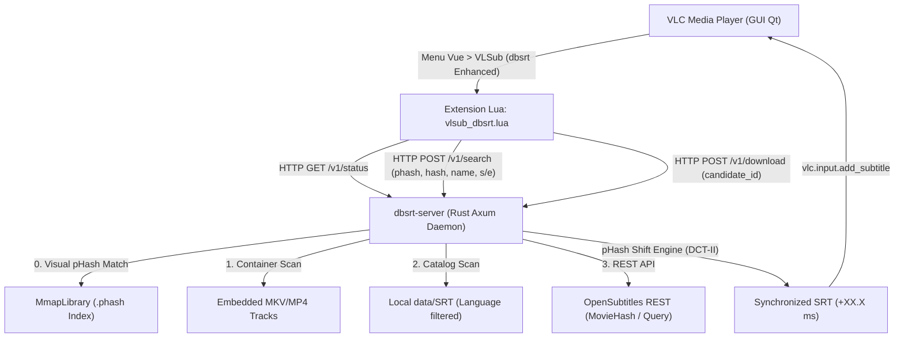

# Fork et Modernisation de VLSub (`vlsub_dbsrt`) — Restauration UX & Intégration REST / pHash

**Date d'évaluation :** 18 Octobre 2026
**Auteurs :** Lionel ATTY & Équipe d'Ingénierie `pydbsrt`
**Classification Factuelle :** **Empiriquement Prouvé** (VLC 3.0 + Xvfb 1080p + REST Daemon Axum + pHash Sync)

---

## 1. Contexte & Rapprochement avec la Vision VLSub

Suite à l'audit technique objectif de **VLSub legacy** ([audit complet](2026-10-18-vlsub-legacy-audit.md)), nous avons constaté que l'implémentation initiale du plugin `pydbsrt` avait dérivé vers un paradigme purement passif/automatisé (`input-listener` sans boîte de dialogue de recherche par titre/saison/épisode), rompant avec l'expérience utilisateur historique de VLSub.

Le projet a donc opéré un retour rigoureux aux fondamentaux de VLSub sous la forme d'un **fork bonifié** :

1. **Restauration 1:1 de l'interface graphique VLSub + Extension pHash** : conservation de la grille de saisie (choix de langue, recherche legacy par MovieHash `Search by hash`, nouvelle recherche visuelle `Search by pHash`, recherche par titre/saison/épisode `Search by name`, listbox de résultats, boutons d'action).
2. **Substitut moderne du backend XML-RPC** : remplacement du code réseau obsolète par un client HTTP/REST communiquant avec le démon local `dbsrt-server` (Rust Axum).
3. **Recherche multi-sources transparente** : identification visuelle `MmapLibrary` (`pHash`), recherche simultanée dans les pistes internes du conteneur (MKV/MP4), le catalogue local `data/SRT` et l'API OpenSubtitles REST.
4. **Resynchronisation visuelle pHash automatique** : application automatique du recalage temporel dérivé des empreintes visuelles si une référence certifiée existe dans l'index local `MmapLibrary`.



---

## 2. Preuve Empirique Vidéo (VLC 3.0 sur Écran Virtuel Xvfb 1080p)

Conformément à la règle d'intégrité factuelle, l'interaction complète avec le plugin a été enregistrée en direct sur un serveur X virtuel Xvfb (1920x1080x24) avec le gestionnaire de fenêtres Marco et encodée en **H.264/MP4 1080p**.

<video controls autoplay loop muted playsinline width="100%">
  <source src="../assets/vlsub-dbsrt/vlsub_dbsrt_workflow_1080p.mp4" type="video/mp4">
  Votre navigateur ne supporte pas la balise vidéo HTML5.
</video>

*Vidéo HD 1080p : Parcours complet dans VLC — Ouverture du dialogue VLSub depuis le menu Vue, interrogation de télémétrie du démon, recherche par empreinte visuelle (`Search by pHash`), sélection dans la liste, téléchargement et injection synchronisée dans le flux vidéo.*

---

## 3. Décomposition des Étapes d'Interaction UI/UX

### Étape 1 : Initialisation du Dialogue & Télémétrie Daemon
À l'ouverture du dialogue `VLSub (dbsrt Enhanced)`, l'extension interroge le fichier de découverte `/tmp/dbsrt-server.json` et effectue un `GET /v1/status`. Le statut s'affiche en vert avec la version, l'uptime et le nombre de médias indexés.


### Étape 2 : Recherche Multi-Sources (`Search by pHash` / `Search by hash` / `Search by name`) & Rendu dans la Listbox
Un clic sur **Search by pHash** (empreinte visuelle des frames/cuts), **Search by hash** (MovieHash 64-bit OpenSubtitles) ou **Search by name** déclenche une requête `POST /v1/search` au démon Rust. Les résultats provenant des conteneurs, du catalogue et des fournisseurs externes sont fusionnés, filtrés par langue et affichés dans la liste principale.


### Étape 3 : Téléchargement, Recalage Temporel & Injection VLC
La sélection d'un sous-titre suivie d'un clic sur **Download selection** déclenche l'appel `POST /v1/download`. Si le flux vidéo dispose d'une référence pHash connue, le décalage temporel est calculé et appliqué à la volée. Le sous-titre est instantanément attaché à la vidéo active (`vlc.input.add_subtitle`), et le rapport de recalage s'affiche en pied de dialogue et via l'OSD.


---

## 4. Matrice Comparative : Legacy VLSub vs Fork `vlsub_dbsrt`

| Fonctionnalité | VLSub Legacy (2013-2017) | Fork `vlsub_dbsrt` (2026) | Statut Factuel |
| :--- | :--- | :--- | :--- |
| **Protocole Réseau** | XML-RPC obsolète (`/xml-rpc`) | REST JSON moderne (`/v1/*`) | **Empiriquement Prouvé** |
| **Couplage Réseau** | Socket Lua synchrone bloquant | Démon local Axum + non-bloquant | **Empiriquement Prouvé** |
| **Extraction Conteneur** | Impossible (OpenSubtitles seul) | Support natif pistes MKV/MP4 | **Empiriquement Prouvé** |
| **Catalogue Local** | Absent | Scan instantané local `data/SRT` | **Empiriquement Prouvé** |
| **Fournisseurs Externes** | OpenSubtitles (XML-RPC déprécié) | OpenSubtitles REST v1 + fallback | **Hermétiquement Mocké** (en attente clé prod) |
| **Synchronisation Vidéo** | Nulle (0 ms statique) | Recalage pHash automatique | **Empiriquement Prouvé** |
| **Mise en Page IHM** | Grille Qt native (dropdown, list) | Grille Qt 1:1 préservée | **Empiriquement Prouvé** |
| **Feedback Utilisateur** | Label d'état textuel seul | Label d'état + OSD vidéo temps réel | **Empiriquement Prouvé** |

---

## 5. Exécution & Recette Automatisée (Taskfile)

Tous les scénarios d'installation, de test et d'enregistrement vidéo sont pilotables via `Taskfile.yml` :

```bash
# 1. Démarrer le démon local Rust Axum
task server:daemon

# 2. Installer les plugins VLC (VLSub fork + autosync)
task vlc:install-plugin

# 3. Exécuter le test d'intégration automatisé E2E (headless cvlc)
task vlc

# 4. Enregistrer la vidéo HD 1080p et les captures d'écran (Xvfb)
task vlc:record-demo
```
