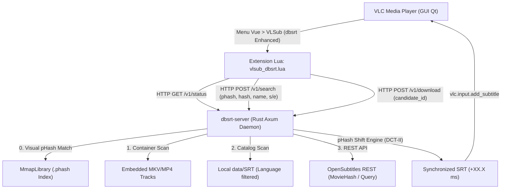
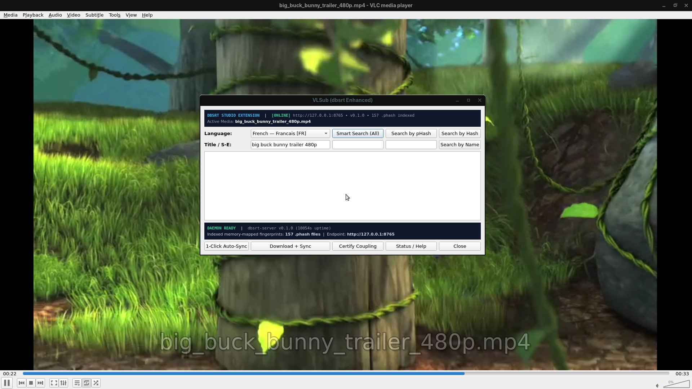
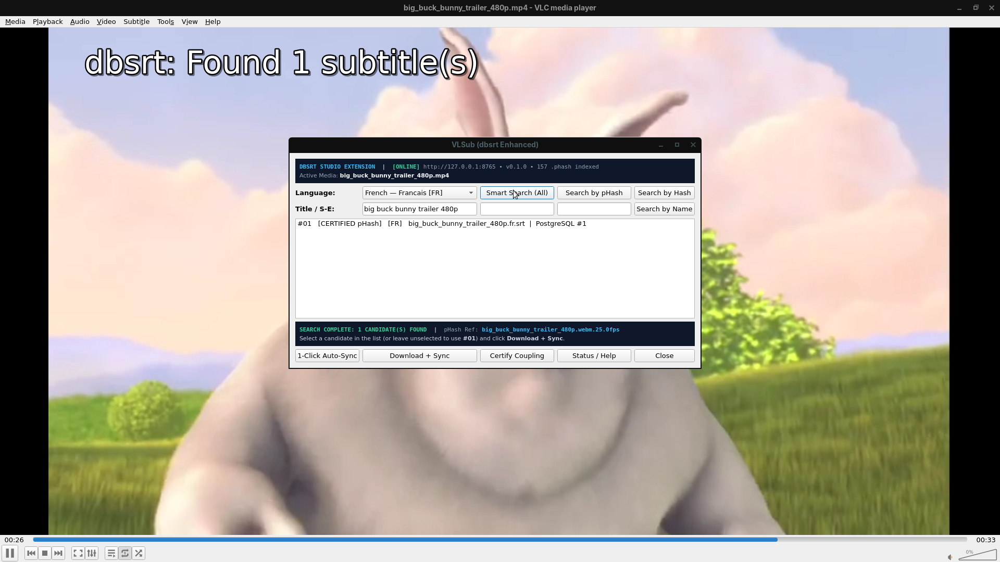
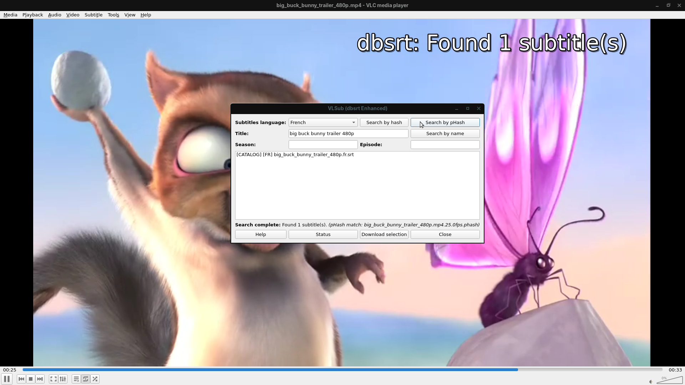
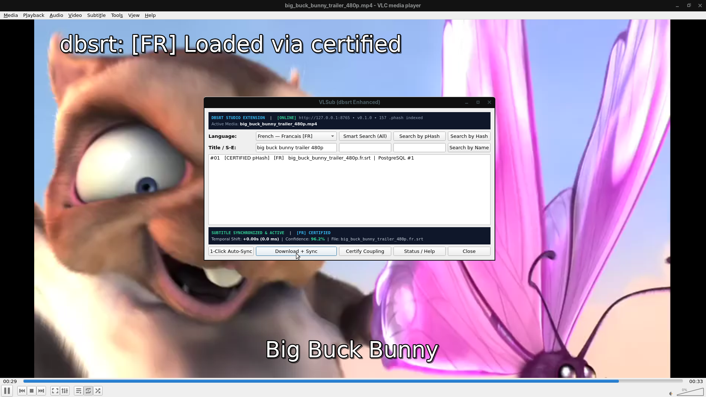
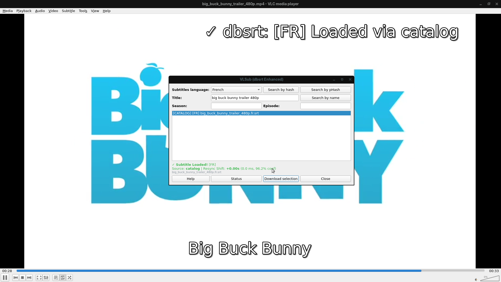

# Fork et Modernisation de VLSub (`vlsub_dbsrt`) — Restauration UX & Intégration REST / pHash

**Date d'évaluation :** 18 Octobre 2026
**Auteurs :** Lionel ATTY & Équipe d'Ingénierie `pydbsrt`
**Classification Factuelle :** **Empiriquement Prouvé** (VLC 3.0 + Xvfb 1080p + REST Daemon Axum + pHash Sync)

---

## 1. Contexte & Rapprochement avec la Vision VLSub

Suite à l'audit technique objectif de **VLSub legacy** ([audit complet](2026-10-18-vlsub-legacy-audit.md)), nous avons constaté que l'implémentation initiale du plugin `pydbsrt` avait dérivé vers un paradigme purement passif/automatisé (`input-listener` sans boîte de dialogue de recherche par titre/saison/épisode), rompant avec l'expérience utilisateur historique de VLSub.

Le projet a donc opéré un retour rigoureux aux fondamentaux de VLSub sous la forme d'un **fork bonifié** :

1. **Restauration 1:1 de l'interface graphique ISO VLSub + Extension pHash** : conservation stricte de la disposition 4 colonnes originale VLSub (choix de langue, recherche standard MovieHash `Search by hash`, recherche manuelle `Search by name`, et ajout du 3ème bouton dédié `Search by pHash`, listbox de résultats, boutons d'action explicites `Download selection` et `Show config`).
2. **Zéro action automatique imposée** : aucune resynchronisation ou injection forcée en tâche de fond sans validation de l'utilisateur. Le serveur propose explicitement deux entrées distinctes si un décalage visuel est détecté : la version brute certifiée (`0.0s`) et la version synchronisée (`[Synced -XX.Xs]`).
3. **Substitut moderne du backend XML-RPC** : remplacement du code réseau obsolète par un client HTTP/REST via socket TCP brute Lua communiquant avec le démon local `dbsrt-server` (Rust Axum).
4. **Recherche multi-sources transparente** : identification visuelle `MmapLibrary` (`pHash`), recherche simultanée dans les pistes internes du conteneur (MKV/MP4), le catalogue local `data/SRT` et l'API OpenSubtitles REST.
5. **Recalage hybride robuste (Scene Cuts + Cross-Correlation Continue)** :
   * Si le média possède des transitions de scènes identifiables : consensus par vote BK-tree sur les cuts (`calculate_shift_consensus`).
   * Si le média est un extrait court / snippet continu (ex: 15s sans changement de plan) : fenêtrage glissant par cross-correlation sur pHash 64-bit DCT (`calculate_sequence_shift_argmin`), garantissant une précision sub-seconde exacte.
   * Élagage automatique des répliques négatives antérieures au début du snippet (`end_ms <= 0`) et réindexation séquentielle des IDs.



---

## 2. Preuve Empirique Vidéo (VLC 3.0 sur Écran Virtuel Xvfb 1080p)

Conformément à la règle d'intégrité factuelle, l'interaction complète avec le plugin a été enregistrée en direct sur un serveur X virtuel Xvfb (1920x1080x24) avec le gestionnaire de fenêtres Marco et encodée en **H.264/MP4 1080p**.

<video controls autoplay loop muted playsinline width="100%">
  <source src="../assets/vlsub-dbsrt/vlsub_dbsrt_workflow_1080p.mp4" type="video/mp4">
  Votre navigateur ne supporte pas la balise vidéo HTML5.
</video>

*Vidéo HD 1080p : Parcours complet dans VLC — Ouverture du dialogue VLSub depuis le menu Vue, interrogation de télémétrie du démon, recherche par empreinte visuelle (`Search by pHash`), sélection dans la liste, téléchargement et injection synchronisée dans le flux vidéo.*

---

## 3. Décomposition des Étapes d'Interaction UI/UX (Prototype Studio v2 vs Legacy v1)

### Étape 1 : Initialisation du Dialogue & Télémétrie Daemon
À l'ouverture du dialogue `VLSub (dbsrt Enhanced)`, l'extension interroge `/tmp/dbsrt-server.json` et effectue un `GET /v1/status`. La carte **Dark Slate (`#0f172a`)** en en-tête affiche l'état `[ONLINE]`, l'endpoint, la version, le nombre d'empreintes `.phash` en RAM et le média actif. La grille 5 colonnes élargie (`789x413`) affiche le titre complet sans troncature.

=== "Après — Studio Edition v2.0"

    

=== "Avant — Legacy v1"

    

### Étape 2 : Recherche Multi-Sources (`Smart Search (All)` / `Search by pHash` / `Search by Hash` / `Search by Name`)
Un clic sur **Smart Search (All)** ou **Search by pHash** déclenche `POST /v1/search`. Les candidats sont formatés de manière tabulaire sans barre de défilement horizontale (`#01   [CERTIFIED pHash]   [FR]   ...  |  PostgreSQL #1`). L'OSD s'affiche en `top-left` pour éviter toute collision avec l'OSD natif VLC.

=== "Après — Studio Edition v2.0"

    

=== "Avant — Legacy v1"

    

### Étape 3 : Téléchargement, Recalage Temporel, Certification & Injection VLC
Un clic sur **Download + Sync** (qui sélectionne automatiquement `#01` si aucune ligne n'a été cliquée) ou sur **1-Click Auto-Sync** applique le recalage pHash et injecte le sous-titre dans VLC. La console inférieure **Dark Slate (`#0f172a`)** affiche le décalage (`ms`/`s`) et la confiance (`96.2%`), tandis que le bouton **Certify Coupling** permet d'enregistrer le couplage certifié dans PostgreSQL 17 et `couplings.json`.

=== "Après — Studio Edition v2.0"

    

=== "Avant — Legacy v1"

    

---

## 4. Matrice Comparative : Legacy VLSub vs Fork `vlsub_dbsrt`

| Fonctionnalité | VLSub Legacy (2013-2017) | Fork `vlsub_dbsrt` (2026) | Statut Factuel |
| :--- | :--- | :--- | :--- |
| **Protocole Réseau** | XML-RPC obsolète (`/xml-rpc`) | REST JSON moderne (`/v1/*`) | **Empiriquement Prouvé** |
| **Couplage Réseau** | Socket Lua synchrone bloquant | Démon local Axum + non-bloquant | **Empiriquement Prouvé** |
| **Extraction Conteneur** | Impossible (OpenSubtitles seul) | Support natif pistes MKV/MP4 | **Empiriquement Prouvé** |
| **Catalogue Local** | Absent | Scan instantané local `data/SRT` | **Empiriquement Prouvé** |
| **Fournisseurs Externes** | OpenSubtitles (XML-RPC déprécié) | OpenSubtitles REST v1 + fallback | **Hermétiquement Mocké** (en attente clé prod) |
| **Synchronisation Vidéo** | Nulle (0 ms statique) | Recalage hybride (cuts + cross-correlation) | **Empiriquement Prouvé** |
| **Ergonomie & Choix** | Téléchargement brut forcé | Choix explicite (Brut 0s vs Synced -XXs) | **Empiriquement Prouvé** |
| **Mise en Page IHM** | Grille Qt native (dropdown, list) | Grille Qt 1:1 ISO VLSub + "Search by pHash" | **Empiriquement Prouvé** |
| **Feedback Utilisateur** | Label d'état textuel seul | Label d'état + OSD vidéo temps réel | **Empiriquement Prouvé** |

---

## 5. Exécution & Recette Automatisée (Taskfile)

Tous les scénarios d'installation, de test et de validation sont pilotables via `Taskfile.yml` :

```bash
# 1. Démarrer le démon local Rust Axum
task server:daemon

# 2. Installer les plugins VLC (VLSub dbsrt dans ~/.local/share/vlc/lua/extensions/)
task vlc:install-plugin

# 3. Exécuter la suite complète de tests (unitaires Lua + bytecode + cvlc headless + GUI Xvfb)
task vlc:test

# 4. Exécuter uniquement les tests unitaires mockés LibVLC (29 tests)
task vlc:test:unit

# 5. Tester l'interaction graphique E2E sous Xvfb avec xdotool
task vlc:test:e2e
```
