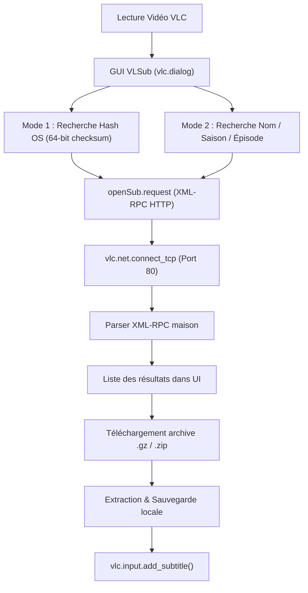

# Audit Technique et Bilan du Plugin Legacy VLSub (VLC)

Date : 2026-10-18
Statut : Bilan de référence & Étude préalable au fork
Source examinée : `vendor/vlsub/vlsub.lua` (2 398 lignes Lua, v0.10.2)

---

## 1. Contexte & Périmètre

VLSub est l'extension Lua officielle et historique de VLC Media Player permettant de rechercher et télécharger des sous-titres depuis OpenSubtitles directement au sein du lecteur.

Cet audit dissèque l'implémentation originale pour cartographier les composants fiables, identifier les points de rupture modernes et définir les bases d'un fork enrichi.

---

## 2. Cartographie Fonctionnelle de l'Implémentation



### 2.1 Extraction des Métadonnées & Fichiers
- **Fonctions** : `getFileInfo()`, `getMovieInfo()`
- Récupère l'URI du média actif, nettoie les séparateurs (`.` et `_` remplacés par des espaces).
- Détecte le schéma des séries via regex : `[sS](%d?%d)[eE](%d%d)` ou `(%d?%d)[xX](%d%d)`.
- Fallback automatique sur les tags et métadonnées internes VLC (`meta-title`).

### 2.2 Calcul d'Empreinte Vidéo (Movie Hash)
- **Fonction** : `getMovieHash()`
- Algorithme OpenSubtitles : Checksum 64-bit calculé sur la taille totale du fichier + les 64 premiers Ko + les 64 derniers Ko.
- Supporte l'accès direct aux fichiers (`io.open`) ou via les flux virtuels de VLC (`vlc.stream`).

### 2.3 Protocole Réseau & API
- **Fonctions** : `openSub.request()`, `http_req()`
- Utilise des sockets TCP bruts non chiffrés (`vlc.net.connect_tcp(host, 80)`).
- Construit des enveloppes XML-RPC POST manuelles vers `http://api.opensubtitles.org/xml-rpc`.
- Parse les réponses XML sans bibliothèque externe via un parseur déclaratif (`parse_xmlrpc()`).

### 2.4 Téléchargement & Injection
- **Fonctions** : `download_subtitles()`, `dump_zip()`, `add_sub()`
- Télécharge l'archive compressée (`.gz` ou `.zip`) dans `/tmp` ou le dossier de la vidéo.
- Extrait le fichier sous-titre via le VFS VLC (`zip://...`).
- Injecte à chaud la piste dans le lecteur sans coupure :
  ```lua
  vlc.var.set(vlc.object.input(), 'sub-file', subPath)
  vlc.input.add_subtitle(subPath)
  ```

---

## 3. Matrice d'Évaluation Factuelle

| Composant | Ce qui fonctionne bien | Ce qui fonctionne mal / est obsolète |
|---|---|---|
| **Packaging & Déploiement** | Fichier unique `.lua` autonome, zéro dépendance binaire externe. | Aucun système de mise à jour automatique hors VLC. |
| **Interface Graphique** | Dialogue VLC natif (`vlc.dialog`), responsive, intégration visuelle propre. | Appels I/O synchrones bloquant le thread UI pendant les requêtes réseau (freeze). |
| **Recherche par Hash** | Précision 100% sur release identique sans risque d'homonymie. | Inopérant si la release locale diffère d'un seul octet (ex: crop, repack, encodage différent). |
| **API & Réseau** | Parsing XML-RPC compact et autonome. | **API XML-RPC dépréciée/fermée**. **Zéro support HTTPS/TLS** natif dans `vlc.net.connect_tcp`. |
| **Fournisseurs** | Intégration OpenSubtitles historique complète (login, upload, download). | **Mono-provider rigide** : impossible d'interroger Addic7ed, Subdl ou un cache local. |
| **Synchronisation** | Injection immédiate dans VLC (`add_subtitle`). | **Zéro gestion du décalage temporel** (pas de détection de délai, pas de resynchronisation). |
| **Encodage & I/O** | Écriture locale simple. | Problèmes fréquents d'encodage (mojibake UTF-8 / Windows-1252) et blocages sur chemins non-ASCII. |

---

## 4. Stratégie du Fork & Bonification

L'objectif du fork n'est pas de réinventer l'expérience utilisateur de VLSub, mais d'éradiquer ses faiblesses structurelles :

1. **Préserver l'IHM et les réflexes utilisateur** : Conserver la disposition intuitive de la boîte de dialogue de VLSub (recherche hash, recherche nom, choix de langue, liste déroulante).
2. **Déléguer la couche réseau et le traitement lourd au daemon local (`dbsrt-server`)** :
   - Éliminer le problème HTTPS/TLS dans Lua : le daemon gère HTTP/HTTPS moderne (Reqwest/Rust), les tokens d'API REST et les multi-providers.
   - Éviter les freezes d'interface : requêtes rapides en local (`localhost:4040`) ou polling non bloquant.
3. **Apporter la resynchronisation en supplément transparent** :
   - Quand un sous-titre est téléchargé, interroger le serveur local pour vérifier s'il existe un recalage calculé (offset temporel ou consensus pHash).
   - Appliquer automatiquement l'offset dans VLC (`sub-delay`) ou servir directement un fichier SRT corrigé.
