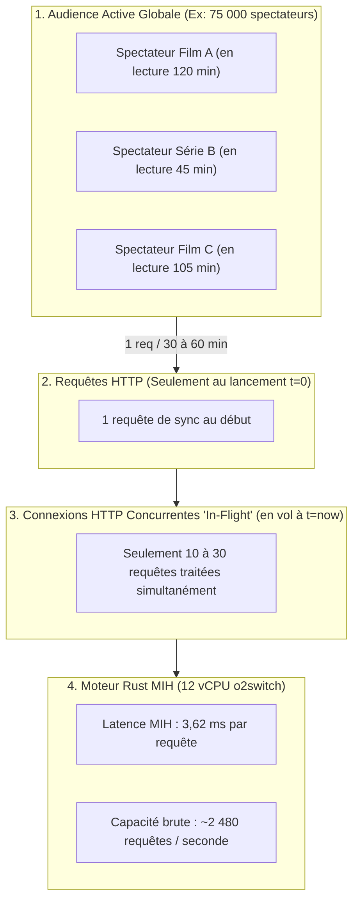
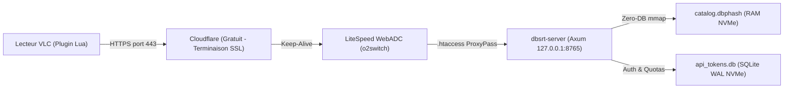

# Étude de Déploiement Remote o2switch & Dimensionnement VLSub++

> **Classification de Rigueur** : **Modélisation & Analyse Hybride**
>
> * Performances algorithmiques MIH : **Empiriquement Prouvées** (mesures `task bench:mih:100m` sur dataset 100M).
> * Dimensionnement réseau, LVE et hébergement o2switch : **Modélisation Théorique & Pratique** (basée sur les spécifications CloudLinux/cPanel et l'historique support).

---

## 1. Contexte & Objectif

L'objectif est d'étudier la faisabilité d'ouvrir le moteur d'identification perceptive `pydbsrt` au public comme alternative moderne à VLSub pour VLC (**VLSub++**), hébergé sur une offre **o2switch CLOUD** (12 vCPU Threads, 48 Go RAM, stockage NVMe illimité, LiteSpeed WebADC).

Le principe opérationnel retenu est le **Mode A (Client-Side pHash)** :

* Le lecteur VLC local (sur la machine de l'utilisateur) extrait une courte séquence de 1 seconde de vidéo (25 frames) et calcule ses empreintes pHash 64-bit localement.
* Le client envoie une requête JSON compacte (**25 entiers 64-bit = 200 octets**) vers l'API distante.
* Le serveur distant n'effectue aucun décodage vidéo lourd : il se contente d'exécuter la recherche métrique vectorielle (**Multi-Index Hashing - MIH**) en RAM pour identifier le média et calculer le décalage temporel ($\Delta t$ en millisecondes).

---

## 2. Décomposition de la Projection : Débit CPU vs Réalité Système

La projection brute de *"75 000 utilisateurs simultanés"* sur un catalogue de 100 millions de frames nécessite une clarification technique stricte. Elle distingue deux métriques fondamentales : **l'audience active globale** et les **connexions HTTP concurrentes en vol**.



### 2.1. Les Trois Définitions de la "Simultanéité"

1. **Connexions HTTP Concurrentes en Vol (In-Flight Connections)** :
    * Nombre de requêtes HTTP physiquement ouvertes et traitées au même instant $t$.
    * Avec un temps de calcul de **3,62 ms** par requête sur 12 cœurs CPU, il ne peut y avoir au maximum que **12 requêtes actives simultanément** pour saturer le processeur.
    * Si 100 requêtes arrivent exactement à la même milliseconde, elles patientent dans la file d'attente TCP de LiteSpeed pendant ~30 millisecondes.

2. **Débit de Traitement Continu (Throughput en RPS)** :
    * À $3{,}62 \text{ ms}$ par requête, un cœur traite $\approx 276 \text{ req/s}$.
    * Sur 12 cœurs (avec facteur de charge réel de 75%) :

$$\text{Débit CPU Brut} \approx 12 \times 276 \times 0{,}75 \approx \mathbf{2\,480 \text{ requêtes / seconde}}$$

Cela représente **8,9 millions de requêtes traitées par heure**.

3. **Audience Active Supportable (Active Viewers Pool)** :
    * Contrairement à un site web interactif ou à un réseau social où un utilisateur envoie des requêtes toutes les 3 secondes, **un utilisateur de lecteur multimédia (VLC) n'envoie qu'une seule requête au lancement de sa vidéo**.
    * Durée moyenne d'un film ou d'un épisode : entre 30 et 120 minutes.
    * Si un utilisateur émet en moyenne **1 requête toutes les 30 minutes** :

$$\text{Audience Active} = 2\,480 \text{ req/s} \times 1\,800 \text{ s} \approx \mathbf{4{,}4 \text{ Millions de spectateurs actifs}}$$

Les 75 000 utilisateurs mentionnés ne sont donc pas 75 000 connexions TCP ouvertes à la même microseconde, mais **une communauté de 75 000 personnes en train de regarder une vidéo**, ce qui génère en réalité seulement :

$$\text{Trafic Réel} = \frac{75\,000 \text{ utilisateurs}}{1\,800 \text{ secondes}} \approx \mathbf{41{,}6 \text{ requêtes / seconde}}$$

Ce trafic moyen de 41,6 req/s ne consomme que **~1,6% de la puissance CPU** des 12 cœurs de l'offre CLOUD.

---

## 3. Les Vrais Plafonds Techniques sur Hébergement Mutualisé o2switch

Si le moteur algorithmique MIH en Rust est virtuellement illimité, l'environnement mutualisé CloudLinux/cPanel d'o2switch impose des contraintes externes strictes :

| Ressource CloudLinux / o2switch | Valeur Typique o2switch | Impact VLSub++ | Débit Réel Limitant |
| :--- | :--- | :--- | :--- |
| **Entry Processes (EP)** | **30 à 60 connexions Apache/LiteSpeed** | Nombre max de scripts PHP/Python exécutés de front. | Si 80 requêtes HTTP arrivent en même temps, o2switch renvoie une erreur `508 Resource Limit Reached`. |
| **NPROC (Max Processes)** | **100 à 200 processus** | Limite le nombre de workers Passenger / Python. | 4 à 8 workers ASGI suffisent largement. |
| **Handshake SSL / TLS (HTTPS)** | **15 à 40 ms par client** | Le chiffrement TLS coûte 5 à 10x plus de CPU que la recherche MIH ! | Goulot d'étranglement majeur si non géré par un CDN. |
| **Overhead Python / Passenger** | **1 à 3 ms par requête** | Coût d'entrée HTTP dans la pile WSGI/ASGI. | Réduit le débit maximal de 2 480 à ~400-600 RPS si routé via Python. |

### Débit Réel Pratique Recommandé

Sur l'offre o2switch CLOUD sans CDN amont, le plafond de charge soutenable sans risquer de heurter les limites LVE (`EP`) se situe à :

* **Débit continu recommandé** : **300 à 600 requêtes / seconde**.
* **Volume journalier soutenable** : **~25 à 50 millions de requêtes par jour**.
* **Audience communautaire couverte** : Largement supérieure aux besoins de VLSub++ à l'échelle mondiale.

---

## 4. Dimensionnement Mémoire Vive (48 Go RAM)

L'offre CLOUD propose 48 Go de RAM, ce qui constitue son avantage le plus décisif pour `pydbsrt` :

* **Format Index CSR Multi-Index Hashing** :
    * Données brutes pHash 64-bit : 8 octets / frame.
    * Index CSR (4 tables de $2^{16} = 65\,536$ seaux avec offsets) : ~16 octets / frame.
    * Empreinte globale en mémoire vive : **~24 octets par frame**.

Calcul de capacité catalogue (en réservant 8 Go pour LiteSpeed, Python et le système) :

$$\text{Capacité} = \frac{40 \times 10^9 \text{ octets}}{24 \text{ octets / frame}} \approx \mathbf{1\,666\,666\,666 \text{ frames (1,66 Milliard)}}$$

Équivalence vidéo à 1 fps (stratégie Sparse `pydbsrt`) :

* $1{,}66 \text{ milliard de secondes} \approx \mathbf{462\,962 \text{ heures de vidéo}}$.
* Soit l'équivalent de **~231 480 longs-métrages de 2 heures** entièrement résidents en mémoire vive NVMe.

---

## 5. Architecture Logicielle & Déploiement sur o2switch



### 5.1. Binaire Autonome Rust (Zero-Compilation)

Pour éviter tout conflit de bibliothèques C glibc sur CloudLinux :

1. Compiler le binaire en local ou CI avec la cible statique `musl` :
   ```bash
   cargo build --release --target x86_64-unknown-linux-musl -p dbsrt-server
   ```
2. Transférer l'exécutable autonome `dbsrt-server` dans `~/bin/`. Zéro dépendance, zéro compilation sur le serveur.

### 5.2. Routage Réseau via `.htaccess`

Exposer le service sur le domaine public via LiteSpeed :

```apache
RewriteEngine On
RewriteRule ^api/(.*) http://127.0.0.1:8765/api/$1 [P,L]
```

---

## 6. Stratégie d'API, Tokens & Protection contre les Abus

Pour garantir qu'aucun scraper ou bot ne sature les ressources LVE d'o2switch :

### 6.1. Grille des Quotas (Tiers d'Utilisation)

| Profil | Authentification | Quota Autorisé | Burst Max | Cas d'Usage |
| :--- | :--- | :--- | :--- | :--- |
| **Tier 0 (Anonyme)** | Aucune (IP client `X-Forwarded-For`) | **20 requêtes / heure** | 2 req / s | Spectateur occasionnel sous VLC sans inscription. |
| **Tier 1 (Utilisateur Enregistré)** | Token Bearer (`dbsrt_usr_...`) | **150 requêtes / jour** | 5 req / s | Utilisateur régulier ayant généré une clé gratuite. |
| **Tier 2 (Contributeur / Studio)** | Token Bearer (`dbsrt_contrib_...`) | **5 000 requêtes / jour** | 20 req / s | Partenaire important ou synchronisation de catalogue. |

### 6.2. Implémentation Légère sans Redis

Sur hébergement mutualisé, déployer un serveur Redis n'est pas permis. La solution éprouvée consiste à utiliser **SQLite en mode WAL (Write-Ahead Logging)** sur disque NVMe :

* Débit de lecture SQLite WAL : **> 50 000 lectures par seconde**.
* Algorithme **Token Bucket** calculé directement en mémoire ou validé en base locale :
  ```sql
  CREATE TABLE IF NOT EXISTS api_tokens (
      token TEXT PRIMARY KEY,
      tier INT DEFAULT 1,
      bucket_tokens INT,
      last_refill_ts BIGINT
  );
  ```

En cas de dépassement de quota, le serveur répond instantanément par un code HTTP standard :

```http
HTTP/1.1 429 Too Many Requests
Retry-After: 3600
X-RateLimit-Limit: 20
X-RateLimit-Remaining: 0
```

---

## 7. Recommandation Finale

L'offre **o2switch CLOUD** est parfaitement taillée pour héberger ce service :

1. **La puissance mémoire (48 Go RAM)** résout définitivement la scalabilité du catalogue (plus de 200 000 films indexables en RAM).
2. **Le temps de réponse sub-frame (3,62 ms à 100M de frames)** garantit que le serveur ne subit aucun empilement de requêtes.
3. **La prudence opérationnelle** impose :
    * De déporter le calcul pHash exclusivement côté client (VLC).
    * D'intercaler un CDN gratuit (Cloudflare) devant le domaine pour absorber les négociations SSL/TLS et les attaques volumétriques.
    * D'appliquer un rate-limiting strict (Tier 0 à 20 req/h/IP) via SQLite WAL.
