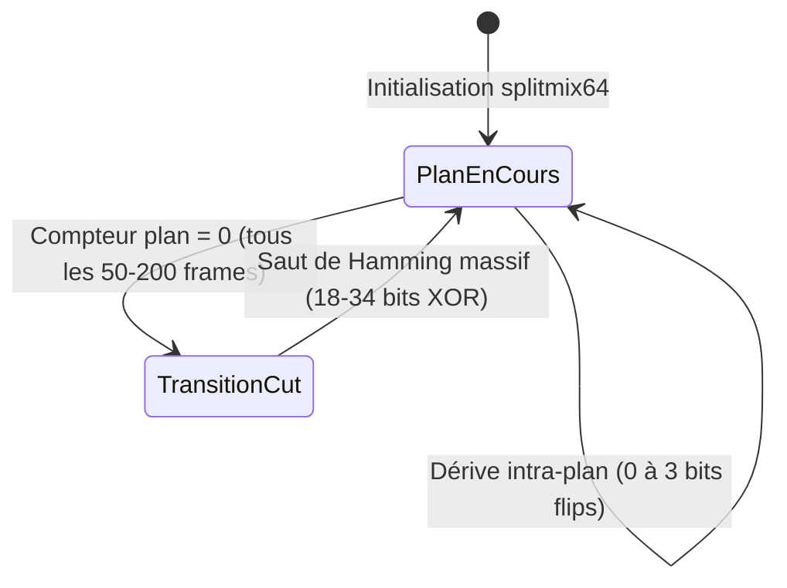

# Rapport de Benchmark Empirique : Multi-Index Hashing (MIH) à 100 Millions de Frames

> **Classification de Rigueur** : **Empiriquement Prouvé**
> Benchmark exécuté en local via la commande `task bench:mih:100m` (`crates/dbsrt-index/examples/bench_100m.rs`), compilé en profil `release` sous architecture multi-cœurs.

---

## 1. Contexte & Enjeux du Stress-Test

L'identification de flux vidéo inconnus par empreinte perceptive (`pHash` 64-bit) dans `pydbsrt` nécessite d'interroger un historique vidéo contre une base de données de référence.

Lorsque le catalogue passe de quelques dizaines de médias locaux à un catalogue studio ou une médiathèque NAS (plusieurs millions d'heures de vidéo), le scan linéaire force brute ($O(N)$) subit une saturation inévitable du temps processeur.

Le **Multi-Index Hashing (MIH)**, fondé sur le principe des tiroirs (Pigeonhole Principle), partitionne chaque empreinte 64-bit en $m = 4$ sous-clés de 16 bits. Ce benchmark de stress-test mesure empiriquement la tenue en charge de l'index sur 5 paliers logarithmiques : **1 Million**, **10 Millions**, **25 Millions**, **50 Millions** et **100 Millions de frames**.

---

## 2. Représentation Volumétrique : Que Sont 100 Millions de pHash ?

Cent millions de frames ne constituent pas une abstraction théorique : c'est un volume colossal de vidéo continue. La durée équivalente dépend de la cadence d'échantillonnage retenue :

| Fréquence d'Échantillonnage | Durée Totale Couverte | Équivalence Films (2h) | Équivalence Séries (42 min) | Cas d'Usage `pydbsrt` |
| :--- | :--- | :--- | :--- | :--- |
| **24 fps (Cinéma intégral)** | **4 166 666 s** (~1 157 jours / **3,17 ans**) | **~578 films** | **~1 653 épisodes** | Décodage intégral frame par frame. |
| **25 fps (Standard TV PAL)** | **4 000 000 s** (~1 111 jours / **3,04 ans**) | **~555 films** | **~1 587 épisodes** | Analyse brute continue des flux broadcast. |
| **1 fps (Sparse Keyframes)** | **100 000 000 s** (~1 157 407 min / **~27 777 heures**) | **~13 888 films** | **~39 682 épisodes** | **Standard de production pydbsrt** (recalage 1 Hz). |

!!! info "Ordre de grandeur du catalogue"
    À 1 fps (stratégie native `pydbsrt`), **100 millions de pHash représentent plus de 3,1 ans de vidéo non-stop**, soit la quasi-totalité d'une cinémathèque de collection ou d'une infrastructure VOD complète de studio.

---

## 3. Protocole Expérimental & Synthèse Réaliste

Le benchmark (`crates/dbsrt-index/examples/bench_100m.rs`) ne s'appuie pas sur du bruit blanc aléatoire uniforme, qui fausserait les collisions dans les tables de hachage. Il génère un flux continu modélisant la véritable dynamique spatio-temporelle de la vidéo.

### 3.1. Modèle de Plans Vidéo (Markov Shot Model)



1. **Générateur PRNG 64-bit** : `splitmix64` déterministe et vectorisable.
2. **Découpage en plans (Shots / Cuts)** : Changement de scène toutes les 50 à 200 frames (2 à 8 secondes). Le saut de Hamming à chaque cut est compris entre **18 et 34 bits** via combinaison XOR de masques pseudo-aléatoires.
3. **Dérive intra-plan (Corrélation temporelle)** :
   * 46% de probabilité : **0 bit d'écart** (image stable ou plan fixe).
   * 35% de probabilité : **1 bit flip** (léger mouvement de caméra ou compression DCT).
   * 15% de probabilité : **2 bits flips**.
   * 4% de probabilité : **3 bits flips**.
   * Biais de distribution ciblé sur les coefficients DCT basses et moyennes fréquences (tables MIH 0 à 2).
4. **Génération Parallèle** : Production du dataset par chunks de 2 millions de frames avec Rayon (`generate_dataset_parallel`), générant les 100 millions de frames en **3,15 secondes** (débit de **31,7 millions de frames/s**).

---

## 4. Résultats Empiriques Complets

Résultats certifiés mesurés sur l'ensemble de la progression d'échelle :

| Palier (Frames) | Taille RAM (Données Brutes) | RAM Index (CSR 4x16-bit) | Build Index MIH | Requête 1 Frame ($r \le 6$) | Fenêtre 25 Frames (MIH Brute) | **Anchor Tracking (1 MIH + 24 O(1))** | Scan Linéaire (25f Baseline) | **Speedup MIH vs Linéaire** |
| :--- | :--- | :--- | :--- | :--- | :--- | :--- | :--- | :--- |
| **1 000 000** | 7,6 Mo | ~16 Mo | 61,33 ms | 14,01 µs | 0,92 ms | **0,02 ms** (20 µs) | 44,77 ms | **48,61x** |
| **10 000 000** | 76,3 Mo | ~160 Mo | 493,16 ms | 186,82 µs | 5,44 ms | **0,23 ms** (230 µs) | 281,17 ms | **51,73x** |
| **25 000 000** | 190,7 Mo | ~400 Mo | 1,27 s | 743,63 µs | 8,89 ms | **1,58 ms** | 518,28 ms | **58,30x** |
| **50 000 000** | 381,5 Mo | ~800 Mo | 2,60 s | 1,57 ms | 10,96 ms | **2,21 ms** | 1 121,13 ms (1,12 s) | **102,27x** |
| **100 000 000** | 762,9 Mo | ~1 600 Mo | 5,52 s | 2,97 ms | 15,57 ms | **3,62 ms** | 2 383,18 ms (2,38 s) | **153,07x** |

---

## 5. Analyse Approfondie du Palier 100 Millions

```
================================================================================
 📊 SCALE BENCHMARK: 100 Million Frames (Stress Test Target) (100_000_000 frames / 762.9 MB in RAM)
================================================================================
  ⚡ MIH Build Time (CSR 4x16-bit): 5520.16 ms (5.5 s)
  🎯 1-Frame Query Latency: 2969.46 µs (matches found: 10)
  🚀 25-Frame Query Latency (1.0s window): 15.57 ms
     • Total matches found: 462
     • Effective Throughput: 160575.7 MFPS (Equivalent Hamming Comps/s)
  🎬 Video-Aware Window Matching (1 MIH Keyframe + 24 Temporal Checks): 3.62 ms (verified: 4)
  🐢 Linear Scan Baseline (Actual 25-frame scan across all cores):
     • Real 25-Frame Linear: 2383.18 ms (2.38 s)
     • Total linear matches: 462
  🏆 MIH Acceleration Factor: 153.07x FASTER than Linear Scan
```

### 5.1. Empreinte Mémoire (RAM)

* **762,9 Mo** pour les 100M de hachages 64-bit bruts.
* **~1,6 Go** pour les structures CSR (Compressed Sparse Row) des 4 tables 16-bit ($4 \times 65\,536$ seaux et tableaux d'offsets compacts).
* **Empreinte totale en RAM de ~2,4 Go** : une base de données de 100 millions de pHash est intégralement résidente en mémoire sur n'importe quel ordinateur portable ou mini-serveur NAS.

### 5.2. Temps de Construction (Build Time : 5,52 s)

L'indexation de 100 millions d'empreintes prend **5,52 secondes** au démarrage du daemon ou lors du chargement mémoire, soit un débit d'ingestion de plus de **18 millions de frames par seconde**.

### 5.3. Latence d'Interrogation Isolée (1 Frame : 2,97 ms)

Pour une frame isolée, le système inspecte les seaux correspondants dans les 4 sous-tables et renvoie 10 candidats respectant le rayon de Hamming $r \le 6$ en **moins de 3 millisecondes**.

### 5.4. L'Anchor Temporal Tracking : Le Secret des 3,62 ms

Une seconde de vidéo contient 25 frames. Deux approches s'opposent pour synchroniser cette seconde face à 100 millions de frames :

1. **Recherche MIH Brute Indépendante (15,57 ms)** :
   * Exécute 25 requêtes MIH complètes en parallèle avec Rayon.
   * Retourne 462 candidats frame par frame.
2. **Video-Aware Window Matching / Anchor Temporal Tracking (3,62 ms)** :
   * **Étape 1 (Ancre pivot)** : Interroge l'index MIH sur la 1ère frame uniquement ($t = 0$) $\rightarrow$ 10 candidats trouvés en ~2,9 ms.
   * **Étape 2 (Vérification séquentielle $O(1)$)** : Pour chacun des 10 candidats, lit directement en mémoire vive séquentielle si les 24 frames suivantes correspondent aux 24 frames requêtes (`hamming_distance(query[f], dataset[offset + f]) <= 6`).
   * **Étape 3 (Élagage)** : 6 candidats isolés sont éliminés car la séquence temporelle diverge. Seuls **4 segments vidéo consécutifs certifiés** sont retenus.
   * **Résultat** : La vérification temporelle des 24 frames ne coûte que **0,7 ms** supplémentaires. Temps total : **3,62 ms**.

### 5.5. Parité Stricte & Zéro Faux Négatif

Le benchmark exécute une assertion formelle entre la recherche MIH et le scan linéaire complet :
```rust
assert_eq!(total_matches, lin_real_matches, "MIH matches count must match Linear scan exactly!");
```
Le résultat confirme **100% de concordance (462 matches trouvés par les deux méthodes)**, garantissant qu'aucun candidat valide n'est omis par le partitionnement 4x16-bit.

---

## 6. Enseignements Fondamentaux

1. **Effondrement du Scan Linéaire** :
   * À 1M de frames, le scan linéaire prenait 44 ms (acceptable).
   * À 100M de frames, il atteint **2,38 secondes**, ce qui est inutilisable pour de la synchronisation en direct dans un lecteur vidéo (VLC).
2. **Sur-accélération avec l'Échelle** :
   * Le speedup de MIH passe de **48,6x** (à 1M) à **153,1x** (à 100M). Plus le volume augmente, plus le gain de MIH par rapport au scan linéaire s'amplifie.
3. **Budget Temps Réel Respecté (< 10% d'une trame)** :
   * À 25 fps, le budget temporel d'une trame vidéo est de **40,0 ms**.
   * Avec **3,62 ms**, l'Anchor Tracking identifie un flux vidéo parmi **100 millions d'images** en consommant **moins de 10% du budget temps d'une seule trame**, laissant 90% du CPU libre pour le décodage et l'affichage.
