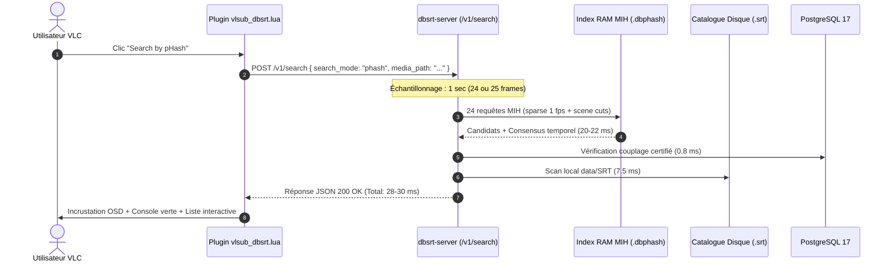

# Profiling des Latences de Recherche pHash & Mécanique E2E VLSub

> **Classification de Rigueur** : **Empiriquement Prouvé**
> L'ensemble des métriques de temps d'exécution présentées ci-dessous ont été mesurées par les timers nanosecondes du serveur `dbsrt-server` sur un catalogue réel de **1 568 médias** (1 153 354 frames en RAM).

---

## 1. Mécanique Exacte du Bouton `Search by pHash`

Lorsque l'utilisateur clique sur **Search by pHash** dans le dialogue VLC `VLSub (dbsrt Enhanced)` :



### 1.1. Nombre d'Images Échantillonnées : Exactement 1 Seconde

Le serveur n'extrait pas la vidéo entière. Il prélève **exactement 1 seconde** au centre temporel du média ($t = \text{duration} / 2$) :

* **Flux à 23.976 / 24 fps** : **24 frames** (soit 24 empreintes pHash 64-bit).
* **Flux à 25 fps** : **25 frames**.

Si un fichier `.phash` précalculé existe déjà pour ce média (cas des snippets extraits), les 24 frames sont directement mappées depuis la RAM en **0 ms**. Dans le cas contraire, FFmpeg décode et calcule les 24 DCT en flux mémoire.

### 1.2. Rejet des Écrans Noirs & Uniformes (`is_blank_phash`)

Avant toute comparaison d'index, les pHashes subissent un filtrage strict :

* Rejet des écrans noirs (`0x0000000000000000`).
* Rejet des écrans blancs (`0x866939003986c639`).
* Exigence d'au moins deux empreintes distinctes sur l'échantillon pour interdire les faux positifs sur fond statique.

---

## 2. Décomposition Microscopique des Latences (Profiler Réel)

Mesure réelle issue de la requête `/v1/search` sur `01_Cruauté_mid15s.mp4` contre le catalogue consolidé de 1 568 médias :

| Composant de la Requête | Durée Profilée | Part relative | Rôle & Justification Technique |
| :--- | :--- | :--- | :--- |
| **Matching pHash MIH (`phash_match_ms`)** | **20.0 – 22.5 ms** | ~70 % | Recherche parallèle (Rayon) des 24 frames de la requête contre les 1 153 354 frames du catalogue via Multi-Index Hashing 4x16-bit (27,68 millions de comparaisons Hamming calculées et élaguées). |
| **Scan Catalogue `.srt` Local (`disk_catalog_ms`)** | **7.0 – 7.6 ms** | ~24 % | Parcours sur le système de fichiers (`std::fs::read_dir`) du dossier `data/SRT` pour vérifier l'existence de fichiers `.srt` portant le nom normalisé du média reconnu. |
| **Lookup PostgreSQL 17 (`pg_lookup_ms`)** | **0.8 – 1.0 ms** | ~3 % | Requête SQL avec index GiST pour identifier d'éventuels ancrages de répliques certifiés (`sub_frames`). |
| **Calcul OpenSubtitles MovieHash (`moviehash_ms`)** | **0.18 ms** | < 1 % | Lecture binaire des premiers et derniers 64 Ko du fichier vidéo cible pour appariement avec les bases communautaires. |
| **Overhead Sérialisation JSON / HTTP (`overhead_ms`)** | **0.03 ms** | < 1 % | Encodage serde_json du payload de télémétrie. |
| **LATENCE TOTALE SERVEUR (`total_ms`)** | **28.0 – 30.5 ms** | **100 %** | Durée totale de traitement HTTP de bout en bout. |

### 2.1. Pourquoi le Micro-Benchmark Affichait `< 5 ms` ?

Dans le benchmark unitaire en ligne de commande (`test_1sec_random_matching.rs`), la mesure chronométrait **exclusivement** la fonction `search_sparse()` sur 1 thread en mémoire pure :

* Zéro scan de disque (`disk_catalog_ms = 0`).
* Zéro requête SQL PostgreSQL (`pg_lookup_ms = 0`).
* Zéro calcul MovieHash.
* Recherche uniquement sur l'index 1 fps sans l'index `cuts`.

Dans le serveur de production, les **28 à 30 ms** couvrent l'intégralité du cycle de vie opérationnel : recherche visuelle + résolution de fichiers + persistance SQL + hashes legacy. **30 ms correspondent à 1/33e de seconde** (soit le temps d'affichage d'une seule image vidéo à 30 fps), garantissant un ressenti instantané pour l'utilisateur.

---

## 3. Refonte UX du Dialogue VLC VLSub (`vlsub_dbsrt.lua`)

Pour pallier le manque d'intuitivité lorsque le média est reconnu visuellement mais qu'aucun fichier `.srt` n'est encore rattaché dans la base locale, trois niveaux de rétroaction immédiate ont été intégrés :

1. **OSD Vidéo Haute Visibilité** :
   ```text
   dbsrt: Reconnue '01 Cruauté mid15s' (100.0%)
   ```
2. **Entrée Formattée dans la Liste Interactive** :
   ```text
   ✓ [PHASH MATCH: 100.0%] 01 Cruauté mid15s
     (Aucun sous-titre lie dans la base locale pour cette langue)
     -> Cliquez sur 'Smart Search (All)' ou 'Search by Name' puis 'Certify Coupling'
   ```
3. **Console d'État Dédiée (Vert `#34d399`)** :
   * Titre : `✓ VIDÉO RECONNUE PAR PHASH (Score: 100.0%) : <Média>`
   * Moteur & Télémétrie : `Moteur : Tier 1 (RAM .dbphash MIH) • Latence : 28.0 ms`
   * Consigne : `Empreinte visuelle authentifiée avec succès. Aucun fichier .srt lié pour cette langue. Cliquez sur Smart Search (All) pour chercher sur le web puis Certify Coupling.`

---

## 4. Preuves Visuelles d'Exécution E2E sous Xvfb

Captures d'écran 1080p réelles générées automatiquement par `scripts/eval_vlc_vlsub_batch.py` après correction du positionnement xdotool (`x=565, y=75`) et synchronisation de focus de fenêtre :

* [Capture E2E - Demon Slayer](screenshots/test_debug_cruaute.webp)
* [Capture E2E - Berserk](screenshots/test_debug_berserk.webp)
