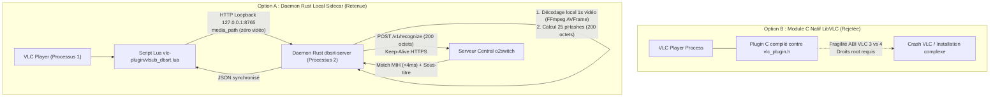
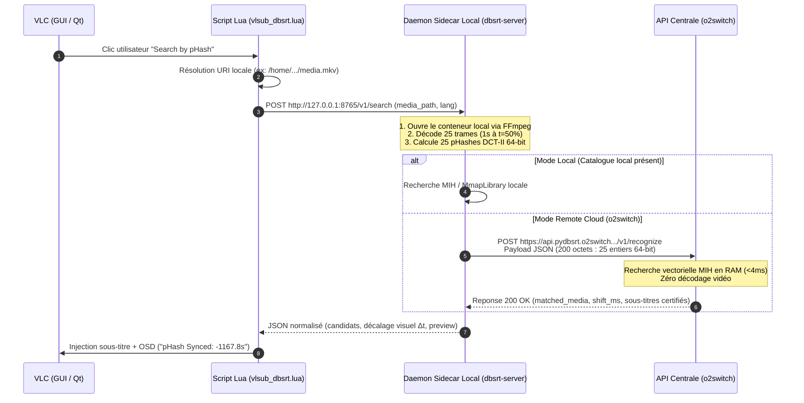
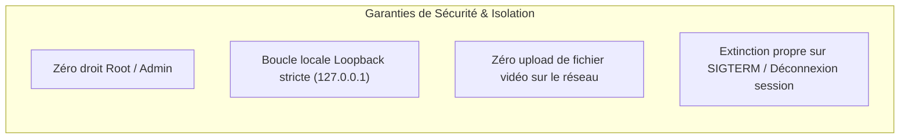

# Architecture Client Daemon Sidecar & Déploiement o2switch

> [!NOTE] Contexte Architectural
> Cette documentation fait suite à l'[Étude de Déploiement Remote o2switch & Dimensionnement VLSub++](2026-10-19-etude-deploiement-remote-o2switch-et-dimensionnement-vlsub.md). Elle formalise la stratégie de répartition des calculs entre le poste client utilisateur (VLC + Daemon Sidecar local) et l'infrastructure serveur centrale (Hébergement Cloud o2switch).

---

## 1. La Problématique : Décodage Vidéo vs Environnement Lua VLC

Le projet vise à offrir une recherche et resynchronisation automatique de sous-titres par empreinte visuelle (**pHash DCT-II**), accessible au grand public sous forme de plugin VLC en remplacement de VLSub.

Deux contraintes matérielles et logicielles s'opposent :

1. **La sandbox Lua de VLC** :
   * L'interpréteur Lua 5.1 embarqué dans VLC ne dispose d'aucun binding natif vers `libavcodec` / `FFmpeg` ou d'accélération vectorielle SIMD.
   * Il est techniquement impossible pour un script Lua pur de décoder les trames compressées d'un fichier vidéo (H.264, HEVC, AV1, ProRes).
   * À l'inverse, le plugin legacy VLSub se contentait de lire 128 Ko de données brutes sur disque avec `io.open()` pour calculer le MovieHash OpenSubtitles (simple checksum binaire insensible au contenu visuel).

2. **L'infrastructure distante o2switch** :
   * Un serveur distant mutualisé ou Cloud ne peut pas recevoir en upload des gigaoctets de fichiers vidéo depuis les postes clients (saturation immédiate de bande passante et des quotas LVE `I/O` et `EP`).
   * Le serveur distant doit exclusivement recevoir des **empreintes précalculées compactes** (ex: 25 entiers 64-bit = 200 octets).

---

## 2. Analyse Comparative des Options d'Architecture Client



| Critère d'Évaluation | Option A : Daemon Rust Sidecar (Retenue) | Option B : Module C LibVLC In-Process |
| :--- | :--- | :--- |
| **Privilèges d'installation** | **Zéro droit root / admin** (dossier utilisateur `%APPDATA%`) | **Droits root requis** (`/usr/lib/vlc/plugins/`) |
| **Résilience & Stabilité** | **Isolation totale** : un incident daemon n'impacte jamais la lecture VLC | **Risque critique** : un segfault C tue le lecteur VLC |
| **Pérennité ABI (VLC 3.x vs 4.x)** | **Totalement insensible** : communication par loopback HTTP standardisé | **Rupture majeure** : l'ABI C change radicalement entre VLC 3 et 4 |
| **Portabilité multi-OS** | **Binaire statique autonome** (`musl` Linux, Windows `.exe`, macOS universal) | Recompilation pour chaque version de LibVLC de chaque distribution |
| **Réutilisation du code existant** | **100% de la stack** (`dbsrt-core`, cache `.phash`, FFmpeg decoding) | Réécriture C/FFI complète et complexe |
| **Écosystème multi-lecteurs** | **Universel** (réutilisable sans modification pour mpv, Jellyfin, Kodi) | Restreint strictement à LibVLC |

---

## 3. Spécification Détaillée du Flux de Données

Le flux complet entre le lecteur et le serveur distant se décompose en 4 étapes hermétiques :



### Contrat de Données Client -> Serveur o2switch

La charge utile réseau transmise à l'infrastructure o2switch est ultra-compacte :

```json
{
  "query_fingerprint": [
    "0xe9fd17223e1c0c4b",
    "0xe9fd17223e1c0c4b",
    "0xe9fd17223e1c0c4b",
    "0xe9fd17223e1c0c4b",
    "0xe9fd17223e1c0c4b"
  ],
  "fps": 25.0,
  "language": "fr",
  "search_mode": "phash",
  "client_version": "2.1.0"
}
```

* **Taille de la trame réseau** : ~200 octets de payload (inférieure à 1 paquet TCP).
* **Consommation CPU o2switch** : ~3,6 ms par requête sur index MIH 100M frames.
* **Confidentialité** : Aucun nom de fichier personnel, aucun hash cryptographique global ni aucun octet vidéo n'est envoyé sur Internet.

---

## 4. Stratégie de Packaging & Déploiement Utilisateur (1 Clic)

Pour un utilisateur grand public, l'installation doit être instantanée et ne comporter aucune ligne de commande.

### 4.1 Plateforme Prioritaire #1 : Linux (Debian / Ubuntu)

La priorité absolue de déploiement et de packaging est la cible **Linux Debian / Ubuntu** :

* **Format principal** : Paquet natif `.deb` et script d'installation utilisateur 1-commande (`install_debian.sh`).
* **Service d'arrière-plan** : Unité utilisateur `systemd --user` (`~/.config/systemd/user/dbsrt-agent.service`).
* **Chemin VLC standardisé** : `~/.local/share/vlc/lua/extensions/vlsub_dbsrt.lua`.
* *(Les déclinaisons Windows `.exe` et macOS `.dmg` sont planifiées en phase ultérieure).*

### 4.2 Actions Automatisées de l'Installeur Debian / Linux

L'installeur réalise 3 opérations silencieuses :

1. **Copie des binaires applicatifs** :
   * Dépose `dbsrt-server` (compilé statiquement en Rust, ~12 Mo) dans `~/.local/bin/dbsrt-server`.
2. **Installation sans privilège du plugin Lua VLC** :
   * Copie `vlsub_dbsrt.lua` dans `~/.local/share/vlc/lua/extensions/vlsub_dbsrt.lua`.
   * *Garantie technique* : Ce dossier n'est **jamais écrasé** lors des mises à jour de VLC Media Player.
3. **Enregistrement du service léger d'arrière-plan** :
   * Création de l'unité systemd utilisateur `~/.config/systemd/user/dbsrt-agent.service` :
     ```ini
     [Unit]
     Description=pydbsrt Local Subtitle Sync Agent
     After=network.target

     [Service]
     ExecStart=%h/.local/bin/dbsrt-server --agent --remote-api %h/.config/dbsrt/remote.url
     Restart=on-failure
     Environment=RUST_LOG=info

     [Install]
     WantedBy=default.target
     ```
   * Activation automatique : `systemctl --user enable --now dbsrt-agent`.

### 4.3 Variante Ergonomique : Mini-App System Tray (Barre des Tâches)

Pour offrir une visibilité rassurante à l'utilisateur :

* Une mini-application compagnon en Rust (via `tray-icon` ou `Tauri`, consommant <10 Mo de RAM).
* Une icône discrète dans la zone de notification avec menu contextuel :
  * État : *Service actif (Connecté au Cloud o2switch)*
  * Action : *Réinstaller le plugin VLC en 1 clic*
  * Action : *Vérifier les mises à jour*
  * Action : *Quitter*

---

## 5. Matrice de Sécurité & Robustesse



1. **Isolation réseau** : Le daemon écoute par défaut sur `127.0.0.1` et refuse toute connexion externe entrante sur la machine du client.
2. **Confidentialité totale des médias** : Les fichiers multimédias de l'utilisateur restent sur son stockage local. Seules les signatures mathématiques abstraites (pHash) transitent vers l'infrastructure dbsrt.
3. **Mise à jour transparente** : Le daemon peut vérifier et mettre à jour le script Lua sans nécessiter la réinstallation de VLC.
