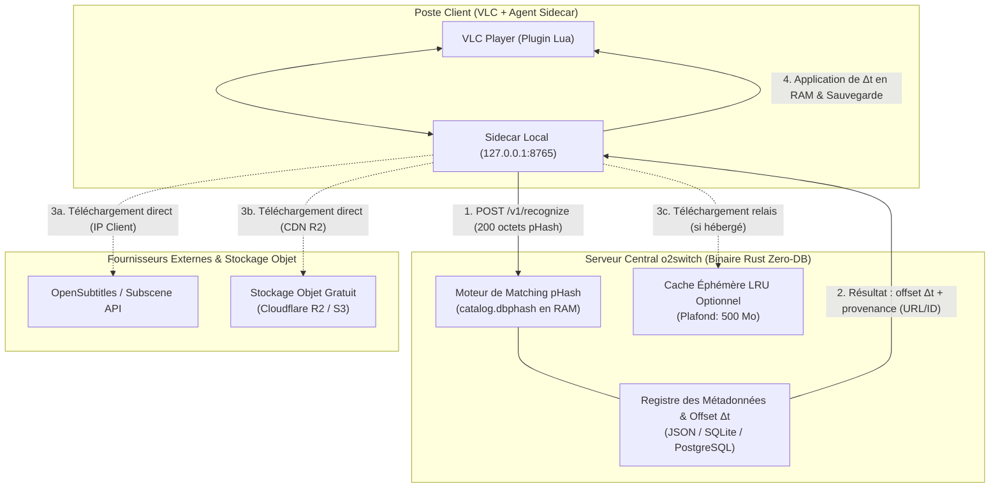
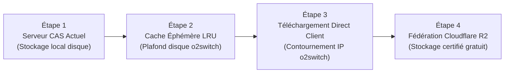

# Architecture de Distribution des Sous-titres sur o2switch & Stockage Décentralisé

> [!NOTE] Contexte
> Ce document répond à la problématique de passage à l'échelle sur hébergement mutualisé ou Cloud contraint (type o2switch/cPanel). Stocker l'intégralité du patrimoine mondial de sous-titres sur le serveur central est irréaliste et sous-optimal. Cette note formalise la séparation stricte entre l'intelligence visuelle (pHash / $\Delta t$) et le stockage des fichiers sous-titres.

---

## 1. Problématique : Le Paradoxe du Stockage Centralisé

Dans un déploiement distant sur hébergement mutualisé (ex: o2switch) :

1. **Volume et Quotas Disque** : L'indexation de centaines de milliers de sous-titres dans toutes les langues générerait des dizaines de gigaoctets de fichiers textuels, saturant l'espace disque alloué et les quotas d'inodes (fichiers unitaires).
2. **Quotas Réseau & Rate-Limiting** : Si le serveur central o2switch téléchargeait lui-même tous les sous-titres depuis les fournisseurs externes (OpenSubtitles, Subscene), son adresse IP unique subirait rapidement un blocage par dépassement de quota (rate limit API).
3. **Consommation Inutile de Bande Passante** : Servir de relais aveugle pour chaque téléchargement de sous-titre gaspille la bande passante du serveur mutualisé alors que le client final dispose de sa propre connexion Internet.

---

## 2. Principe Fondateur : Dissociation Calcul vs Stockage

L'architecture pydbsrt opère une distinction fondamentale entre :

* **L'Intelligence Algorithmique (Hébergée sur o2switch)** :
  * Calcul de resynchronisation pHash ($\Delta t$, confiance, détection de cuts).
  * Base des empreintes visuelles (`catalog.dbphash`, ~100 Ko par heure de vidéo).
  * Table des correspondances et métadonnées de couplage certifié (quel média correspond à quel sous-titre avec quel décalage).
* **Le Payload Sous-titre (Déporté)** :
  * Les octets textuels du fichier `.srt`.



---

## 3. Les Trois Stratégies de Distribution

### 3.1 Stratégie 1 : Téléchargement Direct par le Client (Recommandée)

Dans ce modèle, le serveur o2switch agit exclusivement comme un **calculateur de décalage temporel** :

1. L'agent local du client extrait 5 trames pHash et les soumet à o2switch (`POST /v1/recognize`).
2. o2switch effectue le matching visuel, calcule $\Delta t$ (ex: `-1754.5 ms`), et identifie le sous-titre distant correspondant.
3. o2switch renvoie au client un identifiant de ressource externe :
   ```json
   {
     "candidate_id": "remote:opensubtitles:94821",
     "download_url": "https://api.opensubtitles.com/download/...",
     "shift_ms": -1754.5
   }
   ```
4. L'agent sidecar local sur le PC de l'utilisateur télécharge le fichier `.srt` **directement depuis OpenSubtitles** en utilisant sa propre connexion et son quota utilisateur.
5. L'agent applique le décalage $\Delta t$ en RAM et enregistre le fichier à côté de la vidéo pour VLC.

**Avantages pour o2switch** :

* **0 Mo d'espace disque** consommé pour les sous-titres tiers.
* **0 Mo de bande passante** sortante pour les fichiers `.srt`.
* **Aucun risque de blacklisting IP** auprès des API tierces.

---

### 3.2 Stratégie 2 : Cache Éphémère LRU à la Demande (Modèle Proxy)

Pour les clients ou plugins incapables de contacter des API tierces directement (restrictions réseau, absence de clés API) :

1. o2switch implémente un cache disque local borné (ex: `max_cache_size = 500MB`).
2. Un sous-titre n'est téléchargé par o2switch **que si un utilisateur en fait la demande explicite**.
3. Règle empirique des 80/20 : 20% des séries et films en cours de diffusion représentent 80% des requêtes. Les fichiers populaires restent en cache mémoire/disque.
4. **Politique d'éviction LRU (Least Recently Used)** : Dès que le seuil de 500 Mo est atteint, les sous-titres les moins récemment consultés sont purgés. Un fichier non sollicité après 7 jours est supprimé.

**Avantages pour o2switch** :

* Empreinte disque strictement maîtrisée et bornée.
* Conformité totale avec le contrat REST CAS `GET /v1/subtitles/{hash}`.

---

### 3.3 Stratégie 3 : Stockage Objet Externe Gratuit (Cloudflare R2 / S3)

Pour les sous-titres **certifiés par la communauté pydbsrt** (couplages vérifiés avec synchronisation parfaite) :

1. Les fichiers `.srt` certifiés sont stockés dans un bucket compatible S3 sans frais de bande passante sortante (**Cloudflare R2** : 10 Go de stockage gratuit, zéro coût d'egress).
2. o2switch stocke uniquement la clé SHA-256 du sous-titre et ses métadonnées d'alignement.
3. Lors d'un appel `GET /v1/subtitles/{hash}` sur o2switch :
   * Le serveur renvoie une redirection HTTP `302 Found` ou `307 Temporary Redirect` pointant vers l'URL CDN de Cloudflare R2 (`https://subtitles.dbsrt.org/<hash>.srt`).
   * Ou bien l'agent client télécharge directement depuis le CDN public.

**Avantages pour o2switch** :

* Stockage illimité et externalisé hors de l'hébergement mutualisé.
* Distribution mondiale ultra-rapide via le réseau Anycast de Cloudflare.
* Coût d'infrastructure nul pour le projet.

---

## 4. Matrice Comparative des Approches pour o2switch

| Critère | Centralisé Tout-en-un (Rejeté) | Direct Client (Stratégie 1) | Cache LRU (Stratégie 2) | Stockage Objet R2 (Stratégie 3) |
| :--- | :--- | :--- | :--- | :--- |
| **Stockage Disque o2switch** | > 50 Go (Invivable) | **0 Mo** | Plafonné à 500 Mo | **0 Mo** |
| **Bande Passante o2switch** | Élevée (Saturation) | **Négligeable (200 o / req)** | Modérée | **Négligeable (Redirection)** |
| **Risque Rate-Limit API** | Critique (IP unique) | **Nul (IPs utilisateurs)** | Modéré (mutualisé) | **Nul** |
| **Gestion des Inodes** | Épuisement du quota | **Zéro inode** | Fixe (~15 000 fichiers) | **Zéro inode** |
| **Complexité Client** | Minimale | Requiert client HTTP | Minimale (REST pur) | Minimale (suit redirect) |
| **Cas d'Usage Cible** | Déconseillé | Sous-titres OpenSubtitles | Fallback sans accès direct | Couplages Certifiés pydbsrt |

---

## 5. Feuille de Route d'Intégration



1. **Phase Immédiate (Validée)** : Modèle CAS `sub:sha256:<hash>` déployé sur RPi4 avec service de fichiers locaux.
2. **Phase o2switch (Court Terme)** :
   * Déploiement du serveur en mode **Zero-DB** (sans PostgreSQL, via `catalog.dbphash` en RAM).
   * Activation du cache LRU borné à 500 Mo pour les sous-titres demandés.
3. **Phase Échelle (Moyen Terme)** :
   * Délégation du téléchargement des sous-titres OpenSubtitles à l'agent local.
   * Migration des sous-titres certifiés du catalogue vers un bucket Cloudflare R2 gratuit avec redirection HTTP.
