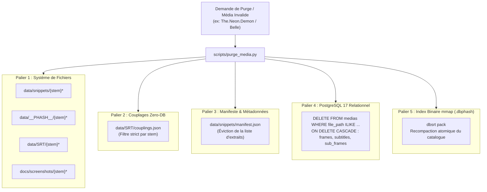

# Architecture de Retrait et d'Invalidation Globale des Données (Toutes les Sorties)

Ce document décrit formellement l'architecture d'invalidation, d'éviction et de purge cohérente des données à travers les **cinq paliers de stockage et d'indexation** du projet `pydbsrt`.

---

## 1. Contexte & Problématique Métier

Dans un pipeline d'indexation perceptuelle et d'alignement de sous-titres, les données sont distribuées sur plusieurs représentations complémentaires :

1. **Fichiers médias & empreintes brutes** sur système de fichiers (`data/snippets`, `data/__PHASH__`, `data/SRT`, `docs/screenshots`).
2. **Couplages certifiés Zero-DB** (`data/SRT/couplings.json`).
3. **Index binaire sérialisé mmap** (`data/catalog.dbphash` généré via `dbsrt pack`).
4. **Base relationnelle transactionnelle** (PostgreSQL 17 : tables `medias`, `frames`, `subtitles`, `sub_frames`).
5. **Rapports, manifestes & dashboards de supervision** (`data/snippets/manifest.json`, documentation MkDocs).

Lorsqu'un média source s'avère **corrompu** (ex. `moov atom not found`, fichier tronqué à quelques octets) ou qu'une entrée doit être retirée pour des raisons juridiques, d'obsolescence ou de recalage erroné, laisser des données orphelines dans l'un de ces paliers engendre des **faux négatifs**, des désynchronisations d'index, ou des plantages du démon VLC/HTTP.

---

## 2. Matrice d'Impact & Paliers d'Invalidation



---

## 3. Détail des Cinq Niveaux de Sortie

### Niveau 1 : Système de Fichiers (Artefacts & Empreintes)
- **Fichiers vidéo snippets** : `data/snippets/<stem>.mp4` (ou mkv, avi).
- **Empreintes perceptuelles brutes** : `data/__PHASH__/<stem>*.phash` (séquences binaires u64).
- **Sous-titres associés** : `data/SRT/<stem>*.srt`.
- **Captures & miniatures** : `docs/screenshots/<stem>*.jpg`.
- **Règle** : Suppression physique ou déplacement en zone de quarantaine (`data/.quarantine/`).

### Niveau 2 : Registre Zero-DB (`couplings.json`)
- Le fichier `data/SRT/couplings.json` maintient les associations `video_fingerprint` $\leftrightarrow$ `certified_subtitle`.
- **Règle** : Éviction atomique de toute clé `video_fingerprint` ou `subtitle_path` contenant le pattern du média révoqué.

### Niveau 3 : Manifeste du Corpus (`manifest.json`)
- Le fichier `data/snippets/manifest.json` liste les extraits servant aux bancs d'essais E2E et benchmarks.
- **Règle** : Réécriture du tableau JSON sans l'entrée du média évincé.

### Niveau 4 : Base Relationnelle PostgreSQL 17
- Grâce aux contraintes relationnelles définies avec `ON DELETE CASCADE` :
  - `frames` $\rightarrow$ clé étrangère vers `medias(id)`
  - `subtitles` $\rightarrow$ clé étrangère vers `medias(id)`
  - `sub_frames` $\rightarrow$ clé étrangère vers `subtitles(id)`
- **Règle** : L'exécution d'un unique `DELETE FROM medias WHERE filename = :stem` détruit instantanément et de façon transactionnelle toutes les frames, empreintes pHash et segments de sous-titres associés.

### Niveau 5 : Index Perceptuel Binaire Sérialisé (`catalog.dbphash`)
- Le fichier `catalog.dbphash` est une structure mmap compacte optimisée en lecture seule pour les recherches sous la milliseconde.
- **Règle** : Une fois les fichiers `.phash` ou vidéos orphelines retirés des dossiers sources, un `task pack` (ou `cargo run -p dbsrt-cli -- pack ...`) génère un nouvel index compacté, garantissant qu'aucune empreinte morte ne subsiste en mémoire partagée.

---

## 4. Outil d'Orchestration Déclaratif : `scripts/purge_media.py`

Pour exécuter l'ensemble de ces étapes sans erreur manuelle, l'outil `scripts/purge_media.py` centralise la purge :

```bash
# Exemple de purge complète d'un média corrompu
python3 scripts/purge_media.py --pattern "The.Neon.Demon.2016" --pack
```

### Options supportées :
- `--pattern <str>` : Motif du fichier / stem à évincer.
- `--pack` : Déclenche automatiquement le repack de `data/catalog.dbphash` après suppression.
- `--db` : Se connecte au conteneur PostgreSQL 17 pour exécuter la purge transactionnelle avec cascade.
