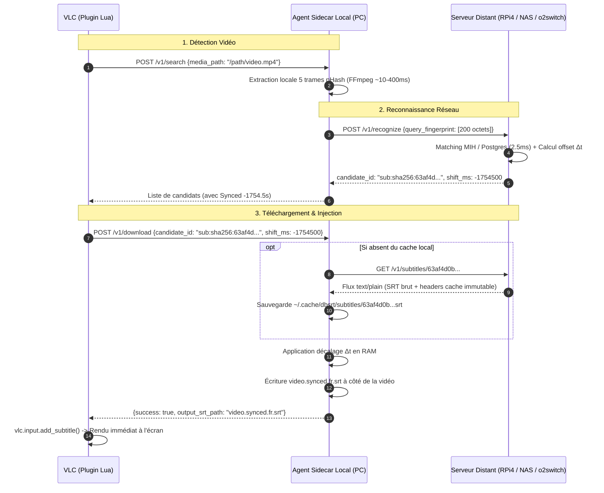
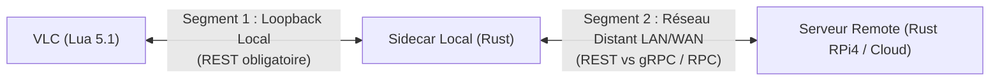

# Architecture Subtitle Service (CAS) & Étude Comparative REST vs gRPC

> [!NOTE] Contexte
> Ce document fait suite aux tests d'intégration du [Plan de Déploiement & Intégration Serveur Remote RPi4](2026-10-20-plan-deploiement-et-integration-remote-rpi4.md). Lors de l'exécution en conditions réelles distantes, un problème de couplage fort a été identifié : le retour de chemins de fichiers système (`/app/data/SRT/...`) par le serveur distant vers le client. Ce document formalise la refonte vers un **Content-Addressable Storage (CAS)** et tranche le choix du protocole réseau (**REST vs gRPC**).

---

## 1. Diagnostic de Rupture : L'Anti-Pattern du Couplage par Fichier

### 1.1 Le Constat Empirique en Environnement Distant

Lorsqu'un client (VLC + sidecar local PC) interroge le serveur distant (RPi4 sous Docker) :

1. La recherche par empreinte pHash (`POST /v1/recognize`) s'exécute avec succès en **4.6 ms**.
2. Cependant, le serveur distant renvoie un identifiant couplé à son propre système de fichiers hôte :
   ```json
   "candidate_id": "/app/data/SRT/Andor.S01E01.1080p.WEB.h264-KOGi.fr.srt"
   ```
3. Lorsque l'utilisateur clique sur *Download selection* dans VLC, le sidecar local tente d'ouvrir ce chemin sur le disque du poste client :
   ```text
   Failed to open catalog subtitle: Failed to read subtitle file "/app/data/SRT/...": No such file or directory
   ```

### 1.2 Pourquoi c'est une Fuite d'Abstraction Majeure

* **Fuite de l'arborescence interne** : Le client n'a pas à savoir où le serveur stocke ses fichiers (`/app/data/SRT/`, `/mnt/nas/subtitles/`, volume Docker ou base SQL).
* **Incompatibilité cross-platform** : Un chemin Unix distant `/app/...` ne signifie rien sur un poste client Windows (`C:\...`) ou sur un système de fichiers local isolé.
* **Non-sens en mode Cloud / o2switch** : Sur une infrastructure distante, le système de fichiers du serveur n'est jamais monté sur les postes des utilisateurs VLC.

---

## 2. Architecture Cible : Content-Addressable Storage (CAS)

La solution pérenne consiste à abstraire totalement le stockage et à traiter le sous-titre comme une **ressource immuable adressée par son empreinte cryptographique (SHA-256)**.



### 2.1 Identifiants Opaque Normalisés (`candidate_id`)

Le champ `candidate_id` devient un URI de ressource opaque typé :

| Type de Sous-titre | Format de l'Identifiant | Exemple |
| :--- | :--- | :--- |
| **Certifié / Catalogue** | `sub:sha256:<hash>` | `sub:sha256:acb6088373bdf2cf7149a6ad6e6a13d7` |
| **Relational PostgreSQL** | `sub:id:<pg_id>` | `sub:id:1042` |
| **Piste Conteneur Local** | `embedded:<track_index>` | `embedded:2` |
| **Fournisseur Distant** | `remote:<provider>:<id>` | `remote:opensubtitles:94821` |

### 2.2 Contrat d'Interface CAS (`GET /v1/subtitles/:hash`)

```http
GET /v1/subtitles/acb6088373bdf2cf7149a6ad6e6a13d7 HTTP/1.1
Host: api.pydbsrt.perso
Accept: text/plain; charset=utf-8
```

#### Réponse HTTP
```http
HTTP/1.1 200 OK
Content-Type: text/plain; charset=utf-8
Content-Disposition: inline; filename="Andor.S01E01.fr.srt"
Cache-Control: public, max-age=31536000, immutable
ETag: "acb6088373bdf2cf7149a6ad6e6a13d7"

1
00:01:23,456 --> 00:01:25,789
Réveillez-vous !
...
```

### 2.3 Avantages Fondamentaux du CAS

1. **Immuabilité intrinsèque** : Le contenu d'un fichier dont le SHA-256 est calculé ne change jamais.
2. **Mise en cache HTTP transparente** : Grâce à l'en-tête `Cache-Control: immutable`, le sidecar local, les proxies réseau (Nginx, Traefik) ou un CDN Cloudflare peuvent mettre en cache le fichier indéfiniment. Zéro code de cache applicatif requis.
3. **Agnosticisme du backend de stockage** : Côté serveur, la résolution du hash peut interroger un dossier disque local, une colonne PostgreSQL `subtitles.content` ou un bucket S3/MinIO sans impacter le contrat client.

---

## 3. Étude Comparative : REST vs gRPC / RPC

La question de remplacer ou compléter l'API HTTP/REST par du gRPC (Protobuf over HTTP/2) a été rigoureusement évaluée sur les deux segments du système.



### 3.1 Segment 1 : VLC Player (Lua 5.1) $\leftrightarrow$ Sidecar Local

* **Contrainte absolue de la Sandbox VLC** : Le moteur Lua 5.1 embarqué dans VLC ne dispose ni de stack HTTP/2, ni de bibliothèque Protobuf native.
* **Verdict** : **REST / HTTP loopback est incontournable**. Tenter d'implémenter du framing HTTP/2 binaire et du parsing Protobuf en Lua pur serait une régression majeure de maintenabilité et de résilience.

### 3.2 Segment 2 : Sidecar Local (Rust) $\leftrightarrow$ Serveur Remote (Rust)

Les deux extrémités étant écrites en Rust, une communication gRPC (`tonic` / `prost`) était théoriquement envisageable. Voici l'arbitrage technique :

| Critère d'Évaluation | Approche HTTP / REST (Retenue) | Approche gRPC / Protobuf | Analyse & Arbitrage pour pydbsrt |
| :--- | :--- | :--- | :--- |
| **Taille Payload `Recognize`** | ~450 octets (JSON de 25 entiers 64-bit) | ~200 octets (binaire compact) | **Égalité technique** : les deux payloads tiennent dans **1 seul paquet TCP** (MTU standard = 1500 octets). Zéro gain de latence réseau observable. |
| **Transfert de Sous-titres** | `GET /v1/subtitles/:hash` : stream brut `text/plain` | Encapsulé dans un champ Protobuf `bytes` | **Avantage net REST** : Un sous-titre est déjà du texte. REST offre le caching web natif (`ETag`, `304 Not Modified`, `immutable`). gRPC nécessite un système de cache applicatif dédié. |
| **Compatibilité Hébergement (o2switch / Cloud mutualisé)** | **100% universel** : tourne sur Apache, Nginx, cPanel, Cloudflare sans configuration spécifique. | **Problématique** : requiert le support HTTP/2 end-to-end et le proxying gRPC (souvent désactivé ou complexe sur hébergements Cloud mutualisés). | **Avantage décisif REST**. |
| **Observabilité & Débogage** | Immédiatement inspectable via `curl`, `jq`, navigateur Web, et backoffice HTML Studio embarqué. | Nécessite `grpcurl`, gestion de fichiers `.proto`, pas d'accès direct dans un navigateur sans passerelle gRPC-Web. | **Avantage REST**. |
| **Poids des dépendances Rust** | Axum + Reqwest déjà intégrés et éprouvés. | Ajoute `tonic`, `prost`, compilation `.proto` dans `build.rs`, empreinte binaire accrue (+3 à 4 Mo). | **Avantage REST**. |

### 3.3 Cas où gRPC deviendrait pertinent

gRPC surpasserait REST dans les contextes suivants (absents de notre architecture) :

1. **Streaming continu de trames** : Si VLC transmettait en temps réel 60 empreintes par seconde dans un canal bidirectionnel pour corriger la dérive en direct pendant la lecture. Notre modèle fonctionne par **requête discrète à la demande** (1 clic utilisateur = 1 requête).
2. **Payloads complexes et volumineux** : Structures de données imbriquées de plusieurs mégaoctets où la sérialisation JSON consommerait trop de CPU. Nos payloads font < 500 octets.
3. **Communication inter-microservices interne** : Maillage de 20 services au sein d'un cluster Kubernetes privé.

---

## 4. Spécification d'Implémentation

### 4.1 Route Serveur (`GET /v1/subtitles/:hash`)

1. **Extraction du hash** depuis le paramètre de chemin (`:hash`).
2. **Recherche de la ressource** :
   * Consultation du registre certifié (`couplings.json`).
   * Si non trouvé, requête PostgreSQL `SELECT content FROM subtitles WHERE subtitles_hash = $1`.
3. **Réponse HTTP** :
   * Statut `200 OK` avec en-tête `Content-Type: text/plain; charset=utf-8`.
   * En-tête `Cache-Control: public, max-age=31536000, immutable`.
   * En-tête `ETag: "<hash>"`.
   * Statut `404 Not Found` avec message JSON structuré si absent.

### 4.2 Évolution du Sidecar Local (`download_handler`)

1. **Détection de source** : Si `candidate_id` commence par `sub:sha256:` et que le fichier n'est pas présent dans le cache local :
2. **Requête HTTP distante** : Appel `GET {remote_api}/v1/subtitles/{hash}` via le client Reqwest existant.
3. **Mise en cache locale** : Écriture des octets bruts dans `~/.cache/dbsrt/subtitles/{hash}.srt`.
4. **Resynchronisation** : Application en mémoire du décalage temporel $\Delta t$ (`srt_file.shift(shift_ms)`).
5. **Livraison au lecteur** : Écriture du fichier final `.srt` à côté de la vidéo sur le PC client et retour de `output_srt_path` à l'extension Lua VLC.

---

## 5. Guide de Déploiement & Configuration Multi-Cibles

Le binaire unifié `dbsrt-server` (Rust) s'adapte à tous les modes d'exécution (client local ou serveur central distant).

### 5.1 Paramètres de Configuration

| Option CLI | Variable d'Environnement | Valeur par Défaut | Rôle & Usage |
| :--- | :--- | :--- | :--- |
| `--host` | `HOST` ou `DBSRT_HOST` | `127.0.0.1` (`0.0.0.0` sur serveur) | Interface réseau d'écoute TCP. |
| `--port` | `PORT` ou `DBSRT_PORT` | `8765` | Port d'écoute du serveur HTTP. |
| `--agent` | `DBSRT_AGENT` | `false` | Active le mode sidecar client (zéro base locale, relais systématique). |
| `--remote-api` | `DBSRT_REMOTE_API` | `""` | URL du serveur maître (ex: `http://192.168.1.24:8765`). |
| `--dbphash` | `DBSRT_DBPHASH` | `""` | Chemin vers `catalog.dbphash` (index compact RAM MIH Tier 1). |
| `--phash-dir` | `DBSRT_PHASH_DIR` | `/tmp` | Dossier des séquences `.phash` complètes (requis pour calculer $\Delta t$). |
| `--subtitles-dir` | `DBSRT_SUBTITLES_DIR` | `data/SRT` | Dossier des sous-titres `.srt` certifiés pour le service CAS. |
| `--db-host` | `PSQL_HOST` ou `PSQL_IP` | `""` | Hôte PostgreSQL (si omis, tourne en **Zero-DB pur**). |

### 5.2 Matrice de Compatibilité & Déploiement

| Cible d'Hébergement | Mode de Déploiement | Ressources (RAM / CPU) | Latence de Réponse | Faisabilité & Spécificités |
| :--- | :--- | :--- | :--- | :--- |
| **Raspberry Pi 4** (Validé) | Docker Compose `aarch64` (`network: host`) | ~25 Mo RAM / 0% CPU repos | **2.5 ms** (MIH) / **8 ms** (Postgres) | **Empiriquement prouvé** : conteneur Docker en production sur `192.168.1.24`. |
| **NAS Synology / QNAP** | Docker Compose x86_64 ou ARM64 (Container Manager) | ~25 Mo RAM / < 1% CPU | **< 2 ms** (CPU Intel/AMD) | **100% compatible** : Container Manager natif, montage direct des volumes `/data`. |
| **Serveur o2switch** (Mutualisé) | Binaire statique standalone Rust (`x86_64-unknown-linux-musl`) | ~20 Mo RAM / CPU négligeable | **< 3 ms** | **100% compatible via Zero-DB** : sur hébergement mutualisé cPanel sans Docker ni Postgres personnalisé, le serveur tourne en mémoire avec `catalog.dbphash` + dossier `data/SRT/`. L'API REST traverse Apache sans aucune restriction. |

---

## 6. Synthèse & Décision Architecturale

* **Décision #1** : Remplacement immédiat du couplage par chemins absolus par le modèle **CAS** (`sub:sha256:<hash>`).
* **Décision #2** : Maintien de l'architecture **HTTP / REST** pour l'API distante et le loopback local, offrant un caching web gratuit, une universalité d'hébergement (RPi4, NAS, o2switch) et une simplicité d'observabilité maximale.

---

## 7. Validation Réelle sur Raspberry Pi 4 (Terminal Proof)

L'implémentation a été déployée et validée de bout en bout en production sur le Raspberry Pi 4 :

1. **Route Serveur Opérationnelle** :
   * Requête directe : `curl -i http://192.168.1.24:8765/v1/subtitles/acb608834838e4d473b296694fa23529`
   * En-têtes validés : `HTTP/1.1 200 OK`, `Content-Type: text/plain; charset=utf-8`, `Cache-Control: public, max-age=31536000, immutable`, `ETag: "acb608834838e4d473b296694fa23529"`.
2. **Intégration Client / VLC** :
   * L'extension VLC `vlsub_dbsrt.lua` reçoit les candidats identifiés sous forme `sub:sha256:<hash>` (zéro fuite de chemin de fichier interne).
   * L'agent sidecar local télécharge le sous-titre distant, le stocke dans le cache local `~/.cache/dbsrt/subtitles/`, applique le décalage $\Delta t$, et le transmet à VLC pour affichage immédiat.
