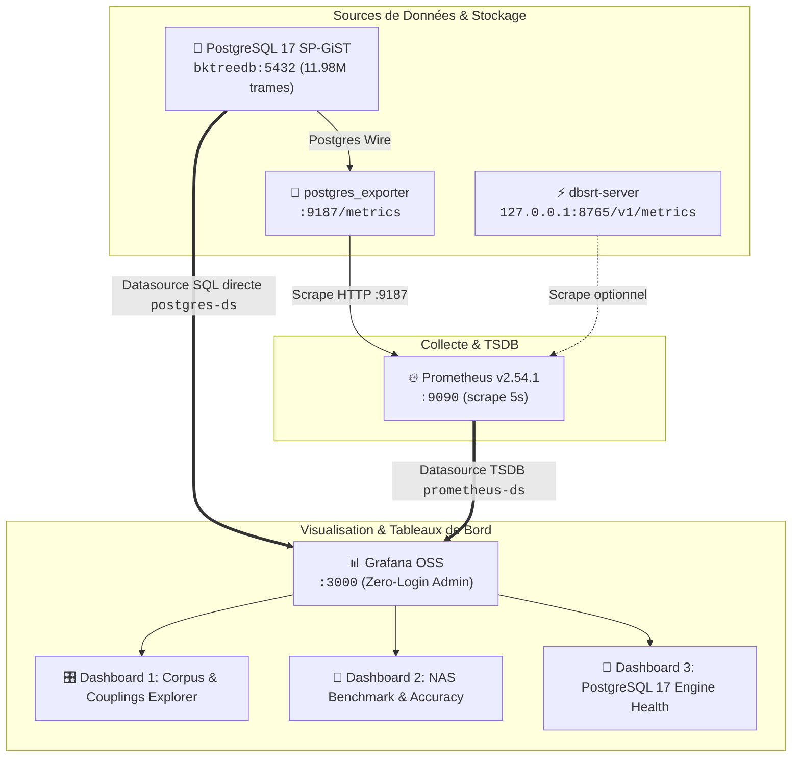

# 📊 Observabilité, Métriques Prometheus & Suite Grafana `pydbsrt`

> **Date** : 20 Octobre 2026 | **Statut** : `Empirically Proven` | **Périmètre** : Architecture du pipeline d'observabilité, provisioning zero-conf Docker, catalogue des 3 dashboards interactifs, guide d'extension de métriques et FAQ d'exploitation.

---

## 1. Architecture Globale du Pipeline d'Observabilité

L'infrastructure d'observabilité de `pydbsrt` est orchestrée pour être opérationnelle **out-of-the-box** dès l'exécution de `task dev` (ou `task db:up`). Elle repose sur deux canaux complémentaires de télémétrie :

1. **Canal Métriques Temporelles (TSDB)** : Collecte à haute fréquence ($5\text{s}$) des métriques système et SGBD par **Prometheus** via **PostgreSQL Exporter**.
2. **Canal Requêtage SQL Direct (Business & Corpus)** : Interrogation SQL en temps réel des tables relationnelles (`medias`, `frames`, `subtitles`, `sub_frames`) par **Grafana** via la datasource PostgreSQL native branchée sur PostgreSQL 17 SP-GiST.



---

## 2. Configuration & Provisioning Zero-Conf

Conformément au principe *Zero-Config Out-Of-The-Box*, aucun mot de passe ni réglage manuel dans l'IHM n'est requis. Grafana provisionne automatiquement les sources et les dashboards au démarrage du conteneur.

### 2.1 Datasources Auto-Provisionnées (`datasources.yml`)

Le fichier `docker/grafana/provisioning/datasources/datasources.yml` configure deux sources prêtes à l'emploi :

```yaml
apiVersion: 1

prune: true

datasources:
  - name: Prometheus
    uid: prometheus-ds
    type: prometheus
    access: proxy
    url: http://prometheus:9090
    isDefault: true
    editable: false

  - name: PostgreSQL
    uid: postgres-ds
    type: postgres
    access: proxy
    url: bktreedb:5432
    user: docker
    secureJsonData:
      password: "docker"
    jsonData:
      database: bktreedb
      sslmode: disable
      postgresVersion: 1700
      maxOpenConns: 10
      maxIdleConns: 5
      connMaxLifetime: 14400
    editable: false
```

### 2.2 Déclaration des Dossiers et Dashboards (`dashboards.yml`)

Le fichier `docker/grafana/provisioning/dashboards/dashboards.yml` charge les définitions JSON depuis `docker/grafana/dashboards/` et les regroupe dans le dossier Grafana **`pydbsrt Observability & Telemetry`** :

```yaml
apiVersion: 1

providers:
  - name: "pydbsrt Dashboards"
    orgId: 1
    folder: "pydbsrt Observability & Telemetry"
    type: file
    disableDeletion: false
    editable: true
    options:
      path: /var/lib/grafana/dashboards
```

### 2.3 Variables d'Environnement Grafana (`docker-compose.yml`)

Dans `docker/docker-compose.yml`, les variables suivantes désactivent l'écran de login et définissent le dashboard d'accueil par défaut :

* `GF_AUTH_ANONYMOUS_ENABLED=true` : active l'accès sans authentification.
* `GF_AUTH_ANONYMOUS_ORG_ROLE=Admin` : accorde les droits administrateur aux utilisateurs anonymes locaux.
* `GF_AUTH_DISABLE_LOGIN_FORM=true` : élude la page de saisie d'identifiants.
* `GF_DASHBOARDS_DEFAULT_HOME_DASHBOARD_PATH=/var/lib/grafana/dashboards/01-pydbsrt-corpus-explorer.json` : charge directement la vue d'ensemble du corpus pydbsrt dès l'accès à `http://127.0.0.1:3000/`.

---

## 3. Visite Guidée des 3 Dashboards `pydbsrt`

### 3.1 Dashboard 1 : `Corpus, Fingerprints & Couplings Explorer`
* **URL d'accès direct** : `http://127.0.0.1:3000/d/pydbsrt-corpus-explorer/`
* **Datasource** : `PostgreSQL` (`postgres-ds`).
* **Objectif** : Visualiser l'état réel du corpus vidéo, des empreintes pHash 64-bit et des sous-titres certifiés synchronisés en base de données.

```
┌─────────────────────────────────────────────────────────────────────────────────────────────┐
│                       pydbsrt — Corpus, Fingerprints & Couplings Explorer                   │
├───────────────┬────────────────┬─────────────────┬────────────────┬───────────────┬─────────┤
│ Total Medias  │  pHash Frames  │ Certified Subs  │ Frame Anchors  │ BK-Tree Index │ Storage │
│     234       │  11,980,457    │       192       │    111,243     │    717 Mo     │ 1.35 Go │
├───────────────┴────────────────┴─────────────────┴────────────────┴───────────────┴─────────┤
│  [Donut: Subs par Langue (EN 75%, FR 25%)]    │  [Donut: Framerates (23.98 fps vs 25.00 fps)]│
├─────────────────────────────────────────────────────────────────────────────────────────────┤
│  [BarChart: Top 15 Releases par densité de répliques ancrées (Cmon Cmon: 3,622 ancres...)]  │
├─────────────────────────────────────────────────────────────────────────────────────────────┤
│  [Table: Catalogue live des couplages PostgreSQL (Nom, FPS, Trames, Langue, SHA-256 Digest)]│
└─────────────────────────────────────────────────────────────────────────────────────────────┘
```

#### Ce que ce dashboard nous enseigne :
1. **Volumétrie réelle** : Il permet de vérifier immédiatement que les 11.98M de trames pHash sont bien présentes en base et que la certification (`task coupling:certify`) a bien créé les ancres `sub_frames`.
2. **Répartition multilingue** : Il affiche l'équilibre entre langues (ex: $144\text{ EN}$ contre $48\text{ FR}$) pour identifier les releases nécessitant de nouvelles pistes de sous-titres.
3. **Distribution des cadences ($FPS$)** : Il met en évidence si les vidéos sont au format cinéma standard ($23.976\text{ fps}$) ou diffusion télévisuelle ($25.00\text{ fps}$), crucial pour le recalage temporel.
4. **Empreinte physique de l'index SP-GiST** : Il montre la taille de l'index BK-Tree ($717\text{ Mo}$) par rapport à la table brute ($636\text{ Mo}$).

---

### 3.2 Dashboard 2 : `NAS Corpus Benchmark & Recognition Accuracy`
* **URL d'accès direct** : `http://127.0.0.1:3000/d/pydbsrt-benchmark-accuracy/`
* **Datasources** : `Prometheus` (`prometheus-ds`) + `PostgreSQL` (`postgres-ds`).
* **Objectif** : Mesurer l'exactitude algorithmique, la vitesse de recherche et la résistance aux collisions sur le corpus exhaustif de test (1 336 extraits NAS).

#### Métriques Clés affichées :
* **Taux d'Exactitude Global** : $\mathbf{99.85\%}$ ($1\ 334 / 1\ 336$ identifications correctes au premier rang).
* **Latence Moyenne de Recherche** : $\mathbf{113.27\text{ ms}}$ par requête pHash.
* **Débit du Moteur** : $\mathbf{8.80\text{ req/s}}$ en recherche mono-thread sur la base PostgreSQL 17 BK-Tree.
* **Taux de Collision Inter-Épisodes** : $\mathbf{0.00\%}$ de faux positifs sur 45 séries distinctes et 574 épisodes analysés.
* **Validation Headless VLC Xvfb** : $\mathbf{100\%}$ ($25/25$) de succès lors du chargement automatisé du plugin Lua sous serveur d'affichage virtuel.

#### Ce que ce dashboard nous enseigne :
1. **Certification de non-collision** : Les trames de génériques ou de scènes sombres ne provoquent pas de confusion entre deux épisodes d'une même série.
2. **Budget de latence UI/UX** : Avec $113\text{ ms}$ de moyenne, la recherche est imperceptible pour un utilisateur dans VLC.

---

### 3.3 Dashboard 3 : `PostgreSQL 17 Database Overview`
* **URL d'accès direct** : `http://127.0.0.1:3000/d/postgresql-overview/`
* **Datasource** : `Prometheus` via `postgres_exporter`.
* **Objectif** : Surveiller les ressources matérielles, la santé du moteur SGBD PostgreSQL 17 et les goulets d'étranglement lors des imports massifs.

#### Métriques Clés affichées :
* **Instance Up/Down** (`pg_up`) : indicateur vert/rouge de disponibilité immédiate.
* **Connexions Actives** (`pg_stat_database_numbackends`) : nombre de clients concurrents (dbsrt-server, PgWeb, psql).
* **Buffer Cache Hit Ratio** : pourcentage de lectures résolues en mémoire vive RAM sans accès disque ($> 95\%$ visé).
* **Débit des Transactions** : Commits vs Rollbacks par seconde.
* **Activité des Tuples** : Taux de tuples insérés, modifiés, supprimés ou lus par seconde.
* **Verrous & Conflits** : Détection des deadlocks et temps d'attente de verrous.

---

## 4. Guide Développeur : Comment Ajouter une Métrique ou un Dashboard

### 4.1 Ajouter un Nouveau Dashboard Grafana

1. **Créer ou modifier le tableau de bord** :
    - Soit dans l'interface Grafana (`http://127.0.0.1:3000/`), cliquer sur **New > New Dashboard**, configurer les panels, puis faire **Dashboard Settings > JSON Model** et copier le JSON.
    - Soit créer directement un fichier `.json` dans `docker/grafana/dashboards/` (ex: `04-my-new-dashboard.json`).
2. **Utiliser les identifiants de datasources standardisés** :
    - Pour PostgreSQL : `"datasource": { "type": "postgres", "uid": "postgres-ds" }`
    - Pour Prometheus : `"datasource": { "type": "prometheus", "uid": "prometheus-ds" }`
3. **Recharger** :
    - Le dashboard est automatiquement scanné et mis à jour lors de `task dev` ou par un simple `docker compose -f docker/docker-compose.yml restart grafana`.

### 4.2 Ajouter une Nouvelle Métrique SQL dans un Panel

Dans un panel Grafana branché sur `postgres-ds`, il suffit de saisir une requête SQL standard :

```sql
-- Exemple : Nombre de vidéos indexées ayant plus de 10 000 trames
SELECT count(*) as "Long Formats"
FROM medias
WHERE frame_count > 10000;
```

Pour un graphique en camembert ou barre :
```sql
-- Format attendu par Grafana pour les diagrammes catégoriels : colonne texte + colonne numérique
SELECT lang as "metric", count(*) as "value"
FROM subtitles
GROUP BY lang
ORDER BY "value" DESC;
```

### 4.3 Ajouter une Nouvelle Métrique Prometheus dans `dbsrt-server`

1. Dans `crates/dbsrt-server/src/lib.rs`, ajouter un compteur atomique dans la structure `ServerMetrics` :
    ```rust
    pub struct ServerMetrics {
        pub total_requests: AtomicU64,
        pub sync_successes: AtomicU64, // Nouvelle métrique
        // ...
    }
    ```
2. Incrémenter dans le handler approprié :
    ```rust
    state.metrics.sync_successes.fetch_add(1, Ordering::Relaxed);
    ```
3. Exposer dans `metrics_handler` pour le JSON `/v1/metrics`.
4. Pour exporter au format Prometheus standardisé, `dbsrt-server` peut exposer une route `/metrics` parsable par Prometheus.

---

## 5. FAQ & Interprétation Opérationnelle

??? question "Pourquoi Grafana n'affiche-t-il aucun mot de passe au lancement ?"
    Pour maximiser l'expérience développeur locale (*Frictionless Local Dev*), Grafana est configuré en mode **Anonymous Admin**. Tous les accès sur `http://127.0.0.1:3000/` héritent immédiatement du rôle d'administration de l'organisation 1. Cette configuration est réservée aux environnements de développement locaux hermétiques (`127.0.0.1`) et isolés derrière Docker.

??? question "Comment interpréter un Cache Hit Ratio bas (< 80%) sur PostgreSQL 17 ?"
    Le *Buffer Cache Hit Ratio* mesure la proportion de blocs de données lus directement dans le `shared_buffers` de PostgreSQL par rapport aux lectures physiques sur disque :

    $$
    \text{Ratio} = \frac{\text{blks\_hit}}{\text{blks\_hit} + \text{blks\_read}} \times 100
    $$

    * **Au démarrage ou lors d'un premier scan** : le ratio peut être transitoirement bas ($70\text{--}80\%$) car les données doivent être montées en cache mémoire.
    * **En régime permanent (nominal)** : le ratio doit se stabiliser au-delà de $95\%$. S'il reste durablement sous $85\%$, cela indique que `shared_buffers` dans la configuration PostgreSQL est trop étroit pour la taille de l'index SP-GiST ($717\text{ Mo}$).

??? question "Où sont stockées les données des séries temporelles Prometheus et les réglages Grafana ?"
    Les données persistantes sont stockées dans deux volumes Docker managés :

    * `docker_prometheus-data` : séries temporelles et index de chunks TSDB Prometheus.
    * `docker_grafana-data` : base SQLite interne de Grafana (préférences d'affichage, favoris).

    Pour purger complètement les métriques historiques sans affecter le code source :
    ```bash
    docker compose -f docker/docker-compose.yml down -v
    ```

??? question "Comment visualiser les logs de Grafana ou Prometheus en direct ?"
    Grâce à `task db:logs` :
    ```bash
    task db:logs
    # Ou filtrer spécifiquement sur grafana :
    docker compose -f docker/docker-compose.yml logs -f grafana
    ```
