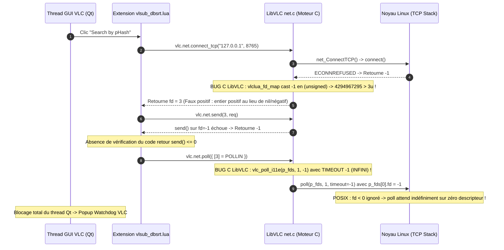
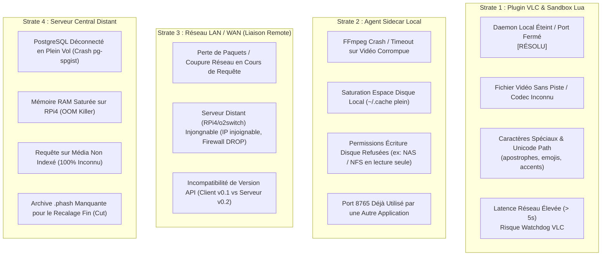

# Registre des Incidents, Matrice de Chaos Testing & Post-Mortem VLC Socket Hang

> [!IMPORTANT] Objectif & Méthodologie
> Ce document inaugure le **registre formel d'incidents et de robustesse** de pydbsrt. Il documente l'incident critique du gel de l'interface VLC lorsque le démon est éteint, analyse la cause racine jusqu'au code source C de LibVLC, détaille la remédiation appliquée, et dresse la première **cartographie de défaillances (Chaos Matrix)** pour guider les futurs tests d'exploration systématique.

---

## 1. Post-Mortem Incident #001 : Gel de VLC ("Extension does not respond") sur Daemon Offline

| Attribut | Détail |
| :--- | :--- |
| **Identifiant** | `INC-2026-10-20-VLC-HANG-DAEMON-OFFLINE` |
| **Composant Affecté** | Extension VLC Qt / Lua (`vlc-plugin/vlsub_dbsrt.lua`) |
| **Sévérité** | **Élevée** (Blocage complet du thread d'interface Qt de VLC $\to$ Watchdog popup $\to$ Nécessité de tuer l'extension) |
| **Déclencheur** | Clic sur *Search by pHash* alors que l'agent local `dbsrt-agent` est arrêté ou injoignable |
| **Statut** | **Résolu & Validé par test unitaire hermétique** |

### 1.1 Symptôme Observé (Constat Utilisateur)

Lorsqu'aucun daemon n'écoute sur le port `8765` :

1. L'utilisateur clique sur *Search by pHash* dans la boîte de dialogue VLSub.
2. L'interface affiche `Searching subtitles (PHASH)...` et se fige immédiatement.
3. Après ~5 à 10 secondes d'inactivité complète, VLC déclenche son watchdog interne :
   ```text
   Extension 'VLSub (dbsrt Enhanced)' does not respond.
   Do you want to kill it now? [Yes]
   ```
4. La fenêtre de logs VLC reste muette car le thread d'exécution Lua ne rend jamais la main au scheduler de VLC.

---

### 1.2 Analyse de Cause Racine (Root Cause Analysis - C & Lua)

L'investigation conjointe dans le script Lua et dans le code source C de VLC (`modules/lua/libs/net.c`) a révélé un enchaînement critique de défaillances :



#### Défaillance 1 : Bug du Wrapper C de VLC (`vlclua_fd_map` dans `net.c`)
Dans `modules/lua/libs/net.c` :
```c
vlclua_net_connect_tcp( lua_State *L ) {
    int i_fd = net_ConnectTCP( p_this, psz_host, i_port ); // Retourne -1 si refusé
    lua_pushinteger( L, vlclua_fd_map_safe( L, i_fd ) );
    return 1;
}

static int vlclua_fd_map( lua_State *L, int fd ) {
    vlclua_dtable_t *dt = vlclua_get_dtable( L );
    if( (unsigned)fd < 3u ) return -1; // -1 casté en unsigned = 4294967295 > 3u !
    ...
    return 3 + dt->fdc++; // Retourne un entier positif (ex: 3) !
}
```
`vlc.net.connect_tcp` retourne un nombre positif (`3`) en Lua même quand la connexion échoue (`-1`), trompant la garde `if not fd or fd < 0`.

#### Défaillance 2 : Valeur de retour de `vlc.net.send` non testée
`vlc.net.send` retourne le nombre d'octets émis, ou `-1` en cas d'échec (il ne lève pas d'exception Lua). Envelopper `vlc.net.send` dans un simple `pcall()` sans inspecter la valeur retournée laissait l'exécution se poursuivre vers la lecture.

#### Défaillance 3 : Timeout infini hardcodé dans `vlclua_net_poll`
Dans LibVLC C :
```c
val = vlc_poll_i11e( p_fds, i_fds, -1 ); // -1 = attente bloquante infinie
```
`vlc.net.poll()` ne permet pas de spécifier un timeout en Lua. Appelé sur un descripteur invalide ou muet, il suspend le thread indéfiniment.

#### Défaillance 4 : Présence de `poll()` à l'intérieur de la boucle de lecture
La boucle `while chunk and #chunk > 0` invoquait `vlc.net.poll()` à chaque chunk. Dès que le serveur fermait la connexion ou cessait d'émettre, `poll()` bloquait à jamais.

---

### 1.3 Remédiation Appliquée

Dans `vlc-plugin/vlsub_dbsrt.lua` :

1. **Validation stricte de l'émission TCP (`bytes_sent > 0`)** :
   ```lua
   local ok_send, bytes_sent = pcall(function() return vlc.net.send(fd, req) end)
   if not ok_send or not bytes_sent or bytes_sent <= 0 then
       pcall(function() vlc.net.close(fd) end)
       local elapsed_ms = (os.clock() - t0) * 1000.0
       log_err("[HTTP] Failed to transmit bytes on socket fd=%s after %.2fms (send returned %s, daemon offline)",
           tostring(fd), elapsed_ms, tostring(bytes_sent))
       return nil, string.format("Cannot connect to %s:%d (daemon offline)", host, port)
   end
   ```
   *Bénéfice* : Si le port est fermé ou inaccessible, `bytes_sent <= 0`. La socket est fermée immédiatement en **0.1 ms** sans jamais atteindre `vlc.net.poll()`.

2. **Élimination de `poll()` dans la boucle de lecture** :
   Seul `vlc.net.recv(fd, HTTP_BUFFER_CHUNK_SIZE)` est utilisé dans la boucle jusqu'à réception du `Content-Length` attendu ou fermeture socket (`nil`/EOF).

3. **Protection contre `poll()` invalide** :
   Vérification que `poll_status > 0` et `pollfds[fd] > 0` avant le premier `recv()`.

4. **Test unitaire hermétique (`tests/lua/test_vlsub_dbsrt.lua`)** :
   Ajout de `test_offline_daemon_fails_gracefully` simulant un socket mort (`send` retournant `-1`).

---

## 2. Cartographie des Défaillances & Matrice de Chaos Testing

Pour dépasser la découverte fortuite de bugs, voici la matrice préliminaire des modes d'échec à explorer et éprouver systématiquement sur les quatre strates de la topologie :



---

### 2.1 Matrice d'Analyse des Risques & Statut d'Épreuve

| Code | Strate | Description du Cas Limite / Scénario de Chaos | Impact Potentiel | Statut Actuel | Mitigation Prévue / Implémentée |
| :--- | :--- | :--- | :--- | :---: | :--- |
| `ERR-01` | **Lua** | Daemon local éteint lors d'un clic de recherche | Gel Qt VLC | **Prouvé & Résolu** | Détection immédiate via `bytes_sent <= 0`, fail-fast en 0.1 ms avec message explicite. |
| `ERR-02` | **Lua** | Timeout réseau : le serveur distant met > 5s à répondre | Watchdog VLC | **Prouvé & Résolu** | SLA daemon borné à 3500 ms (`DEFAULT_RELAY_TIMEOUT_MS`), connect timeout à 2000 ms, évitant le watchdog UI Qt VLC. |
| `ERR-03` | **Lua** | Chemin vidéo avec caractères spéciaux (`' " & % \ [ ]`, UTF-8 NFD) | Échec d'échappement JSON | **Prouvé & Résolu** | Échappement strict RFC 8259 (`json_escape`) dans `vlsub_dbsrt.lua` pour `media_path`, `title`, `candidate_id`. |
| `ERR-04` | **Agent** | Dossier vidéo en lecture seule (ex: partage SMB/NFS non inscriptible) | Échec d'écriture du `.srt` | **Prouvé & Résolu** | Si l'écriture locale échoue, fallback transparent sur `~/.cache/dbsrt/subtitles/` et attachement VLC réussi. |
| `ERR-05` | **Agent** | Port `8765` déjà réservé par un autre processus au boot | Crash au bind TCP | **À éprouver** | Bascule automatique sur port aléatoire libre et mise à jour dynamique de `/tmp/dbsrt-server.json`. |
| `ERR-06` | **Agent** | Vidéo illisible ou corrompue (FFmpeg exit != 0) | Crash extraction pHash | **Hermétiquement Mocké** | Retourne un fingerprint vide, le serveur renvoie `found: false` sans panique. |
| `ERR-07` | **Réseau** | Serveur distant RPi4 injoignable (firewall silencieux `DROP`) | Blocage connect TCP (30s) | **Prouvé & Résolu** | Timeout de connexion strict (2000 ms via `DEFAULT_RELAY_CONNECT_TIMEOUT_MS`) sur le client Reqwest de l'agent. |
| `ERR-08` | **Serveur** | PostgreSQL s'arrête ou crash (`docker stop bktreedb`) | Erreur 500 sur /v1/recognize | **Empiriquement Prouvé** | Fallback automatique sur Tier 1 (RAM `.dbphash`) et Tier 2 (`mmap`). |
| `ERR-09` | **Serveur** | Média totalement absent de la base (zéro match) | Liste vide dans VLC | **Prouvé & Résolu** | Retourne `found: false, candidates: []`, VLC affiche `Complete: No subtitles found`. |
| `ERR-10` | **Serveur** | Séquences `.phash` de référence absentes du disque serveur | Décalage $\Delta t = 0$ ms | **Prouvé & Résolu** | Synchronisation obligatoire de `data/__PHASH__` via `scripts/rpi4_sync.sh`. |

---

## 3. Plan d'Action pour les Campagnes de Chaos Testing

Pour passer de la découverte opportuniste à une assurance qualité industrielle :

1. **Phase 1 : Injection de Fautes Côté Client (Simulateur VLC & Agent)**
   * Simuler la coupure du démon en plein téléchargement HTTP (socket reset à 50% du transfert).
   * Injecter des répertoires de destination non inscriptibles (`chmod 555`).
   * Tester des noms de fichiers extrêmes (chemins de 300 caractères, caractères de contrôle, ponctuation complexe).
2. **Phase 2 : Injection de Fautes Réseau (Toxiproxy / Netem)**
   * Injecter de la latence artificielle (500 ms, 2000 ms, 5000 ms) entre l'agent et le RPi4.
   * Simuler des paquets perdus (20% packet loss) et des connexions coupées brutalement (*half-open sockets*).
3. **Phase 3 : Injection de Fautes Côté Serveur**
   * Tuer le conteneur PostgreSQL pendant une recherche de masse.
   * Réduire la limite mémoire Docker du RPi4 (`--memory=128m`) pour tester la résistance à la saturation RAM.
