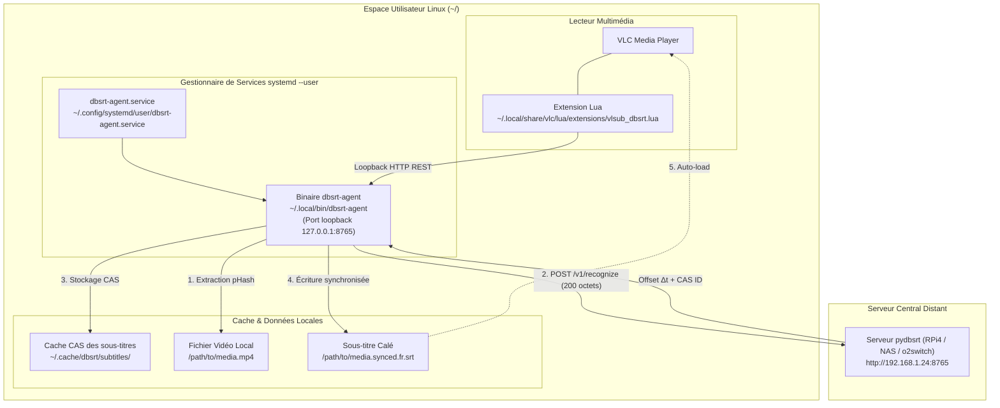

# Tutoriel : Installation & Administration du Client VLC et Service systemd

> [!NOTE] Objectif
> Ce tutoriel opérationnel guide pas à pas l'installation, l'utilisation quotidienne et l'administration de l'environnement client complet : le lecteur VLC avec son extension `vlsub_dbsrt.lua` et le daemon sidecar local `dbsrt-agent` exécuté en arrière-plan permanent via `systemd --user`.

---

## 1. Vue d'Ensemble & Architecture Locale

L'environnement client s'exécute entièrement dans l'espace utilisateur standard (**zéro droit root / zéro `sudo`**) :



---

## 2. Prérequis

* Un système Linux basé sur Debian / Ubuntu (ou toute distribution moderne avec `systemd`).
* Le lecteur VLC installé (`sudo apt install vlc` ou paquet natif).
* L'URL réseau du serveur central `dbsrt-server` (ex: `http://192.168.1.24:8765` sur votre LAN, ou une URL Cloud/o2switch).

---

## 3. Installation en Une Commande

L'installation orchestre la compilation release, le déploiement des binaires dans `~/.local/bin`, l'installation du plugin VLC et la configuration du service permanent :

```bash
# Pointer vers l'adresse de votre serveur distant (ex: RPi4)
task client:linux:install -- http://192.168.1.24:8765
```

### Ce que réalise cette commande :

1. Compile le binaire optimisé `./target/release/dbsrt-server` si nécessaire.
2. Installe l'exécutable dans `~/.local/bin/dbsrt-agent`.
3. Installe l'extension Lua dans `~/.local/share/vlc/lua/extensions/vlsub_dbsrt.lua`.
4. Génère l'unité systemd utilisateur dans `~/.config/systemd/user/dbsrt-agent.service`.
5. Active (`enable`) et démarre (`start`) le service automatiquement en tâche de fond.
6. Valide la bonne santé du démon via `http://127.0.0.1:8765/v1/health`.

---

## 4. Administration & Pilotage du Service

Toutes les opérations d'administration quotidienne sont encapsulées dans des commandes `task` déclaratives :

### 4.1 Vérifier l'État du Service

```bash
task client:linux:status
```

*Affiche le statut systemd (PID, uptime, empreinte mémoire ~1.2 Mo, CPU) ainsi que le statut JSON de l'API locale.*

### 4.2 Suivre les Logs en Direct

```bash
task client:linux:logs
```

*Permet d'observer en temps réel les requêtes de recherche transmises par VLC et les allers-retours avec le serveur distant.*

### 4.3 Démarrer, Arrêter ou Redémarrer

```bash
# Arrêter le service
task client:linux:stop

# Démarrer le service
task client:linux:start

# Redémarrer le service
task client:linux:restart
```

---

## 5. Utilisation dans VLC Media Player

1. Lancez la lecture de votre vidéo dans VLC.
2. Ouvrez le menu : **Vue** $\to$ **VLsub (dbsrt)**.
3. Cliquez sur **Search by pHash** :
   * L'agent local extrait 5 trames pHash (~10 ms à 400 ms selon l'accélération matérielle).
   * L'agent relaie la signature de 200 octets vers votre serveur central distant.
   * La liste affiche les candidats trouvés avec la mention du décalage (ex: `[Synced -1754.5s]` s'il s'agit d'un extrait/cut).
4. Sélectionnez le sous-titre désiré et cliquez sur **Download selection** :
   * Le fichier `.srt` est téléchargé depuis le serveur central via son identifiant CAS `sub:sha256:<hash>`.
   * Le décalage temporel $\Delta t$ est appliqué automatiquement en mémoire.
   * Le fichier synchronisé est sauvegardé à côté de votre vidéo (`video.synced.fr.srt`).
   * VLC attache et affiche immédiatement le sous-titre sur la vidéo active.

---

## 6. Reconfiguration du Serveur Distant

Pour rediriger l'agent local vers un autre serveur (par exemple pour basculer du Raspberry Pi local vers une instance hébergée sur o2switch) :

```bash
task client:linux:install -- https://api.dbsrt.mondomaine.fr
```

*L'unité de service est automatiquement mise à jour et rechargée sans aucune manipulation manuelle de fichiers.*

---

## 7. Désinstallation Complète et Propre

Pour supprimer intégralement le service, l'agent et le plugin VLC :

```bash
task client:linux:uninstall
```

### Actions exécutées :

* Arrêt immédiat de l'unité `dbsrt-agent.service`.
* Désactivation du démarrage automatique.
* Suppression de `~/.config/systemd/user/dbsrt-agent.service`.
* Suppression du binaire `~/.local/bin/dbsrt-agent`.
* Suppression du plugin `~/.local/share/vlc/lua/extensions/vlsub_dbsrt.lua`.
* Zéro trace ni résidu orphelin sur la machine.
