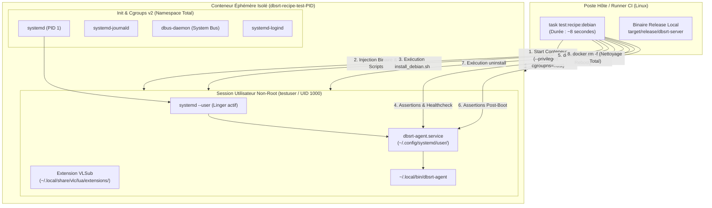

# Stratégie de Test d'Infrastructure & Recettes systemd Hermétiques

> [!IMPORTANT] Problématique & Risque Opérationnel
> Tester un script d'installation système (`systemctl --user enable --now`, création d'unités systemd, copies de binaires dans `~/.local/bin`) directement sur son poste de travail ou sur un serveur de développement est un **anti-pattern critique**.
>
> * **Pollution persistante** : un service activé au boot (`WantedBy=default.target`) survit aux redémarrages de la machine hôte et peut monopoliser silencieusement des ports réseau stratégiques (ex: `8765`), causant des collisions en cascade avec d'autres services locaux.
> * **Effet de bord masqué** : l'absence de purge ou une désinstallation incomplète laisse des états mutables orphelins (fichiers de sockets, caches, descriptors JSON).
> * **Angle mort des tests unitaires** : `cargo test` et `pytest` mockent les sockets et ignorent complètement le cycle de vie de `systemd`, PAM, DBus et les permissions filesystem réelles de l'OS.

---

## 1. Philosophie & Valeur Ajoutée

Pour éliminer le mode "en aveugle" sans avoir à déployer des machines virtuelles lourdes (KVM/VirtualBox) ni attendre un plantage sur le poste utilisateur, `pydbsrt` intègre une **suite de tests d'infrastructure hermétique et éphémère**.



### Bénéfices & ROI Technique

| Axe | Approche Manuelle sur l'Hôte (Avant) | Approche Hermétique Docker systemd (Actuelle) |
| :--- | :--- | :--- |
| **Isolation** | ❌ Pollue l'environnement utilisateur local | ✅ **100% Hermétique** (détruit immédiatement via `trap EXIT`) |
| **Persistance Boot** | ❌ Détecté par surprise au reboot suivant | ✅ **Éprouvé en 2 secondes** via simulation `docker restart` |
| **Désinstallation** | ❌ Jamais testée ou testée à la main | ✅ **Vérification automatique** de suppression des binaires et unités |
| **Temps d'Exécution** | Plusieurs minutes manuelles | **~8 secondes** de bout en bout |
| **Reproductibilité CI** | Impossible sur GitHub Actions standard | ✅ **Exécutable sur runner Ubuntu standard** sans VM dédiée |

---

## 2. Architecture Technique de l'Environnement de Test

L'environnement repose sur deux composants complémentaires :

### 2.1 L'Image Docker Minimaliste (`docker/Dockerfile.test-debian-systemd`)

Cette image dérive de `debian:bookworm-slim` et installe uniquement le strict nécessaire pour émuler un système d'exploitation complet avec session utilisateur :

* **`systemd` & `systemd-sysv`** : pour fournir `/sbin/init` en PID 1.
* **`dbus` & `libpam-systemd`** : pour la gestion des sessions utilisateur et la communication inter-processus via socket DBus.
* **Linger utilisateur pré-configuré** (`/var/lib/systemd/linger/testuser`) : permet au gestionnaire `systemd --user` de démarrer automatiquement sans session graphique X11/Wayland interactive.
* **Masquage des services inutiles** : suppression de `getty.target`, `udevd` et `firstboot` pour un boot conteneur instantané (< 1s).

### 2.2 L'Orchestrateur de Test (`scripts/test_recipe_debian.sh`)

Le script de test pilote le cycle de vie du conteneur selon 7 étapes séquentielles strictes avec sortie colorée et assertions explicites :

```bash
task test:recipe:debian
# Alias : task test:install:recipe
```

#### Étape 1 : Construction / Validation de l'Image
Vérifie la présence locale de `dbsrt-test-debian:latest` ou la compile à chaud en quelques secondes.

#### Étape 2 : Démarrage du Conteneur avec Cgroups v2
Lance le conteneur avec `--privileged --cgroupns=host -v /sys/fs/cgroup:/sys/fs/cgroup:rw --tmpfs /run --tmpfs /run/lock`. Ce montage permet à systemd d'initialiser ses hiérarchies de cgroups sans conflit avec le moteur Docker de l'hôte.

#### Étape 3 : Injection des Artefacts
Injecte le binaire compilé `dbsrt-server` (renommé en agent client), le plugin Lua `vlsub_dbsrt.lua` et le script de déploiement `scripts/install_debian.sh` dans le home de l'utilisateur `testuser`.

#### Étape 4 : Exécution de la Recette d'Installation
Exécute `./scripts/install_debian.sh install` sous les variables d'environnement utilisateur :
```bash
XDG_RUNTIME_DIR=/run/user/1000
DBUS_SESSION_BUS_ADDRESS=unix:path=/run/user/1000/bus
```

#### Étape 5 : Assertions de Santé & API
1. Vérification que l'unité est active : `systemctl --user is-active dbsrt-agent.service` renvoie `active`.
2. Vérification que l'endpoint HTTP répond : `GET http://127.0.0.1:8765/v1/health` renvoie HTTP 200 `{ "status": "ok" }`.

#### Étape 6 : Simulation de Reboot Machine
Exécute `docker restart <container>` pour simuler une coupure de courant ou un redémarrage de la machine hôte. À l'issue du redémarrage, le test vérifie que le démon `systemd --user` s'est relancé et que `dbsrt-agent.service` est de nouveau en état `active`.

#### Étape 7 : Test de Désinstallation Propre
Exécute `./scripts/install_debian.sh uninstall` et vérifie :

* Que le service est arrêté et désactivé.
* Que le fichier d'unité `dbsrt-agent.service` a été supprimé.
* Que le binaire `~/.local/bin/dbsrt-agent` a été effacé.
* Que l'extension VLC a été purgée.

#### Étape 8 : Nettoyage Automatique
Le handler Bash `trap cleanup EXIT INT TERM` garantit la destruction immédiate du conteneur Docker même en cas d'échec ou d'interruption manuelle (`Ctrl+C`).

---

## 3. Registre des Défaillances Détectées & Leçons Apprises

L'introduction de ce banc d'essai hermétique a permis de résoudre deux anomalies réelles :

### Cas Limite #1 : Le Piège du Linger et de la Persistance Boot
* **Symptôme initial** : L'installation de l'agent sur la machine de dev avait persisté au boot, monopolisant le port `8765` et forçant le serveur local de dev à basculer sur `8766`.
* **Résolution** : La recette de déploiement client ne doit jamais être exécutée directement sur l'environnement de développement. Elle est validée via `task test:recipe:debian`, et les instructions du tutoriel rappellent explicitement la commande de désactivation (`systemctl --user disable dbsrt-agent`).

### Cas Limite #2 : La Faiblesse du Service Discovery via Fichier Statique `/tmp`
* **Constat** : Le fichier historique `/tmp/dbsrt-server.json` (utilisé par le plugin Lua de VLC) est un point de collision global sur le filesystem en cas de processus multiples (serveur local vs agent client).
* **Règle de gouvernance** : Les outils d'administration et de supervision (`stack_ctl.sh status`) ne doivent jamais masquer un conflit de port en suivant aveuglément un fichier temporaire. Si le port de dev attendu (`8765`) est occupé par un service tiers, le script doit émettre une alerte de conflit explicite plutôt que de simuler une situation nominale sur un port de repli.
