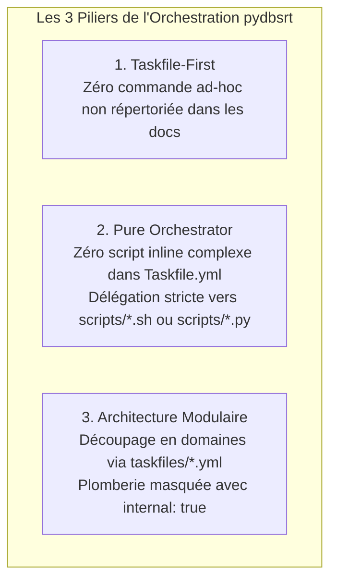
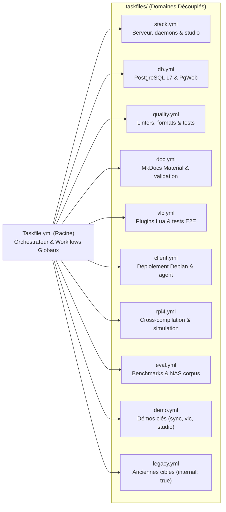
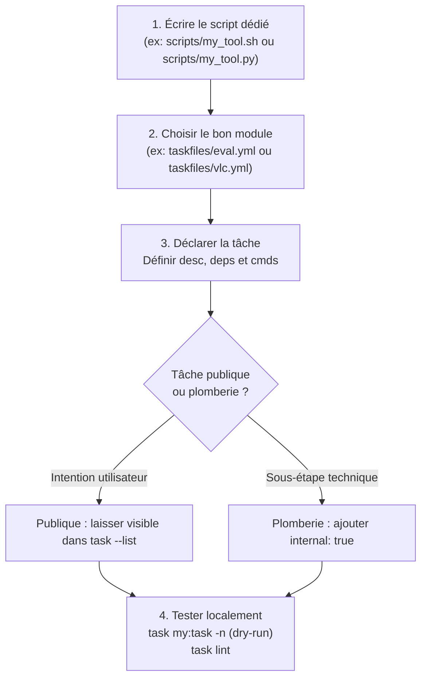

# Tutoriel : Maîtriser l'Orchestrateur Taskfile & Guide Développeur

> [!NOTE] Objectif du Tutoriel
> Ce tutoriel opérationnel guide pas à pas tout contributeur ou développeur abordant `pydbsrt`. Il explique la philosophie d'ordonnancement via **Taskfile**, la structure modulaire par domaine sous `taskfiles/`, les commandes clés à connaître pour le quotidien (boot, lint, tests, doc), et la méthode pas à pas pour créer une nouvelle tâche respectant les standards du dépôt.

---

## 1. Pourquoi Taskfile ? (Philosophie & Règles d'Or)

Historiquement, le dépôt s'appuyait sur un `Makefile` monolithique conçu pour un prototype Python sous Docker en 2021. Avec la refonte vers Rust (`dbsrt-rs`), PostgreSQL 17 SP-GiST, Axum, Lua et uv, ce modèle est devenu obsolète.

`pydbsrt` a adopté **[Taskfile (go-task)](https://taskfile.dev/)** avec trois règles fondamentales :



1. **Taskfile-First** : Toute commande récurrente (build, formatage, validation, stack dev, benchmark, démo) **doit** être déclarée dans un Taskfile et invoquée via `task <nom>`.
2. **Pure Orchestrator (Zéro logique inline)** : Les Taskfiles sont purement déclaratifs. Ils déclarent des dépendances (`deps`), des variables et délèguent l'exécution à des scripts dédiés sous `scripts/` ou à des binaires natifs (`cargo`, `uv`). Aucun script multi-lignes, gestion de PID ou boucle n'est toléré dans un fichier `.yml`.
3. **Ergonomie Développeur (DX)** : `task --list` ne doit afficher que les commandes d'intention utilisateur (~50 tâches), en masquant les sous-étapes techniques grâce à la directive `internal: true`.

---

## 2. Architecture Modulaire : Le Dossier `taskfiles/`

Le fichier racine `Taskfile.yml` est un orchestrateur épuré (< 90 lignes). Il intègre les sous-domaines via les `includes` natifs avec aplatissement (`flatten: true`) :



### Rôle de chaque module

| Module | Fichier | Rôle & Commandes Principales |
| :--- | :--- | :--- |
| **Stack & Serveur** | `taskfiles/stack.yml` | `task studio`, `task server:status`, `task coupling:certify` |
| **Base de Données** | `taskfiles/db.yml` | `task db:up`, `task db:down`, `task db:logs`, `task db:psql` |
| **Documentation** | `taskfiles/doc.yml` | `task doc` (serveur live), `task doc:check`, `task doc:build` |
| **Qualité & Tests** | `taskfiles/quality.yml` | `task lint`, `task fmt`, `task test:rs`, `task coverage`, `task ci:local` |
| **Lecteur VLC** | `taskfiles/vlc.yml` | `task vlc:install-plugin`, `task vlc:run`, `task vlc:demo`, `task vlc:test` |
| **Client Linux** | `taskfiles/client.yml` | `task client:linux:install`, `task test:recipe:debian` |
| **Raspberry Pi 4** | `taskfiles/rpi4.yml` | `task rpi4:build`, `task rpi4:up`, `task rpi4:sync`, `task sim:rpi4:up` |
| **Évaluations** | `taskfiles/eval.yml` | `task eval:nas`, `task bench:mmap-scale`, `task bench:cuts-scale` |
| **Démos Modernes** | `taskfiles/demo.yml` | `task demo:sync` (recalage Rust), `task demo:vlc`, `task demo:studio` |
| **Archives Legacy** | `taskfiles/legacy.yml` | Anciennes cibles Docker 2021 masquées (`internal: true`) |

---

## 3. Les 4 Workflows Quotidiens du Développeur

### Workflow 1 : Démarrage & Supervision de la Stack (`task dev`)

Pour démarrer l'ensemble des services en un seul appel :

```bash
# 1. Démarrer toute la stack (Postgres + PgWeb + Rust Server + MkDocs + VLC plugins)
task dev
# (ou son alias : task up)

# Astuce multi-projets : si le port 8086 est déjà réservé par vos conteneurs pros :
PGWEB_PORT=8088 task dev

# 2. Consulter le tableau de bord de santé unifié
task status

# 3. Éteindre proprement la stack (arrête conteneurs et démons background)
task down
```

`task status` interroge le port `8765`, vérifie la connectivité PostgreSQL, affiche la volumétrie des trames indexées, et émet un avertissement immédiat en cas de collision de port.

---

### Workflow 2 : Cycle de Développement & Validation Qualité

Avant chaque commit ou ouverture de PR, exécuter la suite de contrôles :

```bash
# 1. Formater automatiquement le code (Rust, Python, Shell, Lua)
task fmt

# 2. Exécuter l'ensemble des 9 linters (Ruff, Pyright, Clippy, Shellcheck, Yamllint...)
task lint

# 3. Lancer la suite complète de tests Rust
task test:rs

# 4. Reproduction CI locale complète (<10s chrono)
task ci:local
```

> [!TIP] Pré-commit automatisé
> Pour activer la vérification systématique avant chaque `git commit` :
> ```bash
> uv run pre-commit install
> # Pour tester manuellement sur tous les fichiers :
> task pre-commit
> ```

---

### Workflow 3 : Rédaction & Contrôle de la Documentation

Le projet utilise **Material for MkDocs** avec un validateur strict d'intégrité (vérification des liens relatifs, de la syntaxe LaTeX, des listes tassées et du rendu MathJax vectoriel sous Chrome Headless) :

```bash
# 1. Lancer le serveur local de doc avec rechargement à chaud
task doc
# Accessible sur http://127.0.0.1:8000/

# 2. Valider l'intégrité stricte de la documentation (zéro erreur tolérée)
task doc:check

# 3. Compiler le site statique dans site/
task doc:build
```

---

### Workflow 4 : Tests d'Infrastructure & Recettes de Déploiement

Pour valider l'installation de l'agent client `dbsrt-agent` et de son unité `systemd --user` sans jamais polluer votre machine hôte :

```bash
# Lance le banc de test hermétique en conteneur Docker cgroups v2 avec vrai systemd
task test:recipe:debian
```

Ce test vérifie l'installation, le healthcheck HTTP, la survie au redémarrage (`docker restart`), et la désinstallation propre en **~8 secondes**.

---

## 4. Guide Pratique : Ajouter une Nouvelle Tâche Proprement

Lorsque vous implémentez une nouvelle fonctionnalité ou un nouveau script, suivez cette checklist :



### Exemple Concret : Déclarer une Tâche dans `taskfiles/eval.yml`

```yaml
version: '3'

tasks:
  eval:subtitles:quality:
    desc: Évaluer la précision temporelle du calage pHash sur les sous-titres FR
    deps: [build, db:up]
    cmds:
      - uv run python scripts/eval_subtitles_quality.py {{.CLI_ARGS}}
```

### Règles de Style & Anti-Patterns à Éviter

| À Faire (Best Practices) | STRICTEMENT INTERDIT (Anti-Patterns) |
| :--- | :--- |
| ✅ Déléguer l'exécution à un script dans `scripts/` | ❌ Scripts multi-lignes ou heredocs (`<<EOF`) inline dans le YAML |
| ✅ Utiliser des constantes nommées et déclarées | ❌ Valeurs magiques codées en dur (timeouts, ports non variables) |
| ✅ Marquer les sous-étapes avec `internal: true` | ❌ Laisser polluer `task --list` par des micro-tâches techniques |
| ✅ Utiliser des chemins relatifs (`data/`, `tests/`) | ❌ Chemins absolus machine (`/home/...`) ou `file://` dans le Taskfile |
