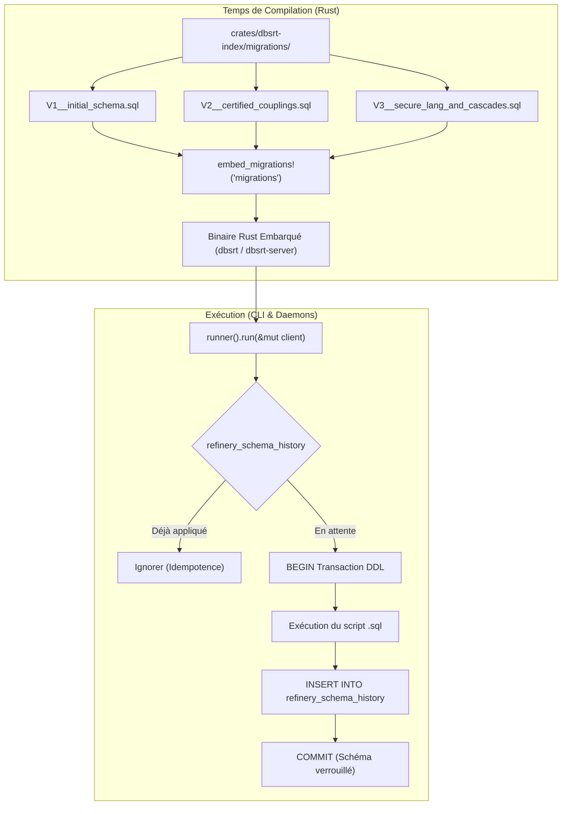

# Guide & Architecture des Migrations PostgreSQL avec Refinery (`dbsrt migrate`)

> **Statut :** Validé & Empiriquement Éprouvé (PostgreSQL 17 & PostgreSQL 15.2 ARM64)
> **Composants :** `crates/dbsrt-index` (runner embarqué), `crates/dbsrt-cli` (`dbsrt migrate`), `taskfiles/db.yml`
> **Référence :** Issues #13 & #16, PR #15
> **Date :** 23 Octobre 2026

---

## 1. Contexte & Problématique Résolue

Avant l'intégration de [Refinery](https://github.com/rust-db/refinery), les définitions de schéma PostgreSQL reposaient sur du code DDL exécuté impérativement via `client.batch_execute(SCHEMA_DDL)` lors de l'instanciation de `DbClient::connect(...)`. Cette approche présentait plusieurs limites critiques :

1. **Deadlocks sous Concurrence de Tests (`cargo test`)** :
   Lorsque plusieurs tests unitaires s'exécutaient en parallèle sur la base de données de test, chacun tentait d'exécuter des instructions `CREATE TABLE IF NOT EXISTS` ou `ALTER TABLE` simultanément. PostgreSQL générait alors des contentions de verrouillage `AccessExclusiveLock` vs `RowShareLock` menant à des blocages (`deadlock detected`).
2. **Absence de Suivi des Versions & Dérives de Schéma** :
   Impossible de déterminer formellement quel schéma était appliqué sur une instance donnée (ex: PostgreSQL 17 Docker local vs PostgreSQL 15.2 physique ARM64 sur Raspberry Pi 4).
3. **Évolution Non Atomique des Schémas** :
   Les modifications structurelles (telles que le refactoring de la colonne `lang` dans l'Issue #13) nécessitaient des scripts shell ad-hoc ou des clauses conditionnelles complexes et fragiles.

---

## 2. Architecture Technique

Refinery apporte un système de migrations versionnées déclaratives (`V1`, `V2`, `V3`, etc.) compilées directement dans le binaire Rust via la macro `embed_migrations!`.



### Avantages Majeurs
- **Zéro Dépendance Externe au Déploiement** : Les scripts SQL font partie intégrante du binaire compilé (`dbsrt` ou `dbsrt-server`). Aucun dossier de scripts SQL n'a besoin d'être transféré sur les nœuds distants (comme le Raspberry Pi 4).
- **Transactions DDL Natives** : PostgreSQL supporte les modifications de schéma dans des transactions. Si une migration échoue au milieu d'un script, un `ROLLBACK` total est effectué sans laisser la base dans un état corrompu.
- **Idempotence & Concurrence Protégée** : Refinery utilise un advisory lock et sa table interne `refinery_schema_history` pour garantir qu'une migration ne s'exécute qu'une seule et unique fois.

---

## 3. Structure des Migrations dans le Repository

Toutes les migrations résident dans `crates/dbsrt-index/migrations/` et suivent la convention stricte `V{version}__{description}.sql` :

```text
crates/dbsrt-index/migrations/
├── V1__initial_schema.sql
├── V2__certified_couplings.sql
└── V3__secure_lang_and_cascades.sql
```

### Détail des Versions Actuelles

| Version | Fichier | Description & Contenu |
| :--- | :--- | :--- |
| **V1** | `V1__initial_schema.sql` | Création de la table `medias`, de la table `frames`, et de l'index SP-GiST BK-Tree sur l'empreinte `phash bigint`. |
| **V2** | `V2__certified_couplings.sql` | Création de la table `subtitles` et `sub_frames` pour les couplages de sous-titres certifiés. |
| **V3** | `V3__secure_lang_and_cascades.sql` | Refactoring de sécurité (Issue #13) : migration de `lang` vers `TEXT`, contraintes d'intégrité, suppression d'anciens types ENUM legacy. |

---

## 4. Cas d'Usage Concret : Issue #13 (`V3__secure_lang_and_cascades.sql`)

Dans l'Issue #13, la colonne `lang` de la table `subtitles` devait être assainie et découplée des contraintes ENUM legacy pour accepter tout code ISO 639-1, ISO 639-2 ou BCP 47 validé par `validate_lang_code`.

Le script `V3__secure_lang_and_cascades.sql` illustre l'idempotence et la robustesse requises :

```sql
-- Migration V3: Sécurisation du code de langue et harmonisation des contraintes
DO $$
BEGIN
    IF EXISTS (
        SELECT 1 FROM information_schema.columns
        WHERE table_name = 'subtitles' AND column_name = 'lang' AND data_type != 'text'
    ) THEN
        ALTER TABLE subtitles ALTER COLUMN lang TYPE TEXT USING lang::text;
    END IF;
END $$;

ALTER TABLE subtitles ALTER COLUMN lang SET DEFAULT 'FR';

-- Élimination idempotente de contraintes obsolètes
DO $$
BEGIN
    IF EXISTS (SELECT 1 FROM pg_constraint WHERE conname = 'subtitles_media_hash_key') THEN
        ALTER TABLE subtitles DROP CONSTRAINT subtitles_media_hash_key;
    END IF;
    IF NOT EXISTS (SELECT 1 FROM pg_constraint WHERE conname = 'subtitles_media_hash_lang_srt_hash_key') THEN
        ALTER TABLE subtitles ADD CONSTRAINT subtitles_media_hash_lang_srt_hash_key UNIQUE(media_hash, lang, srt_hash);
    END IF;
END $$;
```

Grâce à Refinery, cette migration s'exécute de façon atomique sans nécessiter de maintenance manuelle sur les bases PostgreSQL 17 locales ou PostgreSQL 15.2 distantes.

---

## 5. Guide d'Utilisation : Commandes CLI & Taskfile

### Vérifier l'État des Migrations

Pour inspecter l'historique des migrations appliquées sur une instance :

```bash
# Via Taskfile (cible PostgreSQL 17 dev local)
task db:status

# Via binaire direct dbsrt
./target/release/dbsrt migrate --status

# Cibler une machine distante (ex: Raspberry Pi 4 physique)
task db:status -- --host 192.168.1.24 --port 5432
```

Exemple de sortie :
```text
=== PostgreSQL Migration Status ===
Target Database: 127.0.0.1:5433 (bktreedb)
  [V1] initial schema (applied on 2026-10-23 06:14:02 UTC)
  [V2] certified couplings (applied on 2026-10-23 06:14:02 UTC)
  [V3] secure lang and cascades (applied on 2026-10-23 06:14:02 UTC)
```

### Appliquer les Migrations en Attente

```bash
# Via Taskfile
task db:migrate

# Via binaire direct
./target/release/dbsrt migrate

# Cibler une machine distante
task db:migrate -- --host 192.168.1.24 --port 5432
```

Exemple de sortie nominale :
```text
Applying pending refinery migrations on 127.0.0.1:5433...
✓ Database schema is already up to date. (0 migrations applied)
```

---

## 6. Règles & Bonnes Pratiques pour l'Écriture de Nouvelles Migrations

Lors de l'ajout d'une nouvelle évolution de schéma :

1. **Créer un Nouveau Fichier Horodaté / Numéroté** :
   - Fichier : `crates/dbsrt-index/migrations/V{N}__{nom_descriptif}.sql`
   - La numérotation `N` doit être strictement séquentielle (`V4`, `V5`, ...).
2. **Immutabilité des Migrations Déjà Appliquées** :
   - Ne **JAMAIS** modifier un fichier de migration déjà appliqué en production ou dans la branche principale. Refinery valide les checksums et lèvera une erreur en cas d'altération d'un script historique.
3. **Stratégie de Rollback (Forward-Fix)** :
   - En conformité avec les architectures modernes de migration distribuée, les annulations s'effectuent par "Forward-Fix" : pour annuler une modification de `V4`, créer une migration `V5__revert_...sql`.
4. **Idempotence des Scripts DDL** :
   - Préférer systématiquement `CREATE TABLE IF NOT EXISTS`, `DROP INDEX IF EXISTS`, et des blocs `DO $$ ... $$` pour les altérations conditionnelles de colonnes et contraintes.
5. **Validation Multi-Plateforme** :
   - Toujours tester les migrations sur PostgreSQL 17 (local) ET PostgreSQL 15.2 (Raspberry Pi 4) via `cargo test -p dbsrt-index` avant de soumettre une PR.
