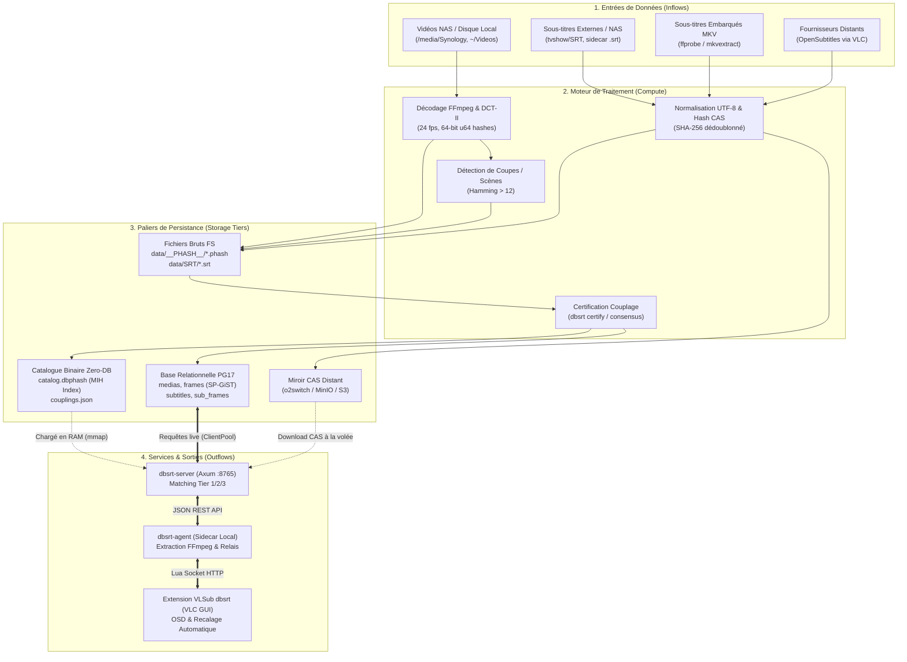
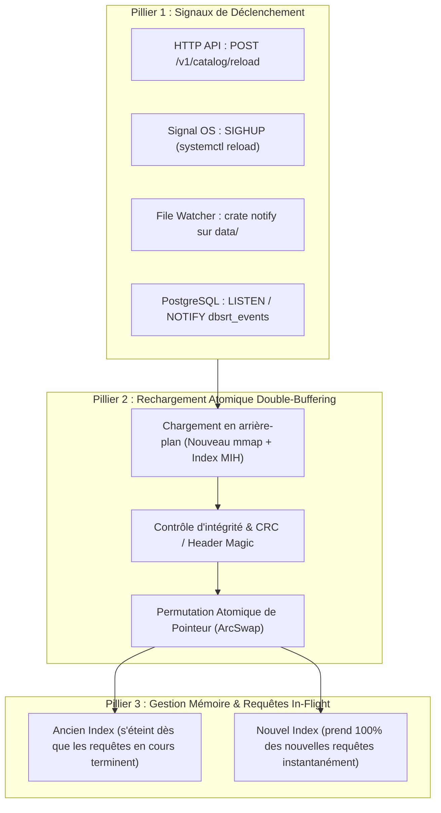

# Architecture : Cycle de Vie des Données, Flux E/S et Rechargement à Chaud (Zero-Downtime)

Ce document formalise les flux d'entrées/sorties (E/S) de données à travers l'écosystème `pydbsrt`, analyse la rupture de conception relative au catalogue statique Zero-DB, et spécifie l'architecture cible de **rechargement et d'ingestion à chaud sans interruption de service** (*Zero-Downtime Hot Updates*).

---

## 1. Cartographie Exhaustive des Flux de Données (I/O)

Le système manipule 4 types d'entités primaires :

1. **Flux Vidéo Brut** (MKV, MP4, AVI sur NAS ou disque local).
2. **Empreintes Perceptuelles pHash & Points de Coupe** (flux 64-bit DCT-II trame par trame + cuts de scènes).
3. **Sous-Titres & CAS** (fichiers SRT/VTT/ASS, hash SHA-256 de contenu).
4. **Couplages Certifiés Ground-Truth** (alignement relationnel certifié entre une empreinte vidéo et un sous-titre).



---

## 2. Analyse Critique de l'Architecture Existante

### 2.1 La Dichotomie Actuelle

| Palier de Stockage | Ingestion / Écriture | Lecture au Runtime | Comportement lors d'un Ajout/Modif |
| :--- | :--- | :--- | :--- |
| **PostgreSQL 17 (Tier 3)** | Dynamique (`INSERT`, `COPY`) | Requêtes SQL dynamiques par requête | **100% à chaud** : nouveau média immédiatement visible sans redémarrage. |
| **Fichiers SRT bruts (`data/SRT`)** | Écriture fichier | `std::fs::read_dir()` par requête | **100% à chaud** : nouveau sous-titre immédiatement trouvable par nom. |
| **Catalogue Zero-DB (`catalog.dbphash` - Tier 1)** | Compilation statique (`dbsrt pack`) | Memory-mapped OS (`mmap`) au boot | **Statique / Bloquant** : le `mmap` ne voit pas les nouveaux octets ; l'index MIH en RAM n'est pas réévalué. |
| **Registre (`couplings.json`)** | Sérialisation JSON | Désérialisation en RAM au boot | **Statique / Bloquant** : la RAM (`AppState.coupling_registry`) n'est pas rechargée automatiquement. |

### 2.2 Problème Identifié

Lors de la synchronisation d'un nouveau catalogue vers une appliance distante (ex: `task rpi4:sync` vers le Raspberry Pi 4 ou futur serveur o2switch) :

- Les fichiers `catalog.dbphash` et `couplings.json` sont mis à jour sur le disque via `rsync`.
- Mais le serveur Axum `dbsrt-server` continue de tourner avec ses anciens descripteurs mémoire (`mmap` et `Arc<RwLock<CouplingRegistry>>`).
- **Pire** : si la taille du fichier `catalog.dbphash` change alors qu'un mmap actif le lit sans coordination, l'OS peut émettre un signal fatal `SIGBUS`.
- La procédure de contournement consistait à faire `task rpi4:up` (recréation/redémarrage du conteneur Docker), ce qui **coupe le service pendant plusieurs secondes**.

Dans une architecture de production et d'appliance 24/7, **cette coupure est inacceptable**.

---

## 3. Scénarios Métier d'Entrée / Sortie

### Scénario 1 : Ingestion d'un nouveau film ou épisode sur le NAS
1. **Événement** : Un fichier `The_Last_of_Us_S02E01.mkv` arrive sur `/media/latty/Synology/tvshow/`.
2. **Extraction** : Le poste de dev calcule l'empreinte pHash complète (24 fps) + détection des cuts.
3. **Persistance locale** :
   - Fichier brut : `data/__PHASH__/The_Last_of_Us_S02E01.phash`
   - Si DB active : `INSERT INTO medias ...; INSERT INTO frames ...`
4. **Besoin de synchronisation** :
   - Comment l'appliance RPi4 apprend-elle l'existence de cet épisode sans redémarrer ?

### Scénario 2 : Ajout ou correction d'un sous-titre
1. **Événement** : Un sous-titre amélioré `The_Last_of_Us_S02E01.fr.srt` est déposé.
2. **Certification** : `task coupling:certify` calcule le décalage référence et écrit dans `couplings.json` + table `subtitles` / `sub_frames`.
3. **Besoin de synchronisation** :
   - L'extension VLC doit immédiatement pouvoir proposer ce sous-titre certifié sans redémarrage démon.

### Scénario 3 : Suppression ou purge d'un média erroné
1. **Événement** : Un encodage tronqué ou défectueux doit être révoqué.
2. **Besoin** : Éviction atomique des tables en RAM et des index sans état corrompu.

---

## 4. Architecture Cible : Rechargement et Ingestion à Chaud (Zero-Downtime)

Pour résoudre ce problème sans dégrader les performances sub-millisecondes du Tier 1 (MIH), nous définissons une architecture à **trois piliers** :



### 4.1 Pilier 1 : Permutation Atomique de Catalogue (ArcSwap / Double-Buffering)

Au lieu de conserver un `Option<Arc<MmapDbphash>>` statique dans `AppState`, le lecteur est enveloppé dans un pointeur atomique réassignable sans verrouillage bloquant pour les lecteurs :

- Utilisation de la crate `arc-swap` (ou `Arc<parking_lot::RwLock<Option<Arc<MmapDbphash>>>>`).
- **Protocole de mise à jour** :

    1. Le thread de mise à jour ouvre le nouveau fichier `catalog.dbphash` dans une **instance indépendante** de `MmapDbphash`.
    2. Il pré-calcule les tables de hachage MIH (`sparse_mih`, `cuts_mih`) en arrière-plan.
    3. Il recharge le registre `couplings.json` en mémoire.
    4. Dès que la nouvelle instance est prête et validée, il effectue un **swap atomique du pointeur** (`arc_swap.store(...)`).
    5. Les requêtes en cours qui lisaient l'ancien index terminent normalement (conservation par comptage de références `Arc`).
    6. Dès que la dernière requête en vol est achevée, l'ancienne mémoire est libérée automatiquement par l'OS (`unmap`).

- **Temps d'interruption perçu par les clients : 0 milliseconde.**

### 4.2 Pilier 2 : Ingestion Hybride à Deux Étages (Base Immuable + Tampon Delta en RAM)

Pour éviter de re-compiler l'intégralité du fichier binaire `catalog.dbphash` (18+ Mo) à chaque nouvel épisode ajouté :

- **Étage Base (Snapshot)** : `catalog.dbphash` immuable stockant le gros corpus (ex: 800 000 trames).
- **Étage Delta (RAM)** : Un index mémoire dynamique (`DeltaIndex`) stockant les empreintes des médias récemment ajoutés au fil de l'eau.
- **Requête de recherche** :

```text
Résultats = Merge(BaseIndex.search(), DeltaIndex.search())
```

- **Compaction périodique** : Une fois par semaine (ou sur déclenchement manuel `task catalog:compact`), le Base et le Delta sont fusionnés dans un nouveau fichier `catalog.dbphash.next`, suivi d'un swap atomique.

### 4.3 Pilier 3 : Canaux de Déclenchement & Orchestration

Le serveur Axum écoutera 3 canaux d'invalidation :

1. **Endpoint REST Sécurisé** :
    - `POST /v1/catalog/reload` : Déclenche le rechargement immédiat de `catalog.dbphash` et `couplings.json`.
    - `POST /v1/catalog/ingest` : Injecte une nouvelle empreinte `.phash` directement dans le `DeltaIndex` sans toucher aux fichiers.

2. **Signal Système POSIX `SIGHUP`** :
    - Permet à `systemd` de recharger le service via `systemctl reload dbsrt-server`.

3. **Synchronisation Taskfile** :
    - La cible `task rpi4:sync` exécute :

        ```bash
        rsync -avz data/catalog.dbphash rpi4:~/dbsrt/data/
        rsync -avz data/SRT rpi4:~/dbsrt/data/
        curl -s -X POST http://${RPI_HOST}:8765/v1/catalog/reload
        ```

    - Zéro redémarrage du conteneur. Continuité de service absolue.

---

## 5. Modélisation Prédictive & Analyse d'Impact sur les Performances

Afin de garantir que l'introduction du rechargement dynamique ne dégrade pas les performances exceptionnelles du moteur pHash en RAM (Tier 1 MIH répondant en < 5 ms), nous formalisons l'analyse comparative des structures de concurrence candidates.

### 5.1 Comparatif des Mécanismes de Concurrence

| Mécanisme | Latence Lecture (par requête `/v1/search`) | Concurrence Écriture (Swap) | Risque de Starvation | Allocation Heap par Read |
| :--- | :--- | :--- | :--- | :--- |
| **Pointeur Fixe Immuable** (Actuel) | ~0.5 ns (déréférencement direct) | Impossible (Restart requis) | Aucun | 0 |
| **`std::sync::RwLock`** | ~20 - 35 ns (atomics fetch_add/sub) | Bloque toutes les lectures pendant le swap (~10-50 µs) | Oui (lecteurs peuvent affamer l'écrivain) | 0 |
| **`parking_lot::RwLock`** | ~10 - 20 ns | Bloque brièvement, writer-prioritized | Non | 0 |
| **`arc-swap::ArcSwapOption`** (Cible) | **~1 - 3 ns** (RCU / Hazard Pointer load) | **Wait-free : 0 blocage des lectures**, swap en 1 cycle d'horloge | **Aucun** | 0 |

### 5.2 Prédictions Quantitatives

1. **Surcoût sur la recherche pHash MIH** :
    - Latence nominale d'une recherche MIH (requête 15 secondes / 360 trames) : **~2 500 000 ns à 5 000 000 ns** (2.5 ms à 5.0 ms).
    - Surcoût d'un `ArcSwap::load()` : **~2 ns**.
    - Ratio d'impact sur la latence de bout en bout :

```text
2 ns / 2 500 000 ns ≈ 0.00008%
```

    - Conclusion prédictive : **Indiscernable du bruit de mesure CPU**.

2. **Impact Mémoire (RAM) lors du Double-Buffering** :
   - Taille fichier `data/catalog.dbphash` : 17.7 Mo.
   - Tables MIH construites en RAM (`sparse_mih` + `cuts_mih`) : ~10.5 Mo.
   - Empreinte en régime stable : **~28.2 Mo**.
   - Empreinte crête pendant le swap (durée ~150-250 ms) : **~56.4 Mo**.
   - Retombée immédiate à 28.2 Mo dès que les requêtes antérieures au swap sont terminées.
   - Sur Raspberry Pi 4 (4 Go/8 Go) ou conteneur Docker limité à 512 Mo, le pic temporaire reste largement en deçà des seuils de pression mémoire.

3. **Garantie de Zéro Downtime (Zéro Requête Perdue)** :
   - Le parsing du nouveau catalogue et la construction des tables MIH s'effectuent sur une instance *déconnectée* du runtime.
   - Les requêtes concurrentes en vol continuent d'accéder à l'ancien index sans aucune dégradation de débit.
   - Le swap physique de pointeur est atomique (`AtomicPtr::swap`). Aucune transition d'état invalide n'est observable.

---

## 6. Protocole de Benchmarking Empirique (Critères d'Acceptation)

Pour valider objectivement ces prédictions sur le code réel, le protocole suivant est défini :

1. **Micro-benchmark de Latence (Criterion / `bench_search_latency`)** :
   - Mesurer 10 000 itérations de recherche pHash consécutives sur `catalog.dbphash` avec pointeur fixe vs `ArcSwap`.
   - Assertion : la différence de temps médian ($p50$) et $p99$ doit être inférieure à 1 µs.
2. **Stress-Test de Concurrence & Swap à Chaud (`test_zero_downtime_hot_reload`)** :
   - Lancer un pool de 8 threads de recherche continue (100 requêtes/seconde).
   - Déclencher `POST /v1/catalog/reload` en cours de charge.
   - Vérifier qu'aucune requête ne renvoie d'erreur HTTP 500, ni de timeout, ni de divergence de résultat.
   - Mesurer le temps d'exécution du swap et la reprise immédiate des nouvelles entrées.

---

## 7. Synthèse & Feuille de Route d'Implémentation

### 7.1 Pilier 1 : Permutation Atomique de Catalogue (ArcSwap / Double-Buffering) — ✅ Implémenté
1. Dépendance `arc-swap = "1.7"` dans `crates/dbsrt-server/Cargo.toml`.
2. Refactoring de `AppState` pour héberger `dbphash_reader: Arc<ArcSwapOption<MmapDbphash>>`.
3. Validation pré-swap (contrôle magic, intégrité CRC/taille, et pré-chauffe MIH avant validation).
4. Transaction en 2 phases (Prepare-then-Commit) : aucune modification d'état en cas d'erreur de parsing/corrupt file.
5. Verrouillage anti-stampede (`reload_in_progress: Arc<AtomicBool>`) retournant `409 Conflict`.
6. Optimisation wait-free `load()` (emprunt de `Guard` sans incrément atomique de refcount Arc).
7. Endpoints HTTP `POST /v1/catalog/reload` et alias `POST /v1/reload`.
8. Écouteur de signal Unix POSIX `SIGHUP` pour rechargement daemon sans coupure (`systemctl reload dbsrt-server`).

### 7.2 Pilier 2 : Ingestion Hybride à Deux Étages (Base Immuable + Tampon Delta en RAM) — ✅ Implémenté
1. Module `dbsrt_index::delta::DeltaIndex` : stockage dynamique en mémoire vive des nouveaux médias et trames pHash.
2. Ingestion unitaire $O(1)$ (`POST /v1/catalog/ingest`) : détection automatique des cuts, échantillonnage sparse 1 fps et construction MIH RAM immédiate.
3. Recherche unifiée fusionnée (`POST /v1/recognize`) : interroge Base (.dbphash) puis Delta (RAM) et sélectionne le candidat de plus haute confiance temporelle.
4. Compaction atomique (`POST /v1/catalog/compact`) : fusionne Base + Delta vers `catalog.dbphash.tmp`, substitution atomique par rename, hot-reload sans coupure et purge du Delta.

### 7.3 Pilier 3 : Canaux de Déclenchement & Orchestration — ✅ Implémenté
1. **Endpoint REST** : `POST /v1/catalog/reload`, `POST /v1/catalog/ingest`, `POST /v1/catalog/compact`, `GET /v1/catalog/status`.
2. **Signal OS** : Signal POSIX `SIGHUP` géré nativement sous Unix.
3. **File Watcher automatique** : Scrutation continue de `data/catalog.dbphash` avec debounce de 500 ms (protection contre écritures rsync partielles).
4. **PostgreSQL LISTEN / NOTIFY** : Thread d'écoute dédié sur le bus d'événements `dbsrt_events` (canaux `catalog_reload`, `catalog_compact`).
5. **Orchestrateur Taskfile** : Cibles unifiées `task catalog:status`, `task catalog:reload`, `task catalog:compact`, `task catalog:ingest`.
3. **Étape 3** : Méthode `AppState::reload_catalog()` (asynchrone / déportée sur worker thread).
4. **Étape 4** : Handler HTTP Axum `POST /v1/catalog/reload`.
5. **Étape 5** : Benchmarks comparatifs & tests d'intégration automatisés.
