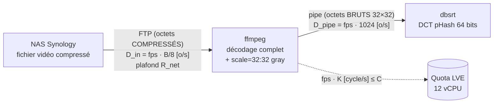

# Étude Théorique : Capacité Maximale Décodage + pHash en Streaming NAS → o2switch

> **Date** : 29 Octobre 2026 à 22:17 CET (révisée le 30/10 : définitions des métriques corrigées d'après le code de `dbsrt top`, modèle mathématique formalisé)
> **Nature** : analyse théorique (contraintes matérielles + coût algorithmique). Aucune mesure de débit/fps de la plateforme n'est utilisée, pour ne pas biaiser le modèle.
> **Question** : quels sont le fps maximal et les débits maximaux théoriques atteignables sur o2switch, en flux FTP depuis le NAS Synology, avec un code « parfait » ?
> **Complément empirique** : [Analyse Performance Décodage CPU vs Réseau (o2switch)](2026-10-28-analyse-performance-decodage-cpu-vs-reseau-o2switch.md).

---

## 1. Le pipeline et ses trois flux

Le pipeline, par job (`crates/dbsrt-core/src/video.rs`) :



Trois flux distincts traversent ce pipeline. Les confondre rend toute analyse instable :

| Métrique affichée par `dbsrt top` | Définition (vérifiée dans le code) | Dépend du média ? |
|---|---|---|
| **frame** | une image de la vidéo source, décodée en entier puis réduite à 32×32 gris = **1 024 octets fixes** dans le pipe (`RAW_FRAME_BYTES`) | non : 1 KiB, que la source soit 4K ou SD |
| **fps** | frames hachées par seconde, sommées sur les jobs actifs (`hashing_fps`, `sampler.rs:2417`) | oui : le coût de décodage d'une frame dépend du média |
| **Pipe pHash MB/s** | `fps × 1 KiB`, exactement (`read_bytes = frames × RAW_FRAME_BYTES`, `sampler.rs:2396`) | non : **redondant avec le fps**, information nulle en plus |
| **Réseau Net RX MB/s** | octets **compressés** entrants (flux FTP), mesurés sur l'interface réseau | oui : proportionnel au débit binaire du fichier |

Conséquences immédiates :

- `Pipe pHash MB/s = fps / 1024` (en MiB/s). L'affichage `0.5 MB/s (509 fps)` est cohérent par construction : $509 \times 1024 / 2^{20} = 0{,}497$.
- Le ratio `Net RX / fps` donne les **octets compressés par frame**, signature du contenu en cours (ex. $28{,}1 \text{ MiB/s} \div 509 \text{ fps} \approx 56{,}5$ KiB/frame, soit ≈ 11 Mb/s à 24 fps).
- La seule métrique stable inter-contenus pour la charge CPU serait les **Mpx/s décodés** ; fps et Net RX ne sont comparables qu'à contenu identique.

## 2. Contraintes physiques (vérifiées sur l'hôte)

| Ressource | Valeur | Rôle |
|---|---|---|
| CPU | Intel Xeon Gold 6263CY (Cascade Lake), AVX2 + AVX-512, max rapporté 3,4 GHz | moteur de décodage |
| Quota CPU LVE | 12 vCPU (1200 %) | **plafond calcul** |
| GPU / VA-API | aucun | décodage 100 % logiciel |
| RAM LVE | 48 GiB | non liant (§5) |
| nproc LVE | 400 | non liant (§5) |
| I/O LVE | 42 MiB/s, 2048 IOPS | I/O bloc uniquement (§4) |

## 3. Modèle mathématique

### 3.1 Variables, constantes, unités

Conventions d'unités : $1$ octet (o) $= 8$ bits ; $1 \text{ MiB} = 2^{20}$ o ; $1 \text{ Mb/s} = 10^6$ bit/s.

**Paramètres du média** (propriétés du fichier, pas de la plateforme) :

| Symbole | Unité | Définition | Exemples |
|---|---|---|---|
| $P$ | px/frame | pixels d'une frame source (largeur × hauteur) | 1080p : $2{,}07 \cdot 10^6$ ; 4K : $8{,}29 \cdot 10^6$ |
| $R_{bit}$ | bit/s | débit binaire du fichier (bitrate vidéo) | rip 1080p : $8 \cdot 10^6$ ; remux 4K : $60 \cdot 10^6$ |
| $f_{src}$ | frame/s | cadence native de la vidéo | 23,976 |
| $B$ | bit/frame | **bits compressés par frame** : $B = R_{bit} / f_{src}$ | de $0{,}2$ à $2{,}5$ Mbit/frame |

**Constantes du codec** (coût de décodage logiciel, ordres de grandeur de la littérature FFmpeg, précision ≈ ±50 %, non profilées sur cet hôte) :

| Symbole | Unité | Définition | Valeur |
|---|---|---|---|
| $\alpha$ | cycle/px | coût de **reconstruction** d'un pixel : prédiction inter/intra, transformée inverse, deblocking/SAO, plus la réduction 32×32 de la luma | H.264 8 bits ≈ 6 ; HEVC 10 bits ≈ 10 |
| $\beta$ | cycle/bit | coût du **décodage entropique** (CABAC) d'un bit compressé ≈ 1,3 bin/bit × 6–7 cycles/bin ; séquentiel par frame, **incompressible** | ≈ 9 |

**Paramètres de la plateforme** :

| Symbole | Unité | Définition | Valeur |
|---|---|---|---|
| $n_{vcpu}$ | — | quota CPU LVE | 12 |
| $f_{clk}$ | cycle/s | fréquence all-core turbo retenue | $3{,}3 \cdot 10^9$ |
| $e_{HT}$ | — | efficacité hyperthreading : 1 si le jumeau HT du cœur est libre, ≈ 0,6 s'il est saturé par les voisins de l'hôte mutualisé | 0,6 – 1 |
| $C$ | cycle/s | **budget de calcul total** : $C = n_{vcpu} \cdot f_{clk} \cdot e_{HT}$ | $C_{min} \approx 2{,}4 \cdot 10^{10}$ ; $C_{max} \approx 4{,}0 \cdot 10^{10}$ |
| $R_{net}$ | o/s | plafond du lien réseau NAS → o2switch (NIC 1 GbE, charge utile TCP ≈ 94,9 %) | ≈ 113 MiB/s $= 1{,}19 \cdot 10^8$ o/s |

**Sorties du modèle** :

| Symbole | Unité | Définition |
|---|---|---|
| $K$ | cycle/frame | coût CPU de production d'une frame hachée |
| $\text{fps}$ | frame/s | frames hachées par seconde, toutes vidéos confondues |
| $D_{in}$ | o/s | débit d'entrée compressé (= « Réseau Net RX ») |
| $D_{pipe}$ | o/s | débit du pipe brut (= « Pipe pHash ») |

### 3.2 Coût d'une frame

$$
K = \underbrace{\alpha \cdot P}_{\text{reconstruction (pixels)}} + \underbrace{\beta \cdot B}_{\text{entropie (bits)}} \qquad [\text{cycle/frame}]
$$

Le terme $\alpha P$ paie la géométrie de l'image (il ne dépend que de la résolution), le terme $\beta B$ paie la densité d'information (il ne dépend que du bitrate). Le plus grand des deux domine :

- rip 1080p HEVC 8 Mb/s : $\alpha P = 20{,}7$ M ≫ $\beta B = 3{,}0$ M → coût dominé par les **pixels** ;
- remux 4K HEVC 60 Mb/s : $\alpha P = 82{,}9$ M vs $\beta B = 22{,}5$ M → pixels encore, mais l'entropie pèse 21 %.

Les deux autres coûts par frame sont négligeables devant $K$ : la DCT pHash 32×32 (≈ $3 \cdot 10^4$ cycles, < 0,2 % de $C$ même à 3 000 fps) et l'écriture du pipe (1 KiB/frame).

### 3.3 Les deux bornes du fps

Le fps agrégé est plafonné indépendamment par le calcul et par le réseau ; le plus petit gagne :

$$
\text{fps}_{cpu} = \frac{C}{K} = \frac{C}{\alpha P + \beta B}
\qquad\qquad
\text{fps}_{net} = \frac{8 \, R_{net}}{B}
$$

$$
\boxed{\;\text{fps}_{max}(P, B) = \min\!\big(\text{fps}_{cpu},\; \text{fps}_{net}\big)\;}
$$

- $\text{fps}_{cpu}$ : chaque frame coûte $K$ cycles, le quota fournit $C$ cycles/s.
- $\text{fps}_{net}$ : chaque frame exige $B/8$ octets compressés, le lien fournit $R_{net}$ o/s.

```
 fps
  │
  │ ──────────────╮  fps_cpu ≈ C/(α·P)      ← plateau : les pixels dominent
  │               ·╲
  │               · ╲   fps_net = 8·R_net/B ← hyperbole réseau
  │               ·  ╲
  │               ·   ╲
  └───────────────┴──────────────►  B  [bit/frame]
                  B*
     B < B* : le CPU lie          B > B* : le réseau lie
```

### 3.4 Débits dérivés

$$
D_{in} = \text{fps} \cdot \frac{B}{8} \quad [\text{o/s}]
\qquad\qquad
D_{pipe} = \text{fps} \cdot 1024 \quad [\text{o/s}]
$$

- $D_{in}$ est le seul « débit » physique du média : il se compare à $R_{net}$.
- $D_{pipe}$ est une **tautologie** ($1024$ o/frame fixes) : il ne plafonne jamais de lui-même et ne porte aucune information que le fps n'a pas déjà.

### 3.5 Frontière des régimes

Le point $B^*$ où les deux bornes se croisent s'obtient en résolvant $\text{fps}_{cpu} = \text{fps}_{net}$ :

$$
B^* = \frac{8 \, R_{net} \cdot \alpha P}{C - 8 \, R_{net} \cdot \beta}
$$

Numériquement, à $C_{max}$ ($8 R_{net} = 9{,}48 \cdot 10^8$ bit/s, $8 R_{net} \beta = 8{,}5 \cdot 10^9$ cycle/s) :

| Profil | $\alpha P$ (cycle) | $B^*$ (bit/frame) | $R_{bit}^*$ équivalent à 23,976 fps |
|---|---|---|---|
| 4K HEVC 10 bits | $8{,}29 \cdot 10^7$ | $2{,}53$ Mbit | ≈ 61 Mb/s |
| 1080p H.264 | $1{,}24 \cdot 10^7$ | $0{,}38$ Mbit | ≈ 9 Mb/s |

Lecture : un remux 4K à 60 Mb/s est **pile sur la frontière** (CPU et réseau saturent ensemble) ; un 1080p H.264 au-delà de ≈ 9 Mb/s devient borné réseau.

### 3.6 Asymptotes

$$
B \to \infty :\;\; D_{in} \to \min\!\Big(R_{net},\; \frac{C}{8\beta}\Big) = \min(113,\; \approx 525) = R_{net}
\qquad
B \to 0 :\;\; \text{fps} \to \frac{C}{\alpha P}
$$

- **Axe débit** : le mur CABAC du CPU ($C/8\beta \approx 525$ MiB/s) est au-dessus du lien 1 GbE. Le réseau lie donc **toujours** l'axe $D_{in}$ à ≈ 113 MiB/s.
- **Axe fps** : à bitrate négligeable, le plafond est $C/\alpha P$, fixé par la seule résolution ($\approx 3\,200$ fps en 1080p H.264 à $C_{max}$, avant le terme $\beta B$ qui le ramène à ≈ 2 800 pour un fichier réel à 5 Mb/s).

### 3.7 Hypothèses du « code parfait »

La sortie doit rester bit-identique (mêmes hashes), donc le décodage complet est obligatoire : l'inter-prédiction exige les frames de référence, et H.264/HEVC n'ont pas de `-lowres`. Le modèle suppose :

- `-threads 1` par process ffmpeg (zéro synchronisation de frame-threading) ;
- au moins 12 jobs indépendants, 1200 % de CPU utilisés en continu ;
- zéro attente I/O (prefetch réseau suffisant).

## 4. Plafond réseau (NAS Synology → o2switch)

- **Lien NAS** : NIC 1 GbE (hypothèse Synology standard, non vérifiée). Charge utile TCP ≈ 1 Gb/s × 0,949 ≈ **113 MiB/s** sur Net RX, toutes connexions FTP confondues.
- **Uplink box / peering o2switch** : fibre FR souvent ≥ 700 Mb/s montant ; peut lier avant la NIC. Non vérifié.
- **TCP mono-connexion** : fenêtre autotunée ≈ 6 Mo, RTT ≈ 20 ms → ≈ 300 MB/s par connexion. Non liant.
- **I/O LVE (42 MiB/s)** : cible le cgroup blkio (lectures disque). Le flux FTP est une lecture socket, jamais écrite sur disque. Ne s'applique pas au pipeline. *Non vérifié sur cet hôte.*
- **CPU du NAS** : non liant en FTP clair ; un FTPS (TLS) sur SoC ARM plafonnerait à 50–150 MB/s. Non vérifié.

## 5. Contraintes secondaires (non liantes)

- **RAM** : DPB 4K HEVC 10 bits ≤ 16 × 8,3 Mpx × 1,5 × 2 o ≈ 0,4 GB/job ; 12 jobs ≈ 6 GB ≪ 48 GiB.
- **nproc** : ≈ 15 tâches/job en `-threads 1` ; 12 jobs ≈ 180 < 400.
- **Bande passante mémoire** : ≈ 35–40 GB/s aux plafonds du §6, sur ≈ 140 GB/s théoriques par socket (DDR4-2933, 6 canaux), partagés avec les voisins. Premier goulot secondaire possible.

## 6. Application numérique par profil

Hypothèse : source 23,976 fps ; bornes = $\min(\text{fps}_{cpu}, \text{fps}_{net})$ avec $R_{net} = 113$ MiB/s.

| Profil | $P$ | $B$ | fps max ($C_{max}$ / $C_{min}$) | $D_{in}$ (MiB/s) | $D_{pipe}$ (MiB/s) | Goulot |
|---|---|---|---|---|---|---|
| 4K HEVC 10 bits remux, 60 Mb/s | 8,29 M | 2,50 Mbit | **376 / 226** | **112 / 67** | 0,37 / 0,22 | CPU (= réseau à $C_{max}$ : $B \approx B^*$) |
| 1080p HEVC 10 bits rip, 8 Mb/s | 2,07 M | 0,33 Mbit | 1 670 / 1 000 | 66 / 40 | 1,6 / 1,0 | CPU |
| 1080p H.264 remux BD, 25 Mb/s | 2,07 M | 1,04 Mbit | 1 816 CPU → **908** réseau | **113** | 0,89 | réseau ($B > B^*$) |
| 1080p H.264 web, 5 Mb/s | 2,07 M | 0,21 Mbit | **2 770 / 1 660** | 69 / 41 | 2,7 / 1,6 | CPU |

Lecture :

- **fps ∝ 1/pixels** : à budget CPU égal, le 1080p donne ≈ 4–7× plus de fps que le 4K.
- **$D_{in}$ ∝ débit binaire** : seuls les contenus à fort débit (remux) peuvent saturer le lien 1 GbE.
- **$D_{pipe}$** suit mécaniquement le fps (÷1024) : il ne plafonne jamais de lui-même.

## 7. Hors périmètre du plafond (sortie différente)

Ces leviers dépassent les bornes ci-dessus mais **changent les hashes ou la sémantique** :

- **`-skip_loop_filter all`** : ≈ −25 % de cycles en HEVC (baisse $\alpha$), mais les hashes dérivent de la base existante.
- **`-skip_frame nokey`** : ne hache que les keyframes ; CPU quasi nul, pipeline 100 % borné réseau (113 MiB/s), fps = keyframes/s.
- **Lecture des seules plages keyframes** (MKV Cues / MP4 `stss` + FTP `REST`) : volume transféré ÷ 5–10 ; les métriques actuelles perdent leur sens.

---

## Conclusion

Hypothèses : pipeline actuel, toutes les frames hachées, sortie bit-identique, code parfait (12 vCPU saturés, `-threads 1`, ≥ 12 jobs), NAS en 1 GbE.

**La vitesse théorique maximale (asymptotique) est ≈ 2 800 fps → ≈ 2,7 MB/s de Pipe pHash**, atteinte sur un parc 1080p H.264 bas débit (le profil le moins coûteux par frame du catalogue). Le Pipe pHash vaut toujours `fps × 1 KiB` : ces deux nombres sont une seule et même mesure.

Les deux autres plafonds, sur leurs axes propres :

- **Débit d'entrée (Net RX)** : **≈ 113 MiB/s**, la limite du lien 1 GbE du NAS, atteignable uniquement sur du contenu à fort débit binaire (remux). Le plafond CPU sur cet axe ($C/8\beta \approx 525$ MiB/s) n'est jamais atteignable.
- **Contenu le plus lourd (remux 4K HEVC 10 bits)** : **≈ 375 fps → 112 MiB/s de Net RX**, point remarquable où $B \approx B^*$ : CPU et réseau saturent simultanément.

Autrement dit : **le fps plafonne entre ≈ 375 (4K) et ≈ 2 800 (1080p léger) selon le contenu, et le débit d'entrée réseau ne dépasse jamais ≈ 113 MiB/s.** Il n'existe pas de plafond unique « fps → MB/s » valable pour tout contenu : le facteur de conversion entre frames et octets compressés est $B/8$, une propriété du média (de ≈ 11 Ko à ≈ 310 Ko par frame selon le profil), pas de la plateforme.
