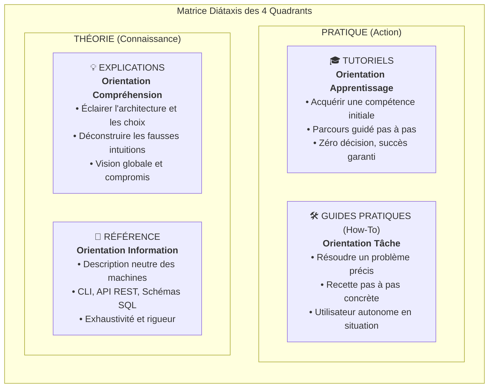
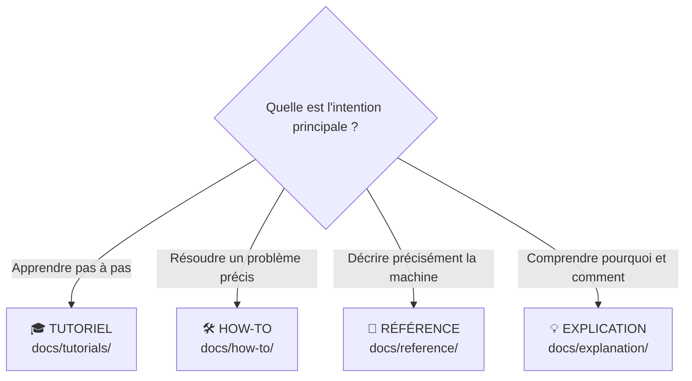

# 🧭 Cadre Documentaire Diátaxis (`pydbsrt`)

> Le projet **`pydbsrt`** applique rigoureusement la méthodologie **[Diátaxis](https://diataxis.fr/)** pour l'organisation, la rédaction et l'évolution continue de sa documentation technique. Ce cadre garantit que chaque besoin utilisateur trouve une réponse immédiatement ciblée, sans ambiguïté entre apprentissage, résolution de tâche, référence technique ou compréhension conceptuelle.

---

## 1. La Matrice des 4 Quadrants Diátaxis

La structure documentaire est organisée selon deux axes orthogonaux :

1. **L'axe Pratique vs Théorique** : orienté vers l'action concrète ou orienté vers la connaissance abstraite.
2. **L'axe Acquisition vs Application** : orienté vers l'apprentissage (pour celui qui découvre) ou orienté vers le travail effectif (pour celui qui produit).

| Quadrant | Cible & Intention | Caractéristiques de Style | Règle d'Or |
| :--- | :--- | :--- | :--- |
| **🎓 Tutoriels** | Débutant complet qui découvre le projet ou un sous-système. | Guidage linéaire, bienveillant, répétable à 100%, aucune digression théorique. | Ne jamais proposer d'alternative ou de choix : un seul chemin direct vers le succès. |
| **🛠️ Guides Pratiques (How-To)** | Praticien ou développeur ayant un objectif opérationnel concret. | Recette orientée problème, série d'étapes ciblées, contexte pratique. | Supposer que le lecteur a déjà les compétences de base ; se focaliser sur l'objectif. |
| **📖 Référence** | Développeur ou administrateur cherchant une information factuelle. | Austère, exact, exhaustif, structuré en tables ou listes de paramètres. | Zéro tutoriel, zéro explication discursive : décrire la machine telle qu'elle est. |
| **💡 Explications** | Ingénieur ou curieux cherchant à comprendre le *pourquoi* des choix. | Discursif, historique, conceptuel, analyse des compromis et modèles mathématiques. | Ne pas donner d'instructions à suivre ; offrir du recul et du discernement. |

---

## 2. Répartition Actuelle du Projet `pydbsrt`

### 🎓 1. Tutoriels (`docs/tutorials/`)
* [01. Premiers Pas & Synchronisation VLC](tutorials/01-premiers-pas-synchronisation-vlc.md) : Installer, lancer la stack et synchroniser son premier média dans VLC en 5 minutes.
* [02. Ingestion & Certification d'un Premier Média](tutorials/02-ingestion-et-certification-premier-media.md) : Extraire les empreintes pHash et certifier son premier couple vérité-terrain.
* [03. Environnement de Développement & Contribution](tutorials/03-environnement-developpement-et-contribution.md) : Configurer l'environnement complet (Rust, uv, pre-commit, linters).
* [04. Déploiement d'une Appliance Raspberry Pi 4](tutorials/04-deploiement-appliance-rpi4.md) : Installer et configurer un noeud dbsrt sur Raspberry Pi 4.

### 🛠️ 2. Guides Pratiques (`docs/how-to/`)
* [Comment synchroniser des sous-titres dans VLC](how-to/synchroniser-sous-titres-vlc.md)
* [Comment ajouter et indexer un média via la façade unifiée](how-to/ajouter-et-indexer-un-media.md)
* [Comment certifier un couplage vidéo-sous-titres](how-to/certifier-un-couplage.md)
* [Comment migrer et administrer PostgreSQL avec Refinery](how-to/migrer-schema-postgresql.md)
* [Comment surveiller la stack avec Prometheus & Grafana](how-to/surveiller-stack-telemetrie.md)
* [Comment invalider et purger des empreintes visuelles](how-to/invalider-donnees-phash.md)
* [Comment exécuter les recettes de chaos testing et tests d'infra](how-to/executer-recettes-chaos-testing.md)
* [Comment contribuer à la documentation selon Diátaxis](how-to/contribuer-documentation-diataxis.md)

### 📖 3. Référence Technique (`docs/reference/`)
* [Référence du CLI `dbsrt`](reference/cli.md) : Catalogue exhaustif des commandes, flags, codes de sortie.
* [Référence de l'API REST Axum](reference/api-rest.md) : Contrats d'interface `/v1/*`, payloads JSON, codes HTTP.
* [Référence du Schéma PostgreSQL 17](reference/schema-postgresql.md) : Modèle relationnel, tables, index SP-GiST, types.
* [Spécification des Formats de Fichiers](reference/formats-fichiers.md) : Spécification binaire `.dbphash` v2 et schéma `couplings.json`.
* [Catalogue des Commandes Taskfile](reference/taskfile.md) : Dictionnaire de l'intégralité des tâches `task *`.
* [Configuration & Variables d'Environnement](reference/configuration.md) : Ports, variables `.env`, flags système.

### 💡 4. Explications & Architecture (`docs/explanation/`)
* [Le Principe Fondamental du pHash et du Retargeting](explanation/principe-fondamental-phash-et-retargeting.md) : Pourquoi 2 flux vidéo sont strictement requis et pourquoi un SRT isolé ne contient aucun signal visuel.
* [Échantillonnage Hybride (Cuts + 1fps)](explanation/echantillonnage-hybride-cuts-et-1fps.md) : Résolution du compromis entre volume de données et réactivité sur plans longs.
* [Indexation Métrique : MIH vs BK-Tree](explanation/indexation-metrique-mih-vs-bktree.md) : Algorithmes de recherche en distance de Hamming sous-linéaire.
* [Modèle Relationnel & Couplages Certifiés](explanation/modele-relationnel-couplages-certifies.md) : Découplage strict des médias et sous-titres, intégrité référentielle.
* [Architecture Démon Axum & VLC OSD](explanation/architecture-daemon-axum-et-vlc-osd.md) : Communication asynchrone non-bloquante et protocole OSD.
* [Stockage Décentralisé CAS & Distribution](explanation/stockage-decentralise-cas-et-distribution.md) : Système de stockage adressable par le contenu.

---

## 3. Consignes pour Alimenter Incrémentalement la Documentation

Toute nouvelle fonctionnalité (pull request ou lot de développement) **DOIT** obligatoirement classifier ses ajouts documentaires dans l'un des 4 quadrants :

### Grille de Décision Rapide

1. **J'ajoute une nouvelle commande CLI ou route API** :
   - Mettre à jour `docs/reference/cli.md` ou `docs/reference/api-rest.md`.
   - Si la commande résout une tâche utilisateur courante, ajouter une recette dans `docs/how-to/<tache>.md`.
2. **J'ajoute un nouveau sous-système complexe** :
   - Rédiger un tutoriel pas à pas d'initiation dans `docs/tutorials/`.
   - Rédiger un document explicatif sur les choix d'architecture dans `docs/explanation/`.
   - Mettre à jour la référence technique dans `docs/reference/`.
3. **Je modifie le schéma de base de données ou un format de fichier** :
   - Mettre à jour `docs/reference/schema-postgresql.md` ou `docs/reference/formats-fichiers.md`.
   - Si la procédure de migration évolue, mettre à jour `docs/how-to/migrer-schema-postgresql.md`.
