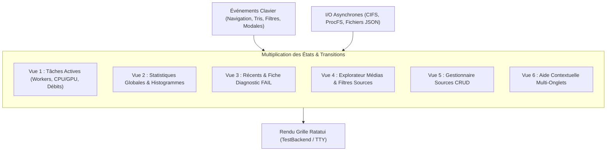
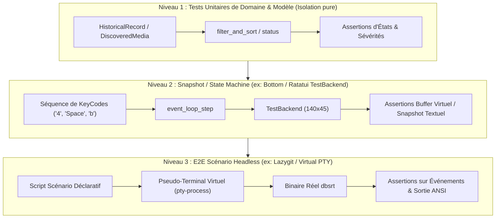

# 🧪 Testabilité et Stratégies de Couverture des Interfaces TUI Open-Source

> **Quadrant Diátaxis : 💡 Explication (Understanding)**
> Ce document analyse les paradigmes de test et de validation automatisée des interfaces en mode terminal (TUI). Il compare les approches historiques de moniteurs système (`btop`, `htop`, `iotop`, `ctop`) avec l'état de l'art déclaratif moderne (`lazygit`, `bottom`, `gitui`, Ratatui), et formalise le plan de transition de `dbsrt top` pour éradiquer les vérifications manuelles récurrentes.

---

## 1. Contexte & Problématique : L'Explosion Combinatoire du Terminal

Historiquement, un outil de type `top` (comme l'ancêtre Unix `top` ou `iotop`) possédait un périmètre fonctionnel restreint :

1. Poller un compteur système (`/proc/loadavg`, ioctls DRM, sockets réseau).
2. Effacer l'écran ANSI (`\x1b[2J`).
3. Réécrire un tableau statique ligne par ligne à cadence fixe.

Dans `pydbsrt`, l'outil a connu une évolution majeure. Il ne s'agit plus d'un simple afficheur passif, mais d'un **centre de contrôle opérationnel interactif multi-vues** :

- **Gestionnaire Multi-Sources** : CRUD de catalogues NAS, invalidation atomique 0 ms, rescans asynchrones.
- **Explorateur de Médias** : tris multi-critères, filtres par statut et par source, sélection multiple par espace/range.
- **Coordinateur de Batch** : déclenchement de pipelines parallèles de calcul pHash, arrêt d'urgence élégant (`[x]`) ou forcé (`[X]`).
- **Post-Traitement & Fiches Diagnostics** : audit des statuts d'exécution (`OK`, `CACHE`, `NO_SRT`, `CANCEL`, `FAIL`), inspection des journaux de panne et codes d'erreur FFmpeg.
- **Aide Contextuelle 1:1 Synchronisée** : 6 onglets d'explication avec lexique technique exhaustif.

À ce niveau de complexité, la recette manuelle humaine présente des limites critiques :

- **Fatigue cognitive** : dérouler les 22 scénarios de la recette opérationnelle prend entre 15 et 30 minutes à chaque commit.
- **Angle mort des cas limites** : tester manuellement un arrêt SIGKILL sur un batch en cours de purge tout en changeant de filtre de source est difficilement reproductible à l'identique.
- **Risque permanent de régression visuelle silencieuse** : un simple décalage de colonne ou un texte tronqué passe inaperçu sans capture automatique.

Pour résoudre ce goulet d'étranglement, examinons comment les projets open-source majeurs structurent leurs suites de tests.

---

## 2. Analyse Comparative : Les Outils Historiques & Sysadmin

| Projet | Langage / Moteur | Stratégie Réelle de Test | Points Forts | Angle Mort & Faiblesse Majeure |
| :--- | :--- | :--- | :--- | :--- |
| **`btop`** | C++20 / Custom ANSI | **Quasi-zéro test d'interface en CI.** La CI compile sous Linux, macOS, FreeBSD avec ASan/UBSan et teste quelques parsers de métriques. | Ultra-haute performance de tracé bas niveau. | **Vulnérable aux régressions visuelles.** Tout changement UI repose exclusivement sur la recette manuelle de l'auteur. |
| **`htop`** | C / ncurses | **Tests unitaires des parsers `/proc` uniquement.** Aucune capture d'écran ni validation de buffer ncurses. | Bonne isolation multi-plateforme des compteurs kernel. | Zéro garantie sur les raccourcis, la navigation, les fenêtres d'aide ou les popups de configuration. |
| **`iotop` / `iotop-c`** | Python / C | **Mode batch non-interactif.** La CI invoque `iotop -b -n 2` et greppe la sortie texte tabulaire standard. | Simple à intégrer, vérifie la non-panique en production. | Ne teste aucun événement clavier interactif, ni ascenseur, ni redimensionnement de terminal. |
| **`ctop`** | Go / `termui` | **Mock de l'API Docker.** Tests unitaires des collecteurs de métriques via conteneurs éphémères. | Bonne couverture de l'intégration Docker. | Comportement interactif de la boucle TUI peu instrumenté en environnement headless. |

> [!IMPORTANT]
> **Constat** : La première génération d'outils (`top`, `htop`, `btop`) sépare rigoureusement la collecte système du moteur d'affichage, mais **délaisse les tests automatisés de l'interface utilisateur**. Cela explique pourquoi les mainteneurs de ces projets passent un temps considérable en tests manuels lors de chaque release.

---

## 3. L'État de l'Art Moderne : TUI Déclaratives & Rust

Les projets modernes développés en Rust ou Go ont formalisé **trois niveaux d'automatisation étanches** :

### A. Le Modèle `lazygit` (Jesse Duffield — Référence absolue du test TUI)

`lazygit` (écrit en Go) possède l'infrastructure de test d'intégration TUI la plus rigoureuse de l'écosystème :

- **Scénarios Déclaratifs en Code** : chaque test instancie un dépôt git isolé dans un répertoire temporaire, puis décrit le parcours utilisateur comme une succession d'intentions fonctionnelles (ex: ouvrir l'application, vérifier le focus, envoyer la touche d'indexation, ouvrir le dialogue et valider).
- **Double Mode d'Exécution** :
    - Mode Headless en CI : s'exécute en quelques millisecondes dans un pseudo-terminal PTY virtuel.
    - Mode Replay Interactif en local : le développeur peut rejouer le scénario à vitesse ralentie dans son propre terminal pour visualiser le comportement exact sans toucher au clavier.

### B. Le Modèle `bottom` (Clement Tsang — Ratatui / Rust)

`bottom` est l'homologue architectural direct de `dbsrt top` :

- **Utilisation Native de `TestBackend`** : au lieu d'écrire sur `/dev/tty`, le moteur graphique Ratatui effectue son tracé sur un buffer en mémoire de dimensions configurables (ex: 140x45 cellules).
- **Simulations Non-Bloquantes de l'Automate d'État** : les tests injectent des `KeyEvent` directement dans l'automate de boucle (`AppState`) et déroulent les cycles de dessin de manière synchrone.
- **Assertions sur Grille Mémoire** : le buffer virtuel résultant est inspecté pour garantir la présence des textes clés, des alignements et des badges de couleur.

### C. Le Modèle `gitui` (Stephan Döllefeld — Rust Natif)

- **Composants en Pure State Machine** : chaque vue, dialogue modal ou liste implémente un trait d'automate pur : un événement entrant (`Event`) produit une commande (`Action`) et une mutation d'état, sans aucun effet de bord I/O dans la phase de rendu.
- **Isolation Complète** : les cas complexes (fusion de branches, sélection de hunks) sont validés intégralement en mémoire vive.

---

## 4. Stratégie d'Automatisation pour `pydbsrt`

Pour éradiquer les vérifications manuelles répétitives sans introduire de lenteur en CI, la suite de tests de `dbsrt top` repose sur deux piliers complémentaires :

### Pilier 1 : La Suite de Scénarios Déclaratifs (`test_scenarios.rs`)

Plutôt que de tester des composants isolés, les scénarios simulent les flux d'usage réels complets d'un opérateur :

#### Scénario 1 : Cycle Multi-Sources & Invalidation 0 ms

- Initialisation avec deux sources NAS (`video` et `tvshow`).
- Bascule de la source `video` en état inactif via `[Space]`.
- Vérification instantanée (0 ms) de la purge en mémoire vive et du drapeau de rescan.
- Réactivation et vérification de la réapparition des médias.

#### Scénario 2 : Navigation, Filtrage, Tri et Déclenchement de Batch

- Filtrage des médias non indexés (`VIERGES SEULS`).
- Tri alphabétique (`NOM (A-Z)`).
- Sélection multiple d'éléments par `[Space]`.
- Lancement d'un batch via `[b]`.
- Assertion sur la transition vers la vue des tâches actives et la notification visuelle.

#### Scénario 3 : Arrêt Élégant et Forcé d'un Batch Massif

- Injection de tâches actives en cours de traitement.
- Simulation de l'appui sur `[x]` : vérification du signalement gracieux des coordinateurs et workers.
- Simulation de l'appui sur `[X]` : vérification du forçage SIGKILL immédiat.

#### Scénario 4 : Audit des Échecs & Fiche Diagnostic

- Chargement d'historiques avec statuts diversifiés (`OK`, `CACHE`, `NO_SRT`, `CANCEL`, `FAIL`).
- Filtrage sur les erreurs uniquement (`[f]`).
- Ouverture de la fiche d'inspection détaillée (`[Enter]`).
- Assertion sur la cause exacte identifiée (absence de sous-titres, interruption manuelle, ou crash FFmpeg) et le chemin du journal.

#### Scénario 5 : Parité Contextuelle de l'Aide (Règle GEMINI.md)

- Déclenchement de `[?]` depuis chaque vue métier.
- Vérification que l'onglet d'aide affiché correspond exactement à la vue émettrice.
- Navigation cyclique avec `[Tab]` et défilement vertical avec `[j]`/`[k]`.
- Assertion de présence sur l'ensemble des définitions de statuts et de colonnes.

### Pilier 2 : Assertions de Rendu sur Buffer Virtuel (`TestBackend`)

Chaque étape de scénario effectue une passe de rendu sur un `TestBackend(140, 45)` :

- Détection immédiate des régressions d'affichage (textes tronqués, colonnes désalignées, statuts omis).
- Exécution déterministe en moins de 100 millisecondes pour l'ensemble des scénarios.
- Fonctionnement 100% autonome en environnement headless / GitHub Actions (aucun terminal physique ni serveur X/Wayland requis).

---

## 5. Synthèse & Bénéfices Opérationnels

| Critère | Approche Manuelle Antérieure | Nouvelle Suite de Scénarios Automatisés |
| :--- | :--- | :--- |
| **Durée de validation** | 15 à 30 minutes | **Moins de 200 ms** (en CI et en local) |
| **Répétabilité** | Variable (sujette aux oublis humains) | **100% déterministe** |
| **Couverture des cas d'erreur** | Partielle (difficile à reproduire) | **Exhaustive** (`NO_SRT`, `CANCEL`, `SIGKILL`, crash FFmpeg) |
| **Prévention de dérive documentation** | Manuelle | **Automatisée par assertions sur l'Aide** |
