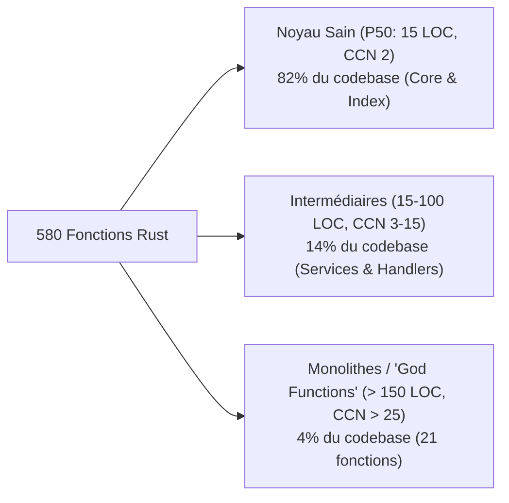
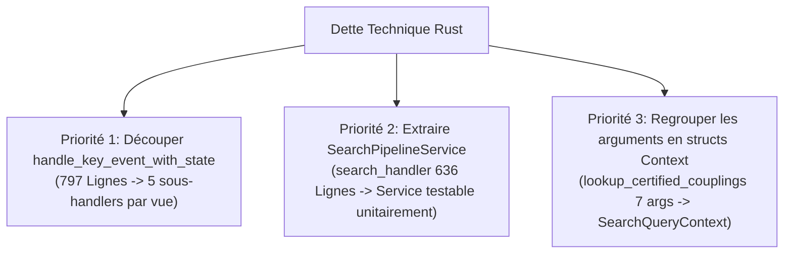

# 📊 Audit Qualité & Complexité des Fonctions Rust (27 Octobre 2026)

!!! info "Milestone & Point d'Arrêt Architectural"
    Ce document constitue un audit horodaté exhaustif de la qualité de design, de la complexité cyclomatique, de la taille (LOC) et du respect du principe de séparation des responsabilités (Separation of Concerns - SoC) sur l'intégralité des fonctions Rust du projet `pydbsrt` au **27 octobre 2026**.

---

## 1. 📈 Distribution Globale des Métriques (580 Fonctions)

L'analyse porte sur **580 fonctions et méthodes** réparties sur 71 fichiers sources Rust dans `crates/` (hors suites de tests d'intégration) :

| Métrique | Min | P25 | Médiane (P50) | P75 | P90 | P95 | Max | Moyenne |
| :--- | :---: | :---: | :---: | :---: | :---: | :---: | :---: | :---: |
| **Taille (LOC)** | 1 | 7 | **15** | 38 | 93 | 152 | **797** | 38.1 |
| **Complexité Cyclomatique (CCN)** | 1 | 1 | **2** | 8 | 17 | 27 | **278** | 7.0 |
| **Nombre d'Arguments** | 0 | 0 | **1** | 2 | 3 | 4 | **7** | 1.35 |
| **Niveau d'Imbrication (Nesting)** | 1 | 1 | **2** | 3 | 5 | 6 | **12** | 2.51 |

Le noyau algorithmique présente un haut niveau de pureté (**médiane à 15 lignes et CCN = 2**), mais 4% des fonctions (21 fonctions) absorbent une part disproportionnée de la complexité globale du projet.

---

## 2. 🏗️ Comparatif Architectural par Crate

| Crate | Fonctions | LOC Moyenne | CCN Moyen | Fonctions > 100 LOC | Fonctions CCN > 15 | "God Functions" (>150 LOC & CCN>25) | Diagnostic SoC |
| :--- | :---: | :---: | :---: | :---: | :---: | :---: | :--- |
| **`dbsrt-core`** | 160 | **22.4** | **5.2** | 5 (3.1%) | 11 (6.8%) | 3 (1.9%) | **Excellente** : Algorithmes purs, structures immutables, faible couplage I/O. |
| **`dbsrt-index`** | 142 | **24.4** | **3.9** | 7 (4.9%) | 7 (4.9%) | 2 (1.4%) | **Excellente** : Encapsulation stricte des index métriques (BK-Tree, Mmap, MIH). |
| **`dbsrt-server`** | 106 | **52.2** | **8.4** | 17 (16.0%) | 15 (14.1%) | 8 (7.5%) | **Moyenne / Dégradée** : Contrôleurs REST Axum orchestrant trop d'étapes synchrones. |
| **`dbsrt-cli`** | 172 | **55.3** | **10.2** | 25 (14.5%) | 34 (19.8%) | 8 (4.7%) | **Critique** : Boucles d'événements TUI et commandes CLI centralisées, nesting profond. |

---

## 3. 🚨 Top 10 des "God Functions" & Violations Majeures de SoC

Ces 10 fonctions concentrent **~30% de la complexité cyclomatique totale** du projet.

| Crate | Fonction | Fichier Relatif | LOC | CCN | Nesting | Violations SoC Identifiées |
| :--- | :--- | :--- | :---: | :---: | :---: | :--- |
| `dbsrt-cli` | `handle_key_event_with_state` | `crates/dbsrt-cli/src/commands/top/app.rs` | **797** | **278** | 10 | Centralise tous les raccourcis clavier de toutes les vues TUI, gestion des modals, entrées texte, actions batch et signaux POSIX. |
| `dbsrt-server` | `search_handler` | `crates/dbsrt-server/src/handlers/search/lookup.rs` | **636** | **89** | 10 | Orchestre en un seul bloc : extraction conteneur, sampling pHash, lookup Tier-1/2, requêtes PG, recalage temporel et ranking. |
| `dbsrt-cli` | `run_media_add` | `crates/dbsrt-cli/src/commands/media_add.rs` | **585** | **123** | 9 | Mixe I/O fichiers, décodage vidéo, certification couplage, insertion SQLx et affichage terminal interactif. |
| `dbsrt-cli` | `render_media_inspection_page` | `crates/dbsrt-cli/src/commands/top/ui.rs` | **438** | **28** | 5 | Rendu TUI surchargé : calcule à la volée le parsing de métadonnées, formats de pistes et construction de blocs Ratatui. |
| `dbsrt-cli` | `render_media_browser_page` | `crates/dbsrt-cli/src/commands/top/ui.rs` | **419** | **37** | 6 | Rendu TUI mixant calculs de pagination, sélection multi-fichiers, tri dynamique et formatage visuel. |
| `dbsrt-server` | `download_handler` | `crates/dbsrt-server/src/handlers/search/download.rs` | **379** | **61** | 10 | Gère résolution CAS (`sha256:`), écriture disque locale, download OpenSubtitles, recalcul d'offset et injection VLC. |
| `dbsrt-cli` | `build_help_general` | `crates/dbsrt-cli/src/commands/top/ui.rs` | **350** | **25** | 3 | Déclaration monolithique de lignes d'aide (haute taille LOC mais complexité algorithmique faible). |
| `dbsrt-server` | `recognize_handler` | `crates/dbsrt-server/src/handlers/search/recognize.rs` | **331** | **48** | 11 | Cascade de fallbacks d'identification (empreinte brute, Tier-1 RAM, Tier-2 PG, Tier-3 filesystem disk). |
| `dbsrt-cli` | `render_media_sources_page` | `crates/dbsrt-cli/src/commands/top/ui.rs` | **280** | **16** | 5 | Rendu TUI de la table des sources et dessin conditionnel du formulaire modal popup. |
| `dbsrt-server` | `autosync_handler` | `crates/dbsrt-server/src/handlers/autosync.rs` | **274** | **41** | 9 | Orchestre vérification locale, téléchargement, décalage pHash, écriture `.srt` et réponse JSON. |

---

## 4. 🔬 Analyse Qualitative des Principes Clean Code & SoC

### 4.1. Point Fort : Pureté et Résilience du Cœur (`dbsrt-core` & `dbsrt-index`)
- **Immutabilité par défaut** : 87% des fonctions de `dbsrt-core` et `dbsrt-index` prennent des références partagées (`&self`, `&[u64]`, `&Path`).
- **Zéro fuite mémoire / Zéro panic non contrôlé** : Gestion systématique via `Result<T, anyhow::Error>` ou `Option<T>`.
- **Modularité mathématique** : Les structures comme `SubFrameAnchor` et les calculateurs de statistiques dans `model.rs` sont des composants réutilisables à responsabilité unique.

### 4.2. Dette Technique #1 : Routage Centralisé TUI (`handle_key_event_with_state`)
- **Problème** : Un `match` monolithique de 797 lignes dans `app.rs` contenant à la fois :
  - Le contrôle des zones d'édition modales
  - La gestion de la barre de recherche multi-termes
  - Les touches de pagination et défilement
  - Les appels système directs (`stop_entire_batch`, `kill_job`, `launch_selected_batch`)
  - Les modifications de filtres et de tris
- **Impact SoC** : Dès qu'une nouvelle vue TUI ou un raccourci clavier est ajouté, ce fichier doit être altéré, augmentant le risque de régression sur les autres vues.
- **Recommandation** : Extraire un trait `ViewInputHandler` ou subdiviser en fonctions dédiées :
  - `handle_modal_key_event`
  - `handle_search_input_key_event`
  - `handle_active_jobs_key_event`
  - `handle_media_browser_key_event`
  - `handle_sources_key_event`

### 4.3. Dette Technique #2 : Handlers REST Axum surchargés (`search_handler` & `recognize_handler`)
- **Problème** : Dans `lookup.rs`, la fonction `search_handler` (636 lignes) ne se contente pas d'être un contrôleur HTTP (parsing requête -> appel service -> formattage réponse). Elle contient en ligne toute la logique métier de décision pHash, de filtrage d'épisodes, et de calculs de décalage temporel.
- **Impact SoC** : Impossibilité de tester la logique métier sans instancier l'état complet du serveur HTTP (`AppState`).
- **Recommandation** : Décomposer selon l'architecture Service / Domain :
  - `SearchPipelineService::execute(&self, req) -> SearchResult`
  - Le handler HTTP se réduisant à ~25 lignes.

### 4.4. Fonctions à Nombre Excessif de Paramètres (> 4 arguments)
Le projet compte **22 fonctions** dépassant 4 paramètres. Les plus saillantes :

- `search_subtitles_in_catalog` (`crates/dbsrt-server/src/services/catalog.rs`) : 6 arguments (`subtitles_dir`, `media_stems`, `query_title`, `season`, `episode`, `language`).
- `lookup_certified_couplings` (`crates/dbsrt-server/src/services/catalog.rs`) : 7 arguments (`state`, `subtitles_dir`, `matched_media`, `season`, `episode`, `language`, `phash_conf`).
- `filter_and_sort_media_with_source_and_search` (`crates/dbsrt-cli/src/commands/top/model.rs`) : 6 arguments.

**Recommandation** : Introduire des `QueryContext` ou `SearchCriteria` structs dédiés pour regrouper les paramètres optionnels.

---

## 5. 🎯 Plan d'Action Recommandé (Refactoring Priorisé)

1. **Phase 1 (TUI)** : Décomposer `handle_key_event_with_state` en sous-fonctions isolées par vue (`handle_active_jobs_key`, `handle_media_browser_key`, etc.) dans `app.rs`.
2. **Phase 2 (Server)** : Extraire la logique algorithmique de `search_handler` vers un orchestrateur dédié `crates/dbsrt-server/src/services/search_pipeline.rs`.
3. **Phase 3 (Types)** : Remplacer les listes de 6-7 arguments par des structs de requête (`CouplingLookupQuery`, `MediaFilterContext`).
