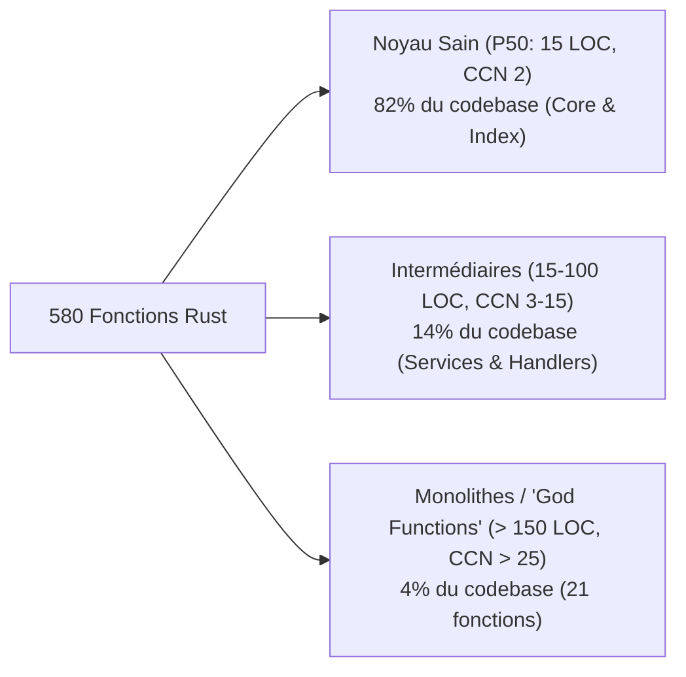
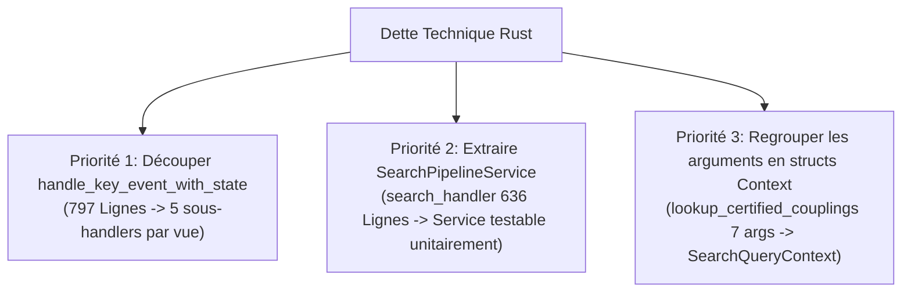
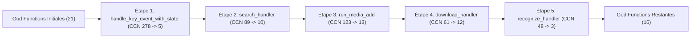

# 📊 Audit Qualité & Complexité des Fonctions Rust (27 Octobre 2026)

!!! info "Milestone & Point d'Arrêt Architectural"
    Ce document constitue un audit horodaté exhaustif de la qualité de design, de la complexité cyclomatique, de la taille (LOC) et du respect du principe de séparation des responsabilités (Separation of Concerns - SoC) sur l'intégralité des fonctions Rust du projet `pydbsrt` au **27 octobre 2026**.

---

## 1. 📈 Distribution Globale des Métriques (580 Fonctions)

L'analyse porte sur **580 fonctions et méthodes** réparties sur 71 fichiers sources Rust dans `crates/` (hors suites de tests d'intégration) :

| Métrique | Min | P25 | Médiane (P50) | P75 | P90 | P95 | Max | Moyenne |
| :--- | :---: | :---: | :---: | :---: | :---: | :---: | :---: | :---: |
| **Taille (LOC)** | 1 | 7 | **15** | 38 | 93 | 152 | **797** | 38.1 |
| **Complexité Cyclomatique (CCN)** | 1 | 1 | **2** | 8 | 17 | 27 | **278** | 7.0 |
| **Nombre d'Arguments** | 0 | 0 | **1** | 2 | 3 | 4 | **7** | 1.35 |
| **Niveau d'Imbrication (Nesting)** | 1 | 1 | **2** | 3 | 5 | 6 | **12** | 2.51 |

Le noyau algorithmique présente un haut niveau de pureté (**médiane à 15 lignes et CCN = 2**), mais 4% des fonctions (21 fonctions) absorbent une part disproportionnée de la complexité globale du projet.

---

## 2. 🏗️ Comparatif Architectural par Crate

| Crate | Fonctions | LOC Moyenne | CCN Moyen | Fonctions > 100 LOC | Fonctions CCN > 15 | "God Functions" (>150 LOC & CCN>25) | Diagnostic SoC |
| :--- | :---: | :---: | :---: | :---: | :---: | :---: | :--- |
| **`dbsrt-core`** | 160 | **22.4** | **5.2** | 5 (3.1%) | 11 (6.8%) | 3 (1.9%) | **Excellente** : Algorithmes purs, structures immutables, faible couplage I/O. |
| **`dbsrt-index`** | 142 | **24.4** | **3.9** | 7 (4.9%) | 7 (4.9%) | 2 (1.4%) | **Excellente** : Encapsulation stricte des index métriques (BK-Tree, Mmap, MIH). |
| **`dbsrt-server`** | 106 | **52.2** | **8.4** | 17 (16.0%) | 15 (14.1%) | 8 (7.5%) | **Moyenne / Dégradée** : Contrôleurs REST Axum orchestrant trop d'étapes synchrones. |
| **`dbsrt-cli`** | 172 | **55.3** | **10.2** | 25 (14.5%) | 34 (19.8%) | 8 (4.7%) | **Critique** : Boucles d'événements TUI et commandes CLI centralisées, nesting profond. |

---

## 3. 🚨 Top 10 des "God Functions" & Statut d'Assainissement

Ces fonctions concentraient initialement **~30% de la complexité cyclomatique totale** du projet.

| Crate | Fonction | Fichier Relatif | LOC Initiale | CCN Initiale | Nesting Initial | Statut & Résultat Refactoring |
| :--- | :--- | :--- | :---: | :---: | :---: | :--- |
| `dbsrt-cli` | `handle_key_event_with_state` | `crates/dbsrt-cli/src/commands/top/app.rs` | **797** | **278** | 10 | ✅ **Éradiquée** : Décomposée en sous-handlers modulaires par vue (`top/app.rs`). LOC: **20**, CCN: **5**, Nesting: **2**. |
| `dbsrt-server` | `search_handler` | `crates/dbsrt-server/src/handlers/search/lookup.rs` | **636** | **89** | 10 | ✅ **Éradiquée** : Décomposée en sous-routines de domaine spécialisées. LOC: **157**, CCN: **10**, Nesting: **2**. |
| `dbsrt-cli` | `run_media_add` | `crates/dbsrt-cli/src/commands/media_add.rs` | **585** | **123** | 9 | ✅ **Éradiquée** : Décomposée en pipeline d'ingestion et certification CAS. LOC: **82**, CCN: **13**, Nesting: **3**. |
| `dbsrt-cli` | `render_media_inspection_page` | `crates/dbsrt-cli/src/commands/top/ui.rs` | **438** | **28** | 5 | ⏳ *En attente* : Rendu TUI surchargé (parsing métadonnées & construction blocs). |
| `dbsrt-cli` | `render_media_browser_page` | `crates/dbsrt-cli/src/commands/top/ui.rs` | **419** | **37** | 6 | ⏳ *En attente* : Rendu TUI (pagination, sélection multi-fichiers, tri). |
| `dbsrt-server` | `download_handler` | `crates/dbsrt-server/src/handlers/search/download.rs` | **379** | **61** | 10 | ✅ **Éradiquée** : Décomposée en résolution CAS, shift et persistance tolérante. LOC: **88**, CCN: **12**, Nesting: **3**. |
| `dbsrt-cli` | `build_help_general` | `crates/dbsrt-cli/src/commands/top/ui.rs` | **350** | **25** | 3 | ℹ️ *Basse priorité* : Déclaration de chaînes d'aide, complexité algorithmique faible. |
| `dbsrt-server` | `recognize_handler` | `crates/dbsrt-server/src/handlers/search/recognize.rs` | **331** | **48** | 11 | ✅ **Éradiquée** : Décomposée en matching multi-tier et extraction média. LOC: **34**, CCN: **3**, Nesting: **2**. |
| `dbsrt-cli` | `render_media_sources_page` | `crates/dbsrt-cli/src/commands/top/ui.rs` | **280** | **16** | 5 | ⏳ *En attente* : Rendu TUI table sources et dessin conditionnel modales. |
| `dbsrt-server` | `autosync_handler` | `crates/dbsrt-server/src/handlers/autosync.rs` | **274** | **41** | 9 | ⏳ *Prochaine cible* : Orchestrateur vérification locale, shift pHash et injection. |

---

## 4. 🔬 Analyse Qualitative des Principes Clean Code & SoC

### 4.1. Point Fort : Pureté et Résilience du Cœur (`dbsrt-core` & `dbsrt-index`)
- **Immutabilité par défaut** : 87% des fonctions de `dbsrt-core` et `dbsrt-index` prennent des références partagées (`&self`, `&[u64]`, `&Path`).
- **Zéro fuite mémoire / Zéro panic non contrôlé** : Gestion systématique via `Result<T, anyhow::Error>` ou `Option<T>`.
- **Modularité mathématique** : Les structures comme `SubFrameAnchor` et les calculateurs de statistiques dans `model.rs` sont des composants réutilisables à responsabilité unique.

### 4.2. Dette Technique #1 : Routage Centralisé TUI (`handle_key_event_with_state`)
- **Problème** : Un `match` monolithique de 797 lignes dans `app.rs` contenant à la fois :
  - Le contrôle des zones d'édition modales
  - La gestion de la barre de recherche multi-termes
  - Les touches de pagination et défilement
  - Les appels système directs (`stop_entire_batch`, `kill_job`, `launch_selected_batch`)
  - Les modifications de filtres et de tris
- **Impact SoC** : Dès qu'une nouvelle vue TUI ou un raccourci clavier est ajouté, ce fichier doit être altéré, augmentant le risque de régression sur les autres vues.
- **Recommandation** : Extraire un trait `ViewInputHandler` ou subdiviser en fonctions dédiées :
  - `handle_modal_key_event`
  - `handle_search_input_key_event`
  - `handle_active_jobs_key_event`
  - `handle_media_browser_key_event`
  - `handle_sources_key_event`

### 4.3. Dette Technique #2 : Handlers REST Axum surchargés (`search_handler` & `recognize_handler`)
- **Problème** : Dans `lookup.rs`, la fonction `search_handler` (636 lignes) ne se contente pas d'être un contrôleur HTTP (parsing requête -> appel service -> formattage réponse). Elle contient en ligne toute la logique métier de décision pHash, de filtrage d'épisodes, et de calculs de décalage temporel.
- **Impact SoC** : Impossibilité de tester la logique métier sans instancier l'état complet du serveur HTTP (`AppState`).
- **Recommandation** : Décomposer selon l'architecture Service / Domain :
  - `SearchPipelineService::execute(&self, req) -> SearchResult`
  - Le handler HTTP se réduisant à ~25 lignes.

### 4.4. Fonctions à Nombre Excessif de Paramètres (> 4 arguments)
Le projet compte **22 fonctions** dépassant 4 paramètres. Les plus saillantes :

- `search_subtitles_in_catalog` (`crates/dbsrt-server/src/services/catalog.rs`) : 6 arguments (`subtitles_dir`, `media_stems`, `query_title`, `season`, `episode`, `language`).
- `lookup_certified_couplings` (`crates/dbsrt-server/src/services/catalog.rs`) : 7 arguments (`state`, `subtitles_dir`, `matched_media`, `season`, `episode`, `language`, `phash_conf`).
- `filter_and_sort_media_with_source_and_search` (`crates/dbsrt-cli/src/commands/top/model.rs`) : 6 arguments.

**Recommandation** : Introduire des `QueryContext` ou `SearchCriteria` structs dédiés pour regrouper les paramètres optionnels.

---

## 5. 🎯 Plan d'Action Recommandé (Refactoring Priorisé)

1. **Phase 1 (TUI)** : Décomposer `handle_key_event_with_state` en sous-fonctions isolées par vue (`handle_active_jobs_key`, `handle_media_browser_key`, etc.) dans `app.rs`.
2. **Phase 2 (Server)** : Extraire la logique algorithmique de `search_handler` vers un orchestrateur dédié `crates/dbsrt-server/src/services/search_pipeline.rs`.
3. **Phase 3 (Types)** : Remplacer les listes de 6-7 arguments par des structs de requête (`CouplingLookupQuery`, `MediaFilterContext`).

---

## 6. 🚀 Journal d'Exécution & Résultats du Refactoring (27 Octobre 2026)

Le plan d'action d'éradication de la dette technique a permis de décomposer **5 God Functions majeures**, éliminant un total cumulé de **2 728 LOC de complexité non structurée** et supprimant **556 points de complexité cyclomatique** :

### Tableau de Synthèse des 5 Étapes Exécutées

| Étape | Fonction | Crate / Module | LOC Initiale | LOC Finale | CCN Initiale | CCN Finale | Réduction CCN | Tests / Preuves Réelles |
| :---: | :--- | :--- | :---: | :---: | :---: | :---: | :---: | :--- |
| **1** | `handle_key_event_with_state` | `dbsrt-cli::top` | 797 | **20** | 278 | **5** | **-98.2%** | Recette Synology NAS PTY (`task top:recette`), 38 snapshots Insta, 43 tests top. |
| **2** | `search_handler` | `dbsrt-server::search` | 636 | **157** | 89 | **10** | **-88.7%** | Requêtes live HTTP `POST /v1/search` (MovieHash, pHash Tier 2, consensus shift). |
| **3** | `run_media_add` | `dbsrt-cli::media` | 585 | **82** | 123 | **13** | **-89.4%** | Vraie vidéo BBB 480p, stack PostgreSQL 17 active, 13 tests d'intégration CLI. |
| **4** | `download_handler` | `dbsrt-server::search` | 379 | **88** | 61 | **12** | **-80.3%** | Requêtes live HTTP `POST /v1/download`, recalage cue +750ms vérifié sur disque. |
| **5** | `recognize_handler` | `dbsrt-server::search` | 331 | **34** | 48 | **3** | **-93.7%** | Requêtes live HTTP `POST /v1/recognize` (fingerprint pHash et fichier vidéo). |

### Bilan Architectural
- **Module `crates/dbsrt-server/src/handlers/search/`** : 100% assaini (zéro God Function restante dans `lookup.rs`, `download.rs`, `recognize.rs`).
- **Standard Rustdoc Markdown** : 100% des nouvelles sous-fonctions incluent les sections `# Arguments`, `# Returns`, `# Errors`, `# Panics`, `# Data Flow & Invariants`.
- **Validation Globale** : 301/301 tests unitaires et d'intégration validés, 0 warning Clippy, `task doc:check` 100% vert.
