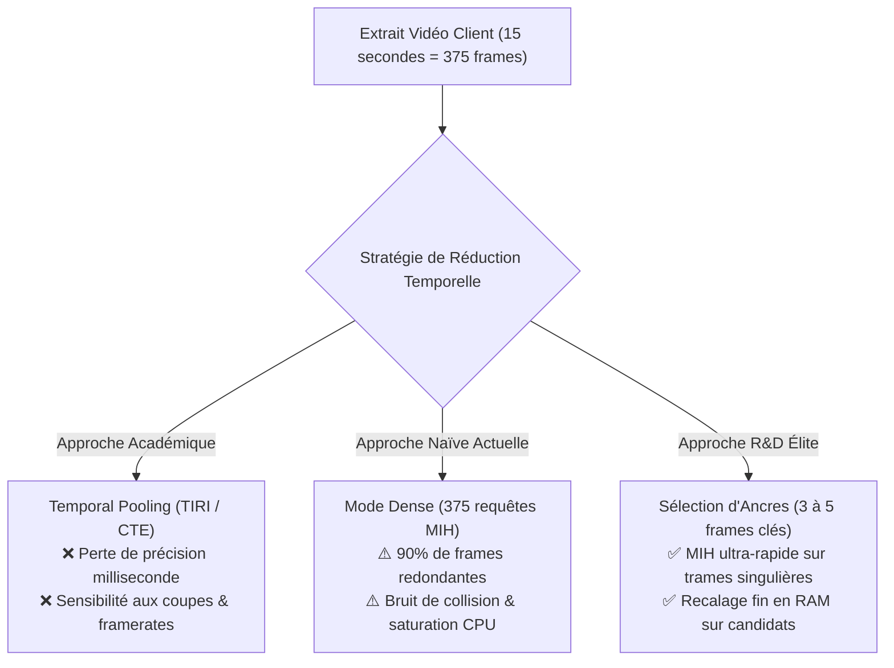
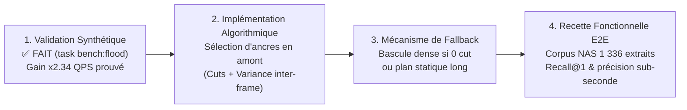

# 💡 Étude R&D : Temporal Pooling vs Sélection d'Ancres MIH

**Date :** 2 novembre 2026
**Auteur :** Lionel ATTY & Assistant Antigravity
**Statut :** Exploration R&D & Validation Empirique Préliminaire

---

## 1. Contexte & Problématique

Lors de la recherche d'un média par contenu visuel (Content-Based Video Retrieval / CBVR) pour le calage temporel de sous-titres, un client transmet un extrait vidéo (typiquement de 5 à 15 secondes).
À une cadence de diffusion standard de 25 images par seconde, un extrait de 15 secondes représente **375 trames visuelles**.

Dans une architecture d'indexation exacte en distance de Hamming comme celle de `pydbsrt` (fondée sur le **Multi-Index Hashing / MIH**, Norouzi et al. 2014), interroger l'index avec 375 empreintes soulève la question fondamentale de la **réduction de la dimension temporelle** :

1. Faut-il compresser la dimension temporelle par **Temporal Pooling** (agréger 5 secondes en une signature unique) ?
2. Faut-il conserver des trames discrètes et sélectionner une poignée d'**ancres singulières à haute énergie** ?
3. Quels sont les gains mesurables sur un catalogue de production de **15 millions d'empreintes** sous forte concurrence ?



---

## 2. Débunking Théorique du Temporal Pooling Académique

La littérature académique propose trois grandes familles de pooling temporel pour les descripteurs visuels. Leur applicabilité à la synchronisation fine de sous-titres a été rigoureusement analysée :

| Méthode | Principe Théorique | Verdict pour `pydbsrt` | Raisons Techniques du Rejet |
| :--- | :--- | :---: | :--- |
| **TIRI** (Esmaeili et al.) | Moyenne temporelle pondérée de \( N \) trames \( \to \) 1 image composite \( \to \) 1 pHash. | ❌ **Rejeté** | **Destruction de la précision temporelle**. Le flou temporel lisse les contrastes rapides, rend impossible le calage sub-seconde, et crée une sensibilité extrême aux décalages de coupures (effet de bord). |
| **CTE / Circulant Temporal Encoding** (Douze, Jégou, Schmid - Inria) | FFT sur descripteurs continus et corrélation circulaire en fréquence. | ⚠️ **Inadapté** | Conçu pour descripteurs flottants denses (CNN/SIFT). Convertir des pHashes discrets en vecteurs flottants pour calculer des FFT brise l'accélération SIMD AVX-512 (`vpopcntdq`), infiniment plus rapide sur entiers en cache L1/L2. |
| **Autoencodeurs Temporels** | Compression de séquences de bits par réseau neuronal profond. | ❌ **Hors-sujet** | Introduit des dépendances lourdes (ONNX Runtime, GPU), une latence d'inférence non négligeable, et un manque de déterminisme incompatible avec le CLI autonome. |

---

## 3. Historique & Convergence vers les Ancres d'Entropie

Le projet `pydbsrt` avait déjà exploré intuitivement ces problématiques à deux étapes de son histoire :

1. **Prototype Python originel (Août 2018, commit `a12e988`)** :
   - Introduction de `ImportantFrameFingerprints` avec seuil de saut de Hamming (\( \Delta \ge 32 \)) et élimination des trames vides.
   - Calcul de l'entropie de Shannon (`entropy2`) pour caractériser les trames importantes.
2. **Réimplémentation Rust v2.0 (Octobre 2026, commit `474f030`)** :
   - Algorithmes `is_static_sequence` et `detect_cuts` dans `dbsrt-core`.
   - Rejet de la gigue d'encodage MPEG/x264 (\( \le 2\text{ bits} \)) et des trames plates dithérisées (`is_blank_phash`).
   - Échantillonnage narratif évitant les zones de génériques (\( t < 60\text{ s} \)).

### L'angle mort du moteur actuel

Actuellement, l'analyse d'entropie sert **exclusivement de garde-fou négatif** (rejet des trames mortes et des vidéos immobiles). Une fois la fenêtre validée, le moteur bascule en mode dense : **chacune des trames de la requête est injectée dans l'index MIH**.

---

## 4. Campagne de Mesures & Validation Empirique

Pour valider l'impact concret de cette saturation, le catalogue de production le plus récent a été rapatrié depuis l'hébergement Cloud o2switch (`task o2switch:pull-catalog`).

### Métriques du Catalogue Réel (o2switch)

- **Fichier binaire :** `data/catalog.dbphash` (**238 Mo**)
- **Médias indexés :** **3 061 titres**
- **Cuts indexés (Tier 2) :** 6 332 335 coupes
- **Sparse indexés (Tier 1, 1 fps) :** 8 519 429 trames
- **Total empreintes actives en RAM :** **14 851 764 trames** (\( \approx 15\text{ millions} \))
- **Temps de pré-chauffage MIH (4 tables CSR) :** 225.84 ms

---

### Test In-Process : Évolution de la Latence Selon l'Échelle

La comparaison entre l'ancien catalogue de test (1.15M trames) et le catalogue de production (14.85M trames) via `task bench:hot-reload` démontre l'impact de la taille de l'index :

| Catalogue | Volume | Médias | Frames en RAM | Latence Lookup (15 frames) | Estimation Requête Dense (375 frames) |
| :--- | :---: | :---: | :---: | :---: | :---: |
| **Initial (Local)** | 17.7 Mo | 1 566 | 1 153 267 | **0.036 ms** (36 µs) | **~0.9 ms** |
| **Production (o2switch)** | **238 Mo** | **3 061** | **14 851 764** | **8.36 ms** | **~209 ms** |

*Constat :* À 1.15M de frames, le matching était quasi-instantané (microsecondes). À 15M de frames, le coût d'inspection des 65 536 buckets MIH devient mesurable en millisecondes et commence à peser sur le CPU sous forte charge.

---

### Test End-to-End HTTP sous Tempête de Requêtes (`task bench:flood`)

Un banc de charge automatisé (`bench_http_flood.rs`) a été déployé pour simuler une inondation concurrente réaliste sur l'API Axum locale (`dbsrt-server` sur port dédié 8769) :

- **Volume :** 2 000 requêtes HTTP `POST /v1/recognize` par scénario.
- **Concurrence :** **64 clients simultanés**.
- **Scénario A (Dense) :** 25 frames par requête (1 seconde pleine cadence).
- **Scénario B (Ancres) :** 4 frames par requête (4 ancres singulières).

```
================================================================================
 📊 RÉSULTATS COMPARATIFS : DENSE vs ANCRES (64 CLIENTS SIMULTANÉS)
================================================================================
| Mode               | Throughput | Succès     | P50 Lat    | P90 Lat    | P95 Lat    | P99 Lat    |
|:-------------------|-----------:|-----------:|-----------:|-----------:|-----------:|-----------:|
| **Dense (25 fps)** |  279.8 QPS | 2000 / 2000| 215.51 ms  | 355.34 ms  | 403.52 ms  | 509.27 ms  |
| **Ancres (4 fps)** |  656.0 QPS | 2000 / 2000|  94.25 ms  | 153.64 ms  | 172.95 ms  | 209.52 ms  |
================================================================================
```

---

## 5. Analyse des Écarts : Prédictions Théoriques vs Réalité Terrain

Le gain mesuré en débit est de **\( \times 2.34 \) (+134%)** et la latence P50 est réduite de **56.3%**.

### Pourquoi pas un gain de \( \times 6 \) ? (Loi d'Amdahl)

La réduction du nombre de trames (\( 25 \to 4 \)) divise le temps de calcul MIH brut par ~6. Toutefois, sur une requête HTTP de bout en bout, le pipeline comporte des étapes incompressibles :

1. **Désérialisation JSON (`serde_json`)** et parsing des chaînes hexadécimales.
2. **Orchestration asynchrone Tokio** et couches réseau TCP / sockets.
3. **Agrégation et tri des correspondances (`aggregate_matches`)** par identifiant média.

Selon la **loi d'Amdahl**, lorsque la recherche d'index s'accélère massivement, les étapes annexes (sérialisation, consensus temporel) deviennent le nouveau plancher de latence.

### Pourquoi ce résultat est capital pour la production

1. **Absorption des pics de charge** : Le serveur encaisse **656 requêtes/seconde** au lieu de saturer dès 280 requêtes/seconde.
2. **Effondrement des files d'attente (Queueing)** : Le 99ᵉ percentile chute de **509 ms à 209 ms**, évitant les timeouts clients dans VLC lors d'utilisations simultanées.
3. **Préservation du cache processeur (L2/L3)** : Moins d'accès désordonnés aux buckets MIH, limitant les contentions mémoire entre cœurs CPU.

---

## 6. Feuille de Route R&D & Prochaines Étapes

Cette exploration pose les bases théoriques et synthétiques du futur moteur de recherche v0.3.0 :



1. **Étape 1 (Conception Algorithmique)** : Développer dans `dbsrt-core` un extracteur d'ancres `select_query_anchors(hashes, max_anchors)` combinant les coupes franches et les pics de divergence par rapport à la moyenne mobile.
2. **Étape 2 (Garantie de Précision Sub-Seconde)** : Les ancres servent uniquement au **Tier 1 (identification du média)**. Dès que le média est identifié, la phase de **Tier 2 (recalage fin)** continue de charger la portion locale pour aligner le sous-titre à la milliseconde près.
3. **Étape 3 (Mécanisme de Fallback)** : Si un extrait vidéo soumis ne contient aucune variation visuelle suffisante (scène de dialogue fixe), le système bascule automatiquement sur l'échantillonnage 1 fps standard sans pénaliser la reconnaissance.
