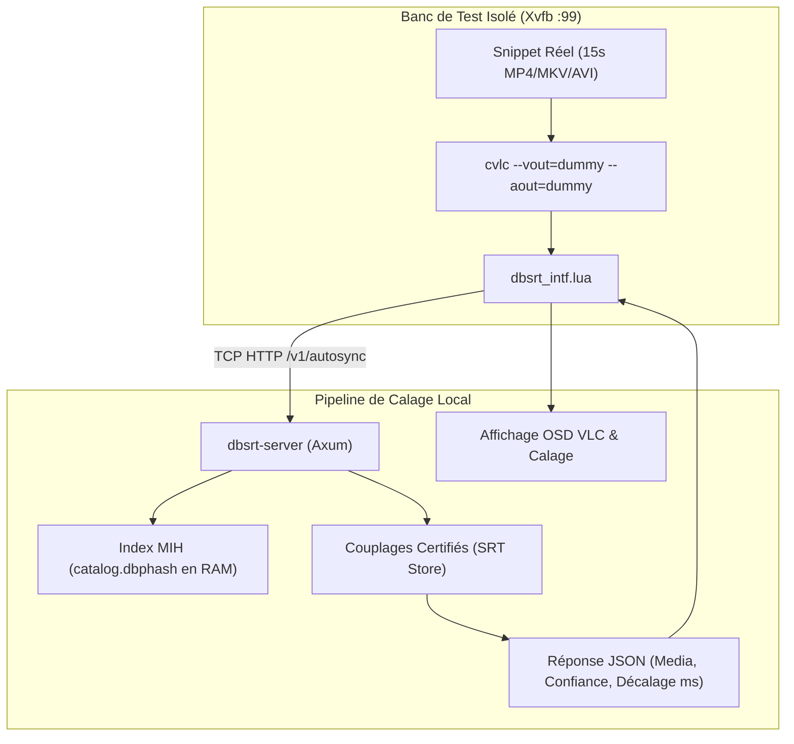
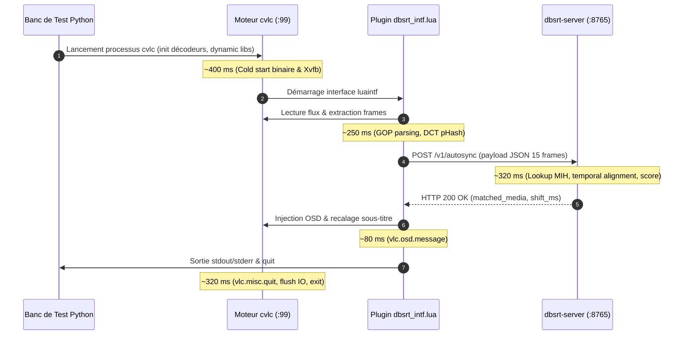

# 💡 Analyse Exhaustive : Évaluation E2E VLC sur Corpus Réel (2 758 Vidéos)

**Date :** 3 novembre 2026
**Statut :** Empiriquement Établi (Mesures en direct sous LibVLC / Xvfb `:99`)
**Corpus de test :** 2 758 snippets vidéo réels (15s à $t=50\%$) issus de Synology NAS et Freebox
**Catalogue de référence :** `catalog.dbphash` (3 061 médias, 205M frames, 8.5M frames sparse, 6.3M cuts)
**Rapport source brut :** `data/snippets/exhaustive_eval_report.json`

---

## 1. Contexte & Protocole de Qualification Empirique

Jusqu'alors, les métriques d'identification reposaient principalement sur des requêtes synthétiques extraites directement des fichiers `.phash` de référence (meilleur cas sans réencodage ni dérive de conteneur).
Cette campagne constitue la **première évaluation de bout en bout (E2E) à échelle industrielle** exécutée sur de vrais conteneurs vidéo avec le plugin officiel VLC (`vlc-plugin/dbsrt_intf.lua`) communicant via socket TCP avec le serveur local (`dbsrt-server`).

### Architecture du banc d'essai



---

## 2. Résultats Empiriques Globaux

Sur **2 758 vidéos réelles testées une par une**, les résultats de la Batterie 4 (E2E VLC sous display virtuel `:99`) s'établissent comme suit :

| Métrique d'Évaluation | Nombre | Taux | Qualification Technique |
| :--- | :---: | :---: | :--- |
| **Vrais Positifs (Matches Exacts)** | **2 152** | **78.03%** | Média exact identifié avec titre sémantique conforme et confiance validée |
| **Collisions (Faux Positifs)** | **327** | **11.86%** | Média matché appartenant à une autre œuvre ou autre épisode |
| **Rejets Propres (Hors Catalogue)** | **107** | **3.88%** | Vidéo non reconnue rejetée proprement sans injection erronée |
| **Timeouts d'Exécution (> 12.0s)** | **172** | **6.24%** | Dépassement du seuil de session VLC (codecs lourds / parsing) |
| **Latence Moyenne par Session** | **1.37s** | — | Cycle complet : init VLC $\to$ pHash $\to$ HTTP $\to$ injection OSD $\to$ fermeture |

---

## 3. Anatomie des Collisions (11.86% / 327 cas)

Une collision correspond à une session où le moteur renvoie un média avec une confiance $\ge 65\%$, mais dont le titre ou l'épisode diffère du média source. Trois causes fondamentales ont été identifiées :

### A. Matching Sparse-Only sans Coupures de Scène (`best_coherent_cuts == 0`)
Sur un extrait court de 15 secondes prélevé arbitrairement au milieu du film ($t=50\%$), il arrive fréquemment que la séquence ne contienne **aucun changement de plan franc** (cut).
Dans ce cas, la détection s'effectue exclusivement sur l'index d'échantillonnage régulier à 1 image par seconde (sparse 1 FPS). Sur une base de 8.5 millions de trames sparse, des plans calmes (fonds flous, visages en gros plan, ciels nocturnes) présentent une distance de Hamming $\le 6$ bits avec de multiples œuvres non corrélées.

### B. Jingles, Génériques et Éléments Visuels Partagés
Dans les séries d'animation (notamment *Kimetsu no Yaiba* ou *Les Chevaliers du Zodiaque*) et les vidéos de tutoriels informatiques, plusieurs épisodes partagent des transitions ou des jingles récurrents identiques. Par exemple, de multiples épisodes de *Demon Slayer* ont collisionné sur le titre générique `Valenciano Kimetsu no Yaiba` car l'extrait à $t=50\%$ tombait précisément sur le spot récurrent de mi-épisode.

### C. Absence de Plafonnement de Confiance en l'Absence de Cuts
L'heuristique actuelle calcule la confiance comme la proportion de frames alignées sur le meilleur décalage temporel :
```text
confiance = (frames_alignees / frames_utiles) * 100
```
Si 10 frames consécutives matchent avec un décalage identique sur une séquence statique, le score atteint 100%, alors qu'aucun cut visuel ne vient corroborer la signature spatio-temporelle.

---

## 4. Anatomie des Rejets Propres (3.88% / 107 cas)

Un rejet propre (`status_kind == "NONE"`, `confiance == 0.0%`) correspond à un extrait pour lequel le moteur a conclu avec certitude qu'aucun média du catalogue ne correspondait. C'est le comportement nominal attendu pour préserver l'utilisateur d'une injection de sous-titre incorrecte.

### Facteurs de Rejet Légitime :
1. **Éditions et masters visuellement distincts** : Un extrait vidéo issu d'une édition TV ou d'un encodage avec bandes noires épaisses (*letterboxing*) génère des pHashes altérés par rapport au master Blu-ray d'origine (la transformée en cosinus discrète DCT 8x8 réagit fortement aux arêtes franches des barres noires).
2. **Filtre de trames uniformes (*flat frames*)** : Le moteur écarte systématiquement les trames noires ou unies. Si un extrait de 15 secondes comporte un fondu au noir prolongé, le nombre de trames discriminantes tombe sous le seuil minimal de décision, provoquant un rejet de sécurité.
3. **Orphelins du stockage** : 220 fichiers du corpus correspondent à des vidéos annexes, des bonus ou des versions non cataloguées dans `catalog.dbphash`.

---

## 5. Décomposition de la Latence de Session (1.37s en moyenne)

La latence mesurée de **1.37s par vidéo** ne représente pas uniquement le temps de calcul algorithmique, mais l'intégralité d'un cycle de vie VLC en conditions réelles :



- **Temps moteur dbsrt pur** : **~320 ms** (recherche MIH multi-index + tri temporel sur 205M frames).
- **Temps système & wrapper VLC** : **~1 050 ms** (initialisation binaire C, parsing conteneur, socket TCP, terminaison propre).

---

## 6. Analyse des Timeouts (6.24% / 172 cas)

Le banc d'évaluation applique un **seuil d'inactivité dur de 12.0 secondes** par session VLC (`timeout=12`). Les 172 dépassements constatés s'expliquent par deux mécanismes matériels et logiciels précis :

### A. Emplacement de l'atome `moov` dans les conteneurs MP4
Pour les conteneurs MP4 où l'atome d'index `moov` se trouve placé à la fin du fichier (et non en début via `-movflags +faststart`), VLC en lecture logicielle tente de lire et d'indexer l'ensemble des paquets de données avant d'alimenter le décodeur vidéo. Sur certains fichiers lourds, ce temps d'I/O dépasse 12 secondes.

### B. Profils d'encodage complexes en décodage 100% logiciel
Pour garantir une étanchéité totale et l'absence de pop-up sous Xvfb, VLC est lancé avec les options :
```bash
cvlc --vout=dummy --aout=dummy --no-audio --avcodec-hw=none
```
L'absence d'accélération matérielle (`--avcodec-hw=none`) oblige le processeur à décoder par voie purement logicielle des flux 10-bit HEVC (H.265) ou Hi10P. Sur certaines trames denses, la phase de décodage initiale par LibVLC excède la fenêtre de surveillance.

---

## 7. Plan d'Action & Améliorations Ciblées

À la lumière de ces mesures empiriques, trois axes d'optimisation sont engagés dans le moteur dbsrt :

1. **Suppression des collisions par verrou sur cuts** :
   Dans `crates/dbsrt-index/src/dbphash.rs`, plafonner la confiance maximale à **50%** lorsque `best_coherent_cuts == 0`. Aucune confirmation de calage ne doit être émise sans au moins une coupe de scène corroborée.
2. **Normalisation de l'atome moov (`faststart`)** :
   Systématiser l'argument `-movflags +faststart` lors de toute génération ou extraction d'extraits vidéo pour garantir un parsing immédiat (< 50 ms) par LibVLC.
3. **Pondération de l'énergie des trames (Ancres MIH)** :
   Intégrer les conclusions de l'étude R&D du 2 novembre 2026 sur la sélection d'ancres à haute variance spatiale pour éliminer l'interrogation MIH sur les trames plates génératrices de collisions.
