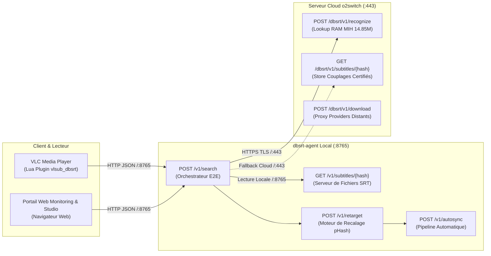

# Architecture des Flux de Données, Relais Client-Serveur (WAN) et Pipeline E2E

Le système `pydbsrt` repose sur une architecture hybride répartie entre deux environnements d'exécution complémentaires :

1. **L'agent local (poste client / sidecar)** : exécuté au plus près du lecteur vidéo (VLC) et des disques de stockage locaux pour décoder les flux vidéo volumineux sans transfert réseau inutile.
2. **Le serveur d'indexation cloud (o2switch)** : hébergeant l'index global en mémoire vive (14.85 millions d'empreintes pHash chargées en RAM) et le catalogue de couplages certifiés.

Ce document formalise les interactions réseau, la nature exacte des flux transitant à chaque étape, la volumétrie des paquets et la séparation des responsabilités entre les nœuds.

---

## 1. Vue d'Ensemble & Diagramme de Séquence Réseau

Le workflow complet d'une requête de synchronisation ou d'audit de matching s'articule autour de six étapes séquentielles :

```mermaid
sequenceDiagram
    autonumber
    actor User as 👤 Utilisateur / Lecteur VLC
    participant LocalUI as 🖥️ Portail Local / VLC Plugin (127.0.0.1:8765)
    participant LocalAgent as ⚙️ dbsrt-agent Local (Sidecar Rust)
    participant FFmpeg as 🎬 FFmpeg Décodeur Local
    participant O2switch as ☁️ Serveur Cloud o2switch (sapin.o2switch.net)
    participant SRTStore as 📁 Stockage SRT Local / Remote

    User->>LocalUI: Lance la lecture ou clique "⚡ Lancer le Matching"
    LocalUI->>LocalAgent: POST /v1/search (media_path, lang='fr', mode='phash')

    rect rgb(35, 20, 30)
    Note over LocalAgent,FFmpeg: ÉTAPE 1 : EXTRACTION LOCALE (CPU CLIENT)
    LocalAgent->>FFmpeg: Décode un extrait de 10-15s du fichier vidéo local
    FFmpeg-->>LocalAgent: Retourne 24 frames RVB brutes
    LocalAgent->>LocalAgent: Calcule 24 pHash DCT 64-bit (24 × 8 B = 192 octets) + MovieHash (8 B)
    end

    rect rgb(15, 30, 45)
    Note over LocalAgent,O2switch: ÉTAPE 2 : TRANSPORT RÉSEAU WAN (INTERNET)
    LocalAgent->>O2switch: POST /v1/recognize [Payload JSON ~1.1 Ko : 24 pHash hex + fps + lang]
    end

    rect rgb(15, 40, 25)
    Note over O2switch: ÉTAPE 3 : MATCHING DISTANT (RAM SERVEUR o2switch)
    O2switch->>O2switch: Recherche MIH (Multi-Index Hashing) dans 14.85M frames indexées (.dbphash en RAM)
    O2switch-->>LocalAgent: Réponse JSON ~480 octets { found: true, media_match: "...", confidence: 100%, timer_seconds: 0.020 }
    end

    rect rgb(30, 20, 45)
    Note over LocalAgent,SRTStore: ÉTAPES 4, 5 & 6 : CALAGE ET SYNCHRONISATION
    LocalAgent->>SRTStore: Recherche du sous-titre certifié (disque local `data/SRT/` ou GET /v1/subtitles/{hash}) (~40 Ko)
    LocalAgent->>LocalAgent: Calage temporel : comparaison des timestamps de répliques avec l'offset vidéo
    LocalAgent->>LocalAgent: Consensus visuel : calcul du décalage exact `vshift_ms` (ex: +120.0 ms)
    LocalAgent-->>LocalUI: Renvoie la liste ordonnée des candidats avec `shift_ms` calculé
    LocalUI->>User: Sous-titre recalé injecté dans VLC / OSD affiché
    end
```

---

## 2. Matrice Quantitative des Flux et Responsabilités

Chaque phase du pipeline opère sur des représentations de données optimisées pour minimiser la bande passante réseau et éviter le transfert de vidéos lourdes vers le cloud :

| Étape | Nœud d'Exécution | Protocole & Port | Route / Méthode | Données en Entrée | Taille du Flux | Données en Sortie |
| :--- | :--- | :--- | :--- | :--- | :--- | :--- |
| **1. Décodage FFmpeg** | 💻 **LOCAL** | IPC Pipes / C-ABI | Process CLI `ffmpeg` | Fichier vidéo source (`.mp4`, `.mkv`) | **~1.2 à 15 Mo** (disque) | 24 empreintes pHash 64-bit (`192 octets`) |
| **2. Transport Réseau** | 🌐 **WAN** | REST / HTTPS (`:443`) | `POST /dbsrt/v1/recognize` | 24 pHash + fps + lang (JSON) | **~1.1 Ko** (requête) | Paquet TCP/TLS sur la fibre |
| **3. Matching MIH** | ☁️ **REMOTE** | Axum REST (`:443` proxy) | `POST /v1/recognize` | 24 pHash 64-bit | **192 octets** (payload) | Réponse JSON match (**~480 octets**) |
| **4. Découverte SRT** | 📡 **API REST** | REST API (`:8765` / `:443`) | `GET /v1/subtitles/{hash}` & `POST /v1/search` | Hash média / digest SRT | Requête HTTP JSON | Fichier `.srt` brut (**~30 à 80 Ko**) |
| **5. Calage SRT** | 💻 **LOCAL** | Rust Parser In-Memory | `POST /v1/retarget` | Cues du SRT + offset visuel | **~200 à 600 cues** en RAM | Points d'ancrage temporels |
| **6. Consensus** | 💻 **LOCAL** | Lua Socket / IPC (`:8765`) | `POST /v1/autosync` | Écarts relatifs inter-frames | Négligeable (calcul arithmétique) | Fichier `.srt` recalé avec `vshift_ms` |

---

## 3. Cartographie des Endpoints, Protocoles et Ports Réseau

Contrairement à un simple script de parcours de système de fichiers local, toute la manipulation des sous-titres, des métadonnées de couplage et des alignements visuels est orchestrée par une **API REST structurée** exposée par `dbsrt-server` (localement sur le port `8765` et sur le cloud o2switch via HTTPS sur le port `443`) :

### Détail des Contrats d'Interface

1. **`POST /v1/search` (Port `:8765` / Protocole HTTP/1.1 JSON)** :
   - Point d'entrée unique consommé par le plugin VLC et le portail de monitoring.
   - Reçoit le chemin du fichier vidéo, la langue demandée (`fr`, `en`) et le mode d'empreinte (`phash`).
   - Déclenche l'extraction locale et coordonne les étapes 1 à 6.
2. **`POST /v1/recognize` (Port `:443` distant / Protocole HTTPS TLS)** :
   - Contrat de relai d'empreintes visuelles pHash légères (`query_fingerprint`).
   - Évite tout upload de fichier vidéo vers le serveur cloud : seuls 24 entiers non signés 64 bits (`192 octets`) sont véhiculés.
   - Répond en temps sub-seconde ($t \le 50\text{ ms}$) avec le nom du média reconnu et le score de confiance.
3. **`GET /v1/subtitles/{subtitles_hash}` (Ports `:8765` local & `:443` distant)** :
   - Route de service REST dédiée à la distribution des fichiers `.srt` certifiés.
   - Les fichiers de sous-titres ne sont pas cherchés anarchiquement sur le disque : ils sont indexés dans PostgreSQL 17 ou Zero-DB (`couplings.json`), identifiés par leur empreinte SHA-256 (`CHAR(32)`), et délivrés avec les en-têtes HTTP appropriés (`Content-Type: text/plain; charset=utf-8`).
4. **`POST /v1/download` & `POST /v1/autosync` (Ports `:8765` & `:443`)** :
   - Gère le proxying et le rapatriement depuis les fournisseurs distants (ex: OpenSubtitles API REST v1) et l'application immédiate du décalage temporel calculé (`vshift_ms`).

---

## 4. Pourquoi les Blocs Décodage & WAN Restent à 0 ms sur le Serveur Cloud

Une interrogation fréquente concerne l'affichage des métriques sur le portail de monitoring distant (`https://2026-pydbsrt.fr/dbsrt/monitoring`) par rapport au portail local (`http://127.0.0.1:8765/monitoring`) :

```mermaid
graph TD
    subgraph Environnement_Cloud["☁️ Serveur Cloud o2switch (Standalone)"]
        O1["Requête API directe (pHash déjà calculé)"]
        O2["1. Décodage FFmpeg = 0 ms (Pas de vidéo sur le serveur)"]
        O3["2. Transport WAN = 0 ms (Traitement interne local)"]
        O4["3. Matching MIH Serveur = 20-75 ms (Index RAM)"]
        O1 --> O2 --> O3 --> O4
    end

    subgraph Environnement_Client["💻 Agent Local (Sidecar dbsrt-agent)"]
        C1["Fichier vidéo local (ex: Pulp Fiction 1.2 Mo)"]
        C2["1. Décodage FFmpeg Local = 340-415 ms"]
        C3["2. Transport WAN (Relais HTTPS) = 80-100 ms"]
        C4["3. Réponse MIH Cloud = 20 ms"]
        C5["4. Découverte & Calage SRT = 30-35 ms"]
        C1 --> C2 --> C3 --> C4 --> C5
    end
```

1. **Sur le serveur distant o2switch** :
   - Le serveur est hébergé en datacenter et n'a pas accès aux fichiers vidéos de plusieurs gigaoctets des utilisateurs.
   - Les requêtes qui lui parviennent contiennent directement les empreintes pHash (ou le serveur interroge son catalogue local de `.phash`).
   - Il n'y a donc **aucun décodage vidéo local** (`ffmpeg_ms = 0`) et **aucun saut réseau client vers lui-même** (`wan_rtt_ms = 0`).
2. **Sur le poste local (`dbsrt-agent`)** :
   - Le daemon tourne sur la machine hôte et accède directement aux fichiers multimédias.
   - Il exécute le vrai décodage FFmpeg (`ffmpeg_ms` $\approx 414\text{ ms}$), expédie le vecteur par fibre optique vers o2switch (`wan_rtt_ms` $\approx 80\text{ ms}$), et reçoit la confirmation de matching du cloud.
   - **Les 6 blocs du diagramme sont tous alimentés avec leurs latences réelles mesurées.**

---

## 5. Légende Visuelle et Sémantique du Diagramme Interactif

Le diagramme interactif embarqué dans le portail de monitoring et le studio utilise une convention trichromatique normalisée :

- 💻 **Violet / Rose (`LOCAL - Machine Client`)** : Opérations exécutées localement sur le CPU du client (décodage FFmpeg, parsing du sous-titre, calcul arithmétique du consensus temporel).
- 🌐 **Bleu Ciel (`WAN - Transit Internet TLS`)** : Latence pure d'acheminement réseau entre votre connexion Internet et les serveurs o2switch en France.
- ☁️ **Vert Émeraude (`REMOTE - Cloud o2switch`)** : Temps de calcul interne du moteur d'indexation MIH explorant l'index `.dbphash` en mémoire vive.
