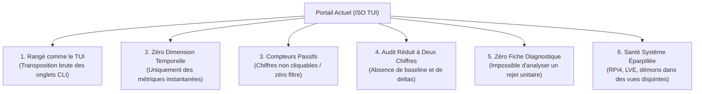
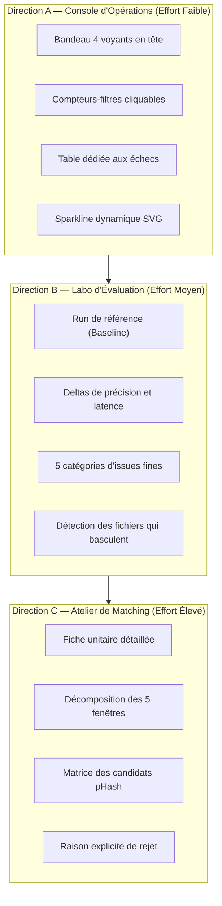
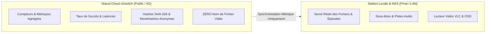

# Étude Comparative de 43 Backoffices Open Source & Architecture Cible du Portail de Monitoring

Le portail web de monitoring embarqué (`dbsrt-server`, route `/monitoring`) a été conçu initialement comme une transposition web directe de la console terminale TUI (`dbsrt top`). Si cette parité stricte garantit une parité 1:1 avec les primitives du CLI, elle n'exploite pas les capacités interactives, temporelles et visuelles d'un navigateur moderne.

Cette étude formalise les conclusions tirées d'un benchmark approfondi de **43 solutions open source** de monitoring, d'évaluation d'apprentissage automatique (ML) et de gestion multimédia, et définit la feuille de route d'évolution du portail en trois axes complémentaires.

---

## 1. Diagnostic Critique du Portail Hérité (ISO TUI)

L'audit ergonomique et fonctionnel du portail initial a mis en exergue six limitations majeures :

1. **Rangé comme la console terminale, pas selon les questions d'exploitation** :
   Les onglets `[1] Tâches`, `[2] Stats`, `[3] Récents`, `[5] Sources` reproduisent l'organisation du terminal. Or, un opérateur web interroge le système selon trois axes vitaux : *« Est-ce que tout tourne ? »*, *« Qu'est-ce qui a échoué et pourquoi ? »*, *« La précision s'améliore-t-elle ? »*.
2. **Absence totale de dynamique temporelle** :
   Le portail n'expose aucune série chronologique. Aucun graphique ne permet de visualiser un creux de débit réseau, un palier de saturation CPU CloudLinux LVE ou une régression de latence.
3. **Compteurs statiques déconnectés de l'action** :
   Un compteur d'échecs (`Échecs : 3`) n'offre aucun lien direct vers les enregistrements incriminés. Dans des consoles modernes, chaque indicateur numérique sert simultanément de filtre de sélection.
4. **Évaluation d'audit réduite à deux pourcentages bruts** :
   Afficher « 87% titre » et « 91% épisode » sans référence à un commit antérieur (`baseline`), sans delta ($\Delta$) et sans catégorisation des erreurs empêche d'évaluer l'impact d'une mise à jour logicielle.
5. **Absence de traçabilité fine sur le matching** :
   Face à un média mal reconnu, l'opérateur ne dispose d'aucune vue décomposant les 5 fenêtres d'analyse temporelle ($t=120\text{ s}, 300\text{ s}, \dots$) ni les distances de Hamming des candidats concurrents.
6. **Fragmentation des indicateurs de disponibilité** :
   L'état du démon local, du superviseur RPi4, de la synchronisation du catalogue et de la charge LVE était dispersé entre plusieurs sous-onglets.

---

## 2. Benchmark des 43 Projets Open Source Étudiés

L'analyse comparative s'est articulée autour de quatre familles d'outils de référence :

| Famille d'Outils | Projets Analysés | Principes Directeurs Extraits |
| :--- | :--- | :--- |
| **Consoles d'Opérations & Télémétrie** | *Beszel, Netdata, Glances, Scrutiny, Prometheus, Grafana* | Bandeau de santé permanent, indicateurs de fraîcheur temporelle (« vu il y a 4 s »), sparklines ultra-légères sans dépendances JS lourdes. |
| **Gestionnaires de Files & Tâches Distribuées** | *Sidekiq, Mission Control, Flower, BullMQ Dashboard, Airflow* | Compteurs cliquables servant de filtres directs, isolation des échecs dans une file dédiée avec messages d'erreurs lisibles et relance unitaire. |
| **Labos d'Évaluation & Analyse de Performance ML** | *FiftyOne, Allure Framework, Braintrust, ReportPortal, MLflow* | Modèle par *Runs*, run de référence certifié (`baseline`), deltas ($\Delta\pm$), catégorisation des issues en 5 classes, identification des bascules (corrigés vs régressés). |
| **Ateliers Multimédia & Rapprochement Métier** | *FileBot, MusicBrainz Picard, Bazarr, Sonarr, Radarr, Tdarr* | Fiche unitaire par fichier, matrice de comparaison original vs reconnu, raisons explicites de rejet (distance, ratio, durée), couverture de collection. |

---

## 3. Les Trois Directions Architecturales Cibles

Le benchmark a permis de formaliser trois orientations d'ingénierie :

### Direction A : Console d'Opérations (Inspirée de *Beszel*, *Sidekiq*, *Immich*)
- **Objectif** : Répondre immédiatement à la question *« Est-ce que l'infrastructure tourne nominalement ? »*.
- **Fonctionnalités clés** :
  - Bandeau de santé à 4 pastilles d'état (Démon API, Superviseur RPi4, Synchronisation catalogue, Audit actif).
  - Boîtes KPI interactives : cliquer sur `Échecs : 3` filtre dynamiquement la table des événements récents sur les trois anomalies.
  - Sparklines temps réel en SVG pur (débit réseau RX, latence HTTP aller-retour, charge vCPU).
  - Heartbeat horodaté par machine avec calcul de dérive (« vu il y a $X\text{ s}$ »).

### Direction B : Labo d'Évaluation (Inspirée de *FiftyOne*, *Allure*, *Braintrust*)
- **Objectif** : Répondre à la question *« Le dernier commit améliore-t-il la reconnaissance sans casser l'existant ? »*.
- **Fonctionnalités clés** :
  - Notion de run d'audit comparable : chaque exécution est liée au hash de commit Git correspondant.
  - Évaluation restreinte à l'intersection des fichiers : le différentiel de précision n'est calculé que sur les médias évalués à la fois par le run courant et le run de référence.
  - Typologie des anomalies en 5 catégories distinctes :
    1. *Titre exact*
    2. *Titre erroné*
    3. *Titre exact, épisode erroné* (séries TV)
    4. *Non reconnu / Sans réponse* (seuil de distance non franchi)
    5. *Erreur technique de décodage* (codec non supporté ou fichier tronqué)
  - Métrique de bascule : comptabilisation explicite du type *« 38 corrigés, 11 régressés »*.

### Direction C : Atelier de Matching Visuel (Inspirée de *FileBot*, *Picard*, *Bazarr*)
- **Objectif** : Répondre à la question *« Pourquoi ce fichier spécifique a-t-il été associé à ce sous-titre ? »*.
- **Fonctionnalités clés** :
  - Fiche détaillée par média sélectionné.
  - Décomposition des 5 fenêtres temporelles analysées ($t_1, \dots, t_5$) avec statut individuel de chaque fenêtre.
  - Tableau des candidats concurrents classés par distance de Hamming croissante.
  - Justification algorithmique du rejet (ex: *« Rejeté : durée divergente de plus de 120 s »* ou *« Collision évitée par consensus temporel »*).

---

## 4. Cloisonnement de Sécurité & Confidentialité Zéro-Fuite (o2switch)

Une contrainte d'architecture fondamentale de `dbsrt` réside dans l'étanchéité stricte des données personnelles sur hébergement Cloud mutualisé (o2switch) :

- **Mode Cloud Passerelle (o2switch)** : Aucun chemin physique ni nom de média personnel ne quitte l'infrastructure privée. L'interface distante n'affiche que les métriques agrégées, les hashes et les indicateurs de précision.
- **Mode Studio Local** : Exécuté sur le réseau local ou le poste opérateur, il dispose du catalogue complet et donne accès à la visualisation des extraits et des correspondances.

---

## 5. Matrice Comparative de Synthèse

| Axe | Implémentation ISO TUI | Nouvelle Proposition Architecturale |
| :--- | :--- | :--- |
| **Modèle conceptuel** | Reproduction fidèle de `dbsrt top` | Tableau de bord décisionnel orienté diagnostic |
| **Navigation** | Onglets séquentiels statiques | Cartouche d'état et filtres croisés |
| **Historique** | Tableau paginé passif | Tableau enrichi avec recherche, filtres d'état et drawer de détail |
| **Audit** | Deux compteurs statiques | Comparateur de runs avec deltas, baseline et 5 catégories |
| **Observabilité** | Chiffres instantanés | Sparklines vectorielles SVG et historique glissant |
| **Confidentialité** | Filtrage partiel | Cloisonnement strict Zéro-Fuite entre passerelle Cloud et nœud local |
