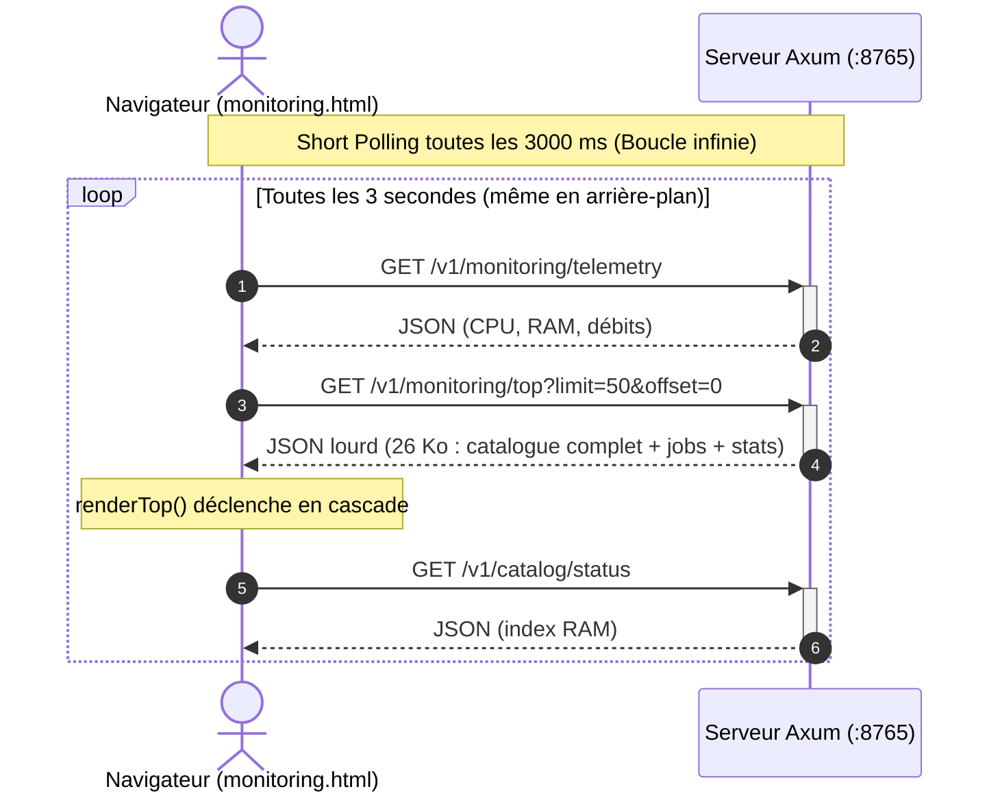
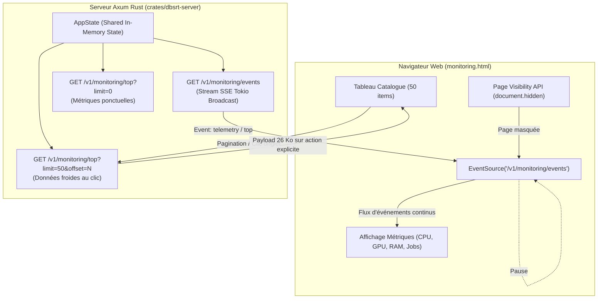

# 💡 Architecture de Streaming SSE et Optimisation du Polling Monitoring

**Date :** 4 novembre 2026
**Statut :** Spécification d'Architecture et Validation Empirique
**Axe :** Observabilité Réseau, Économie de Bande Passante et Réactivité Front/Back

---

## 1. Contexte & Diagnostic du Problème

Dans le portail de supervision et de monitoring web (`dbsrt top` et son interface web servie par `dbsrt-server`), la vue d'inspection des requêtes réseau (`DevTools Network`) révélait un volume disproportionné de requêtes répétitives : **354 requêtes en 6 minutes**, transférant plus de 4.3 Mo de JSON.

### Causes Racines Identifiées

1. **Short Polling Aveugle & Répétitif** :
   Une boucle `setInterval(refreshAll, 3000)` déclenchait systématiquement 3 requêtes HTTP concurrentes toutes les 3 secondes :
   - `GET /v1/monitoring/telemetry` (métriques système et pipeline)
   - `GET /v1/monitoring/top?limit=50&offset=0` (snapshot dbsrt top avec 50 entrées catalogue, 26 Ko par tick)
   - `GET /v1/catalog/status` (déclenché en cascade par la fonction `renderTopSystem`)
2. **Re-téléchargement Inutile de Données Froides** :
   Le catalogue de médias et l'historique batch ne changent pas toutes les 3 secondes. Re-télécharger 26 Ko de données tabulaires à chaque cycle saturait la file d'attente HTTP/1.1 du navigateur et créait des temps de latence perceptibles (latences mesurées jusqu'à 4.06 s sur des requêtes en attente).
3. **Absence de Détection de Visibilité (Page Visibility API)** :
   Lorsque l'utilisateur bascule sur son terminal, son IDE ou un autre onglet, le navigateur continuait d'émettre 1 requête par seconde en continu sans aucun ralentissement ni mise en veille.

---

## 2. Étude Comparative des Motifs d'Actualisation Temps Réel

Quatre motifs d'architecture ont été analysés pour moderniser le transport des métriques :

| Critère d'Évaluation | Short Polling Actuel | WebSockets (WS / WSS) | ETag / HTTP 304 | SSE (Server-Sent Events) |
| :--- | :--- | :--- | :--- | :--- |
| **Volume de Requêtes HTTP** | ❌ ~60 requêtes/minute | 🏆 1 connexion TCP | ❌ ~60 requêtes/minute | 🏆 **1 requête HTTP persistante** |
| **Bande Passante Réseau** | ❌ 26 Ko à chaque tick | ⚡ Trame binaire / texte minimal | ⚡ En-têtes HTTP seuls (corps 0 Ko) | ⚡ **Push JSON différentiel uniquement** |
| **Gestion Reconnexion** | ❌ Manuelle (erreur fetch) | ⚠️ Manuelle côté client (code JS custom) | ❌ Manuelle | 🏆 **100% native par le navigateur** |
| **Complexité Client (JS)** | Trivial (`fetch`) | Élevée (state machine, ping/pong) | Modérée | 🏆 **Trivial (`EventSource` standard W3C)** |
| **Compatibilité o2switch / Proxys** | 100% | ⚠️ Fragile (blocage `Upgrade: websocket`) | 100% | 🏆 **100% (pur HTTP/1.1 streaming)** |
| **Sens du Flux** | Pull (Client $\to$ Serveur) | Full Duplex ($\leftrightarrow$) | Pull (Client $\to$ Serveur) | Push (Serveur $\to$ Client) |

### Pourquoi les WebSockets Sont Sous-Optimaux Ici

Le protocole WebSocket impose un upgrade de protocole (`Upgrade: websocket`) au-dessus de TCP. Sur un hébergement mutualisé ou cloud managé (cPanel, Nginx/Passenger, reverse-proxies o2switch), les sockets longue durée sans trafic bidirectionnel sont fréquemment tués ou bloqués par les coupe-circuits de sécurité.
De plus, le tableau de bord de supervision n'émet pas de flux continu de données vers le serveur : les commandes utilisateur (lancer matching, paginer) sont des opérations ponctuelles qui s'expriment naturellement par des requêtes REST `POST` ou `GET`.

### Pourquoi Server-Sent Events (SSE) Est la Solution Idéale

1. **Standard Natif W3C** : Implémenté nativement dans tous les navigateurs modernes (`new EventSource('/v1/monitoring/events')`) sans aucune bibliothèque externe.
2. **Résilience Réseau Intégrée** : En cas de coupure temporaire ou redémarrage du serveur, le navigateur retente la connexion automatiquement avec un backoff standardisé.
3. **Visibilité DevTools** : Dans l'onglet *Network*, une **seule et unique ligne** apparaît avec le statut `Pending`. Le détail des événements entrants est consultable sous forme chronologique dans l'onglet dédié *EventStream*, libérant l'inspection réseau de tout bruit.
4. **Intégration Axum 0.8** : Axum fournit un support de premier ordre via `axum::response::Sse` et `tokio_stream::wrappers::BroadcastStream`.

---

## 3. Architecture Cible Hybride (SSE Push + REST On-Demand)

Le nouveau paradigme repose sur une séparation stricte entre **métriques chaudes (Push SSE)** et **données volumineuses froides (Fetch REST)** :

### Règles d'Or de l'Architecture Cible

1. **Flux SSE Unique (`/v1/monitoring/events`)** :
   - Diffuse les métriques rapides (CPU, GPU, RAM, statut des jobs actifs, débit pHash).
   - Taux d'émission configurable (par exemple 1 seconde lors d'ingestion active, 3 secondes au repos).
2. **Découplage Catalogue (Données Froides)** :
   - Le catalogue de médias ne fait **jamais** l'objet d'un polling récurrent.
   - Les listes volumineuses (`limit=50`) sont interrogées uniquement sur action explicite :
     - Changement d'onglet vers le catalogue.
     - Clic sur les boutons de pagination (page suivante / précédente).
     - Signal explicite de rechargement post-ingestion.
3. **Mise en Veille Automatique (Page Visibility API)** :
   - Lorsque `document.hidden` est vrai, la connexion `EventSource` ou le timer d'actualisation est immédiatement suspendu.
   - Dès que l'utilisateur revient sur la page (`visibilitychange`), un rafraîchissement immédiat est exécuté et le flux est reconnecté.
4. **Suppression des Appels Cascades** :
   - Le statut du catalogue (`/v1/catalog/status`) est intégré directement dans le payload unifié de l'état système, éliminant les requêtes orphelines secondaires.
