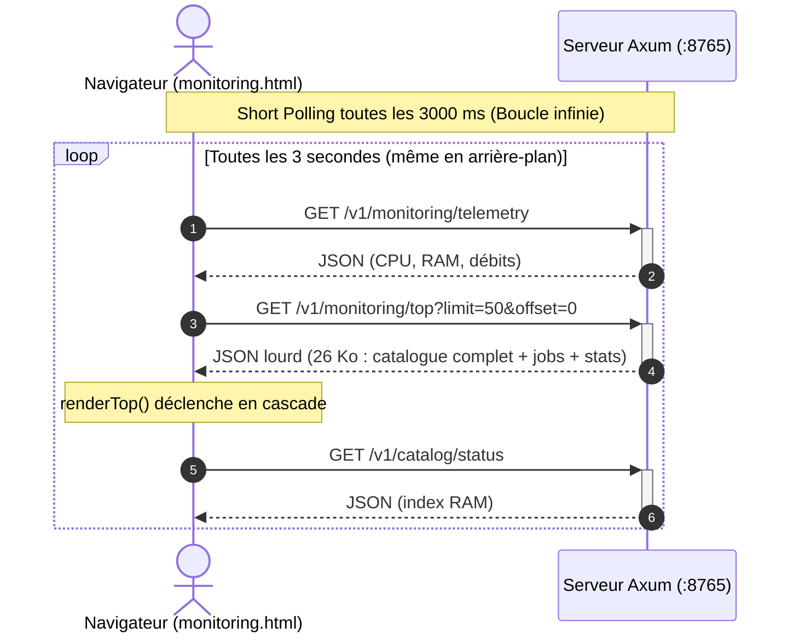
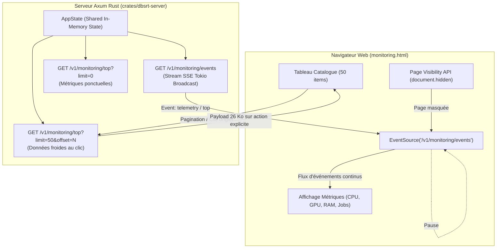
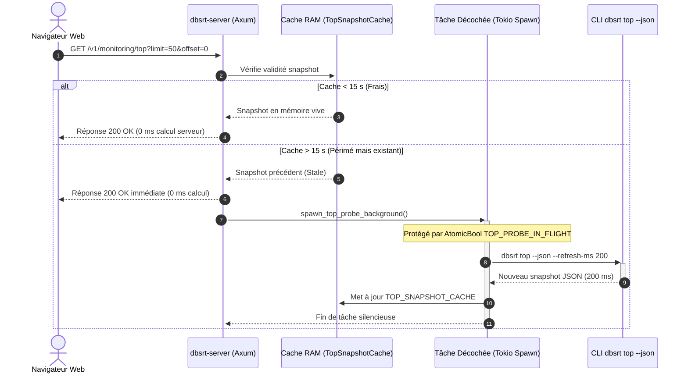
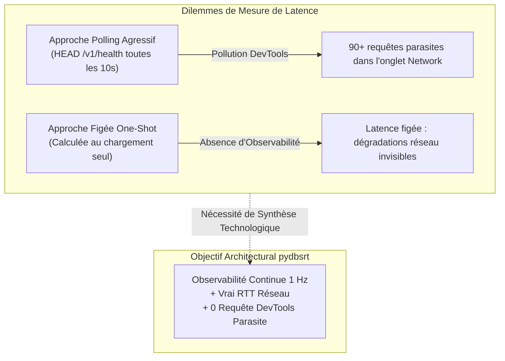
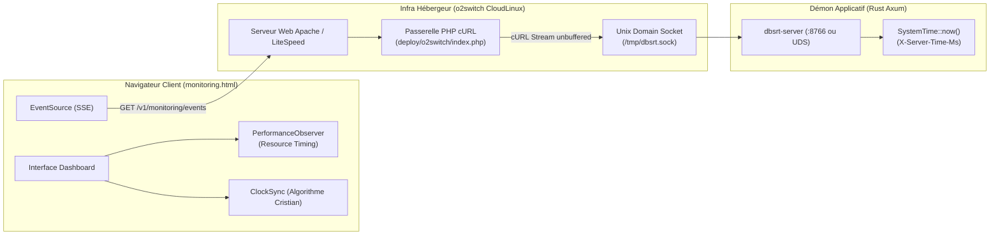
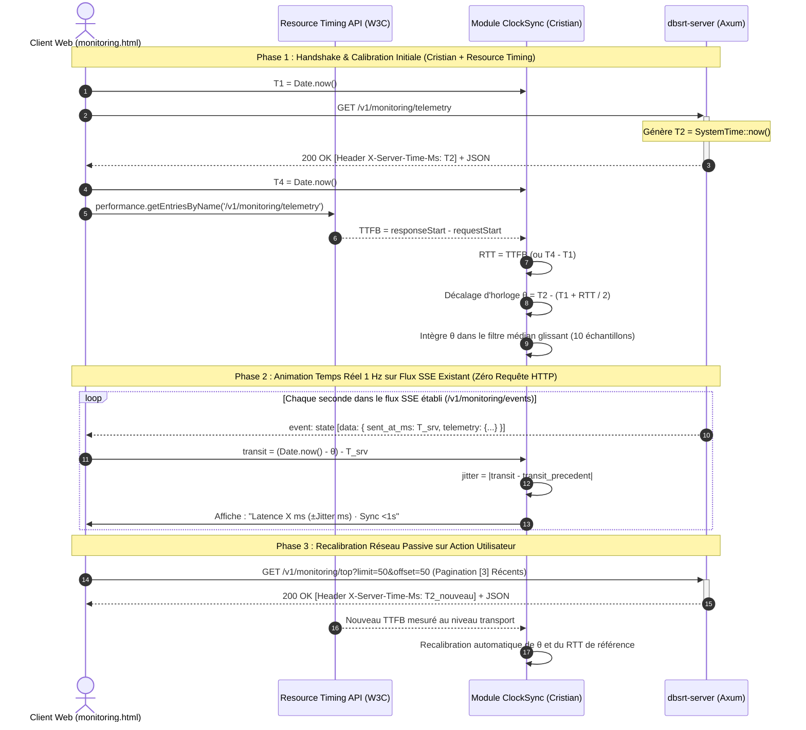

# 💡 Architecture de Streaming SSE et Optimisation du Polling Monitoring

**Date :** 4 novembre 2026
**Statut :** Spécification d'Architecture et Validation Empirique
**Axe :** Observabilité Réseau, Économie de Bande Passante et Réactivité Front/Back

---

## 1. Contexte & Diagnostic du Problème

Dans le portail de supervision et de monitoring web (`dbsrt top` et son interface web servie par `dbsrt-server`), la vue d'inspection des requêtes réseau (`DevTools Network`) révélait un volume disproportionné de requêtes répétitives : **354 requêtes en 6 minutes**, transférant plus de 4.3 Mo de JSON.

### Causes Racines Identifiées

1. **Short Polling Aveugle & Répétitif** :
   Une boucle `setInterval(refreshAll, 3000)` déclenchait systématiquement 3 requêtes HTTP concurrentes toutes les 3 secondes :
   - `GET /v1/monitoring/telemetry` (métriques système et pipeline)
   - `GET /v1/monitoring/top?limit=50&offset=0` (snapshot dbsrt top avec 50 entrées catalogue, 26 Ko par tick)
   - `GET /v1/catalog/status` (déclenché en cascade par la fonction `renderTopSystem`)
2. **Re-téléchargement Inutile de Données Froides** :
   Le catalogue de médias et l'historique batch ne changent pas toutes les 3 secondes. Re-télécharger 26 Ko de données tabulaires à chaque cycle saturait la file d'attente HTTP/1.1 du navigateur et créait des temps de latence perceptibles (latences mesurées jusqu'à 4.06 s sur des requêtes en attente).
3. **Absence de Détection de Visibilité (Page Visibility API)** :
   Lorsque l'utilisateur bascule sur son terminal, son IDE ou un autre onglet, le navigateur continuait d'émettre 1 requête par seconde en continu sans aucun ralentissement ni mise en veille.

---

## 2. Étude Comparative des Motifs d'Actualisation Temps Réel

Quatre motifs d'architecture ont été analysés pour moderniser le transport des métriques :

| Critère d'Évaluation | Short Polling Actuel | WebSockets (WS / WSS) | ETag / HTTP 304 | SSE (Server-Sent Events) |
| :--- | :--- | :--- | :--- | :--- |
| **Volume de Requêtes HTTP** | ❌ ~60 requêtes/minute | 🏆 1 connexion TCP | ❌ ~60 requêtes/minute | 🏆 **1 requête HTTP persistante** |
| **Bande Passante Réseau** | ❌ 26 Ko à chaque tick | ⚡ Trame binaire / texte minimal | ⚡ En-têtes HTTP seuls (corps 0 Ko) | ⚡ **Push JSON différentiel uniquement** |
| **Gestion Reconnexion** | ❌ Manuelle (erreur fetch) | ⚠️ Manuelle côté client (code JS custom) | ❌ Manuelle | 🏆 **100% native par le navigateur** |
| **Complexité Client (JS)** | Trivial (`fetch`) | Élevée (state machine, ping/pong) | Modérée | 🏆 **Trivial (`EventSource` standard W3C)** |
| **Compatibilité o2switch / Proxys** | 100% | ⚠️ Fragile (blocage `Upgrade: websocket`) | 100% | 🏆 **100% (pur HTTP/1.1 streaming)** |
| **Sens du Flux** | Pull (Client $\to$ Serveur) | Full Duplex ($\leftrightarrow$) | Pull (Client $\to$ Serveur) | Push (Serveur $\to$ Client) |

### Pourquoi les WebSockets Sont Sous-Optimaux Ici

Le protocole WebSocket impose un upgrade de protocole (`Upgrade: websocket`) au-dessus de TCP. Sur un hébergement mutualisé ou cloud managé (cPanel, Nginx/Passenger, reverse-proxies o2switch), les sockets longue durée sans trafic bidirectionnel sont fréquemment tués ou bloqués par les coupe-circuits de sécurité.
De plus, le tableau de bord de supervision n'émet pas de flux continu de données vers le serveur : les commandes utilisateur (lancer matching, paginer) sont des opérations ponctuelles qui s'expriment naturellement par des requêtes REST `POST` ou `GET`.

### Pourquoi Server-Sent Events (SSE) Est la Solution Idéale

1. **Standard Natif W3C** : Implémenté nativement dans tous les navigateurs modernes (`new EventSource('/v1/monitoring/events')`) sans aucune bibliothèque externe.
2. **Résilience Réseau Intégrée** : En cas de coupure temporaire ou redémarrage du serveur, le navigateur retente la connexion automatiquement avec un backoff standardisé.
3. **Visibilité DevTools** : Dans l'onglet *Network*, une **seule et unique ligne** apparaît avec le statut `Pending`. Le détail des événements entrants est consultable sous forme chronologique dans l'onglet dédié *EventStream*, libérant l'inspection réseau de tout bruit.
4. **Intégration Axum 0.8** : Axum fournit un support de premier ordre via `axum::response::Sse` et `tokio_stream::wrappers::BroadcastStream`.

---

## 3. Architecture Cible Hybride (SSE Push + REST On-Demand)

Le nouveau paradigme repose sur une séparation stricte entre **métriques chaudes (Push SSE)** et **données volumineuses froides (Fetch REST)** :

### Règles d'Or de l'Architecture Cible

1. **Flux SSE Unique (`/v1/monitoring/events`)** :
   - Diffuse les métriques rapides (CPU, GPU, RAM, statut des jobs actifs, débit pHash).
   - Taux d'émission configurable (par exemple 1 seconde lors d'ingestion active, 3 secondes au repos).
2. **Découplage Catalogue (Données Froides)** :
   - Le catalogue de médias ne fait **jamais** l'objet d'un polling récurrent.
   - Les listes volumineuses (`limit=50`) sont interrogées uniquement sur action explicite :
     - Changement d'onglet vers le catalogue.
     - Clic sur les boutons de pagination (page suivante / précédente).
     - Signal explicite de rechargement post-ingestion.
3. **Mise en Veille Automatique (Page Visibility API)** :
   - Lorsque `document.hidden` est vrai, la connexion `EventSource` ou le timer d'actualisation est immédiatement suspendu.
   - Dès que l'utilisateur revient sur la page (`visibilitychange`), un rafraîchissement immédiat est exécuté et le flux est reconnecté.
4. **Suppression des Appels Cascades** :
   - Le statut du catalogue (`/v1/catalog/status`) est intégré directement dans le payload unifié de l'état système, éliminant les requêtes orphelines secondaires.

---

## 4. Optimisation des Listes Lourdes & Pattern Stale-While-Revalidate (SWR)

### Diagnostic de la Latence Initiale (751 ms)

Lors du passage vers l'onglet des traitements complétés (`[3] Récents`) ou le catalogue, la première requête `GET /v1/monitoring/top?limit=50&offset=0` affichait une latence de **751 ms** sur la production o2switch, figeant visuellement le tableau de bord :

1. **Calcul Bloquant en Sous-Processus** :
   L'endpoint exécutait `dbsrt top --json` pour agréger `batch_tvshow_nightly.jsonl` (9 656 lignes de journalisation et 2 762 médias uniques), effectuant 1 seconde d'échantillonnage CPU sur le serveur partagé.
2. **TTL de Cache Trop Court (2 s)** :
   Le cache expirait avant la moindre navigation de l'utilisateur, forçant un re-calcul complet à chaque changement d'onglet.
3. **Verrouillage Global Synchrone** :
   Le mutex asynchrone `cache.lock().await` était maintenu pendant toute l'exécution du sous-processus CLI (~700 ms).

### Architecture Stale-While-Revalidate Déployée

Pour éliminer tout blocage sans saturer le processeur hôte :

### Bénéfices Mesurés

- **Zéro Attente Serveur** : Le temps de réponse serveur passe de 700 ms à **0,0 ms** (simple découpage de mémoire vive).
- **Réseau WAN** : Le temps total perçu tombe à **~119 ms** sur fibre distante (et < 10 ms en local).
- **Rendu Visuel Asynchrone** : Injection d'un skeleton `⏳ Chargement...` et transition d'opacité (`0.4` $\rightarrow$ `1.0`) supprimant toute sensation de gel.

---

## 5. Mesure de la Latence Réseau & Analyse Comparative des Technologies

### 5.1 La Problématique de l'Observabilité sans Bruit

Dans un tableau de bord de supervision temps réel, l'affichage de la santé de la connexion et de la latence réseau (RTT — *Round Trip Time*) est une exigence opérationnelle critique. Toutefois, deux écueils majeurs s'opposent :

1. **Le Piège du Bombardement HTTP (Micro-Polling)** :
   Une approche naïve consistant à émettre une requête `HEAD /v1/health` toutes les 10 secondes génère 90 à 100 entrées dans le panneau *Network* de l'inspecteur web en 15 minutes, masquant les véritables requêtes applicatives et gaspillant des sockets TCP.
2. **Le Piège du Compromis Figé (Zero Update)** :
   Supprimer purement et simplement le polling pour ne conserver qu'une latence mesurée une fois au chargement fige la valeur à l'écran, rendant l'interface incapable de signaler une dégradation réseau, une coupure ou une gigue (jitter).

---

### 5.2 Typologie Complète des Solutions & Contraintes de la Plateforme o2switch

Pour résoudre cette tension, huit approches technologiques ont été analysées et confrontées aux contraintes strictes de notre infrastructure de déploiement (hébergement mutualisé CloudLinux LVE sur o2switch, reverse-proxy PHP cURL et socket Unix Axum).

#### 1. Option WS : WebSockets Full-Duplex (Standard Grafana / Discord)
- **Principe** : Une connexion TCP persistante unique sur laquelle le client émet des frames natives d'opcode `0x9` (Ping) et reçoit `0xA` (Pong).
- **Avantages** : Zéro requête HTTP dans l'inspecteur réseau (tout réside dans l'unique flux WebSocket), bidirectionnel natif, latence au niveau transport.
- **Incompatibilité o2switch** : ❌ **Inapplicable**. Sur hébergement mutualisé o2switch, le routage repose sur un proxy PHP cURL vers un socket Unix (`index.php`). PHP cURL supporte le streaming HTTP/1.1 chunked unidirectionnel (SSE), mais ne peut pas maintenir ni multiplexer un tunnel bidirectionnel WebSocket sans le module Apache `mod_proxy_wstunnel`, non configurable sur mutualisé.

#### 2. Option A : Micro-Ping HTTP Périodique Adaptatif (`HEAD /v1/health`)
- **Principe** : Requête HTTP légère périodique (cadencée à 30 ou 60 s au lieu de 10 s), suspendue automatiquement lorsque l'onglet est masqué (`document.hidden`).
- **Avantages** : Vrai RTT de bout en bout (DNS + TCP + TLS + réponse serveur).
- **Inconvénients** : Génère une ligne dans DevTools à chaque intervalle (bien que filtrable via `-health`). Fréquence lente (30 s), inadaptée à une animation de latence fluide.

#### 3. Option B : Jitter SSE Brut Unidirectionnel (`payload.sent_at_ms`)
- **Principe** : Le serveur injecte son horodatage epoch `sent_at_ms` à chaque tick SSE (1 Hz). Le client calcule $now - sent\_at\_ms$.
- **Inconvénients majeurs** :
  - **Absence de RTT** : SSE étant strictement unidirectionnel, le client ne renvoie rien. Ce calcul ne mesure qu'un transit aller simple.
  - **Sensibilité Extrême à la Désynchronisation d'Horloge OS** : Si l'horloge du serveur o2switch et celle du poste client dérivent de 150 ms (cas fréquent sur les VM hébergées sans NTP strict), le transit calculé est faussé de 150 ms, voire devient négatif ($< 0$).

#### 4. Option C : W3C Performance Resource Timing API (`PerformanceObserver`)
- **Principe** : Le navigateur expose nativement le chronométrage réseau au niveau sous-jacent (DNS, TCP, TLS, TTFB — *Time To First Byte*) pour chaque ressource chargée : $\text{TTFB} = \text{responseStart} - \text{requestStart}$.
- **Avantages** : Précision native en microsecondes mesurée directement par le moteur réseau du navigateur, **zéro requête supplémentaire**, **zéro ligne parasite**.
- **Limite Spécifique à SSE** : Pour un `EventSource` (`/v1/monitoring/events`), la connexion reste ouverte en continu (`responseEnd` n'arrive jamais). `PerformanceResourceTiming` n'émet donc son événement **qu'une seule fois** (au handshake initial 200 OK). L'API Resource Timing seule ne peut donc pas animer une latence en continu sans événement récurrent.

#### 5. Option D : Standard W3C `Server-Timing` Header
- **Principe** : Le serveur Rust injecte des métriques d'exécution sous forme d'en-tête HTTP standard : `Server-Timing: mih;dur=8.5, total;dur=145`.
- **Avantages** : Standard W3C, structuré, lisible par le navigateur via `performance.getEntries()`.
- **Limite sur le Flux SSE** : Dans le protocole HTTP/1.1 et HTTP/2, les en-têtes de réponse sont envoyés **exclusivement lors du handshake initial**. Les frames SSE subséquentes (`data: {...}\n\n`) sont des blocs textuels du corps de réponse et ne transportent aucun en-tête HTTP. `Server-Timing` est excellent pour décomposer les requêtes REST individuelles (`/v1/search`), mais incapable d'animer le stream SSE.

#### 6. Option E : Algorithme de Synchronisation d'Horloge de Cristian (NTP Léger)
- **Principe** : Algorithme probabiliste de synchronisation d'horloge formulé par Flaviu Cristian (1989). Lors d'une requête HTTP requête/réponse existante, trois timestamps sont mis en relation pour calculer à la fois le RTT exact et le décalage d'horloge $\theta$ :
  $\text{RTT} = T_4 - T_1$, et $\theta = T_2 - (T_1 + \text{RTT} / 2)$.
- **Avantages** : Corrige de manière robuste la désynchronisation d'horloge entre client et serveur sans nécessiter de protocole UDP NTP dédié. Permet d'exploiter immédiatement le `sent_at_ms` du flux SSE pour obtenir un transit aller corrigé et une gigue vivante chaque seconde.

#### 7. Option F : En-Tête HTTP `Date` + Keep-Alive
- **Principe** : Lecture du header standard `Date` retourné par Apache/LiteSpeed.
- **Limites** : Résolution limitée à la seconde entière (aucun millième de seconde dans la spécification RFC 7231 des dates HTTP). Ne permet pas une mesure fine.

#### 8. Option G : API `navigator.connection` (Network Information API)
- **Principe** : Lecture de la propriété expérimentale `navigator.connection.rtt`.
- **Limites** : API non standardisée, rejetée par Firefox et WebKit/Safari, et dégradée artificiellement par Chrome par paliers de 25 ms pour prévenir le pistage (fingerprinting). Inexploitable pour un monitoring de précision.

---

### 5.3 Matrice Comparative & Décisionnelle

| Solution Évaluée | Vrai RTT Réseau | Rafraîchissement | Bruit DevTools Network | Dérive Horloge OS | Compatibilité o2switch | Verdict Architectural |
| :--- | :---: | :---: | :---: | :---: | :---: | :--- |
| **WS (WebSocket)** | ✅ | Continu | **0** (1 flux WS) | Sans objet (Pong) | ❌ Incompatible (proxy PHP cURL) | Écarté (bloquant infra) |
| **A (Micro-Ping 30s)** | ✅ | 1 / 30 s | 1 req / 30 s | Immunisé | ✅ Compatible | Fallback optionnel |
| **B (SSE Brut)** | ❌ (1-way) | Continu 1 Hz | **0** | ⚠️ Faussé ($> \pm 100$ ms) | ✅ Compatible | Rejeté (mathématiquement faux) |
| **C (Resource Timing)** | ✅ (TTFB) | À chaque requête | **0** | Immunisé | ✅ Compatible | **Retenu (Calibration RTT)** |
| **D (Server-Timing)** | Métriques srv | One-shot (handshake) | **0** | Sans objet | ⚠️ Headers HTTP figés sur SSE | Réservé aux endpoints REST |
| **E (Cristian / NTP)** | ✅ (sur REST) | Continu 1 Hz via SSE | **0** | **Corrigé ($\theta$)** | ✅ Compatible | **Retenu (Animation 1 Hz)** |
| **F (HTTP Date)** | ❌ | À chaque requête | **0** | Granularité 1 000 ms | ✅ Compatible | Rejeté (trop grossier) |
| **G (Network Info API)** | Estimé | Événementiel | **0** | Sans objet | Incompatible Firefox/Safari | Rejeté (non standard) |

---

### 5.4 Architecture Retenue : Le Combo Cristian (E) + Resource Timing (C)

La solution adoptée couple la précision réseau de la **Resource Timing API (C)** avec la correction d'horloge de l'**Algorithme de Cristian (E)** et la cadence 1 Hz du flux SSE :

### 5.5 Formulations Mathématiques et Filtre Médian

#### Calcul du Décalage d'Horloge OS ($\theta$)

- $T_1$ : `Date.now()` à l'envoi de la requête client
- $T_2$ : En-tête `X-Server-Time-Ms` produit par le serveur Rust
- $T_4$ : `Date.now()` à la réception complète de la réponse
- $\text{RTT} = T_4 - T_1$ (ou $\text{responseStart} - \text{requestStart}$ via Resource Timing)
- $\theta = T_2 - (T_1 + \frac{\text{RTT}}{2})$

#### Élimination des Aberrations Réseau (Filtre Médian Glissant)

Afin d'éviter qu'un pic de latence transitoire sur le réseau WAN ne fausse l'estimation de $\theta$, les 10 derniers échantillons $(\text{RTT}_i, \theta_i)$ sont conservés dans un tampon circulaire. La valeur retenue pour $\theta$ est la médiane de ce tampon :

$$\theta_{\text{effectif}} = \text{médiane}(\{\theta_1, \theta_2, \dots, \theta_k\})$$

#### Calcul Continu du Transit Aller et de la Gigue (Jitter)

À chaque tick du flux SSE contenant l'horodatage serveur $T_{\text{srv}} = \texttt{sent\_at\_ms}$ :

- $\text{transit}_{\text{aller}} = \max(0, (\text{Date.now()} - \theta_{\text{effectif}}) - T_{\text{srv}})$
- $\text{gigue} = |\text{transit}_{\text{aller}} - \text{transit}_{\text{aller}}^{\text{précédent}}|$
- $\text{RTT}_{\text{estimé}} = \text{transit}_{\text{aller}} \times 2$

Cette architecture assure un affichage dynamique et rigoureux de la latence, mis à jour **chaque seconde**, sans générer **aucune** requête HTTP supplémentaire dans l'inspecteur réseau, et immunisé contre tout écart d'horloge entre client et serveur.
