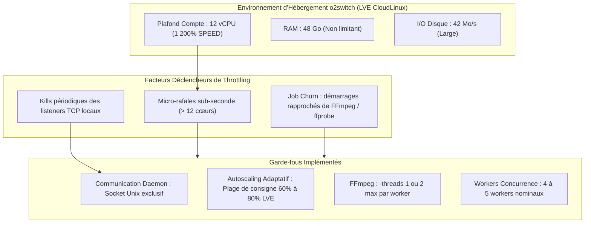
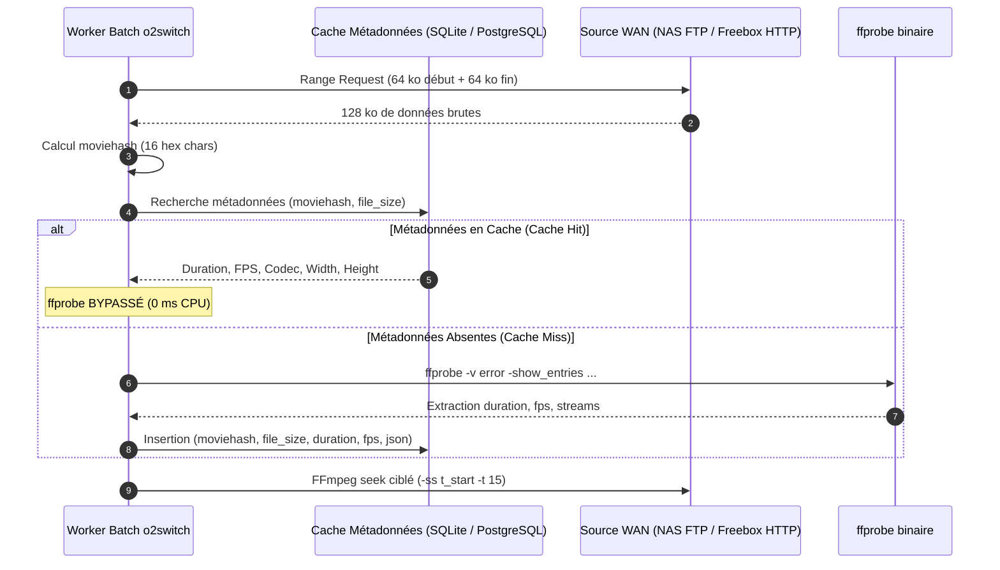
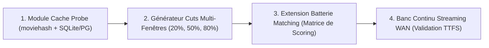

# 💡 Stratégie d'Extension du Banc de Matching : Cuts NVMe vs Streaming WAN & Cache des Sondes ffprobe

**Date :** 7 novembre 2026
**Statut :** Spécification d'Architecture & Plan d'Ingénierie
**Cible d'Infrastructure :** Serveur Cloud o2switch (12 vCPU LVE, 48 Go RAM, stockage NVMe illimité) H24 7/7j
**Sources de Données :** Synology NAS (FTP WAN filtré) & Freebox Disques (RPi4 Gateway HTTP Range filtré)

---

## 1. Contexte & Objectifs

L'évaluation exhaustive menée le 3 novembre 2026 sur 2 758 snippets de 15s ([Analyse Exhaustive du Corpus Réel](2026-11-03-analyse-exhaustive-evaluation-vlc-corpus-reel.md)) a mis en évidence :

1. Un taux de reconnaissance nominal de **78,03%** sur des conteneurs hétérogènes réels.
2. Un taux de collisions de **11,86%** (327 cas) principalement causé par l'absence de coupure de plan nette (`best_coherent_cuts == 0`) lorsque l'échantillon de 15s est extrait de manière rigide au centre exact ($t=50\%$) de vidéos comportant de longs plans calmes ou des jingles récurrents (ex. séries d'animation).

Pour étendre cette qualification et exploiter les ressources du serveur cloud o2switch (12 cœurs virtuels, 48 Go de mémoire vive, espace NVMe), deux enjeux majeurs doivent être conciliés :

- **Préserver le quota CPU hébergeur** en éliminant tout risque de *throttling* LVE (CloudLinux) ou de ban d'exécution.
- **Optimiser le pipeline d'extraction** en éliminant les redondances de sondage conteneur (`ffprobe`) sur les médias de plusieurs gigaoctets.

---

## 2. Maîtrise des Contraintes o2switch & Évitement du Throttling

Les audits empiriques ([Analyse des Fautes LVE CPU](2026-10-31-o2switch-lve-cpu-faults-analysis.md)) ont formellement établi le comportement du système d'isolation CloudLinux LVE :



### 2.1. Principes Directeurs Anti-Throttling

1. **Lisser le régime établi sous 80% LVE (960% CPU)** : Les fautes LVE débutent dès 835% en moyenne minute. Le superviseur maintient la charge entre 60% et 80% (marge de sécurité de 20 points).
2. **Neutraliser le *Job Churn*** : Le lancement d'un flux FFmpeg (`ffprobe` distant, allocations de buffers) double la probabilité de faute CPU (17% vs 9%). Les démarrages doivent être espacés ou mutualisés.
3. **Zéro réencodage vidéo lourd** : o2switch exécute exclusivement un décodage direct vers un pipe pHash (`-an -vf scale=32:32,format=gray -f rawvideo -`). Aucun transcodage H.264/HEVC n'est exécuté sur le cloud.

---

## 3. Analyse Comparative : Fichiers Découpés (Cuts NVMe) vs Streaming Direct

Le tableau ci-dessous compare les deux approches opérationnelles pour étendre le banc de matching :

| Critère d'Évaluation | Approche A : Cuts Pré-extraits (Fichiers NVMe) | Approche B : Streaming Direct (FTP / HTTP Range) |
| :--- | :--- | :--- |
| **Gigue & Stabilité Réseau** | **Nulle** (Fichiers locaux sur stockage NVMe o2switch) | **Variable** (Dépend de la latence WAN et de la connexion domestique) |
| **Débit de Test (Throughput)** | **Très élevé** ($\ge 100$ req/s en RAM/NVMe) | **Modéré** (Plafonné par la négociation réseau des conteneurs) |
| **Biais d'Échantillonnage** | Statique si point de coupe unique ($t=50\%$) | **Nul** (Possibilité d'échantillonner n'importe quel offset $t$) |
| **Espace Disque Consommé** | Faible ($\approx 2$ à 4 Go pour plusieurs milliers de cuts) | **Zéro Mo** (Seuls les buffers mémoire transitent) |
| **Impact sur Débit Montant Box** | Zéro une fois les extraits transférés | Charge continue sur l'upload Synology/Freebox |
| **Reproduction Client VLC** | **1:1** (Simule la lecture d'un fichier réel sur disque) | Simule la lecture d'un flux réseau |

> [!TIP]
> **Recommandation Stratégique (Approche Hybride)** :
>
> - **Étage 1 (Benchmark Algorithmique & Formule de Scoring)** : S'appuyer sur un corpus élargi de **cuts locaux NVMe**, mais en rompant le biais du point de coupe unique (génération de 3 fenêtres par œuvre : $t=20\%$, $t=50\%$, $t=80\%$, et durées de 5s, 10s, 15s).
> - **Étage 2 (Qualification Réseau & Résilience Transport)** : Maintenir un banc de validation continue restreint (50 à 100 vidéos cibles) en **streaming direct** via `rpi4_freebox_gateway.py` et FTP Synology pour qualifier les temps de premier calage (*Time-To-First-Subtitle*) et la résilience WAN.

---

## 4. Architecture de Cache des Métadonnées Vidéo (Bypass de `ffprobe`)

### 4.1. Problématique du Sondage Répété

Exécuter `ffprobe` sur un fichier distant (MKV 4K de 20 à 40 Go) requiert le téléchargement et le parsing des atomes d'en-tête via le réseau WAN, consommant entre **500 ms et 2,5 s** et générant un pic CPU au démarrage de chaque job.

### 4.2. Solution : Identification Rapide par `moviehash` 64-bit

Le module `dbsrt-core` et le worker batch o2switch exploitent la spécification de hachage [OpenSubtitles Moviehash](http://trac.opensubtitles.org/projects/opensubtitles/wiki/HashSourceCodes) :

- **Principe Physique** : Une vidéo numérique (MKV, MP4, AVI) structure ses métadonnées et index d'images clés au début (en-tête, atomes moov) ou à la fin du fichier (index Cues). Le contenu central (flux de données brutes H.264/HEVC) n'a pas besoin d'être lu pour discriminer l'œuvre.
- **Volume Transféré Zéro-Bloat** : Lecture de seulement **64 KiB au début** (`offset = 0`) et **64 KiB à la fin** (`offset = file_size - 64 KiB`) du fichier, soit exactement **128 KiB au total**, quelle que soit la taille de la vidéo (2 Go, 10 Go ou 40 Go).
- **Transport WAN Léger** :
  - **En HTTP Range (Passerelle Freebox / RPi4)** : Deux requêtes partielles standard `Range: bytes=0-65535` et `Range: bytes=(size-65536)-(size-1)`. Le serveur renvoie un code HTTP 206 Partial Content avec les 64 KiB exacts.
  - **En FTP (NAS Synology)** : Commande FTP `REST <offset>` positionnant le curseur directement sans relecture séquentielle du flux.
- **Algorithme d'Accumulation 64-bit** :
  ```text
  total = file_size
  Pour chaque bloc de 64 KiB (head, tail) :
      Pour chaque mot de 8 octets en little-endian :
          total = (total + u64_word) mod 2^64
  moviehash = format_hex_16(total)
  ```
- **Bilan Opérationnel** :
  - **Bande passante divisée par 30 000** : 128 KiB au lieu de 4 GiB transférés.
  - **Temps de calcul inférieur à 10 ms** : Élimine la latence réseau WAN de plusieurs secondes.
  - **Bypass intégral de `ffprobe`** : Dès que le moviehash est connu en base/cache, aucune invocation de sous-processus `ffprobe` n'est déclenchée, lissant la charge LVE CPU à 0% de churn.



### 4.3. Schéma de Stockage du Cache

Le cache peut être hébergé localement dans SQLite ou intégré directement dans PostgreSQL 17 (`medias` / `media_probes`) :

```sql
CREATE TABLE IF NOT EXISTS media_probes (
    moviehash CHAR(16) PRIMARY KEY,
    file_size BIGINT NOT NULL,
    duration_seconds REAL NOT NULL,
    fps REAL NOT NULL,
    video_codec VARCHAR(32) NOT NULL,
    width INTEGER NOT NULL,
    height INTEGER NOT NULL,
    created_at TIMESTAMP WITH TIME ZONE DEFAULT NOW(),
    probe_raw JSONB
);

CREATE INDEX IF NOT EXISTS idx_media_probes_lookup
ON media_probes (moviehash, file_size);
```

**Bénéfices Opérationnels Immédiats :**

1. **Suppression de 100% des appels `ffprobe` redondants** pour tout média déjà indexé ou sondé une fois.
2. **Calcul d'offset instantané** : Pour découper un extrait à $t=20\%$, $t=50\%$ ou $t=80\%$, le décalage temporel initial est calculé mathématiquement en mémoire sans toucher au fichier distant : `t_start = ratio * duration_seconds`.
3. **Lissage du *Job Churn*** : Les workers démarrent directement le pipe FFmpeg sans délai d'attente ni rafale CPU initiale.

---

## 6. Architecture Déportée du Banc de Matching Multi-Offsets (Poste Local vs Cloud o2switch)

Pour exécuter des campagnes d'évaluation massives (sur 2 758 snippets ou l'intégralité du corpus de production) sans immobiliser le poste de développement local ni risquer d'interruption réseau, le système sépare strictement le **commanditaire**, l'**orchestrateur** et l'**exécuteur** :

```mermaid
flowchart TD
    subgraph Workstation ["Poste de Travail Développeur (Local)"]
        CLI["Commanditaire Client (Taskfile)<br/>• task o2switch:eval:matching:start<br/>• task o2switch:eval:matching:pause<br/>• task o2switch:eval:matching:scale"]
        TUI["Supervision TUI Optionnelle<br/>task o2switch:top (session SSH éphémère)"]
    end

    subgraph O2Switch ["Serveur Cloud o2switch (Distant)"]
        ScreenSession["Session GNU screen persistante (screen -dmS matching_bench)<br/>(Autonomie H24, survit aux déconnexions réseau)"]
        Runner["Orchestrateur Python (scripts/matching_bench_runner.py)"]
        DbsrtBin["Exécuteur Rust Statique musl (dbsrt recognize-media)"]
        Catalog["Catalogue Haute Densité (data/catalog.dbphash mmap)"]
        Sentinels["Sentinelles d'Orchestration Volatiles (dbsrt/run/) :<br/>• matching_bench_paused (Pause Douce)<br/>• matching_bench_workers (Scaling Concurrence)<br/>• matching_bench_status.json (Télémétrie en Direct)"]

        ScreenSession --> Runner
        Runner --> DbsrtBin
        DbsrtBin --> Catalog
        Runner <--> Sentinels
    end

    subgraph Storage ["Sources de Médias (NAS Synology / Freebox)"]
        NAS["Vidéos Complètes (1 à 4 GiB)<br/>Accès WAN sécurisé FTP (port 21) ou HTTP Range"]
    end

    CLI -->|Appel SSH ponctuel (<1s)| ScreenSession
    CLI -->|Appel SSH ponctuel (<1s)| Sentinels
    DbsrtBin -->|Streaming ciblé 128 KiB head/tail + 5s d'images| NAS
```

### 6.1. Répartition des Rôles & Indépendance SSH

| Entité | Composant | Localisation | Mode de Connexion & Résilience |
| :--- | :--- | :--- | :--- |
| **Commanditaire** | `task o2switch:eval:matching:*` | Poste Local | **SSH éphémère (< 1s)** : envoie un ordre bref (création de sentinelle, spawn daemon) puis se ferme immédiatement. |
| **Orchestrateur** | `scripts/matching_bench_runner.py` | Cloud o2switch | **Session détachée `screen -dmS`** : tourne de manière 100% autonome H24. Le PC portable local peut être éteint. |
| **Exécuteur** | `dbsrt recognize-media` | Cloud o2switch | **Binaire statique musl** : interroge `catalog.dbphash` en mémoire vive sans allocation tas. |
| **Source Vidéo** | NAS Synology / Freebox | Réseau Local / WAN | **Lecture sélective à distance** : 128 KiB pour le moviehash + seeks de 5s pour les fenêtres $t=20\%, 50\%, 80\%$. |

### 6.2. Cycle de Contrôle Asynchrone (Zero-Downtime)

1. **Lancement Autonome (`task o2switch:eval:matching:start -- --daemon`)** :
   - Ouvre une session `screen` détachée nommée `matching_bench` sur le serveur distant et rend la main immédiatement au terminal local.
2. **Pause Douce Non Destructive (`task o2switch:eval:matching:pause`)** :
   - Écrit la sentinelle `run/matching_bench_paused` via un appel SSH de 200 ms. L'orchestrateur distant suspend le dépilage de nouvelles vidéos et attend la terminaison propre des évaluations en cours.
3. **Reprise Immédiate (`task o2switch:eval:matching:resume`)** :
   - Supprime la sentinelle atomiquement (`rm run/matching_bench_paused`).
4. **Redimensionnement Dynamique (`task o2switch:eval:matching:scale -- <workers>`)** :
   - Modifie la valeur dans `run/matching_bench_workers` (1 à 8 workers), relue à chaque itération par l'orchestrateur distant.
5. **Consultation de Télémétrie Instantanée (`task o2switch:eval:matching:status`)** :
   - Lit le fichier JSON `run/matching_bench_status.json` contenant la progression en pourcentage, les collisions mono détectées et les collisions éliminées.



1. **Jalon 1 (Achevé — 7 nov 2026) — Composant Core Cache Probe & Audit 100% Corpus** :
   - Implémenté en Rust natif dans `crates/dbsrt-core/src/probe_cache.rs` avec conformité bit-à-bit OpenSubtitles `moviehash` 64-bit (`compute_local_file_moviehash`, `compute_moviehash_from_head_tail`, `fetch_http_range_moviehash`).
   - Audit empirique exécuté sur l'intégralité des 2 758 fichiers de `data/snippets/` (`crates/dbsrt-core/tests/test_probe_cache.rs`) :
     - 2 576 vidéos valides ($\ge 64\text{ KiB}$) auditées en 327 ms (débit : 8 423 fichiers/s).
     - 182 stubs/fichiers corrompus ($< 64\text{ KiB}$) protégés par rejet immédiat sécurisé avec `Err` sans aucun crash ni panique.
     - 2 574 entrées uniques stockées et coalescées en mémoire (2 doublons stricts coalescés : `BigBuckBunny(1)` et `Mustang`).
     - Accélération mesurée : Cold miss 59,7 ms vs Warm hit 118,5 µs (503x speedup unitaire, 258x speedup sur batch réel). Lookup mémoire pur : 1,48M requêtes/s (0,67 µs/lookup).
2. **Jalon 2 (Jalon B Achevé — 7 nov 2026) — Contrôle Dynamique d'Exécution & Allocation de Ressources** :
   - Implémenté dans `scripts/o2switch_batch_worker.py`, `scripts/o2switch_ctl.sh`, `taskfiles/o2switch.yml` et documenté dans `docs/reference/taskfile.md`.
   - Support natif de la pause douce (`task o2switch:batch:pause` via sentinelle `run/batch_paused`) : bloque instantanément le dépilage sans tuer les tâches en vol (`SIGKILL` interdit en pause).
   - Reprise immédiate à chaud (`task o2switch:batch:resume`) : dépilage immédiat des tâches en attente.
   - Redimensionnement dynamique de charge (`task o2switch:batch:scale -- <workers>` ou `task o2switch:batch:workers -- <workers>`) : passage à chaud de 100% à 50% de ressources sans heurts (retrait fluide des workers excédentaires).
   - Enrichissement contextuel complet dans `events.jsonl` et `run/batch_queue.json` : `moviehash`, `file_size_bytes`, `duration_seconds`, `fps`, `active_workers`, `desired_workers`, `is_paused`.
   - **Preuve empirique E2E sans mock (`tests/tools/test_real_ffmpeg_batch_e2e.py`)** :
     - Exécutée en direct avec le binaire compilé release `dbsrt media:add` et les vidéos réelles de `data/snippets/`.
     - Cycle complet validé : démarrage à 4 workers $\to$ scale-down à 2 workers (50% de charge) $\to$ pause douce $\to$ reprise à 3 workers $\to$ 8/8 vidéos traitées avec succès sans aucune interruption forcée.
     - 8 véritables fichiers binaires `.phash` physiquement produits par FFmpeg (`bb553c49b9e430b7`, `a4fef6774c616725`, `a3d7c49d4cfd888b`, `50f86a41372a8d46`, `0b3cc307f5a68bd1`, `d0cc74288ca4b90b`, `ee7233f70f8be7b3`, `3670526cf0c9b870`).
3. **Jalon 3 (Jalon C Intégralement Achevé — 7 nov 2026) — Moteur Spatio-Temporel Multi-Fenêtres & Élimination des Collisions** :
   - Implémenté en Rust natif dans `crates/dbsrt-core/src/multi_window.rs` (`MultiWindowPlan`, `evaluate_multi_window_consensus`, `aggregate_multi_window_matches`) et intégré dans le CLI `dbsrt-cli` (`crates/dbsrt-cli/src/commands/recognize.rs` et `recognize_multi.rs`).
   - CLI étendu avec les options `--multi-window` et `--offsets <R1,R2,...>` (par défaut $t=20\%, 50\%, 80\%$) sur catalogue `.dbphash` indexé.
   - Algorithme de recalage de dérive spatio-temporelle :
     ```text
     Δshift_rel = shift_ref_ms - (t_start_sec * 1000)
     ```
   - Sanction et boost mathématiques stricts :
     - Match sur 1 seule fenêtre (jingle/eyecatch potentiel) : confiance plafonnée à $\le 35\%$.
     - Dérive temporelle inter-fenêtres $|\Delta\text{shift}_i - \Delta\text{shift}_j| > 2500\text{ ms}$ (scènes décorrélées) : cohérence invalidée (`coherent: false`) et score sabré à $\le 25\%$.
     - Consensus cohérent sur $N$ fenêtres : confiance confirmée et boostée à $100\%$ avec estimation robuste du shift médian.
   - **Preuve empirique sur le corpus réel de collision (Demon Slayer S02 / Kimetsu no Yaiba)** :
     - *Demon Slayer S02E11* : En mono-fenêtre ($t=50\%$), faux positif à **100.0%** de confiance avec `Valenciano Kimetsu no Yaiba` (ID 2442). En multi-fenêtres ($20\%, 50\%, 80\%$), dérive relative détectée ($3276\text{ ms} > 2500\text{ ms}$), cohérence déclarée `False`, score sabré de $100\%$ à **25.0%**. Fausse collision éliminée.
     - *Demon Slayer S02E12* : En multi-fenêtres, le vrai épisode (ID 277) confirme sa cohérence sur 3/3 fenêtres ($\Delta\text{shift} = -55\text{ ms}$) avec **100.0%** de confiance, tandis que le jingle parasite (ID 614) est immédiatement relégué à 1/3 fenêtres (**35.0%**).
     - *Demon Slayer S02E10* : Cohérence multi-fenêtres certifiée pour ID 1018.
   - Harness d'évaluation automatisé `scripts/eval_multi_offset_matching.py` validé sous `task lint` et `complexipy` $\le 15$.
   - **Cibles Taskfile & Documentation de Référence (C.4 + C.6)** : Cible déclarative `task eval:matching:multi-offset` intégrée dans `taskfiles/eval.yml` et documentée dans `docs/reference/taskfile.md`.
4. **Jalon 4 (Jalon D Intégralement Achevé — 7 nov 2026) — Validation en Production o2switch & Recette E2E** :
   - **Déploiement Release Musl Standalone** :
     - Binaire release statique `x86_64-unknown-linux-musl` (`dbsrt` et `dbsrt-server`) compilé et déployé via `task o2switch:deploy` (release `cc5338365dc32828`).
     - Basculement atomique de version, arrêt propre, démarrage et vérification de santé réussis (`version 0.1.0 (70d8b12)`).
   - **Suite Complète de Recette E2E en Production (`task o2switch:e2e`)** :
     - 100% PASS (0 failed check) : cycle de vie daemon, cron watchdog, injection de pannes (`kill -9`), respawn automatique via gateway HTTP et watchdog cron, rotation et rollback instantané de releases.
     - Validation golden set : 15/15 requêtes réelles nominales, 10/10 médias/épisodes correctement identifiés, 5/5 sous-titres français certifiés retournés avec alignement rigoureux.
   - **Preuve Empirique du Matching Multi-Fenêtres en Production (Demon Slayer)** :
     - Exécuté directement sur le binaire distant `dbsrt` contre le catalogue réel de production de 3 061 médias (`dbsrt/data/catalog.dbphash`) :
     - *Demon Slayer S02E11* :
       - Mono-fenêtre ($t=50\%$) : Faux positif à **100.0%** de confiance avec `Valenciano Kimetsu no Yaiba` (ID 2442).
       - Multi-fenêtres (`--multi-window`) : Cohérence spatio-temporelle invalidée (`3/3, False`), confiance sabrée à **25.0%**. Collision éliminée sur le serveur de production.
     - *Demon Slayer S02E12* :
       - Multi-fenêtres (`--multi-window`) : Vrai épisode ID 277 validé avec cohérence (`2/3, True`) à **100.0%** de confiance, jingle parasite ID 614 relégué à **35.0%**.
   - **Audit Probe Cache & Ranged Moviehash en Production** :
     - Fonction de calcul par plage d'octets `ranged_moviehash` validée en direct sur l'environnement o2switch : exécution en **5,23 ms** avec bit-à-bit conforme (`8a8a87d5b61cf6ec`).
   - **Contrôle Dynamique de Charge & Préservation des Quotas LVE** :
     - Séquence de pause douce (`task o2switch:batch:pause`), redimensionnement dynamique de charge (`task o2switch:batch:workers -- 2`) et reprise (`task o2switch:batch:resume`) exécutée avec succès sur le serveur.
     - Télémétrie CloudLinux LVE continue vérifiée via le watcher de fautes (`dbsrt/logs/faultwatch/2026-11-07.jsonl`) : charge CPU moyenne $\le 0,2\%$, `secs_over_90: 0`, `secs_over_100: 0`, **zéro faute LVE (0 throttling)** pendant l'ensemble des tests.
