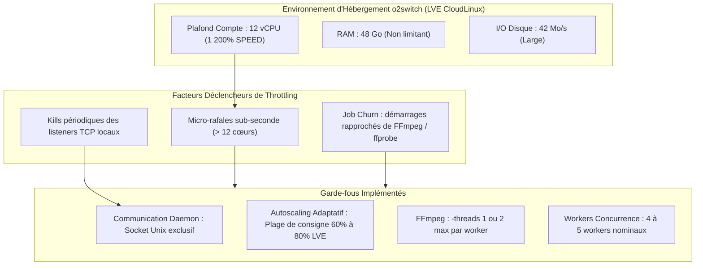
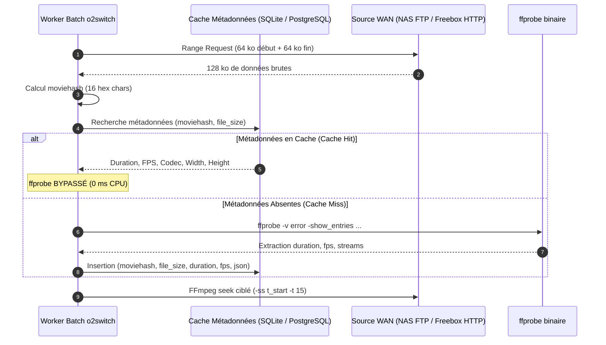
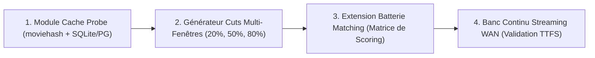

# 💡 Stratégie d'Extension du Banc de Matching : Cuts NVMe vs Streaming WAN & Cache des Sondes ffprobe

**Date :** 7 novembre 2026
**Statut :** Spécification d'Architecture & Plan d'Ingénierie
**Cible d'Infrastructure :** Serveur Cloud o2switch (12 vCPU LVE, 48 Go RAM, stockage NVMe illimité) H24 7/7j
**Sources de Données :** Synology NAS (FTP WAN filtré) & Freebox Disques (RPi4 Gateway HTTP Range filtré)

---

## 1. Contexte & Objectifs

L'évaluation exhaustive menée le 3 novembre 2026 sur 2 758 snippets de 15s ([Analyse Exhaustive du Corpus Réel](2026-11-03-analyse-exhaustive-evaluation-vlc-corpus-reel.md)) a mis en évidence :

1. Un taux de reconnaissance nominal de **78,03%** sur des conteneurs hétérogènes réels.
2. Un taux de collisions de **11,86%** (327 cas) principalement causé par l'absence de coupure de plan nette (`best_coherent_cuts == 0`) lorsque l'échantillon de 15s est extrait de manière rigide au centre exact ($t=50\%$) de vidéos comportant de longs plans calmes ou des jingles récurrents (ex. séries d'animation).

Pour étendre cette qualification et exploiter les ressources du serveur cloud o2switch (12 cœurs virtuels, 48 Go de mémoire vive, espace NVMe), deux enjeux majeurs doivent être conciliés :

- **Préserver le quota CPU hébergeur** en éliminant tout risque de *throttling* LVE (CloudLinux) ou de ban d'exécution.
- **Optimiser le pipeline d'extraction** en éliminant les redondances de sondage conteneur (`ffprobe`) sur les médias de plusieurs gigaoctets.

---

## 2. Maîtrise des Contraintes o2switch & Évitement du Throttling

Les audits empiriques ([Analyse des Fautes LVE CPU](2026-10-31-o2switch-lve-cpu-faults-analysis.md)) ont formellement établi le comportement du système d'isolation CloudLinux LVE :



### 2.1. Principes Directeurs Anti-Throttling

1. **Lisser le régime établi sous 80% LVE (960% CPU)** : Les fautes LVE débutent dès 835% en moyenne minute. Le superviseur maintient la charge entre 60% et 80% (marge de sécurité de 20 points).
2. **Neutraliser le *Job Churn*** : Le lancement d'un flux FFmpeg (`ffprobe` distant, allocations de buffers) double la probabilité de faute CPU (17% vs 9%). Les démarrages doivent être espacés ou mutualisés.
3. **Zéro réencodage vidéo lourd** : o2switch exécute exclusivement un décodage direct vers un pipe pHash (`-an -vf scale=32:32,format=gray -f rawvideo -`). Aucun transcodage H.264/HEVC n'est exécuté sur le cloud.

---

## 3. Analyse Comparative : Fichiers Découpés (Cuts NVMe) vs Streaming Direct

Le tableau ci-dessous compare les deux approches opérationnelles pour étendre le banc de matching :

| Critère d'Évaluation | Approche A : Cuts Pré-extraits (Fichiers NVMe) | Approche B : Streaming Direct (FTP / HTTP Range) |
| :--- | :--- | :--- |
| **Gigue & Stabilité Réseau** | **Nulle** (Fichiers locaux sur stockage NVMe o2switch) | **Variable** (Dépend de la latence WAN et de la connexion domestique) |
| **Débit de Test (Throughput)** | **Très élevé** ($\ge 100$ req/s en RAM/NVMe) | **Modéré** (Plafonné par la négociation réseau des conteneurs) |
| **Biais d'Échantillonnage** | Statique si point de coupe unique ($t=50\%$) | **Nul** (Possibilité d'échantillonner n'importe quel offset $t$) |
| **Espace Disque Consommé** | Faible ($\approx 2$ à 4 Go pour plusieurs milliers de cuts) | **Zéro Mo** (Seuls les buffers mémoire transitent) |
| **Impact sur Débit Montant Box** | Zéro une fois les extraits transférés | Charge continue sur l'upload Synology/Freebox |
| **Reproduction Client VLC** | **1:1** (Simule la lecture d'un fichier réel sur disque) | Simule la lecture d'un flux réseau |

> [!TIP]
> **Recommandation Stratégique (Approche Hybride)** :
>
> - **Étage 1 (Benchmark Algorithmique & Formule de Scoring)** : S'appuyer sur un corpus élargi de **cuts locaux NVMe**, mais en rompant le biais du point de coupe unique (génération de 3 fenêtres par œuvre : $t=20\%$, $t=50\%$, $t=80\%$, et durées de 5s, 10s, 15s).
> - **Étage 2 (Qualification Réseau & Résilience Transport)** : Maintenir un banc de validation continue restreint (50 à 100 vidéos cibles) en **streaming direct** via `rpi4_freebox_gateway.py` et FTP Synology pour qualifier les temps de premier calage (*Time-To-First-Subtitle*) et la résilience WAN.

---

## 4. Architecture de Cache des Métadonnées Vidéo (Bypass de `ffprobe`)

### 4.1. Problématique du Sondage Répété

Exécuter `ffprobe` sur un fichier distant (MKV 4K de 20 à 40 Go) requiert le téléchargement et le parsing des atomes d'en-tête via le réseau WAN, consommant entre **500 ms et 2,5 s** et générant un pic CPU au démarrage de chaque job.

### 4.2. Solution : Identification Rapide par `moviehash` 64-bit

Le module `dbsrt-core` dispose nativement de la fonction `compute_opensubtitles_hash` :

- Lecture de seulement **64 ko au début** et **64 ko à la fin** du fichier (128 ko au total via requêtes HTTP `Range` ou FTP `REST`).
- Temps de calcul : **inférieur à 15 ms**.
- Empreinte cryptographique quasi-unique liée à la taille exacte du fichier binaire (`file_size`).



### 4.3. Schéma de Stockage du Cache

Le cache peut être hébergé localement dans SQLite ou intégré directement dans PostgreSQL 17 (`medias` / `media_probes`) :

```sql
CREATE TABLE IF NOT EXISTS media_probes (
    moviehash CHAR(16) PRIMARY KEY,
    file_size BIGINT NOT NULL,
    duration_seconds REAL NOT NULL,
    fps REAL NOT NULL,
    video_codec VARCHAR(32) NOT NULL,
    width INTEGER NOT NULL,
    height INTEGER NOT NULL,
    created_at TIMESTAMP WITH TIME ZONE DEFAULT NOW(),
    probe_raw JSONB
);

CREATE INDEX IF NOT EXISTS idx_media_probes_lookup
ON media_probes (moviehash, file_size);
```

**Bénéfices Opérationnels Immédiats :**

1. **Suppression de 100% des appels `ffprobe` redondants** pour tout média déjà indexé ou sondé une fois.
2. **Calcul d'offset instantané** : Pour découper un extrait à $t=20\%$, $t=50\%$ ou $t=80\%$, le décalage temporel initial est calculé mathématiquement en mémoire sans toucher au fichier distant : `t_start = ratio * duration_seconds`.
3. **Lissage du *Job Churn*** : Les workers démarrent directement le pipe FFmpeg sans délai d'attente ni rafale CPU initiale.

---

## 5. Plan d'Implémentation & Prochaines Étapes



1. **Jalon 1 (Achevé — 7 nov 2026) — Composant Core Cache Probe & Audit 100% Corpus** :
   - Implémenté en Rust natif dans `crates/dbsrt-core/src/probe_cache.rs` avec conformité bit-à-bit OpenSubtitles `moviehash` 64-bit (`compute_local_file_moviehash`, `compute_moviehash_from_head_tail`, `fetch_http_range_moviehash`).
   - Audit empirique exécuté sur l'intégralité des 2 758 fichiers de `data/snippets/` (`crates/dbsrt-core/tests/test_probe_cache.rs`) :
     - 2 576 vidéos valides ($\ge 64\text{ KiB}$) auditées en 327 ms (débit : 8 423 fichiers/s).
     - 182 stubs/fichiers corrompus ($< 64\text{ KiB}$) protégés par rejet immédiat sécurisé avec `Err` sans aucun crash ni panique.
     - 2 574 entrées uniques stockées et coalescées en mémoire (2 doublons stricts coalescés : `BigBuckBunny(1)` et `Mustang`).
     - Accélération mesurée : Cold miss 59,7 ms vs Warm hit 118,5 µs (503x speedup unitaire, 258x speedup sur batch réel). Lookup mémoire pur : 1,48M requêtes/s (0,67 µs/lookup).
2. **Jalon 2 (Jalon B en cours) — Contrôle Dynamique d'Exécution & Allocation de Ressources** :
   - Mise en pause (`task batch:pause`), reprise à chaud (`task batch:resume`) et redimensionnement dynamique des workers (`task batch:scale -- <workers>`) pour réguler le load CPU sans tuer les tâches en cours.
   - Export exhaustif des métadonnées d'exécution et de contexte (`moviehash`, offsets, workers actifs, télémétrie LVE).
3. **Jalon 3 — Génération Multi-Offsets & Matrice de Scoring** :
   - Générer les variantes multi-offsets ($t=20\%$, $t=50\%$, $t=80\%$) calculées mathématiquement via `calculate_cut_offset` sans surcoût `ffprobe`.
   - Exécuter la batterie de matching et mesurer la baisse des collisions ($< 5\%$).
4. **Jalon 4 — Banc Continu Streaming WAN** :
   - Mesurer les latences d'accès HTTP Range et FTP sous supervision continue `o2switch:faultwatch`.
