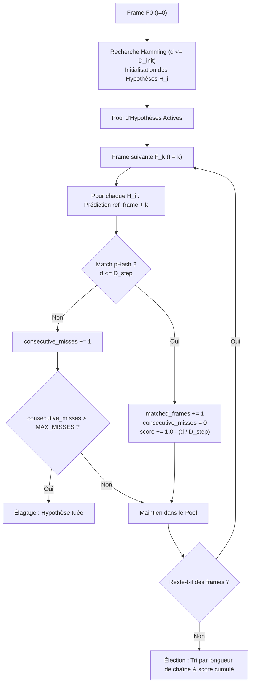

# Spatiotemporal Multi-Hypothesis Trajectory Tracking Matching

## 1. Contexte & Rationale

Les approches de matching basées sur des requêtes ponctuelles isolées ou des moyennes arithmétiques de scores multi-fenêtres présentent deux limites majeures :

1. **Vulnérabilité aux scènes statiques et intros partagées** : un jingle ou un carton d'introduction commun fait matcher plusieurs épisodes avec un score élevé sur une fenêtre donnée.
2. **Pollution du score d'identité par la dérive temporelle** : pénaliser l'identité d'un média parce que sa cadence (23.976 vs 24.0 fps) ou la longueur de son générique induit un décalage de quelques secondes est une erreur de modélisation.

L'algorithme de **Trajectory Tracking** (accumulation séquentielle de trajectoires d'hypothèses) résout ce problème en traitant le flux de frames comme un signal temporel continu.

---

## 2. Modèle Mathématique & Machine d'État

### Invariants et paramètres de survie :
- $D_{\text{init}}$ (Seuil initial d'hypothèse) : distance de Hamming maximale pour faire naître une hypothèse à $F_0$ (ex: $\le 10$).
- $D_{\text{step}}$ (Seuil de propagation) : distance de Hamming maximale pour valider le pas de temps suivant (ex: $\le 8$).
- $\Delta_{\text{slack}}$ (Tolérance locale de déphasage temporel) : $\pm 1$ frame autour de l'indice théorique pour absorber les micro-variations de cadence.
- $\text{MAX\_MISSES}$ : nombre maximal de frames consécutives non reconnues avant élagage immédiat (ex: 3 frames).
- **Survie** : un faux positif isolé disparaît naturellement après 2 à 3 frames car la dynamique visuelle de la vidéo suivante diverge immédiatement. Seul le vrai média maintient sa trajectoire active sur tout le segment.

---

## 3. Plan d'Implémentation & Jalons de Recette

### Jalon 1 : Coeur Algorithmique Isolé (Moteur de Trajectoire Pure)
- Module Rust dédié `crates/dbsrt-core/src/trajectory.rs`.
- Structures : `TrajectoryHypothesis`, `TrajectoryTrackerConfig`, `TrajectoryTracker`.
- Tests unitaires synthétiques : validation du cycle de vie (naissance, propagation, élimination par misses, élection de la trajectoire dominante).
- Validation : 100% test coverage sur le module, zéro régression de complexité.

### Jalon 2 : Connecter le Tracker aux Empreintes & Catalogue
- Interrogation dynamique contre un flux de frames réelles et les index pHash (`dbphash` / `.phash`).
- Évaluation sur 1 vidéo réelle contrôlée : observation du dégonflement du pool d'hypothèses ($N$ candidats à $t_0 \to 1$ seul candidat survivant à $t_K$).
- Validation humaine et métrique avant passage à l'étape suivante.

### Jalon 3 : Résilience face aux Collisions Réelles
- Banc d'évaluation sur les cas pièges (intros partagées, épisodes sombres, cuts multiples).
- Comparaison empirique avec la baseline sur les 12 épisodes réels (Westworld S04 + Devs S01).

### Jalon 4 : Intégration CLI, Taskfile & Documentation Diátaxis
- Exposition CLI sous `dbsrt match-trajectory`.
- Câblage dans `Taskfile.yml` et documentation dans `docs/reference/` et `docs/explanation/`.

---

## 4. Sémantique des Frames Noires : Le Principe du « Silence Musical »

Les frames noires, uniformes ou à très basse énergie visuelle (évaluées via `is_blank_phash`) constituent une difficulté majeure du matching visuel. Leur gestion repose sur une analogie fondamentale avec la musique : **les silences ont une valeur structurelle**.

### A. Non-discrimination au démarrage ($t_0$) : L'impossibilité d'identifier une oeuvre par le silence

- Une frame noire possède un pHash dégénéré (popcount faible ou invariant uniforme) qui matche des dizaines de milliers d'autres frames noires dans le catalogue (logos de distribution, transitions au noir, génériques de fin).
- **Contrainte $t_0$** : Établir $t_0$ sur une frame noire provoque une explosion combinatoire immédiate (ex: 14 743 candidats sur `data/black_frames.mp4` ou `Westworld S04E01` à $t=0$).
- **Règle retenue** : Interdiction d'ancrer le seed $t_0$ sur une frame noire. Le moteur avance jusqu'à la première frame porteuse d'énergie visuelle (`!is_blank_phash`) pour initier le pool d'hypothèses, puis compense l'offset temporel pour préserver le calage initial.

### B. Progression temporelle : Les silences comme respirations et concordances structurelles

- **Interdiction de requête globale** : En cours de trajectoire, interroger le catalogue global sur une frame noire n'a aucun sens algorithmique (cela réinjecterait du bruit issu de milliers de médias étrangers).
- **Valeur contextuelle du silence** : En musique, un silence n'est pas une absence de musique mais une respiration délibérée. Dans une vidéo, un fondu au noir ou une coupe au noir fait partie intégrante du rythme d'un média :
  - **Silence Concordant** : Si la cible est noire à $t_k$ et que la référence suivie par l'hypothèse prévoyait également une frame noire à $t_{\text{ref}} + k \cdot \Delta t$, cette concordance confirme le rythme temporel de l'oeuvre sans qu'il soit nécessaire d'interroger l'index.
  - **Silence Discordant** : Si la cible est noire alors que la référence présentait une scène d'action lumineuse (ou inversement), la rupture rythmique constitue un véritable miss pénalisant l'hypothèse.
- **État d'implémentation actuel vs cible** :
  - *Actuel* : Les frames noires en propagation avancent sans requête index (`std::iter::empty()`), tolérées jusqu'à `max_consecutive_misses` sans polluer le scratchpad de faux candidats.
  - *Cible expérimentale* : Vérification locale directe $\mathcal{O}(1)$ dans la tranche `sparse_entries` de l'hypothèse active pour qualifier le silence de *concordant* (maintien ou renforcement du score) ou *discordant* (miss avéré).

---

## 4. Architecture Hybride Actuelle & Feuille de Route WAN Streaming (Option 2)

### A. Phase 1 : Pipeline Hybride Déployé (Batch Haute Vitesse sur .phash Denses)

L'architecture immédiate pour les campagnes de masse sur serveur distant (o2switch / appliance) découple la phase de transcodage de la phase d'inférence spatiotemporelle :

1. **Source dense** : Lecture directe des fichiers `.phash` natifs (`data/__PHASH__/*.phash`), contenant l'intégralité des empreintes 64-bit brutes calculées sans sous-échantillonnage destructif.
2. **Multi-Cuts paramétrique** : Découpage temporel automatique (ex: $N=3$ cuts à 20%, 50%, 80% ou $N=5$ cuts à 10%, 30%, 50%, 70%, 90% de la durée réelle du média).
3. **Tracking & Consensus** : Exécution de 20 frames de propagation par cut, élection du candidat majoritaire et validation de la cohérence temporelle inter-cuts ($|(T_2 - T_1) - (R_2 - R_1)| \le \Delta_{\text{slack}}$).
4. **Débit observé** : ~800 ms à 1.0 s par média pour 3 cuts complets en multi-workers, permettant d'auditer l'ensemble du catalogue en moins de 15 minutes sans charge CPU excessive ni saturation disque.

### B. Phase 2 (Roadmap) : Pipeline Streaming WAN Distant (Option 2)

Pour les nouveaux médias non encore indexés ou stockés sur des passerelles de stockage distantes (NAS Synology en FTP, disques Freebox en passerelle HTTP) :

1. **Entrée réseau distante** : URLs distantes de flux vidéo (`ftp://synology/...`, `http://freebox/...`).
2. **Extraction ciblée sans rapatriement total** : FFmpeg avec seeking distant rapide (`-ss <offset> -i <url> -t <duration>`) pour extraire uniquement les 20 à 30 secondes requises pour chaque cut, sans télécharger les dizaines de gigaoctets du conteneur MKV/AVI.
3. **Calcul pHash à la volée** : Décodage en mémoire des frames ciblées, calcul des pHashes 64-bit et injection directe dans l'évaluateur de trajectoire.
4. **Résilience et limitation de bande passante** : Gestion des timeouts de transport réseau, reconnexions automatiques et découplage via queue de travail asynchrone.
