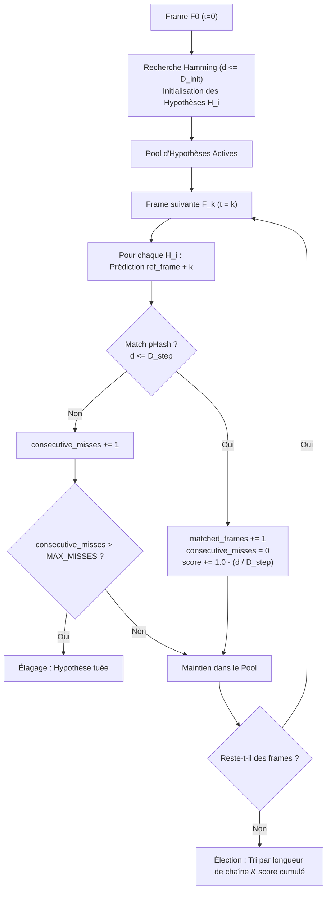

# Spatiotemporal Multi-Hypothesis Trajectory Tracking Matching

## 1. Contexte & Rationale

Les approches de matching basées sur des requêtes ponctuelles isolées ou des moyennes arithmétiques de scores multi-fenêtres présentent deux limites majeures :

1. **Vulnérabilité aux scènes statiques et intros partagées** : un jingle ou un carton d'introduction commun fait matcher plusieurs épisodes avec un score élevé sur une fenêtre donnée.
2. **Pollution du score d'identité par la dérive temporelle** : pénaliser l'identité d'un média parce que sa cadence (23.976 vs 24.0 fps) ou la longueur de son générique induit un décalage de quelques secondes est une erreur de modélisation.

L'algorithme de **Trajectory Tracking** (accumulation séquentielle de trajectoires d'hypothèses) résout ce problème en traitant le flux de frames comme un signal temporel continu.

---

## 2. Modèle Mathématique & Machine d'État

### Invariants et paramètres de survie :
- $D_{\text{init}}$ (Seuil initial d'hypothèse) : distance de Hamming maximale pour faire naître une hypothèse à $F_0$ (ex: $\le 10$).
- $D_{\text{step}}$ (Seuil de propagation) : distance de Hamming maximale pour valider le pas de temps suivant (ex: $\le 8$).
- $\Delta_{\text{slack}}$ (Tolérance locale de déphasage temporel) : $\pm 1$ frame autour de l'indice théorique pour absorber les micro-variations de cadence.
- $\text{MAX\_MISSES}$ : nombre maximal de frames consécutives non reconnues avant élagage immédiat (ex: 3 frames).
- **Survie** : un faux positif isolé disparaît naturellement après 2 à 3 frames car la dynamique visuelle de la vidéo suivante diverge immédiatement. Seul le vrai média maintient sa trajectoire active sur tout le segment.

---

## 3. Plan d'Implémentation & Jalons de Recette

### Jalon 1 : Coeur Algorithmique Isolé (Moteur de Trajectoire Pure)
- Module Rust dédié `crates/dbsrt-core/src/trajectory.rs`.
- Structures : `TrajectoryHypothesis`, `TrajectoryTrackerConfig`, `TrajectoryTracker`.
- Tests unitaires synthétiques : validation du cycle de vie (naissance, propagation, élimination par misses, élection de la trajectoire dominante).
- Validation : 100% test coverage sur le module, zéro régression de complexité.

### Jalon 2 : Connecter le Tracker aux Empreintes & Catalogue
- Interrogation dynamique contre un flux de frames réelles et les index pHash (`dbphash` / `.phash`).
- Évaluation sur 1 vidéo réelle contrôlée : observation du dégonflement du pool d'hypothèses ($N$ candidats à $t_0 \to 1$ seul candidat survivant à $t_K$).
- Validation humaine et métrique avant passage à l'étape suivante.

### Jalon 3 : Résilience face aux Collisions Réelles
- Banc d'évaluation sur les cas pièges (intros partagées, épisodes sombres, cuts multiples).
- Comparaison empirique avec la baseline sur les 12 épisodes réels (Westworld S04 + Devs S01).

### Jalon 4 : Intégration CLI, Taskfile & Documentation Diátaxis
- Exposition CLI sous `dbsrt match-trajectory`.
- Câblage dans `Taskfile.yml` et documentation dans `docs/reference/` et `docs/explanation/`.
