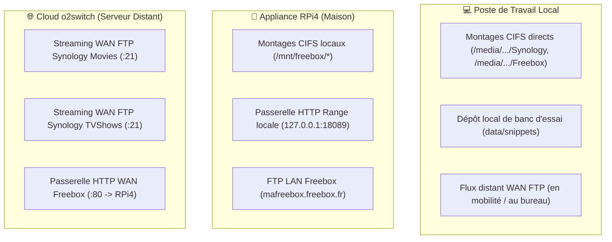
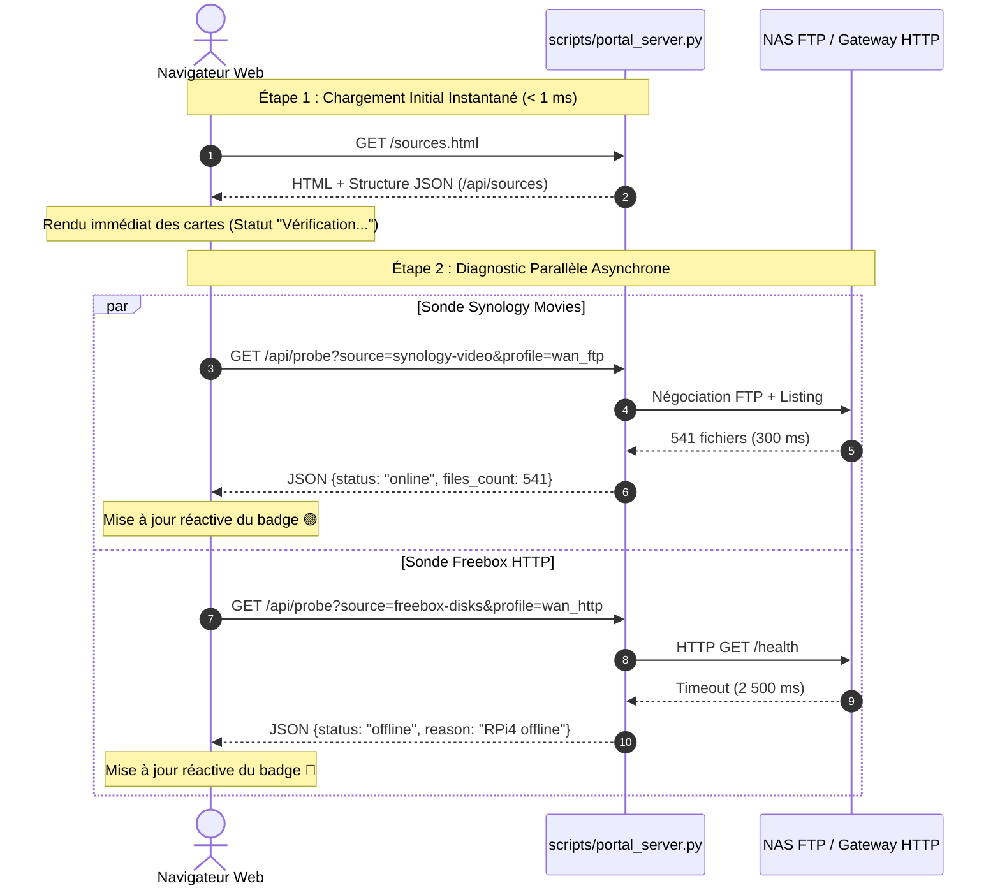
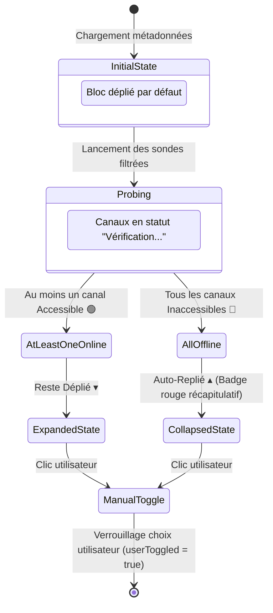

# 💡 Architecture du Portail Sources Médias & Diagnostic Multi-Environnements

Ce document explicatif détaille les principes de conception, les arbitrages d'architecture et la séparation stricte des responsabilités mis en œuvre dans la page **Sources Médias (Physique)** du portail web `pydbsrt`.

---

## 1. Séparation Conceptuelle : Réalité Physique vs État Base de Données

Un biais fréquent dans les backoffices multimédia consiste à confondre la **réalité physique du stockage** (l'existence effective de conteneurs `.mkv` et `.mp4` sur un disque ou un flux réseau) avec **l'état logique d'indexation** (les enregistrements présents dans la table `medias` de PostgreSQL ou dans un catalogue binaire).

| Dimension | Qu'est-ce que c'est ? | Support opérationnel | Question clé |
| :--- | :--- | :--- | :--- |
| **Réalité Physique & Réseau** | Les conteneurs vidéo stockés sur disques locaux, partages CIFS, serveurs FTP ou passerelles HTTP. | Disque local (`data/snippets`), CIFS NAS/Freebox, FTP WAN Synology, Passerelle RPi4. | *« Le fichier vidéo est-il accessible et lisible depuis cette machine ici et maintenant ? »* |
| **État Logique & Métadonnées** | Les lignes indexées, les coupes pHash calculées et les couplages certifiés. | PostgreSQL 17 (`medias`, `frames`), catalogue Zero-DB `catalog.dbphash`, `couplings.json`. | *« La vidéo a-t-elle été scannée, découpée et enregistrée en base de données ? »* |

> [!IMPORTANT]
> **Problème résolu :**
> Lorsque PostgreSQL était vide, l'ancienne interface affichait trompeusement « 0 Actifs », alors même que le disque local contenait physiquement 2 758 vidéos de banc d'essai et que le NAS Synology exposait 614 vidéos en streaming FTP.
> La page **Sources Médias** se consacre **exclusivement** à l'accessibilité physique des fichiers, sans aucune dépendance vis-à-vis des tables de la base de données.

---

## 2. Topologie Réseau et Profils d'Exécution Multi-Environnements

Le portail `pydbsrt` est déployé et exploité depuis trois environnements fondamentalement différents :

### Le non-sens des faux négatifs locaux sur un serveur cloud
Sur un serveur cloud distant (`o2switch`), tester l'existence d'un chemin de montage local comme `/media/<user>/Synology/video` renvoie systématiquement une erreur. Afficher un badge rouge « Inaccessible » pour un chemin qui n'a aucun sens d'exister sur un serveur distant constitue une pollution visuelle et fonctionnelle.

### Solution : Canaux paramétriques et profils d'environnement
Chaque profil d'accès déclare ses environnements cibles (`envs: ["local", "rpi4", "o2switch"]`) :
1. **`🌐 Cloud o2switch`** : Uniquement les flux distants WAN (FTP Synology et Passerelle HTTP). Les chemins locaux CIFS et les snippets sont filtrés et masqués.
2. **`💻 Poste Local`** : Montages locaux de dev, snippets de banc d'essai et relais distants de secours.
3. **`🍓 Appliance RPi4`** : Partages Freebox locaux montés dans `/mnt/freebox/` et service gateway local.
4. **`🔍 Diagnostic Brut (Tous)`** : Vue exhaustive permettant de sonder l'intégralité des 12 canaux déclarés.

---

## 3. Architecture Asynchrone Non-Bloquante (< 1 ms Initial)

Tester des accès réseau distants (FTP avec négociation TLS/credentials, ou passerelle HTTP avec timeout de 1,5 s) bloque tout serveur synchrone si l'évaluation est faite au chargement de la page :

---

## 4. Machine à États de l'Accordéon (Auto-Collapse)

Pour maximiser l'efficacité de lecture, chaque bloc de gisement adapte automatiquement son état replié/déplié en fonction des résultats du diagnostic :

1. **Règle nominale** : Si un gisement possède au moins un canal actif (ex: FTP Synology accessible alors que CIFS local est éteint), le bloc reste grand ouvert (`uncollapsed`).
2. **Règle de repli** : Si **tous** les canaux d'un gisement sont hors service, le bloc se compacte automatiquement pour ne pas encombrer l'écran, affichant un badge de synthèse rouge.
3. **Priorité utilisateur** : Dès que l'utilisateur clique manuellement sur un en-tête ou utilise « Tout Déplier » / « Tout Replier », l'automatisme s'efface devant le choix explicite de l'opérateur.
