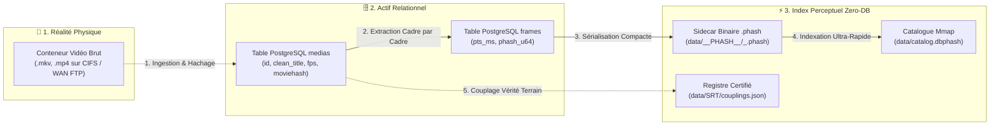
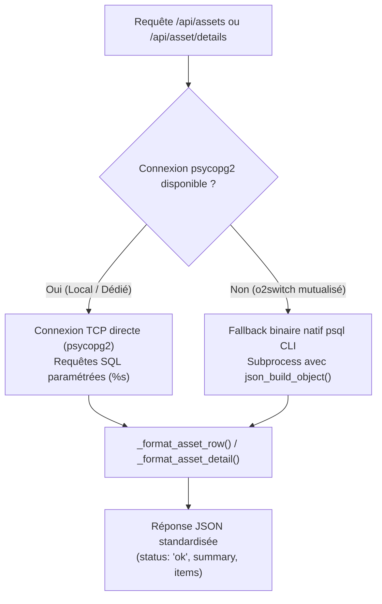
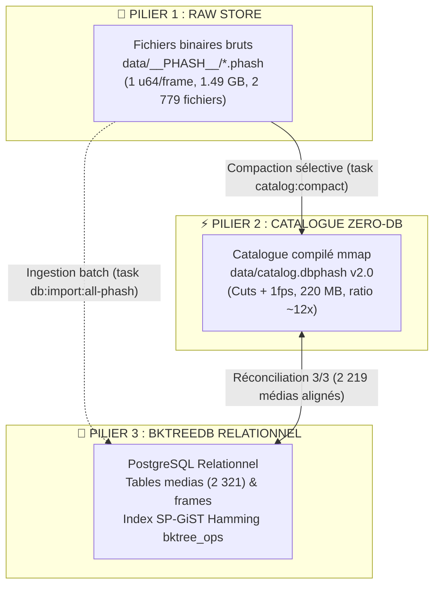

# 💡 Réconciliation des Actifs Médias, Modèle PostgreSQL & Empreintes pHash

Ce document explicatif détaille les fondements architecturaux, le modèle de données relationnel et les choix de conception régissant la vue **Actifs Médias (DB)** du portail web `pydbsrt`.

---

## 1. La Trinité Conceptuelle : Conteneur Physique, Actif Relationnel et Empreinte pHash

L'écosystème `pydbsrt` repose sur la distinction stricte entre trois entités indépendantes :



### Définition des Rôles

1. **Le Conteneur Physique** : Le fichier stocké sur le support de masse (ex: `/media/user/Synology/tvshow/...`). Il possède une taille en octets, un horodatage système (`mtime`) et un protocole de transport (CIFS, FTP, HTTP Range).
2. **L'Actif Relationnel (`medias`)** : L'enregistrement dans PostgreSQL. Il consigne l'identité épurée du média (`clean_title`, saison, épisode), les caractéristiques intrinsèques du flux (`fps`, `is_vfr`, `duration_ms`), et l'état d'avancement de l'analyse (`phash_status`).
3. **L'Empreinte Perceptuelle (`pHash`)** : La série temporelle d'empreintes perceptuelles 64 bits calculées à 24 ou 25 fps. Elle est stockée soit en base (`frames`), soit dans un fichier binaire sidecar (`.phash`), permettant la recherche sans base de données (Zero-DB) en production.

---

## 2. Invariant Fondamental : Le pHash Ne Recale Pas des Sous-titres Seuls

> [!IMPORTANT]
> **Vérité d'Architecture :**
> Perceptual Hashing (`pHash`) opère **exclusivement entre deux flux vidéo** : une vidéo de référence (dont le découpage temporel et les sous-titres sont certifiés) et une vidéo cible (release alternative, encodage différent, version web).
> Un fichier de sous-titres (`.srt`) ne contient aucune empreinte visuelle.

Pour qu'un recalage automatique de sous-titres fonctionne :

1. Le média cible doit être reconnu par matching pHash contre une vidéo de référence déjà connue dans notre catalogue.
2. Cette vidéo de référence doit posséder un couplage certifié dans `couplings.json` ou dans la table `subtitles` de PostgreSQL.
3. Si un sous-titre est importé depuis un fournisseur distant (OpenSubtitles) pour une release non répertoriée dans notre catalogue, le décalage visuel calculé est de **0 ms** et le sous-titre est injecté tel quel sans altération temporelle magique.

---

## 3. Architecture Double Moteur PostgreSQL (Zero-C-Dependency Fallback)

Le serveur de portail (`scripts/portal_server.py`) doit pouvoir fonctionner sans friction à la fois sur un environnement de développement local disposant des pilotes natifs compilés, et sur un hébergement mutualisé distant (`o2switch`) soumis à des restrictions de compilation :



### Mécanisme du Fallback CLI `psql`

Sur `o2switch`, les extensions Python C comme `psycopg2` peuvent être absentes de l'interpréteur par défaut. Plutôt que de faire échouer le portail avec une erreur 500, le serveur bascule automatiquement sur l'exécutable système `/usr/bin/psql` configuré avec les identifiants locaux (`dbsrt/etc/.pg_config`).

Pour garantir des performances optimales et éviter le parsing fragile de sorties tabulaires textuelles, la requête SQL délègue l'agrégation directement au moteur PostgreSQL :

```sql
SELECT json_build_object(
    'total', count(*),
    'nominal', count(CASE WHEN phash_status = 'complete' AND video_rel_path IS NOT NULL AND video_rel_path != '' THEN 1 END),
    'missing_phash', count(CASE WHEN phash_status != 'complete' THEN 1 END),
    'unmapped_path', count(CASE WHEN video_rel_path IS NULL OR video_rel_path = '' THEN 1 END)
)::text FROM medias;
```

Le résultat est désérialisé en un seul appel `json.loads()`, garantissant une latence inférieure à 15 ms même en mode CLI.

---

## 4. Résilience de la Pagination & Invariance des Filtres

Lors de la navigation dans un catalogue volumineux (2 300+ médias), le changement dynamique de filtre textuel ou de statut entraîne une variation abrupte du nombre total de pages ($N_{\text{pages}} = \lceil \text{Total} / \text{Limit} \rceil$).

### Le Problème de l'Écran Vide (« Faux Zéro Résultat »)
Si un opérateur consulte la page 5 d'un statut global (100 éléments), puis tape une recherche spécifique (ex: `Carnivàle`, 24 résultats = 1 seule page), l'état client non synchronisé demandait `page=5`. Côté SQL, `LIMIT 25 OFFSET 100` sur un ensemble de 24 résultats retournait 0 ligne, trompant l'utilisateur en lui affichant « Aucun actif trouvé ».

### Double Verrouillage Implémenté

1. **Frontend Réactif (`sources.html`)** :
   - Toute modification de `assetsSearchQuery` (avec debounce 300 ms), de `assetsSourceFilter`, de `assetsSort` ou de `assetsLimit` déclenche `onAssetsFilterChange()`, qui force immédiatement `assetsPage = 1` et met à jour le hash d'URL.
   - En cas d'incohérence résiduelle dans l'URL hash (chargement direct avec `page=99`), `fetchAssets()` détecte `assetsPage > assetsTotalPages` et refetch automatiquement la page 1.
2. **Backend Sécurisé (`portal_server.py`)** :
   - Clamping formel : si $\text{page} > \text{total\_pages}$ et $\text{total\_items} > 0$, alors $\text{page} = 1$ et $\text{offset} = 0$.
   - Le serveur garantit qu'aucune requête valide avec des résultats ne renverra jamais une liste vide par dérive de pagination.

---

## 5. L'Observatoire des 3 Piliers d'Empreintes pHash

L'empreinte perceptuelle d'un média existe sous trois formes physiques et relationnelles distinctes au sein du système `pydbsrt` :



### Caractéristiques Comparées des 3 Piliers

| Caractéristique | Pilier 1 : RAW Store | Pilier 2 : Catalogue Zero-DB | Pilier 3 : BKtreeDB Relationnel |
| :--- | :--- | :--- | :--- |
| **Support de stockage** | Fichiers `.phash` sur disque | Fichier binaire unique `catalog.dbphash` | Tables PostgreSQL (`medias`, `frames`) |
| **Structure interne** | Suite continue d'entiers `u64` big-endian | En-tête structuré (128 o) + Entrées médias (64 o) + Tranches binaires | Lignes relationnelles + index SP-GiST |
| **Échantillonnage** | Exhaustif (100% des trames à 24/25 fps) | Élagué : Cuts de plans ($\Delta \ge 10$ bits) + Sparse 1 fps | Configurable lors de l'ingestion |
| **Objectif opérationnel** | Archivage de référence & ré-échantillonnage | Matching sub-milliseconde en mémoire projetée (`mmap`) | Requêtes analytiques complexes, lignage & métadonnées |
| **Empreinte disque** | ~1.49 GB (2 779 médias) | ~220 MB (gain de compression ~12x) | Variable selon la rétention des trames |

### Microscopie d'Empreinte en Temps Réel

Le point d'accès `/api/phash/details` permet une inspection microscopique instantanée (< 45 ms sur un long métrage de 2 heures / 170 000 trames) :

- **Popcount spectral** : moyenne des bits à 1 par empreinte (théoriquement proche de 32 bits pour une distribution uniforme).
- **Entropie par histogramme 8 buckets** : contrôle de la dispersion statistique (absence de saturation noire ou blanche).
- **Détection des changements de plans (Cuts)** : saut de distance de Hamming $\Delta \ge 10$ bits entre trames consécutives.
- **Ratio d'efficacité Zero-DB** : comparaison volumétrique entre l'archive RAW et son empreinte compactée dans le catalogue compilé.

---

## 6. Recherche Insensible aux Accents sans Extension C

Sur un hébergement mutualisé comme `o2switch` (PostgreSQL 9.6 sans droits super-administrateur pour installer l'extension `unaccent`), les requêtes `ILIKE` échouent par défaut sur les caractères diacritiques (ex: rechercher `Carnivale` ne retournait aucun des 26 épisodes de `Carnivàle`).

Pour garantir un fonctionnement 100% déterministe sur toutes les versions de PostgreSQL sans dépendance C externe :

1. **Normalisation SQL native par `translate()`** :
   ```sql
   translate(lower(clean_title), 'àáâãäåèéêëìíîïòóôõöùúûüýÿñç', 'aaaaaaeeeeiiiiooooouuuuyync') LIKE '%carnivale%'
   ```
2. **Normalisation Unicode côté Python** :
   La chaîne de recherche opérateur est préalablement décomposée par `unicodedata.normalize('NFD', search_q)` en retirant les marques combinatoires (`Mn`).
   La chaîne transmise à la requête SQL est garantie 100% ASCII, éliminant tout conflit d'encodage `LC_CTYPE` / `psql` tout en maximisant la vitesse de filtrage.
