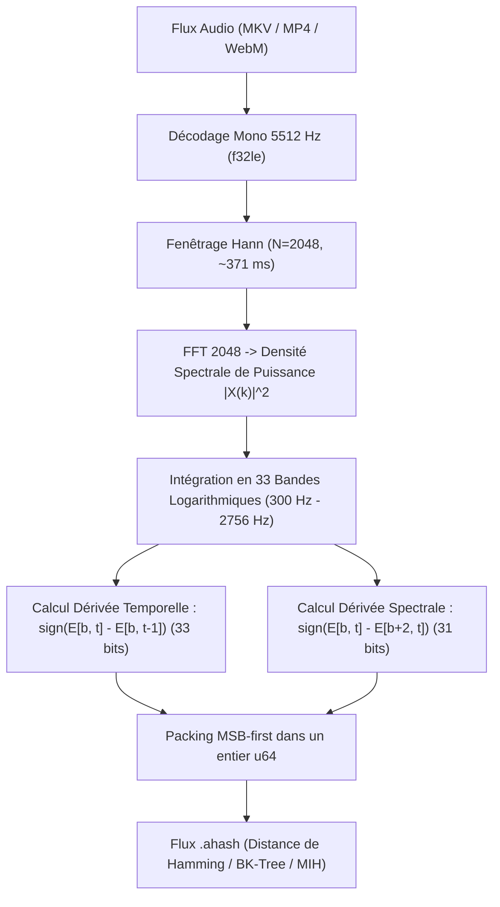

# 💡 Étude R&D : Empreinte Spectrale Audio `.ahash` (Haitsma-Kalker) & Multimodalité

- **Statut** : Analyse d'Architecture & Étude Comparative
- **Date** : 2026-11-10
- **Branche** : `feat/ahash-audio-fingerprint`

---

## 1. Contexte & Problématique Métier

Le moteur d'identification et de recalage de sous-titres de `pydbsrt` repose historiquement sur le hachage perceptuel visuel (`pHash` 2D DCT-II sur images de luminance $32 \times 32$).

Si cette approche offre une universalité absolue indépendamment de la langue parlée (un film a la même image qu'il soit visionné en VO, VF ou VOST), elle présente des fragilités structurelles sur certains profils de contenus :

1. **Scènes visuellement plates ou sous-exposées** : écrans noirs prolongés, transitions lentes au noir, génériques minimalistes où les trames successives présentent une distance de Hamming inter-trames quasi-nulle ($\Delta \approx 0$).
2. **Plans fixes avec narration** : documentaires, cours magistraux, tutoriels vidéo où l'image reste inchangée pendant des dizaines de secondes alors que le flux de parole est riche et continu.
3. **Coût computationnel du décodage vidéo** : décoder des flux vidéo haute définition (H.264/HEVC 1080p ou 4K) sans accélération matérielle VA-API sur des cibles contraintes comme le Raspberry Pi 4 sature les cœurs CPU.

L'objectif de cette étude est d'évaluer l'intégration de l'empreinte spectrale audio différentielle de **Haitsma-Kalker (2002)**, packée dans un format 64-bit `.ahash`, en tant que modalité secondaire.

---

## 2. Principes Algorithmiques : Le Hashing Différentiel de Haitsma-Kalker

Contrairement aux approches de reconnaissance musicale basées sur des constellations de pics (ex: Shazam), l'algorithme de Haitsma-Kalker produit un flux continu de signatures 64-bit à cadence fixe, mathématiquement isomorphe à une séquence de trames vidéo.



### 2.1 Dérivée Relative & Invariance au Volume

L'algorithme n'évalue jamais l'énergie absolue d'une fréquence, mais uniquement le **signe des variations différentielles** :

- **Variation Temporelle** : le bit est à 1 si l'énergie de la bande $b$ croît par rapport à la trame précédente, 0 sinon. Cette mesure est insensible à la dynamique globale du mixage ou au volume d'écoute.
- **Variation Spectrale** : le bit est à 1 si l'énergie de la bande $b$ dépasse celle de la bande $b+2$, capturant la pente du timbre indépendamment de la normalisation sonore.

---

## 3. Analyse Comparative : pHash Visuel vs aHash Audio

| Critère | pHash Visuel (2D DCT-II) | aHash Audio (Haitsma-Kalker) | Impact Architectural |
|---|---|---|---|
| **Dimension unitaire** | `u64` (64 bits) | `u64` (64 bits) | 100% interopérable avec BK-Tree, MIH, `popcnt`. |
| **Coût CPU d'extraction** | 100 ms à 500 ms par seconde vidéo | 2 ms à 10 ms par seconde audio | **Gain de vitesse de 10x à 50x**. |
| **Accélération matérielle requise** | Recommandée (VA-API / GPU) | Nulle (CPU pur mono thread) | Idéal pour appliances RPi4 ou VPS o2switch. |
| **Résistance au ré-encodage vidéo** | Sensible aux crops, aspect ratio, logos | **100% insensible** aux modifications visuelles | Excellente stabilité entre éditions BluRay/WEBRip. |
| **Sensibilité au doublage (VO/VF)** | **Insensible** (même vidéo pour toutes langues) | **Échec complet** (spectres de parole divergents) | Contrainte majeure : nécessite la même langue. |
| **Résolution temporelle native** | 24.0 fps ($\Delta t \approx 41.6$ ms) | ~86.1 fps ($\Delta t \approx 11.6$ ms) | Précision temporelle fine au détriment de la taille. |
| **Taille pour 2h de film** | ~1.38 MB | ~4.84 MB (à 86 fps) / ~1.35 MB (à 24 fps) | Nécessite un compromis de cadence (`HOP_SIZE`). |

---

## 4. Les Limites Critiques & Pièges d'Intégration

### 4.1 L'Écueil du Multi-Langue (Doublage International)

Dans l'écosystème de `pydbsrt`, les utilisateurs synchronisent régulièrement des pistes sous-titrées sur des releases étrangères (ex: sous-titre français sur release japonaise ou américaine).

- Si l'audio de la référence certifiée est en version originale (VO anglaise) et que la cible locale est une version doublée (VF française), l'empreinte spectrale Haitsma-Kalker ne présentera **aucune corrélation** sur la bande de parole (300–2000 Hz).
- Par conséquent, l'aHash brut mono ne peut pas se substituer au pHash vidéo comme identifiant primaire universel sans pré-traitement.

### 4.2 Piste de Résolution R&D : Isolation M&E (Music & Effects) & Filtrage Vocal Invariant

Dans la chaîne de post-production cinématographique, le doublage international ne ré-enregistre jamais les bruitages ni la musique. Les studios utilisent la piste **M&E (Music & Effects)** : seuls les dialogues du canal central sont remplacés.

Deux techniques à coût computationnel quasi-nul permettent d'extraire la signature M&E directement dans le pipe FFmpeg :

#### A. Rips Multicanaux (5.1 / 7.1) : Suppression du Canal Central (Center Drop)

Dans un mixage 5.1 cinéma, le canal central ($FC$) concentre 95% à 99% des dialogues. Les canaux latéraux et surround ($FL, FR, SL, SR$) portent la bande originale et les effets sonores.

- **Filtrage FFmpeg (Coût CPU : 0%)** :
  ```bash
  ffmpeg -i video.mkv -vn -af "pan=mono|c0=0.5*FL+0.5*FR+0.5*BL+0.5*BR" -ar 5512 -f f32le -
  ```
- **Résultat** : La composante vocale est éliminée, tandis que la trame sonore commune (M&E) est préservée. Deux releases VO et VF deviennent alors hautement corrélées au sens de l'aHash.

#### B. Rips Stéréo (2.0) : Annulation de Phase Mid/Side (OOPS : Out-Of-Phase Stereo)

Dans un mix stéréo broadcast, la voix parlée est mixée au centre fantôme (en phase identique sur le canal gauche et droit : $L_{\text{voix}} = R_{\text{voix}}$).

- **Principe de Soustraction** :
  $S_{\text{M\&E}} \approx L - R$
- **Filtrage FFmpeg (Coût CPU : 0%)** :
  ```bash
  ffmpeg -i video.mkv -vn -af "pan=mono|c0=0.5*c0-0.5*c1" -ar 5512 -f f32le -
  ```
- Annule mathématiquement toute source acoustique parfaitement centrée (dialogue) et conserve la musique stéréo, la réverbération et les effets panoramiques.

#### C. Comparatif & Limites de l'Approche M&E

| Méthode | Coût CPU | Efficacité VO vs VF | Limite Structurelle |
|---|---|---|---|
| **Center Drop (5.1)** | **0% (gratuit)** | **Excellente** | Nécessite un conteneur multicanal. |
| **Soustraction $L - R$ (Stéréo)** | **0% (gratuit)** | **Bonne sur musique/effets** | Inopérant si la release source est un pur mono ($L = R \rightarrow S = 0$). |
| **Séparation par IA (Demucs/Spleeter)** | Lourd (GPU requis) | Maximale | **Incompatible** avec la cible temps réel RPi4/o2switch. |

**Cas limite** : Une scène de dialogue intime sans musique d'ambiance ni effet sonore spatialisé. En supprimant la voix, le signal résiduel tend vers le silence ($E \approx 0$). Dès lors, l'isolation M&E constitue un étage complémentaire puissant pour les génériques, scènes d'action et transitions musicales, le pHash visuel demeurant le filet de sécurité absolu pour les dialogues purs.

### 4.3 L'Effet du PAL Speedup (24 fps vers 25 fps)

Le passage d'un master cinéma (24 fps) à une diffusion européenne (25 fps) accélère le média de 4.1%.

- **En vidéo** : l'axe temporel est étiré, mais chaque trame visuelle individuelle reste identique.
- **En audio** : si aucun algorithme de pitch-shifting n'a été appliqué au ré-encodage, toutes les composantes fréquentielles sont translatées de +4.1% ($f' = 1.041 \times f$).
- Avec 33 bandes d'environ 52 Hz de largeur, un décalage de +40 Hz à 1000 Hz fait baver l'énergie sur la sous-bande voisine, augmentant artificiellement la distance de Hamming.

### 4.4 Dimensionnement & Alignement Mémoire ARM64

L'en-tête du format `.ahash` est rigoureusement fixé à **176 octets** (avec padding de 4 octets). Cette disposition assure un alignement strict à 8 octets, permettant un accès sans copie (`zero-copy mmap`) sur processeur ARM Cortex-A72 (Raspberry Pi 4) sans risque de faute matérielle ou de baisse de débit.

---

## 5. Stratégie de Fusion Hybride Recommandée

```text
Query Cible (Vidéo + Audio)
      │
      ├──> Extraction Audio Rapide (~50 ms) ────────┐
      │                                             ▼
      │                                   Scoring aHash (Fast Probe)
      │                                   - Si score >= 0.85 et langue confirmée -> Match validé (Delta t exact)
      │                                   - Si score indécis ou divergence
      ▼                                             │
Extraction Vidéo pHash (Full / Probes) <────────────┘
      │
      ▼
Scoring pHash Visuel (Garantie universelle)
      │
      ▼
Consensus Spatiotemporel Final
```

Cette architecture à deux étages permet de diviser par 10 le temps de qualification sur les releases partageant la même piste audio, tout en conservant le filet de sécurité absolu du pHash vidéo pour les versions doublées.
