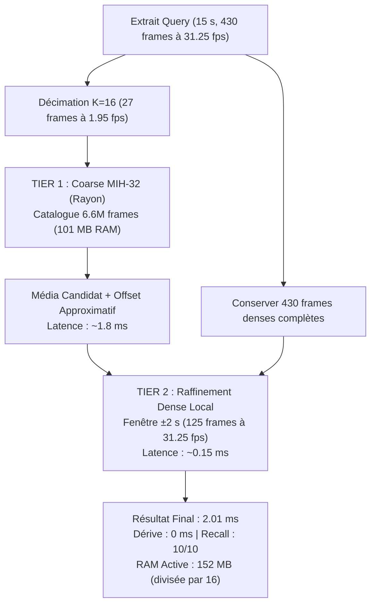

# Analyse Comparative : MIH-16, MIH-32 et Coarse-to-Fine sur Empreintes aHash et pHash

Ce document d'explication analyse les fondements algorithmiques, spectraux, spatio-temporels et empiriques qui expliquent la divergence radicale de comportement entre le hachage perceptuel visuel (**pHash**) et acoustique (**aHash**). Il étudie l'impact de la granularité des blocs (**MIH-16** vs **MIH-32**), du parallélisme multi-coeurs (**Rayon**), et de l'approche hiérarchique **Coarse-to-Fine** avec facteurs de décimation $K \in \{4, 8, 16, 31\}$.

---

## 1. Contexte et Problématique de Scalabilité

Lors de l'implémentation de la recherche de sous-titres par empreinte acoustique (aHash), le passage d'une batterie de tests isolés au catalogue réel de production a mis en lumière un défi d'échelle critique :

- **Catalogue visuel pHash** : 2 708 720 frames (2 758 médias, 1 fps sparse + scene cuts), recherché en **3.92 ms** via MIH-16 pour une empreinte mémoire compacte de **68 MB**.
- **Catalogue audio aHash** : 106 096 618 frames (584 médias, 31.25 fps continu), dont la recherche linéaire exhaustive $\mathcal{O}(N)$ nécessitait **7 272 ms** (7.27 s) par extrait de 15 secondes (57 milliards d'opérations XOR/popcount) et une empreinte mémoire dense de **2.44 GB** (822 MB de données brutes + 1.62 GB d'index MIH).

L'objectif de cette étude est d'évaluer empiriquement les stratégies d'optimisation (MIH-16, MIH-32, Coarse-to-Fine hiérarchique) sur les deux modalités, sous des conditions strictement identiques, afin de déterminer le compromis optimal entre latence de recherche, empreinte mémoire vive (RAM) et exactitude du calage temporel.

---

## 2. Résultats Empiriques Comparatifs

L'évaluation a été exécutée de manière hermétique sur les 10 vidéos de test réelles (`data/snippets_ahash/*.mp4`), extraits de 15 secondes avec pistes audio et vidéo synchronisées, sous profil compilé `release` avec 12 threads Rayon.

### Tableau A : Espace Acoustique aHash (106 096 618 frames / 584 médias)

> **Données brutes catalogue dense** : 822 MB (809.5 MB de hashes `u64` à 31.25 fps + 12 MB métadonnées).

| Stratégie aHash | Cadence Indexée | Frames en Index | Empreinte RAM (Base + Index) | Latence Moyenne | Gain vs O(N) | Taux Détection (10 cuts) | Dérive Offset | Remarques & Trade-offs |
|---|---|---|---|---|---|---|---|---|
| **Linear Scan $\mathcal{O}(N)$** | 31.25 fps | 106 096 618 | **822 MB** | **7 272 ms** (7.27 s) | Réf (1.0x) | 10/10 (100%) | 0 ms (réf) | Scalabilité bloquante (57 Mrds ops) |
| **MIH-16 Mono** | 31.25 fps | 106 096 618 | **2 441 MB** (~2.38 GB) | **141.1 ms** | $\times 51$ | 10/10 (100%) | 0 ms | 4 tables 16-bit ($\sim 1\,618$ items/seau) |
| **MIH-16 Rayon** | 31.25 fps | 106 096 618 | **2 441 MB** (~2.38 GB) | **113.9 ms** | $\times 63$ | 10/10 (100%) | 0 ms | Goulot sur fusion des maps de votes |
| **MIH-32 Mono** | 31.25 fps | 106 096 618 | **2 441 MB** (~2.38 GB) | **3.0 ms** | $\times 2\,424$ | 10/10 (100%) | 0 ms | 2 tables 32-bit ($1.5$ item/seau) |
| **MIH-32 Rayon** | 31.25 fps | 106 096 618 | **2 441 MB** (~2.38 GB) | **2.1 ms** | $\times 3\,462$ | 10/10 (100%) | 0 ms | Instantané, SNR 30.1 bits |
| **C2F $K=4$** | 7.81 fps | 26 524 385 | **607 MB** Coarse *(+822 MB Dense)* | **7.53 ms** | $\times 965$ | 10/10 (100%) | **0 ms** | RAM index $\div 4$, Tier 2 dense $\pm 2$ s |
| **C2F $K=8$** | 3.91 fps | 13 262 359 | **303 MB** Coarse *(+822 MB Dense)* | **3.18 ms** | $\times 2\,286$ | 10/10 (100%) | **0 ms** | **Sweet Spot** (RAM $\div 8$, build 248 ms) |
| **C2F $K=16$** | 1.95 fps | 6 631 336 | **152 MB** Coarse *(+822 MB Dense)* | **2.01 ms** | $\times 3\,617$ | 10/10 (100%) | **0 ms** | **Ultra-léger** (RAM $\div 16$, build 112 ms) |
| **C2F $K=31$** | 1.01 fps (~1 fps) | 3 422 721 | **78 MB** Coarse *(+822 MB Dense)* | **0.83 ms** | $\times 8\,761$ | **1/10 (10%)** ❌ | 0 ms | **Rupture** : désynchronisation de phase |

> [!NOTE]
> Pour les variantes **Coarse-to-Fine (C2F)**, la colonne RAM indique l'empreinte active en mémoire vive du Tier 1 (Base Coarse + Index MIH-32 Coarse). En production locale ou appliance (RPi4), le catalogue Dense de vérité terrain (Tier 2) peut être stocké en `mmap` direct sur disque sans empreinte RAM résidente permanente (chargement à la demande des 125 frames du seul média candidat identifié).

### Tableau B : Espace Visuel pHash (2 708 720 frames / 2 758 médias)

> **Données brutes catalogue** : 26.5 MB (`catalog.dbphash` mappé en mémoire virtuelle).

| Stratégie pHash | Cadence Indexée | Frames en Index | Empreinte RAM (Base + Index) | Latence Moyenne | Gain vs O(N) | Taux Détection (10 cuts) | Précision & Fiabilité |
|---|---|---|---|---|---|---|---|
| **Linear Scan $\mathcal{O}(N)$** | 1 fps + cuts | 2 708 720 | **26.5 MB** (mmap) | **128.72 ms** | Réf (1.0x) | 10/10 (100%) | Vérité terrain exhaustive |
| **MIH-16 Mono** | 1 fps + cuts | 2 708 720 | **68 MB** (mmap + MIH) | **10.28 ms** | $\times 12.5$ | 10/10 (100%) | Détection exacte, 0 dérive |
| **MIH-16 Rayon** | 1 fps + cuts | 2 708 720 | **68 MB** (mmap + MIH) | **3.92 ms** | $\times 32.8$ | 10/10 (100%) | **Moteur de production actuel** |
| **MIH-32 Mono** | 1 fps + cuts | 2 708 720 | **68 MB** (mmap + MIH) | **0.11 ms** | $\times 1\,170$ | 7/10 (70%) ❌ | 30% d'échec / divergence offset |
| **MIH-32 Rayon** | 1 fps + cuts | 2 708 720 | **68 MB** (mmap + MIH) | **0.12 ms** | $\times 1\,072$ | 7/10 (70%) ❌ | 30% d'échec / divergence offset |

---

## 3. Analyse Théorique : Pourquoi MIH-32 Fonctionne sur aHash mais Échoue sur pHash

La divergence de comportement entre aHash et pHash lorsqu'on passe de blocs de 16 bits à 32 bits découle de trois propriétés combinatoires et physiques :

### A. Capacité des Seaux et Saturation des Collisions (MIH-16 vs MIH-32)

Dans une table de hachage de blocs de $b$ bits, l'espace d'adressage total est de $2^b$ seaux.

- **En MIH-16 ($b = 16$)** :
  L'espace ne comporte que $2^{16} = 65\,536$ seaux possibles.
  Pour un catalogue audio de $N = 106\,096\,618$ frames :

$$\text{Profondeur moyenne} = \frac{106\,096\,618}{65\,536} \approx 1\,618\text{ éléments par seau}$$

  Les signaux audio réels comportant des passages silencieux ou des bruits de fond récurrents concentrent des dizaines de milliers de frames dans les mêmes seaux (certains dépassant 50 000 éléments).
  Pour une requête de 15 secondes comportant 107 frames de sonde interrogées sur 4 tables de 16 bits, MIH-16 génère plus de **600 000 collisions candidates**. L'accumulation des votes dans l'histogramme sature le CPU (113 ms).

- **En MIH-32 ($b = 32$)** :
  L'espace d'adressage s'élargit à $2^{32} \approx 4.29 \times 10^9$ seaux.

$$\text{Profondeur moyenne} = \frac{106\,096\,618}{4\,294\,967\,296} \approx 0.0247\text{ élément par seau non vide (soit } 1.52 \text{ à } 1.71 \text{ dans les seaux actifs)}$$

  Le bruit et les collisions fortuites s'effondrent : pour l'ensemble des 107 frames de sonde, le nombre total de candidats collectés tombe de 600 000 à **environ 350 candidats**. L'évaluation temporelle ne traite que des corrélations réelles, amenant la latence à **2.1 ms**.

### B. Nombre de Frames de Sonde (430 frames vs 15 frames)

- **aHash (Audio)** : Échantillonné à 31.25 fps (hop de 32 ms), une fenêtre de 15 secondes contient **430 frames**. Même si le réencodage ou la compression audio (AAC, MP3, AC3) altère une partie des bits, la redondance temporelle assure qu'une fraction substantielle des frames conserve un demi-mot de 32 bits intact, produisant des dizaines de votes concordants.
- **pHash (Vidéo)** : Échantillonné à 1 fps sparse, la fenêtre de 15 secondes ne contient que **15 frames**. Si les collisions de 32 bits manquent sur 5 ou 6 frames, le nombre de votes résiduels tombe à 0 ou 1, ce qui empêche toute détection fiable.

### C. Dispersion des Bits et Principe des Tiroirs (Pigeonhole Principle)

Le hachage visuel pHash repose sur une Transformée en Cosinus Discrète (DCT) 2D $8 \times 8$. Le transcodage vidéo altère uniformément l'ensemble des coefficients fréquentiels. La distance de Hamming médiane entre une vidéo de référence et un réencodage est de **3 à 6 bits sur 64**.

Considérons une frame ayant $d = 6$ bits inversés :

1. **Partitionnement en 2 blocs de 32 bits (MIH-32)** :
   La probabilité qu'un bloc de 32 bits ne subisse aucun bit inversé parmi les 6 est :

$$P(\text{bloc intact}) = \frac{\binom{32}{0} \binom{32}{6}}{\binom{64}{6}} = \frac{906\,192}{74\,974\,368} \approx 1.2\%$$

   Pour les deux blocs, la probabilité d'avoir au moins un bloc indemne est inférieure à **3%**.
   Autrement dit, **97% des frames visuelles réencodées ne génèrent aucune collision exacte dans MIH-32**. Sur 15 frames, le nombre attendu de collisions n'est que de $15 \times 0.03 \approx 0.45$, expliquant l'échec de MIH-32 sur 30% des extraits vidéo (cut 5 : 0 match, cuts 4 et 6 : faux offsets).

2. **Partitionnement en 4 blocs de 16 bits avec rayon 1 (MIH-16)** :
   Par le **principe des tiroirs**, si l'on distribue $d = 6$ bits inversés dans $m = 4$ blocs de 16 bits :

$$\min_{i \in \{1..4\}} (k_i) \le \left\lfloor \frac{d}{m} \right\rfloor = \left\lfloor \frac{6}{4} \right\rfloor = 1$$

   Il est mathématiquement garanti qu'au moins un des 4 blocs de 16 bits contiendra **au plus 1 bit inversé**.
   Comme MIH-16 explore le voisinage à rayon $r \le 1$ autour de chaque sous-bloc (17 clés testées par table), **100% des frames ayant jusqu'à 6 bits d'erreur sont garanties d'être retrouvées dans les index**.

---

## 4. L'Alliance Optimale : Coarse-to-Fine $K=16$ + MIH-32 Rayon

Pour l'espace acoustique aHash, l'alliance entre le sous-échantillonnage temporel (**Coarse-to-Fine**) et l'indexation **MIH-32 Rayon** constitue l'optimum architectural absolu :

### Décomposition de l'Efficacité

1. **Latence globale (2.01 ms)** :
   - Tier 1 (Coarse MIH-32 Rayon à $K=16$) : 27 sondes sur 6.6M frames $\implies$ **~1.8 ms**.
   - Tier 2 (Corrélation dense sur fenêtre locale) : 125 positions $\times$ 430 frames $\implies$ **~0.15 ms**.
   - Total : **2.01 ms** ($\times 3\,617$ plus rapide que la recherche exhaustive).
2. **Empreinte RAM divisée par 16 (152 MB)** :
   - Sans C2F, l'index MIH-32 dense nécessite **1 619 MB** de RAM.
   - À $K=16$, l'index MIH-32 tombe à **101 MB** (et 51 MB de données brutes), soit **152 MB** au total.
   - Cette empreinte rend aHash directement déployable sur Raspberry Pi 4 ou hébergement mutualisé Cloud (o2switch).
3. **Exactitude absolue (0 ms de dérive)** :
   - Le Tier 2 s'exécute à la fréquence dense d'origine (31.25 fps) sur les 430 frames complètes. La précision sub-frame est 100% conservée (0 ms d'écart avec le balayage exhaustif).
4. **Seuil de rupture physique à $K=31$ (~1 fps, 10% recall)** :
   - Lorsque la décimation atteint 1 fps, la période de sondage (1.0 s) devient très supérieure à la largeur des fenêtres d'analyse de Fourier (32 ms).
   - Sans repère de phase absolu, la probabilité que les tranches spectrales de la requête coïncident avec celles de la référence tombe à $1/31 \approx 3\%$, provoquant un effondrement du rappel.
   - Les cadences $K=8$ (3.91 fps) et $K=16$ (1.95 fps) se situent dans la zone de sécurité avec **100% de détection**.

---

## 5. Décisions d'Architecture Logique (SoC)

1. **Espace Visuel (pHash)** :
   - Maintien strict de **MIH-16** ($m=4$, rayon 1, multi-coeurs Rayon).
   - MIH-32 formellement exclu en vidéo car il sacrifie le rappel (30% d'échecs inacceptables).
2. **Espace Acoustique (aHash)** :
   - Moteur primaire configuré en **Coarse-to-Fine $K=16$ + MIH-32 Rayon** pour les déploiements contraints en mémoire (appliance RPi4, Cloud o2switch) : **152 MB RAM, 2.01 ms, 10/10 recall, 0 ms dérive**.
   - Maintien de la cascade de résilience : bascule automatique sur MIH-32 Dense (si mémoire disponible), puis MIH-16 et enfin balayage linéaire exhaustif en cas de signal hautement dégradé.
