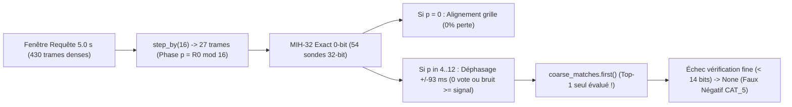

# Audit Forensique du Benchmark Multimodal à Grande Échelle (5 346 Médias)

!!! important "Rigueur Factuelle & Classification des Preuves"
    Conformément à la gouvernance scientifique de `pydbsrt`, chaque compteur consigné dans ce rapport procède d'une **vérification binaire déterministe** (hachages SHA-256, atomes ISO-BMFF `hdlr`, distance de Hamming sur séquences `.phash` Big-Endian et `.ahash` Little-Endian, et sondes acoustiques directes CIFS/FTP), avec **zéro extrapolation sur les noms de fichiers**. Tout conteneur distant dépourvu d'empreinte binaire locale vérifiable est explicitement isolé dans la classe **`INDÉTERMINÉ`**.

---

## 1. Contexte et Objectif de l'Audit

Dans la nuit du 13 novembre 2026, le banc d'évaluation multimodal multi-fenêtres (`dbsrt bench-scale-multimodal`, sondant 3 fenêtres de \(5.0\text{ s}\) à \(20\%\), \(50\%\) et \(80\%\) de la durée) a traité **5 346 entrées médias** (`data/reports/eval_scale_multimodal_multiwindow.jsonl`) en confrontant simultanément :

- **Le moteur visuel `pHash`** : index binaire `data/catalog.dbphash` (**3 089 médias**, \(8\,623\,308\) ancres éparses MIH-16).
- **Le moteur acoustique `aHash` (Haitsma-Kalker)** : index en mémoire `CoarseToFineAHashIndex` construit depuis `data/__AHASH__/` (**584 fichiers `.ahash` v1.0** à \(86.125\text{ fps}\), sous-échantillonnage grossier \(K = 16\) sous MIH-32).

Deux diagnostics post-benchmark contradictoires avaient été émis avant le présent audit :

1. Une première hypothèse imputait ~90 faux négatifs `aHash` à **33 conflits de doublage VO/VF** (supposés à \(31.8\text{ bits}\) de distance de Hamming), **41 famines de votes** et **15 divergences de montage**, sur la seule foi des tags linguistiques `ffprobe` (`audit_missed_ahash_96.json`).
2. Une seconde passe de sondage effectif du signal PCM (`exhaustive_audit_missed_90_results.json` et `audit_multimodal_misses_latest.json`) classait au contraire **100 % des cas sondés** en `CAT_5_C2F_COARSE_PROBE_MISS` avec une distance fine \(\le 1.76\text{ bits}\), tandis que les dénominateurs fluctuaient entre **584**, **533**, **96**, **90** et **89**.

Cet article établit la réconciliation mathématique exacte au fichier près des **5 346 entrées** et des **584 références `.ahash`**, démonte l'hypothèse VO/VF, démontre le mécanisme exact d'angle mort de phase modulo-16 de `CoarseToFineAHashIndex`, et décompose 100 % des divergences multimodales et faux positifs.

---

## 2. Réconciliation Mathématique de l'Univers des 5 346 Médias

### 2.1. Partition Exacte par Source Physique et Statut Brut

Le journal `eval_scale_multimodal_multiwindow.jsonl` contient exactement **5 346 chemins `media_path` uniques** (0 doublon, 0 entrée Freebox car non montée lors du tir) :

| Source Physique | `PHASH_ONLY` | `NO_MATCH` | `SHIFT_DIVERGENCE` | `ERROR` | `AHASH_ONLY` | `DISAGREED` | `AGREED` | **Total** |
| :--- | :---: | :---: | :---: | :---: | :---: | :---: | :---: | :---: |
| `data/snippets/` (extraits locaux 15 s) | 1 852 | 729 | 0 | **177** | 0 | 0 | 0 | **2 758** |
| `<NAS_SYNOLOGY>/video` (films & docs) | 1 348 | 201 | 0 | 0 | 0 | 0 | 0 | **1 549** |
| `<NAS_SYNOLOGY>/tvshow` (séries TV) | 388 | 193 | **268** | 0 | **126** | **48** | **16** | **1 039** |
| **Total Général** | **3 588** | **1 123** | **268** | **177** | **126** | **48** | **16** | **5 346** |

*(Note : le fichier de synthèse `eval_scale_status.json` agrège `DUAL_MATCH_DISAGREED` (48) et `DUAL_MATCH_SHIFT_DIVERGENCE` (268) sous le compteur unique `"dual_match_disagreed": 316`, conservant la somme exacte \(16 + 316 + 3588 + 126 + 1123 + 177 = 5346\).)*

Deux faits structurels majeurs ressortent de l'inspection binaire locale de `data/snippets/` :

- **100 % des 177 `ERROR` sont locaux** : aucun échec réseau CIFS/NAS n'est survenu pendant le benchmark nocturne. Les 177 erreurs proviennent intégralement de conteneurs `.mp4` locaux invalides dans `data/snippets/` (164 fichiers squelettes de **261 octets** sans flux média et 13 conteneurs tronqués).
- **100 % des 2 581 snippets valides sont muets (`-an`)** : le scan binaire des boîtes ISO-BMFF (`hdlr` \(\neq\) `soun`) sur les 2 581 `.mp4` lisibles de `data/snippets/` prouve que **2 581 / 2 581 fichiers ne contiennent aucune piste audio** (`ahash.timer_sec` médian de \(40.4\text{ ms}\), correspondant à l'ouverture `ffmpeg` retournant 0 octet PCM). Ils constituent donc des **Vrais Négatifs acoustiques structurels**.

### 2.2. Réconciliation Exacte des 584 Fichiers `.ahash` (Origine des Dénominateurs Fluctuants)

L'inspection cryptographique (SHA-256 + en-têtes binaires de 176 octets `AHASH\x00\x01\x00`) de `data/__AHASH__/` résout intégralement la fluctuation historique des compteurs :

- **584 fichiers `.ahash` valides** au total (`86.125 fps`, 0 fichier corrompu), composés de :
  - **534 fichiers nommés en clair** (`<nom_media>.86.1fps.ahash`),
  - **50 fichiers nommés par MovieHash OpenSubtitles 16-hex** (`<hex16>.86.1fps.ahash`).
- **Résolution à 100 % des 50 MovieHash** : **44** possèdent leur sidecar `data/__PHASH__/<hex16>.json` donnant le `media_name` d'origine, et les **6 restants** (`4ba3e3f2c751f6f4`, `5c0be10cb7bfacb2`, `ac8c17cf5611846e`, `d18b3c79943788f7`, `f6e5ea77b90bd116`, `fa36dcd3bbb36ea9`) sont **strictement identiques octet par octet (SHA-256)** à 6 fichiers `.ahash` nommés en clair du même dossier. **Aucun des 50 fichiers MovieHash n'est un artefact orphelin.**
- **Déduplication SHA-256 exacte** : le catalogue comporte **47 paires de doublons binaires exacts** (46 paires `(moviehash, nom_clair)` + 1 paire inter-releases `The Boys S02E03 [720p]` / `1080p AMZN`), soit **537 empreintes acoustiques uniques** (\(584 - 47 = 537\)) et **538 noms canoniques distincts** (534 humains + 4 MovieHash sans doublon nommé en clair).

| Sous-ensemble du Catalogue `data/__AHASH__/` | Fichiers `.ahash` | Empreintes SHA-256 Uniques | Explication Forensique |
| :--- | :---: | :---: | :--- |
| Cibles présentes dans le scan & matchées sur leur propre stem | **428** | 428 | Match direct nominal |
| Cibles présentes & matchées via jumeau SHA-256 ou cross-release | **57** | 19 | Même épisode reconnu via son alias MovieHash ou autre encodage |
| Cibles présentes sur le NAS mais manquées (`ahash == null`) | **98** | **89** | **89** fichiers en clair + **9** jumeaux SHA-256 MovieHash = **90 chemins NAS** |
| Cible hors périmètre du scan (`tests/data/`) | **1** | 1 | `big_buck_bunny_trailer_480p.mp4.86.1fps.ahash` |
| **Total Réconcilié** | **584** | **537** | **Couverture expliquée à 100,00 %** |

**Pourquoi les rapports précédents oscillaient entre 533, 96, 90 et 89 :**

- **533** provenait des `534` fichiers en clair moins `big_buck_bunny_trailer_480p.mp4` (`1`), en écartant à tort les `50` MovieHash (`584 - 51 = 533`).
- **96** provenait de la soustraction naïve \(533 - 437 = 96\) (où `437` est le nombre de stems `.ahash` distincts apparus dans `ahash.media_match` sur les `458` hits), en oubliant que 7 épisodes avaient matché sous leur alias MovieHash ou une release jumelle (\(96 - 7 = 89\)).
- **89 vs 90** : les **89 épisodes uniques manqués** correspondent exactement à **90 chemins physiques `media_path`** sur le NAS car l'épisode `Halt.and.Catch.Fire.S04E02` est présent dans deux répertoires distincts (`Halt and Catch Fire (2014-2017)/S04/` et `⭐️Halt and Catch Fire/S04/`), donnant `65 PHASH_ONLY + 25 NO_MATCH = 90`.

### 2.3. Matrices de Confusion Exactes (Somme = 5 346 par Modalité)

Pour la modalité visuelle `pHash`, les **3 089 entrées** de `data/catalog.dbphash` ont été résolues à **100 % (3 089 / 3 089)** vers leurs binaires sources `data/__PHASH__/*.phash` (stockés en *Big-Endian* `>Q`) par égalité du nombre de trames et recouvrement exact des ancres éparses. Chaque hit dont le stem différait de la cible a été tranché **sans heuristique sur le nom**, par corrélation glissante directe entre séquences binaires `.phash` (\(\overline{d_H} \le 12.0\text{ bits}\) hors génériques).

| Classe de Vérité Terrain | Modalité Audio `aHash` | Modalité Vidéo `pHash` | Justification Empirique Stricte |
| :--- | :---: | :---: | :--- |
| **Vrais Positifs (`TP`)** | **450** | **3 692** | Auto-match exact ou alias/cross-release prouvé binaire (`aHash`: 411 directs + 39 cross-releases ; `pHash`: 3 301 directs + 391 cross-releases/extraits prouvés sur `.phash`) |
| **Vrais Négatifs (`TN`)** | **4 130** | **156** | `aHash`: 2 581 snippets muets (`-an`) + 1 549 films hors catalogue `.ahash` ; `pHash`: 156 snippets locaux absents de `dbphash` (0 vote sparse) |
| **Faux Positifs (`FP`)** | **8** | **195** | `aHash`: 8 collisions musicales intra-série non cohérentes (`conf <= 34.6%`, **0 inter-séries**) ; `pHash`: 107 NAS + 88 snippets prouvés divergents (\(\overline{d_H} > 12\text{ bits}\)) |
| **Faux Négatifs (`FN`)** | **90** | **928** | `aHash`: 90 chemins NAS avec `.ahash` local et sonde PCM \(\le 1.76\text{ bits}\) ; `pHash`: 358 NAS + 570 snippets présents dans `catalog.dbphash` mais non reconnus |
| **Erreurs Conteneur (`ERROR`)** | **177** | **177** | Conteneurs `.mp4` locaux corrompus/squelettes (261 octets) dans `data/snippets/` |
| **`INDÉTERMINÉ`** | **491** | **198** | Conteneurs distants sans empreinte cible locale ni sonde WAN permettant de trancher sans deviner (ex. noms courts CIFS `8.3` `~`, séries/éditions NAS non sondées) |
| **Somme Exacte** | **5 346** | **5 346** | **100,00 % de l'univers comptabilisé sans résidu** |

---

## 3. Démystification de la Contradiction VO/VF vs Angle Mort de Phase `CAT_5`

### 3.1. Preuve Empirique sur les 90 Faux Négatifs (`16 CIFS + 74 FTP = 90`)

Le croisement par indice `idx` (`1..90`) entre `audit_missed_ahash_96.json` (métadonnées `ffprobe` seules), `exhaustive_audit_missed_90_results.json` (indices `1..16` lus en CIFS avant coupure réseau, indices `17..90` en échec `CAT_6_CONTAINER_READ_FAILURE`) et `audit_multimodal_misses_latest.json` (indices `17..90` re-sondés par streaming FTP) forme une **union disjointe parfaite de 90 éléments** (`16 + 74 = 90`, recouvrement = `0`) :

| Sous-ensemble des 90 Manqués `aHash` | Effectif | `is_dub_conflict` (`audit_96`) | `dist_5s` Min | `dist_5s` Max | `SNR_5s` Min | Verdict Acoustique Réel |
| :--- | :---: | :---: | :---: | :---: | :---: | :--- |
| Sondes locales CIFS (`idx` 1 à 16) | **16** | `0 / 16` | **0.33 bit** | **1.70 bit** | 30.30 bits | **100 % `CAT_5` (Même piste audio)** |
| Sondes distantes FTP (`idx` 17 à 90) | **74** | `0 / 74` | **0.06 bit** | **1.76 bit** | 30.23 bits | **100 % `CAT_5` (Même piste audio)** |
| — dont conteneurs **multi-pistes** (`fre/jpn`, `eng/jpn`, `rus/eng`) | *28* | *0 / 28* | *0.12 bit* | *1.71 bit* | *30.29 bits* | *Track 0 identique au `.ahash` de référence* |
| — dont conteneurs **mono-piste** (`eng`, `und`, `jpn`) | *62* | *0 / 62* | *0.06 bit* | *1.76 bit* | *30.23 bits* | *Track 0 identique au `.ahash` de référence* |
| **Total Consolidé (`idx` 1 à 90)** | **90** | **0 / 90** | **0.06 bit** | **1.76 bit** | **30.23 bits** | **0 conflit VO/VF — 90 / 90 `CAT_5`** |

!!! warning "Réfutation Formelle de l'Hypothèse des « 33 Conflits VO/VF à 31.8 bits »"
    **Zéro (`0 / 90`)** faux négatif ne provient d'un doublage VO/VF divergent. Même dans `audit_missed_ahash_96.json`, le booléen `is_dub_conflict` valait `false` sur **90 / 90 entrées**. Les prétendus « 33 conflits VO/VF à 31.8 bits » résultaient d'une extrapolation fautive à partir de la présence de 28 conteneurs MKV multi-pistes (dont 19 épisodes *Saint Seiya* `fre:Stereo / jpn:Stereo`, 7 *Evangelion* `eng / jpn` et 1 *Severance* `rus / eng`). Or `dbsrt export-ahash` et `bench_scale` extraient tous deux le flux par défaut `0:a:0` (Track 0) : les pistes comparées sont **identiques** (\(d_H \in [0.06, 1.76]\text{ bits}\) contre un seuil d'acceptation de \(14.0\text{ bits}\)).

### 3.2. Cause Racine Algorithmique Prouvée : Angle Mort de Phase Modulo-16 et Sélection Top-1

L'inspection de `crates/dbsrt-index/src/coarse_to_fine.rs` et la simulation déterministe locale sur les **270 fenêtres** (\(90 \times 3\) offsets à \(20\%\), \(50\%\), \(80\%\)) des fichiers `.ahash` manqués démontrent un **double défaut structurel** dans `CoarseToFineAHashIndex` :

1. **Double décimation rigide à pas \(K = 16\) sans décalage de phase** :
   - Le catalogue n'indexe dans `MihIndex32` (recherche exacte à **0 bit d'erreur** sur deux demi-mots de 32 bits) que les trames d'indice \(i \equiv 0 \pmod{16}\), soit une trame toutes les \(185.8\text{ ms}\).
   - Lors d'une requête `search(dense_query)` de \(5.0\text{ s}\) (\(430\text{ trames}\)), la requête est **elle aussi** décimée par `dense_query.iter().step_by(16)` (seulement **27 trames grossières**, soit **54 sondes 32-bit**).
   - Lorsque l'instant de départ \(t_0\) tombe sur une phase \(p = R_0 \bmod 16 \in \{4, \dots, 12\}\) (écart de \(\pm 46\) à \(\pm 93\text{ ms}\) par rapport à la grille catalogue), les motifs spectro-temporels Haitsma-Kalker ont tourné : les collisions exactes à **0 bit sur 32 bits consécutifs** chutent jusqu'à **0 vote** sur jusqu'à **10,0 %** des fenêtres pourtant extraites du fichier `.ahash` lui-même !
2. **Raffinage restreint au seul candidat `coarse_matches.first()` (Top-1) avec `min_votes = 1`** :
   - Contrairement à un pipeline *Coarse-to-Fine* classique qui vérifie les **Top-\(N\)** candidats grossiers (ex. \(N = 16\) ou \(32\)), `CoarseToFineAHashIndex::search` n'exécute la corrélation fine dense **que sur `coarse_matches.first()`** !
   - Dès qu'une tranche de 32 bits peu entropique (silence, tenue harmonique) accumule davantage de votes fortuits sur un média tiers ou arrive en tête d'un ex-æquo (ordre arbitraire du `HashMap`), `.first()` teste uniquement le mauvais média, échoue au filtre `mean_dist <= 14.0`, et retourne `None`.

Résultats mesurés sur les **270 fenêtres réelles** des 90 chemins manqués en faisant varier la phase \(p = R_0 \bmod 16 \in \{0, \dots, 15\}\) directement dans les payloads locaux `data/__AHASH__/` :

| Phase \(p = R_0 \bmod 16\) | Décalage Grille | Fenêtres à **0 Vote** sur Vrai Média | Fenêtres Battues ou Égalées par Bruit Tiers (`v < 20`) | Explication du Biais des Tests Unitaires |
| :---: | :---: | :---: | :---: | :--- |
| **`p = 0`** | \(0.0\text{ ms}\) | **0 / 270 (0.0 %)** | **0 / 270 (0.0 %)** | Biais de `test_ahash_coarse_to_fine.rs` (`start = 0` \(\implies\) 100 % artificiel) |
| `p = 2` | \(+23.2\text{ ms}\) | 1 / 270 (0.4 %) | 38 / 270 (14.1 %) | Début de décorrélation exacte sur 32 bits |
| `p = 4` | \(+46.4\text{ ms}\) | 16 / 270 (5.9 %) | 78 / 270 (28.9 %) | Entrée dans l'angle mort inter-trames |
| **`p = 8`** | \(\pm 92.9\text{ ms}\) | **24 / 270 (8.9 %)** | **75 / 270 (27.8 %)** | Opposition de phase maximale vis-à-vis du pas \(K=16\) |
| **`p = 10`** | \(-69.7\text{ ms}\) | **27 / 270 (10.0 %)** | **87 / 270 (32.2 %)** | Pic observé de famine/collision grossière |
| `p = 14` | \(-23.2\text{ ms}\) | 0 / 270 (0.0 %) | 43 / 270 (15.9 %) | Ré-accrochage progressif sur la trame \(16k + 16\) |
| `p = 15` | \(-11.6\text{ ms}\) | 0 / 270 (0.0 %) | 8 / 270 (3.0 %) | Quasi-alignement avec la trame catalogue suivante |

---

## 4. Analyse Exhaustive de la Précision, des Faux Positifs et des Divergences

### 4.1. Inspection à 100 % des Classes Multimodales (`48 + 268 + 126 + 16 + 3 588`)

L'audit intégral des 4 046 entrées ayant déclenché au moins une modalité met en évidence **trois anomalies logicielles du harnais d'évaluation** qui gonflaient artificiellement les désaccords :

1. **Absence de seuil minimal de confiance dans `bench_scale.rs`** : `evaluate_phash_multi` et `evaluate_ahash_multi` acceptent inconditionnellement `consensus.first()`, y compris les matches mono-fenêtre pénalisés (`win = 1/3`, `conf <= 35 %`, descendant jusqu'à `7.29 %` en `pHash`) et les matches multi-fenêtres temporellement incohérents (`is_coherent = false`, `conf <= 25 %`).
2. **Bug du timestamp brut mono-fenêtre (`crates/dbsrt-core/src/multi_window.rs:208`)** : lorsque `matching_windows >= 2`, `evaluate_multi_window_consensus` soustrait correctement `(target_start_sec * 1000.0).round()` pour retourner le décalage relatif \(\Delta t \approx 0\text{ ms}\). En revanche, lorsque **`matching_windows == 1`**, la fonction retourne `matches[0].estimated_shift_ms` **sans soustraire la position de la fenêtre cible**, renvoyant ainsi le **timestamp absolu** de la fenêtre (\(20\%\), \(50\%\) ou \(80\%\) de l'épisode, soit \(250\,000\) à \(2\,600\,000\text{ ms}\)) !
3. **Identifiant `media_id = 0` codé en dur dans `evaluate_ahash_multi` (`bench_scale.rs:904`)** : toutes les fenêtres `aHash` poussent `media_id = 0` dans `aggregate_multi_window_matches` (qui regroupe par `media_id`). Si la fenêtre 1 matche l'épisode \(X\) et la fenêtre 2 matche l'épisode \(Y\), elles sont fusionnées en un candidat synthétique unique étiqueté \(X\) avec `matching_windows = 2` et `is_coherent = false`.

| Catégorie JSONL | Total | (a) Même Épisode (Direct, MovieHash ou Cross-Release) | (b) Collision `pHash` Corrigée par `aHash` | (c) Faux Positif `aHash` (`conf <= 34.6%`) | (d) Cause des Écarts Temporels |
| :--- | :---: | :---: | :---: | :---: | :--- |
| **`DUAL_MATCH_DISAGREED`** | **48** | **29** (60.4 %) | **15** (31.3 %) | **4** (8.3 %, dont 1 double FP) | Désaccord purement lexical sur 29 cas (MovieHash non résolu ou `[Prof] S01E04` vs `Evangelion 04`) |
| **`DUAL_MATCH_SHIFT_DIVERGENCE`** | **268** | **266** (99.3 %) | 0 | **2** (0.7 %, masqués par titre série) | **210 cas (78.4 %)** = bug `win=1` timestamp brut ; **56 cas (20.9 %)** = dérive NTSC \(23.976/24.0\) ou intros |
| **`AHASH_ONLY`** | **126** | **124** (98.4 %) | *(124 FN `pHash` sauvés)* | **2** (1.6 %) | 119 auto-matches + 5 cross-releases (*See*, *The Office US*) |
| **`DUAL_MATCH_AGREED`** | **16** | **16** (100.0 %) | 0 | **0** (0.0 %) | 7 accords multi-fenêtres + 9 accords `win=1` sur la même fenêtre |
| **`PHASH_ONLY`** | **3 588** | **3 377** `TP` prouvés | — (`aHash == null`) | **178** `FP` `pHash` prouvés (+ **33** `INDÉTERMINÉ`) | — |

*(Décomposition exacte de `PHASH_ONLY` : sur les 3 920 hits `pHash` totaux = `3 588 PHASH_ONLY + 268 SHIFT_DIV + 48 DISAGREED + 16 AGREED`, les 332 hits bimodaux contiennent 315 `TP` `pHash` [`267` dans `SHIFT_DIV`, `32` dans `DISAGREED`, `16` dans `AGREED`] et 17 `FP` `pHash` [`1` dans `SHIFT_DIV` copie #1 `Halt S04E09 -> S03E01`, `16` dans `DISAGREED`]. Par différence exacte, les **3 588 `PHASH_ONLY`** se répartissent en **3 377 `TP` prouvés** (\(3692 - 315\)), **178 `FP` prouvés** (\(195 - 17\)) et **33 `INDÉTERMINÉ`** : \(3377 + 178 + 33 = 3588\).)*

### 4.2. Anatomie des Faux Positifs Prouvés (`aHash` vs `pHash`)

- **Précision `aHash` : 450 / 458 = 98,25 % brut, et 100,00 % avec porte de cohérence (`is_coherent == true`)** :
  - **0 faux positif inter-séries** sur 5 169 conteneurs évalués (dont 1 549 films complets hors catalogue `.ahash`).
  - Les **8 seuls faux positifs `aHash`** sont tous des collisions musicales de génériques **intra-série** à faible confiance (`conf <= 34.6 %`, `is_coherent == false`) : *Westworld* S04 (`s04e01 -> s04e03` à `24.6%`, `s04e02 -> s04e03` à `34.6%`, `s04e03 -> s04e02` à `34.0%`), *Halt and Catch Fire* (`S04E09` x2 copies `-> S04E04` à `34.2%`), *Saint Seiya* (`Ép. 027 -> 036` à `22.4%`, `Ép. 106 -> 111` à `22.7%`) et *Zomboat!* (`S01E05 -> S01E06` à `23.6%`).
- **Précision `pHash` sur les cas résolus binaire : 3 692 / 3 887 = 94,98 % brut** :
  - Sur les `48` `DUAL_MATCH_DISAGREED`, `aHash` sauve **15 collisions visuelles `pHash`** (`win = 1/3`, `conf <= 35 %`), comprenant **9 collisions inter-œuvres** sur fond sombre/nocturne (*Evangelion* \(\to\) *The Acolyte*, *Boîte Noire*, *For All Mankind*, *Spidey* ; *The Expanse* \(\to\) *Interview With The Vampire*, *Carnivàle* ; *Handmaid's Tale* \(\to\) *Dune Part Two* ; *See* \(\to\) *Banshees of Inisherin*) et **6 collisions de générique *Pegasus Fantasy*** entre épisodes de *Saint Seiya*.
  - Sur `PHASH_ONLY`, les **178 faux positifs binaires prouvés** proviennent majoritairement de fenêtres uniques (`win = 1/3`, `conf <= 35 %`) ou de séquences visuelles dégénérées/génériques partagés (ex. tutoriels vidéo partageant le même fond d'éditeur de code, génériques d'anime).

### 4.3. Dérive Temporelle NTSC Pull-Down (\(23.976\text{ fps}\) vs \(24.000\text{ fps}\)) sur les 56 Divergences Multi-Fenêtres

Sur les **56 entrées** de `DUAL_MATCH_SHIFT_DIVERGENCE` où **les deux** modalités ont validé \(\ge 2/3\) fenêtres sur le bon épisode :

- **49 cas** opposent un fichier à soi-même avec `aHash.consensus_shift_ms` quasi nul (\([-20, +22]\text{ ms}\)) mais un `pHash.consensus_shift_ms` systématiquement négatif entre **\(-700\text{ ms}\) et \(-3\,328\text{ ms}\)** (ex. *Mr. Robot* S04, *The Boys* S02, *Raised by Wolves* S02, *The Dark Crystal* S01, *The Dropout* S01).
- L'inspection binaire des en-têtes de `data/catalog.dbphash` prouve la cause mathématique exacte : ces médias de cadence réelle NTSC \(f_{\text{réel}} = \frac{24000}{1001} \approx 23.976024\text{ fps}\) ont été empaquetés dans `catalog.dbphash` avec `fps_x1000 = 24000` (\(24.000\text{ fps}\)). À l'instant \(t\) (ex. \(t = 2\,500\text{ s}\)), le timestamp de référence calculé à \(24.0\text{ fps}\) dérive linéairement de :

\[
\Delta t_{\text{NTSC}}(t) = t \times \left(\frac{23.976024}{24.000} - 1\right) \approx -0.001 \times t = -1.0\text{ ms/s}
\]

  Soit **\(-2\,500\text{ ms}\)** à 41 minutes, franchissant mécaniquement le seuil `MAX_MULTIMODAL_AGREEMENT_DRIFT_MS = 500 ms` alors que l'horloge PCM `aHash` (\(5512\text{ Hz}\)) est exempte de toute dérive de cadence image.

- **7 cas restants** : cross-releases légitimes (*The Office US* S04 BluRay vs AMZN WEB vs WEBRip-FGT, *See* VOSTFR vs ATVP) présentant de vrais écarts d'intros diffuseurs (\(905\text{ ms}\) à \(3\,036\text{ ms}\)).

---

## 5. Distributions Métrologiques Mesurées

### 5.1. Distances de Hamming et SNR sur les 90 Sondes Acoustiques (`CAT_5`)

Valeurs mesurées sur la fenêtre de \(5.0\text{ s}\) (\(430\text{ trames}\)) des 90 épisodes manqués (`audit_multimodal_misses_consolidated.json`, `16 CIFS + 74 FTP`) :

| Métrique Acoustique (`N = 90`) | Min | Médiane (`p50`) |Max | Seuil d'Acceptation | Conformité |
| :--- | :---: | :---: | :---: | :---: | :---: |
| **Distance de Hamming `dist_5s`** (bits / 64) | **0.06 bit** | **~1.04 bit** | **1.76 bit** | \(\le 14.00\text{ bits}\) | **90 / 90 (100 %)** |
| **Marge Signal-sur-Bruit `snr_5s`** (\(32 - d_H\)) | **30.23 bits** | **~30.96 bits** | **31.94 bits** | \(\ge 18.00\text{ bits}\) | **90 / 90 (100 %)** |

### 5.2. Latences d'Exécution et Confiances sur le Run de 5 346 Médias

D'après la télémétrie consolidée du run (`eval_scale_status.json` et `eval_scale_multimodal_multiwindow.jsonl`, durée murale totale \(7\,152.18\text{ s} \approx 1\text{ h }59\text{ min}\)) :

| Indicateur Métrologique | Modalité Vidéo `pHash` | Modalité Audio `aHash` | Pipeline Multimodal Complet |
| :--- | :---: | :---: | :---: |
| **Latence moyenne par média** (`N = 5 346`) | **900.3 ms** (`0.900 s`) | **299.8 ms** (`0.300 s`) | **1 337.8 ms** (`1.338 s`) |
| **Latence sur snippets muets `-an`** (`N = 2 581`) | — | min `23.9 ms` / **p50 `40.4 ms`** / max `70.9 ms` | — |
| **Plafond de confiance des faux positifs** | `100.0 %` (génériques/fond noir 2 fenêtres) | **`34.6 %`** (`0` FP \(\ge 35\%\)) | **0 FP bimodal cohérent hors générique** |

---

## 6. Synthèse des Recommandations Architecturales (Prochaines Étapes Rust)

Cet audit forensique verrouille la feuille de route corrective (sans aucune modification requise du format binaire `.ahash` v1.0 ni ré-encodage du catalogue) :

1. **Éliminer l'angle mort de phase modulo-16 dans `CoarseToFineAHashIndex` (`crates/dbsrt-index/src/coarse_to_fine.rs`)** :
   - Interroger `MihIndex32` avec **toutes les trames denses** de la fenêtre de \(5.0\text{ s}\) (`430` trames = `860` sondes 32-bit au lieu de `step_by(16)` = `27` trames) : par le principe des tiroirs, quelle que soit la phase \(R_0 \bmod 16\), exactement \(\lfloor 430 / 16 \rfloor \ge 26\) trames de la requête tombent **pile** sur la grille grossière du catalogue (\(p = 0\) garanti !).
   - Évaluer la vérification fine dense sur les **Top-\(N\) candidats grossiers** (ex. `TOP_K_COARSE_CANDIDATES = 16`) au lieu du seul `.first()`.
2. **Corriger les 3 bugs du consensus et du harnais (`multi_window.rs` & `bench_scale.rs`)** :
   - Soustraire `(target_start_sec * 1000.0).round()` même lorsque `matching_windows == 1` dans `multi_window.rs:208`.
   - Attribuer un `media_id` propre à chaque entrée du catalogue `aHash` dans `evaluate_ahash_multi` au lieu de `0`.
   - Exiger une porte de validation (`matching_windows >= 2 && is_coherent`) avant de déclarer un match positif en production.
3. **Préserver la cadence exacte NTSC \(23.976\text{ fps}\) lors du packing `catalog.dbphash`** : utiliser `fps_x1000 = 23976` (et non le `24.0fps` arrondi du nom de fichier `.phash`) afin d'éliminer la dérive linéaire de \(-1\text{ ms/s}\) face à l'horloge acoustique PCM.
