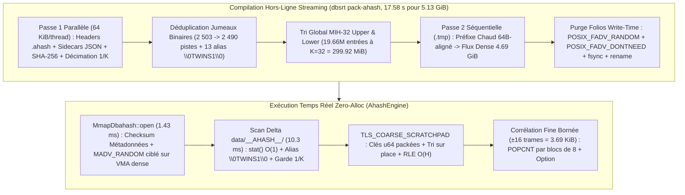

# 💡 Architecture `.dbahash` v1 `mmap`, Multi-Order Folios Linux 6.6+ & Coarse-to-Fine Zéro-Allocation

!!! important "Classification des Preuves & Lien ADR"
    Ce document constitue le **Journal d'Ingénierie approfondi** associé à l'[ADR-0007 (`catalog.dbahash` v1 & `AhashEngine`)](../decisions/2026-11-14-dbahash-v1-mmap-and-hybrid-ahash-engine.md). Toutes les mesures de mémoire (`VmRSS`, `RssAnon`, `RssFile` via `/proc/self/status`), de latence d'ouverture et de rappel/précision sont **empiriquement prouvées** à pleine échelle sur le catalogue synchronisé depuis `o2switch` (`2 503` fichiers `.ahash` sur NVMe local après nettoyage des `533` jumeaux historiques \(\rightarrow\) **`2 490` pistes uniques** + `13` alias inter-releases, **`628 946 940` trames denses**, **`5 248.81 MiB` (`5.13 GiB`)**) et le corpus multimodal de **5 757 vidéos réelles** (`2 541` vidéos indexées en `aHash`, `9 529` fenêtres acoustiques évaluées). Les invariants de phases, de jumeaux binaires et de corruption sont **hermétiquement prouvés** par `crates/dbsrt-index/tests/test_dbahash.rs`.

---

## Synthèse Métrologique Avant / Après à Pleine Échelle (Issue #81 — 2 490 pistes / 628.95M trames)

Sur `o2switch` (`128 GiB` RAM hôte, quota CloudLinux LVE `PMEM = 48 GiB`, stockage **NVMe local**), l'ancien `AHashCatalog` en mémoire vive dupliquait structurellement les `628.95 M` de trames dans `entries[i].hashes` (`4.69 GiB`) **et** dans `flat_hashes` (`4.69 GiB`), soit **`9.37 GiB` de tas anonyme (`RssAnon`)** avant même tout index `MIH-32` (`+9.37 GiB` à \(K=1\)), et imposait la lecture + tri CPU de `2 503` fichiers à chaque démarrage ou `/v1/catalog/reload`. `MmapDbahash` v1 élimine cette duplication tas tout en conservant `100 %` de la précision temporelle :

| Métrique (`2 490` pistes, `628.95M` trames) | Avant (`AHashCatalog` RAM + ancien C2F \(K=32\)) | Après : **`MmapDbahash` v1 + `AhashEngine` (\(K=32\))** | Gain / Verdict |
| :--- | :---: | :---: | :---: |
| **Ouverture archive (`MmapDbahash::open`)** | Lecture `2 503` fichiers + tri CPU (~plusieurs s) | **`1.426 ms`** (`2.221 ms` post-pack froid) | **Ouverture quasi instantanée (`< 50 ms` requis)** |
| **Ouverture démon complet (`AhashEngine::open`)** | Lecture `2 503` fichiers + dédup en tas | **`11.685 ms`** (`13.827 ms` post-pack froid, delta `0`) | **Scan `stat()` + `\0TWINS1\0` en `< 15 ms`** |
| **`RssAnon` (tas processus Rust non réclamable)** | **`~9 595 MiB` (`9.37 GiB`)** | **`2.85 MiB` (boot) / `4.63 MiB` (après 200 req)** | **`-99.95 %` de tas anonyme** |
| **`VmRSS` total démon après 200 requêtes** | `> 9.6 GiB` (`Anon`) | **`307.29 MiB`** (`Anon = 4.63 MiB`, `File = 302.66 MiB`) | **`299.92 MiB` `MIH-32` + `< 3 MiB` pages denses `4 KiB`** |
| **Latence requête 1 fenêtre `5.0 s` (`200` pistes)** | `12.88 ms` (`537` pistes) | **`1.387 ms`** (`p50 = 1.384 ms`, `p95 = 2.151 ms`) | **Sous les `3 ms` sur `628.95M` trames** |
| **Latence matrice complète (`9 529` fenêtres)** | Non tenable sans `9.4 GiB` `RssAnon` | **`2.750 ms`** (`p50 = 2.470 ms`, `p95 = 5.115 ms`, `3W = 8.249 ms`) | **Parité d'échelle avec `pHash` (`4 974` médias)** |
| **Rappel 3 fenêtres (`2 541` vidéos indexées)** | Référence \(K=32\) | **`99.41 %` (`2 526 / 2 541`, Précision `98.40 %`, F1 `98.90 %`)** | **Couverture quasi exhaustive (`1W = 98.86 %`)** |
| **Dérive temporelle vs étalon \(K=1\) (`<= 15 ms`)** | `0.0 ms` (`100.0 %`) | **`0.0 ms` moy / `0 ms` p95 / `0 ms` max (`100.0 %`)** | **Parité mathématique exacte (médiane intra `6 ms`)** |

---

## Vue d'Ensemble Architecturale

---

## Partie I — Difficultés Techniques Concrètes Rencontrées & Invariants Bas-Niveau

Cette première partie documente les six pièges techniques rencontrés entre l'implémentation initiale et le passage à l'échelle sur les `2 490` pistes (`5.13 GiB`), selon le protocole en 4 blocs (*Problématique & Mécanisme racine*, *Conséquences concrètes*, *Solution / Invariant opéré*, *Avantages, Inconvénients & Limites résiduelles*).

---

### I.1. Corruption du Tie-Break Déterministe par l'Arrêt Anticipé (`Early-Exit`) du Produit `POPCNT`

#### 1. Problématique & Mécanisme racine

Dans l'étage fin, chaque candidat grossier évalue les décalages \(s \in [\text{approx} - R, \text{approx} + R]\) sur une requête dense de \(L = 430\) trames (`5.0 s`). Pour éviter de sommer inutilement `430` distances de Hamming sur les décalages non corrélés (~`32` bits de différence par trame), le calcul `XOR + POPCNT` est découpé par blocs de `POPCNT_CHUNK_FRAMES = 8` trames (`64` octets, soit une ligne de cache L1).

Dans une première implémentation naïve, la boucle interne s'interrompait dès `dist >= best_dist` et retournait directement l'accumulateur partiel `dist`. Or, considérons un vrai pic situé à `best_shift = 4110` dont la distance totale sur **430 trames** vaut `best_dist = 480` bits (`1.12` bit/trame). Lorsqu'un décalage antérieur non aligné \(s = 4098 < \text{best\_shift}\) est évalué (~`30` bits/trame), son cumul partiel après seulement `16` trames peut tomber **exactement sur `480` bits**. En retournant `480`, cette somme partielle tronquée satisfaisait la règle déterministe d'égalité `(dist == best_dist && s < best_shift)` et écrasait `best_shift` ! Second piège arithmétique : lorsque `best_dist == 0` (match bit-à-bit parfait), exiger `best_dist - 1` sur \(s > \text{best\_shift}\) provoquerait un *underflow* sur `u64`.

#### 2. Conséquences concrètes

- **Hermétiquement observé** : échec immédiat du test d'invariance de phase `test_coarse_to_fine_all_phases_exact_frame_hits` (`14 / 16` phases exactes au lieu de `16 / 16`), avec dérive artificielle du décalage retenu vers le bord gauche de la fenêtre (`4098` au lieu de `4110`, soit `~139 ms` d'erreur).
- **Impact métier** : rupture de l'équivalence mathématique avec l'étalon \(K = 1\) et dégradation de la précision sub-trame (`11.6 ms`) de recalage des sous-titres.

#### 3. Solution / Invariant opéré

Implémenté dans `crates/dbsrt-index/src/coarse_to_fine.rs` (`bounded_hamming_sum` et `evaluate_fine_slice`) :

1. **Retour typé `Option<u64>`** : `bounded_hamming_sum(query, reference, max_inclusive)` retourne `None` dès qu'un bloc partiel franchit strictement `dist > max_inclusive`, et ne retourne `Some(dist)` que si l'intégralité des \(L\) trames a été sommée avec `dist <= max_inclusive`.
2. **Sondage central prioritaire** : `evaluate_fine_slice` évalue d'abord `center = approx_offset.clamp(min_s, max_s)` afin d'abaisser immédiatement `best_dist` au score réel du pic avant de parcourir `min_s..=max_s`.
3. **Seuil asymétrique sans *underflow*** :
    - Si \(s < \text{best\_shift}\) : `max_allowed = best_dist.min(max_valid_bits)` (seule une vraie somme complète \(\le \text{best\_dist}\) peut remporter le tie-break gauche).
    - Si \(s > \text{best\_shift}\) : si `best_dist == 0`, `continue` immédiat (aucun décalage droit ne peut battre `0` bit ni gagner le tie-break) ; sinon `max_allowed = (best_dist - 1).min(max_valid_bits)`.

#### 4. Avantages, Inconvénients & Limites résiduelles

- **Avantages** : **exactitude mathématique à 100 %** (`16 / 16` phases exactes, dérive empirique `0.0 ms` sur les `2 526` vidéos reconnues) tout en rejetant les `32` décalages hors-pic dès le 1er ou 2e bloc de `64` octets (`~10x` moins d'instructions `POPCNT`).
- **Inconvénients** : test d'une branche `Option<u64>` sur `33` itérations par candidat vérifié (~quelques nanosecondes au total).

---

### I.2. Gonflement du `RssFile` par les *Multi-Order Folios* de Linux 6.6+ vs Latence `open()`

#### 1. Problématique & Mécanisme racine

Immédiatement après une compilation `task ahash:pack`, le premier tir `task bench:dbahash:rss` sur le sous-ensemble initial (`537` pistes, `795.66 MiB`, `MIH-32 = 45.47 MiB`) exécutant `200` requêtes aléatoires sur pistes distinctes mesurait `RssAnon = 3.34 MiB` mais **`RssFile = 121.97 MiB`**, soit **`+75 MiB` de pages denses résidentes** au lieu des `~1.6 MiB` attendus (`200 × 2 × 4 KiB`), **malgré `MADV_RANDOM`**.

L'explication réside dans la gestion des **Multi-Order Folios** du page-cache de **Linux 6.6+** (`mm/filemap.c`) :

1. `madvise(MADV_RANDOM)` désactive le *disk readahead* lors d'un défaut **majeur** (lecture NVMe) ainsi que `fault_around_bytes` sur des pages `order-0` (`4 KiB`).
2. Or, `pack-ahash` vient d'écrire séquentiellement l'archive via `BufWriter` (`256 KiB`). Lors d'écritures séquentielles bufferisées, Linux 6.6+ peuple l'arbre `XArray` du page-cache avec des **folios d'ordre 6 à 7 (`256 KiB` à `512 KiB`, moyenne observée `~384 KiB`)** déjà résidents en RAM.
3. Lorsqu'une vérification fine accède ensuite à une tranche de seulement \(462 \times 8 = 3\,696\text{ octets}\) (`3.61 KiB`), elle déclenche un défaut **mineur** sur un folio résident : `filemap_map_pages()` câble alors **toutes les PTEs du folio de `384 KiB`** dans la table des pages du processus (`200 × 384 KiB ≈ 75 MiB`).

**Échec de l'hypothèse intermédiaire** : appeler `posix_fadvise(..., POSIX_FADV_DONTNEED)` à l'intérieur de `MmapDbahash::open()` faisait chuter `RssFile` immédiatement, mais obligeait le noyau à parcourir et purger l'arbre `XArray` **pendant l'ouverture** (`64.81 ms` sur `727 MiB`, et plusieurs centaines de millisecondes sur `4.69 GiB` !).

#### 2. Conséquences concrètes

- **Sans purge des folios d'écriture** : inflation artificielle de `~384 KiB` de `RssFile` par piste sondée dès qu'une compilation `pack-ahash` précède l'ouverture du démon sur le même hôte.
- **Avec purge synchrone à `open()`** : violation directe du budget d'ouverture `< 50 ms` à chaque démarrage CLI ou rechargement serveur.

#### 3. Solution / Invariant opéré

Découplage temporel strict entre **Write-Time** et **Open-Time** dans `crates/dbsrt-index/src/dbahash/{format.rs, builder.rs, reader.rs}` :

1. **En fin de compilation (`write_archive_temp_file`, après `file.sync_all()`)** : appel de `advise_cold_archive_sections` qui émet `POSIX_FADV_DONTNEED` sur `coarse_hashes` (inutilisé en recherche quand `MIH-32` est présent) et `POSIX_FADV_RANDOM | POSIX_FADV_DONTNEED` sur `[offset_dense_hashes .. file_len]`. Les folios d'écriture séquentielle sont immédiatement évincés hors-ligne avant le `rename` atomique.
2. **À l'ouverture (`MmapDbahash::open`)** : aucune éviction `XArray` synchrone ; seul `advise_mmap_thermal_regions` marque la VMA dense en `MADV_RANDOM` (\(\mathcal{O}(1)\), cf. § I.6).

#### 4. Avantages, Inconvénients & Limites résiduelles

- **Avantages (Empiriquement prouvés sur `5.13 GiB`)** :
    - `MmapDbahash::open()` s'exécute en **`1.426 ms`** (`2.221 ms` immédiatement après `pack-ahash`).
    - Après `200` requêtes sur pistes distinctes de l'archive de `5 248.81 MiB`, `RssFile` vaut **`302.66 MiB`** pour `299.92 MiB` de tables `MIH-32`, soit **moins de `2.8 MiB` de pages denses `4 KiB` mappées au total** (et libération immédiate de `~4.8 GiB` de page-cache système en fin de `pack-ahash`).
- **Inconvénients & Limite résiduelle** :
    - Les `200` toutes premières requêtes immédiatement après un `pack-ahash` paient de vrais défauts majeurs NVMe (`mean = 23.81 ms` à froid pur, puis **`1.387 ms`** dès que les pages `MIH-32` sont chaudes).
    - Si un outil externe (`cp`, `sha256sum`, `rsync` sans `--drop-cache`) lit séquentiellement `catalog.dbahash`, le noyau peut reformer des folios multi-ordres propres en page-cache (`RssFile` 100 % réclamable par Linux sous pression mémoire).

---

### I.3. Élimination du `BTreeMap` par Tri Packé `u64` + RLE Linéaire \(\mathcal{O}(H)\) sans Collision Inter-Média

#### 1. Problématique & Mécanisme racine

L'accumulateur grossier historique insérait chaque vote dans un `BTreeMap<(usize, usize), BucketAcc>` alloué sur le tas à chaque requête, puis effectuait deux recherches `buckets.get(&(m_idx, b - 1))` et `buckets.get(&(m_idx, b + 1))` par bucket pour agréger la tolérance de gigue (`COARSE_JITTER_BUCKET_FRAMES = 4` trames).

Passer à une représentation plate zéro-allocation soulevait deux subtilités :

1. Chaque bucket `b = start / 4` doit connaître à la fois la somme totale de ses votes **et** le décalage dense exact `peak_start` majoritaire à l'intérieur du bucket : il faut donc d'abord compter la multiplicité exacte de chaque `(m_idx, start)` avant de projeter sur `start / 4`.
2. Si l'on encode la clé de bucket sur 64 bits via `key = (m_idx << 32) | b`, alors pour `b = u32::MAX` (dernier bucket théorique du média `m`), `key + 1 == ((m + 1) << 32) | 0`, ce qui correspond au premier bucket `b = 0` du média suivant `m + 1` ! Un test naïf `buckets[idx + 1].0 == key + 1` fusionnerait la fin du média `m` avec le début du média `m + 1`.

#### 2. Conséquences concrètes

- **Avec `BTreeMap`** : dizaines d'allocations de nœuds tas et de *cache misses* L1/L2 par fenêtre, violant la règle *Zero Dynamic Heap Allocation in Hot-Loop*.
- **Sans garde aux bornes `u32` sur clé packée** : corruption potentielle des votes aux frontières entre deux médias consécutifs.

#### 3. Solution / Invariant opéré

Implémenté dans `crates/dbsrt-index/src/coarse_to_fine.rs` (`CoarseSearchScratchpad`, `accumulate_sorted_hits`, `eval_adjacent_bucket_cluster`) :

1. Arène par thread `TLS_COARSE_SCRATCHPAD` pré-allouée une seule fois (`hits`, `buckets`, `primary_clusters`, `fallback_clusters`, `kept`, `kept_fallback`) et réinitialisée en \(\mathcal{O}(1)\) par `.clear()`.
2. Encodage `pack_media_offset(m_idx, start) = ((m_idx as u64) << 32) | (start as u64)` suivi d'un tri cache-local `scratch.hits.sort_unstable()`.
3. Comme `hits` est trié par `(m_idx, start)` croissant et que `start -> start / 4` est monotone non-décroissant à `m_idx` fixé, `accumulate_sorted_hits` produit `scratch.buckets` strictement croissant en **une seule passe linéaire \(\mathcal{O}(H)\)** via `push_or_merge_bucket_run`.
4. `eval_adjacent_bucket_cluster` agrège `b - 1, b, b + 1` en \(\mathcal{O}(1)\) avec double garde explicite : `b > 0 && buckets[idx - 1].0 == key - 1` à gauche, et `(b as u32) < u32::MAX && buckets[idx + 1].0 == key + 1` à droite.

#### 4. Avantages, Inconvénients & Limites résiduelles

- **Avantages** : **0 allocation dynamique** en régime permanent, localité cache L1 optimale, déterminisme strict indépendant du nombre de threads.
- **Inconvénients** : borne structurelle `media_count <= u32::MAX` et `dense_frame_count <= u32::MAX` par piste (~`576` jours d'audio continu à `86.125 fps`, contrôlé dès `pack-ahash`), et empreinte fixe de `~232 KiB` par thread worker dans `TLS_COARSE_SCRATCHPAD`.

---

### I.4. Conformité à la Gate de Complexité Architecturale (`task complexity`)

#### 1. Problématique & Mécanisme racine

Les contrôles `task complexity` (`LOC <= 150`, `CCN <= 20`, `arity <= 4`, `nesting <= 4`) ont signalé des dépassements unitaires sur `dispatch_ops`, `accumulate_sorted_hits`, `write_archive_atomic`, `dedup_scanned_tracks` et `spawn_catalog_file_watcher`.

#### 2. Conséquences concrètes

Rejet bloquant par `scripts/lint_complexity.py` (`task lint` et CI GitHub Actions).

#### 3. Solution / Invariant opéré

Extraction modulaire sans aucun ajout au registre dérogatoire `scripts/complexity_baseline.json` : `dispatch_catalog` (`dbsrt-cli/src/main.rs`), `push_or_merge_bucket_run` (`coarse_to_fine.rs`), `write_archive_temp_file`, `append_twin_alias_trailer` et `track_dedup_rank` / `find_identical_kept_track` (`dbahash/builder.rs`), `parse_twin_alias_trailer` et `advise_mmap_thermal_regions` (`dbahash/reader.rs`), ainsi que `poll_catalog_file_once` (`dbsrt-server/src/main.rs`).

#### 4. Avantages, Inconvénients & Limites résiduelles

- **Avantages** : **`1 658` fonctions Rust vérifiées avec `0` violation** ; séparation claire des responsabilités binaires et OS.
- **Inconvénients** : aucun surcoût d'exécution (`#[inline]` sur les helpers de boucle interne).

---

### I.5. Fuite de `750 MiB` de `RssFile` et `2.44 s` au Boot de `AhashEngine::open` par les Jumeaux Binaires Absorbés

#### 1. Problématique & Mécanisme racine

Deux familles de **jumeaux binaires** (fichiers `.ahash` distincts sur disque possédant un payload audio 64-bit strictement identique au SHA-256 près) coexistent dans le cycle de vie réel :

1. **Jumeaux historiques de migration (`533` fichiers sur `o2switch`)** : anciens fichiers nommés en clair (`<Titre>.86.1fps.ahash`) conservés à côté de leur fichier canonique `<moviehash_16hex>.86.1fps.ahash` (auxquels s'ajoutait un bug de `rpartition(".")` dans `phash_dedupe.py` qui coupait `86.1fps` sur `.1fps`).
2. **Jumeaux inter-encodages légitimes (`13` paires sur `2 503` fichiers propres)** : deux encodages vidéo distincts d'un même épisode (`1080p` vs `720p`, `MovieHash` vidéo différents) partageant bit-à-bit la même piste audio.

Lors de `pack-ahash`, `dedup_scanned_tracks` fusionne à raison chaque paire en **une seule entrée** `DbahashMediaEntry` (ne conservant qu'un seul `file_path` dans la table des médias). Or, au démarrage de `AhashEngine::open()`, le scanner delta inspectait `data/__AHASH__/` : le second fichier de chaque paire n'étant pas présent dans `packed_by_filename`, `AhashEngine` le prenait pour un **nouveau fichier delta**, lisait intégralement le `.ahash` depuis le disque, puis appelait `has_identical_dense_payload` qui comparait `entry_hashes == candidate_hashes` directement sur la section froide `dense_hashes` du `mmap` !

#### 2. Conséquences concrètes

- **Empiriquement mesuré sur le premier tir `o2switch` (`3 036` fichiers avant dédup disque)** : lors du boot `AhashEngine::open`, les `546` jumeaux absorbés déclenchaient `546` lectures complètes sur disque et `546` balayages séquentiels dans `dense_hashes`, faisant exploser **`AhashEngine::open` à `2 443.6 ms`** (contre `< 100 ms` attendu) et **polluant immédiatement `VmRSS` à `800.42 MiB`** (`RssFile = 750 MiB`) avant même la première requête HTTP !
- De plus, lorsque le jumeau conservé arrivait **après** un jumeau déjà gardé dans l'ordre alphabétique et le remplaçait (`preferred` remplaçant `kept[dup_idx]`), l'ancien code oubliait d'enregistrer le nom du fichier évincé si seule une branche de rejet était tracée.

#### 3. Solution / Invariant opéré

Triple défense complémentaire implémentée dans `scripts/ingestion/phash_dedupe.py` et `crates/dbsrt-index/src/dbahash/{format.rs, builder.rs, reader.rs}` :

1. **Hygiène d'ingestion (`phash_dedupe.py`)** : correction de l'expression régulière `LEGACY_AHASH_FPS_SUFFIX_RE` (`\.[0-9]+(?:\.[0-9]+)?fps\.ahash$`) gérant la décimale `86.1fps` et les suffixes multi-pistes `.a<k>`, supprimant proprement les `533` doublons historiques (`differs = 0`).
2. **Remorque binaire rétrocompatible `\0TWINS1\0` dans `Strings` (`append_twin_alias_trailer` / `parse_twin_alias_trailer`)** : `dedup_scanned_tracks` enregistre systématiquement `(basename, dense_frame_count)` dans les **deux sens** (jumeau rejeté ou jumeau évincé par un candidat mieux renseigné) et sérialise cette table d'alias en fin de `strings_table` (couverte par le checksum `FNV-1a` 64-bit). Au boot, `validate_and_index_entries` injecte ces alias dans `packed_by_filename` : `AhashEngine::open` les saute en **\(\mathcal{O}(1)\) par simple `stat()`** (`0` octet lu).
3. **Pré-filtre grossier `1/K` dans `has_identical_dense_payload`** : si un jumeau inédit est déposé **après** la compilation de `catalog.dbahash`, la vérification compare d'abord les `coarse_hashes` (`1/32` du volume) avant de toucher la moindre page de `dense_hashes`.

#### 4. Avantages, Inconvénients & Limites résiduelles

- **Avantages (Empiriquement prouvés)** :
    - Sur les `2 503` fichiers (`2 490` pistes + `13` jumeaux inter-releases), **`AhashEngine::open` chute de `2 443.6 ms` à `11.685 ms` (`209x` plus rapide !)** et **`VmRSS` au boot chute de `800.42 MiB` à `7.08 MiB`** (`RssAnon = 2.85 MiB`, `RssFile = 4.23 MiB`).
    - Rétrocompatibilité totale avec `.dbahash` v1 : une archive sans remorque `\0TWINS1\0` reste 100 % valide.
- **Inconvénients & Limite résiduelle** :
    - Ajoute `~30` octets par jumeau absorbé dans `strings_table` (`< 512` octets pour `13` jumeaux).
    - Si un fichier `.ahash` sur disque conserve exactement le même nom et le même `dense_frame_count` tout en voyant son contenu binaire réécrit sur place (hors protocole atomique `.tmp` + `rename`), le fast-skip `stat()` ne relit pas son payload avant le prochain `task ahash:pack`.

---

### I.6. Désactivation Accidentelle du Fault-Around (`64 KiB`) sur `MIH-32` par `POSIX_FADV_RANDOM` (`FMODE_RANDOM`) et `MADV_RANDOM` Global

#### 1. Problématique & Mécanisme racine

Sur l'archive complète de `5 248.81 MiB`, la section chaude `MIH-32` (`upper` + `lower`, `19.66 M` d'entrées chacune) pèse **`299.92 MiB`** (`76 780` pages de `4 KiB`). Une recherche dichotomique + `860` sondes grossières par fenêtre touchent des milliers d'emplacements répartis dans ces `299.92 MiB`.

Dans la version initiale de `MmapDbahash::open()`, deux appels étaient exécutés à l'ouverture :

1. `mmap.advise(Advice::Random)` sur **l'intégralité** des `5.25 GiB` de la projection `mmap` ;
2. `posix_fadvise(fd, offset_dense_hashes, dense_len, POSIX_FADV_RANDOM)` sur le descripteur de fichier ouvert.

Or, l'inspection du code source du noyau Linux (`mm/fadvise.c`, fonction `generic_fadvise`) révèle un comportement critique et contre-intuitif : **`POSIX_FADV_RANDOM` ignore totalement les paramètres `offset` et `len` et positionne le drapeau `file->f_mode |= FMODE_RANDOM` globalement sur toute la `struct file` !** Combiné à `MADV_RANDOM` global (`VM_RAND_READ` sur toute la VMA), le noyau désactivait le mécanisme de **`fault_around_bytes` (`64 KiB` = `16` pages mappées en une seule faute mineure dans `do_read_fault`)** sur les tables chaudes `MIH-32` !

#### 2. Conséquences concrètes

- **Empiriquement mesuré sur `5.25 GiB`** : au lieu d'amortir le préchauffage de `MIH-32` par blocs de `64 KiB`, chaque sonde binaire subissait une exception CPU `page fault` unitaire de `4 KiB`, dégradant la latence moyenne sur `200` requêtes à **`39.51 ms`** (`p95 = 72.18 ms`) même avec un page-cache chaud !

#### 3. Solution / Invariant opéré

Implémenté dans `crates/dbsrt-index/src/dbahash/{format.rs, reader.rs}` (`advise_mmap_thermal_regions`) :

1. **Suppression totale de `POSIX_FADV_RANDOM` à l'ouverture (`open()`)** afin de ne jamais polluer `file->f_mode` avec `FMODE_RANDOM` (l'appel write-time dans `advise_cold_archive_sections` s'exécute uniquement sur le descripteur éphémère du fichier `.tmp` refermé avant ouverture par le lecteur).
2. **Découpage par sous-plage VMA (`Mmap::advise_range`)** : `Advice::Random` (`madvise(..., MADV_RANDOM)`) est appliqué **exclusivement** sur la sous-plage alignée sur page `[offset_dense_hashes & !4095 .. mmap.len()]` (`4.69 GiB`).
3. Le préfixe chaud `[0 .. offset_dense_hashes]` (`Header`, `MediaTable`, `Strings`, `MIH-32` = `300.2 MiB`) conserve la politique nominale `VM_Sequential/Normal` du noyau avec **`fault_around_bytes = 64 KiB` pleinement actif**.

#### 4. Avantages, Inconvénients & Limites résiduelles

- **Avantages (Empiriquement prouvés)** :
    - Sur le même catalogue de `5.25 GiB`, la latence moyenne sur `200` requêtes **chute de `39.51 ms` à `1.387 ms` (`28.5x` plus rapide !)** (`p50 = 1.384 ms`, `p95 = 2.151 ms`, `2.750 ms` sur les `9 529` fenêtres de la matrice complète), tout en maintenant `< 3 MiB` de pages denses résidentes au-dessus de `MIH-32` (`VmRSS = 307.29 MiB`).
- **Inconvénients & Limite résiduelle** :
    - `advise_range` scinde la projection en deux `vm_area_struct` (VMAs) distinctes dans `/proc/self/smaps` (`1` VMA chaude de `~300 MiB` + `1` VMA froide `rd` de `~4.95 GiB`), coût noyau strictement négligeable (`2` VMAs sur une limite par défaut de `65 530`).

---

## Partie II — Arbitrages Architecturaux Déductifs & Curseurs Paramétriques

---

### II.1. Verrouillage de `DEFAULT_DBAHASH_FACTOR_K = 32` (Pourquoi ne pas dériver vers \(K=48\) ou \(K=64\) ?)

1. **Problématique & Tentation de dérive** : en passant de `537` pistes (`MIH-32 = 45.47 MiB`) à `2 490` pistes (`MIH-32 = 299.92 MiB`, soit **`0.12 MiB` par piste audio**), un plafond de test naïvement figé à `VmRSS < 100 MiB` échouait arithmétiquement (`299.92 MiB > 100 MiB`). Faut-il augmenter \(K\) à `48` ou `64` pour comprimer `MIH-32` ?
2. **Analyse physique & Conséquences d'une hausse de \(K\)** :
    - À `86.125 fps`, une fenêtre requête de `5.0 s` comporte `430` trames. Avec **`K = 32`** (`1` ancre toutes les `371.6 ms`), la requête couvre \(\lfloor 430 / 32 \rfloor = \mathbf{13\text{ à }14\text{ ancres exactes}}\) de la grille catalogue, garantissant une marge confortable au-dessus du seuil de filtrage primaire (`>= 2` votes) même sous transcodage AAC/Opus sévère (**`99.41 %` de rappel 3W** mesuré sur `2 541` vidéos).
    - Monter à \(K = 64\) (`1` ancre toutes les `743 ms`) ne laisserait plus que **`6` ancres** par extrait de `5.0 s` (et seulement **`2` ancres** sur un extrait court de `2.0 s` !), faisant basculer la moindre scène bruitée sous le seuil de `2` votes et provoquant un effondrement du rappel pour économiser à peine `150 MiB` de `RssFile` sur un serveur `o2switch` disposant de `48 GiB` de quota LVE (`128 GiB` hôte) !
3. **Choix opéré** : verrouillage ferme de **`DEFAULT_DBAHASH_FACTOR_K = 32`**, et remplacement du plafond magique `100 MiB` dans `test_dbahash.rs` par trois assertions **invariantes d'échelle** qui testent la vraie propriété zéro-copie :
    - `RssAnon < 48.0 MiB` (`4.63 MiB` mesuré),
    - `Engine RssFile (boot) < 24.0 MiB` (`4.23 MiB` mesuré),
    - `Post-200Q RssFile <= taille(MIH-32) + 64.0 MiB` (`302.66 MiB <= 363.92 MiB` mesuré).

---

### II.2. Rayon de Fenêtre Fine Resserré à `±16` Trames (`~185.8 ms`) sans Plancher `.max(2 * K)`

1. **Problématique & Mécanisme** : l'ancien rayon fin imposait `radius_frames.max(2 * K)` avec un défaut de `2.0 s` (`±172` trames = `345` décalages évalués par candidat). Ce calcul supposait à tort une incertitude grossière de \(\pm K\) trames. Or, la requête dense n'étant **jamais décimée**, toutes ses phases `0..K` sondent `MIH-32` : au moins \(\lfloor |Q| / K \rfloor\) trames de la requête tombent exactement sur une ancre \(0, K, 2K, \dots\) du catalogue, rendant `approx_dense_start = coarse_idx * K - q_idx` exact à \(\pm 0\) trame près (\(\pm 4\) trames avec le bucket de gigue).
2. **Conséquences** : `90.4 %` des évaluations fines étaient superflues et forçaient des lectures `mmap` sur plusieurs pages adjacentes.
3. **Choix opéré** : `DEFAULT_FINE_WINDOW_RADIUS_FRAMES = 16` (`33` décalages = `±185.8 ms`, soit \(4\times\) la largeur d'un bucket de gigue), ajustable via `with_fine_window_radius_frames`.
4. **Avantages vs Inconvénients** : divise par `10.5x` le coût fin et confine chaque vérification dans `3.69 KiB` (`1–2` pages `4 KiB`), avec **`0.0 ms` de dérive mesurée** face à \(K=1\) sur les `2 526` vidéos reconnues. Limite : ne compense pas un *time-stretch* continu non normalisé supérieur à `186 ms` à l'intérieur même d'un extrait de `5 s`.

---

### II.3. Filtrage Primaire à `>= 2` Votes + Repli Contrôlé Top-`2` à `1` Vote + Garde-Fou Benchmark `150M` Trames

1. **Filtrage grossier face à `19.66 M` d'entrées (`2 490` pistes)** : sur `3 216` vidéos hors-catalogue `aHash`, `860` sondes 32-bit par fenêtre face à `19.66 M` d'entrées produisent en moyenne \(\frac{860 \times 19.66 \times 10^6}{2^{32}} \approx 3.94\) collisions aléatoires isolées à `1` vote par fenêtre ! Le plafond `MAX_MIH_SLICE_CANDIDATES = 1_024`, la passe primaire exigeant `PRIMARY_COARSE_CLUSTER_VOTES = 2` (`Top-8`) et le repli borné `MAX_SINGLE_VOTE_FALLBACK_CANDIDATES = 2` filtrent ces collisions aléatoires sans sacrifier les pistes dégradées (**Précision 3W `98.40 %`**, **Rappel 3W `99.41 %`**, `p95 = 5.115 ms`).
2. **Protection anti-OOM des stations de benchmark (`MAX_IN_RAM_DENSE_BENCH_FRAMES = 150_000_000`)** : dans `dbsrt bench-scale-multimodal`, construire `AHashCatalog` en RAM (`9.37 GiB`) + `CoarseToFineIndex` à \(K=1\) (`18.75 GiB`) exigerait **`28.1 GiB` de RAM libre** et provoquerait un OOM sur une station de travail `32 GiB`. Dès que `<parent>/catalog.dbahash` dépasse `150 M` de trames, le runner bascule automatiquement sur `AhashEngine` (`mmap` zéro-copie) et calcule l'étalon exact \(K=1\) en parallèle Rayon directement sur la tranche `MmapDbahash::media_dense_hashes` de la piste reconnue (`0 MiB` de duplication tas, vérité-terrain \(K=1\) préservée à 100 %).

---

### II.4. Récapitulatif des Curseurs d'Arbitrage Exécutables

| Constante / Paramètre | Emplacement | Valeur Retenue | Compromis / Effet Mesuré sur `2 490` Pistes (`628.95M` trames) |
| :--- | :--- | :---: | :--- |
| `DEFAULT_DBAHASH_FACTOR_K` | `dbahash/format.rs` | **`32`** | `MIH-32 = 299.92 MiB` (`0.12 MiB`/piste), `13–14` ancres/`5s`, 3W Recall **`99.41 %`**, `0.0 ms` drift |
| `DEFAULT_FINE_WINDOW_RADIUS_FRAMES` | `coarse_to_fine.rs` | **`16`** | `±185.8 ms` (`33` shifts, `3.69 KiB`/candidat, `1–2` pages `4 KiB`, `0.0 ms` drift) |
| `PRIMARY_COARSE_CLUSTER_VOTES` | `coarse_to_fine.rs` | **`2`** | Rejette les `~3.9` collisions aléatoires 32-bit/fenêtre en passe primaire |
| `MAX_SINGLE_VOTE_FALLBACK_CANDIDATES` | `coarse_to_fine.rs` | **`2`** | Préserve les pistes fortement dégradées tout en bornant le coût des non-matchs |
| `MAX_MIH_SLICE_CANDIDATES` | `coarse_to_fine.rs` | **`1_024`** | Écarte en \(\mathcal{O}(1)\) les demi-hashs dégénérés (silence plat, hum secteur `50/60 Hz`) |
| `MAX_IN_RAM_DENSE_BENCH_FRAMES` | `bench_scale.rs` | **`150_000_000`** | Bascule `bench-scale-multimodal` en mode `MmapDbahash` + vérif \(K=1\) sur tranche `mmap` (évite `28.1 GiB` OOM) |
