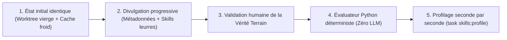

# 💡 Méthodologie d'Ingénierie, Profiling et Optimisation des Agent Skills (`7 min 31 s` → `1 min 01 s`)

Cet article consigne l'ensemble des méthodes d'étude, d'évaluation objective, de profilage temporel et d'arbitrage de modèles extraites lors de la conception du premier skill du projet (`.agents/skills/pydbsrt-data-access/`). Ce référentiel sert de **capitalisation réutilisable** pour construire, mesurer et optimiser tous les futurs skills de `pydbsrt` sans repartir de zéro ni retomber dans les mêmes pièges.

---

## 1. Synthèse de la Trajectoire Expérimentale (`÷ 7,4` en temps, `÷ 15,1` en tokens)

Tous les essais ci-dessous ont été exécutés **à l'aveugle** sur le même questionnaire à 4 volets (inventaire inter-nœuds `.ahash`, fraîcheur binaire `catalog.dbphash`, topologie des 3 disques Freebox, croisement `snippets` / `couplings.json`), depuis un `git worktree` vierge non initialisé et **cache supprimé (départ 100 % à froid)** :

| Jalon expérimental | Modèle | Temps total | Temps outils | Temps IA (réflexion + écriture) | Appels d'outil | Tokens totaux | Anomalies détectées (`task skills:profile`) |
| :--- | :--- | ---: | ---: | ---: | ---: | ---: | :--- |
| **0. Sans Skill (Baseline)** | `pro` | `451 s` (`7m 31s`) | `82 s` | `369 s` | `34` | `1 083 513` | Exploration à tâtons (20 fichiers lus) + `RTK_TEE_TRUNCATION` |
| **1. Skill v1 (appels séparés)** | `pro` | `139 s` (`2m 19s`) | `20 s` | `119 s` | `10` | `158 731` | `PARALLEL_TOOL_STAMPEDE:5_calls` + double-vérifications `ls` |
| **2. Skill v2a (`task` + ligne géante)** | `pro` | `116 s` (`1m 56s`) | `4 s` | `112 s` | `4` | `101 276` | `RTK_TEE_TRUNCATION` (`+22 s`) + tableaux verbeux (`64 s` d'écriture) |
| **3. Essai quota strict `< 1800 car.`** | `pro` | `354 s` (`5m 54s`) | `5 s` | `349 s` | `4` | `152 331` | `THINKING_LOOP_SPIKE:39127c` (`310 s` !) + `OUTPUT_TXT_SPILL_10KB` |
| **4. Skill v2b corrigé (`pro`)** | `pro` | `90 s` (`1m 30s`) | `3 s` | `87 s` | `4` | `100 094` | Débordement résiduel `10,2 Ko > 10 Ko` (`+10 s`) |
| **5. Skill v2 final (`< 8,5 Ko` + `flash`)** | **`flash`** | **`61 s` (`1m 01s`)** | **`4 s`** | **`57 s`** | **`3` (minimum théorique)** | **`71 729`** | **`[]` (Zéro anomalie — trajectoire optimale)** |

> [!IMPORTANT]
> Le minimum théorique physique d'un sous-agent découvrant un skill est de **3 appels d'outil** : (1) lire `SKILL.md`, (2) exécuter 1 commande groupée du résolveur SSOT, (3) transmettre la réponse finale. Le jalon #5 atteint exactement cette borne inférieure (`3` appels).

---

## 2. Protocole d'Évaluation Objective (Zéro Biais, Zéro Juge IA)

Une évaluation de skill n'est valide que si elle respecte 4 garde-fous méthodologiques :

1. **Parité stricte de l'état initial** : avant chaque mesure comparative, purger le cache utilisateur (`~/.cache/dbsrt/`) et retirer les liens symboliques temporaires du worktree afin que l'agent « Après » affronte exactement le même départ à froid que l'agent « Avant ».
2. **Divulgation progressive authentique (avec leurres)** : ne jamais injecter le contenu de `SKILL.md` dans le prompt système du sous-agent de test. Lui présenter uniquement le catalogue de descriptions courtes entouré d'au moins 3 skills leurres sans rapport, et vérifier qu'il choisit lui-même d'ouvrir le bon `SKILL.md` — sans aucune fuite des termes du test dans les exemples de `SKILL.md`.
3. **Validation humaine préalable de la vérité terrain** : un agent créateur ne doit **jamais** s'auto-proclamer juge de la justesse de son propre skill. Les réponses attendues sont d'abord soumises côte à côte à l'opérateur humain ; une fois validées, elles sont figées dans un script Python déterministe (`scripts/benchmarks/eval_skill_data_access.py`, cible `task skills:eval-benchmark`).
4. **Distinction dans l'évaluateur entre *exigences explicites* et *exhaustivité bonus*** : si une question demande *« Trouve **un** extrait »*, un modèle discipliné comme `flash` présentera exactement 1 extrait valide plutôt que la liste entière du dossier. Les assertions obligatoires de l'évaluateur doivent tester strictement ce que l'énoncé exige, sans pénaliser un modèle qui évite le hors-sujet.

---

## 3. Méthode de Profiling Temporel & Démystification « Chaud / Froid / Python vs Rust »

### 3.1 Découper où passe réellement chaque seconde (`task skills:profile`)

L'intuition humaine attribue spontanément la lenteur d'un agent à la vitesse des scripts locaux. Le profileur générique `scripts/benchmarks/profile_skill_transcript.py` (`task skills:profile -- <transcript_full.jsonl>`) reconstruit à partir des horodatages exacts (`Created At` / `Completed At`) trois compteurs disjoints :

- **`tool_execution_seconds`** : temps cumulé réellement passé dans les sous-processus, lectures disque et appels réseau.
- **`llm_inference_and_writing_seconds`** : temps passé sur les serveurs du modèle à réfléchir (`thinking`) et générer des tokens de sortie.
- **`final_synthesis_seconds`** : part du temps IA consacrée uniquement à rédiger le message final (~110 à 125 tokens/s sur `pro`).

Dès le jalon #2, **96,7 % du temps total (`87 s` sur `90 s`) n'était plus dans le code local (`3 s`), mais dans la génération de tokens du modèle**. Optimiser un outil déjà tombé à `3 s` ne peut jamais faire gagner `40 s` : seul le profilage chiffré évite d'optimiser le mauvais composant.

### 3.2 Vérité mesurée sur « Chaud vs Froid » et Python vs Rust

Les chronométrages empiriques sur le résolveur SSOT montrent pourquoi la question « interpréteur Python vs binaire compilé Rust » était un faux suspect pour ce type d'outil :

| Étape mesurée | Durée réelle | Cause physique dominante |
| :--- | ---: | :--- |
| Démarrage nu de `python3` | `0,10 s` (`106 ms`) | Chargement interpréteur en RAM |
| Lecture cache + index `couplings` pré-calculé (`80 Ko` au lieu de `41,2 Mo`) | `0,07 s` (`65 ms`) | Lecture SSD NVMe locale |
| **Total appel « à chaud » complet** | **`0,17 s` (`171 ms`)** | Quasi instantané à l'échelle d'un tour LLM (`10–40 s`) |
| **Total appel « à froid » complet** | **`3,10 s` (`3 105 ms`)** | Déchiffrement GPG `pass` (`~0,8 s`) + handshakes TCP/SSH distants (`~2,1 s`) |

Un binaire Rust compilé démarrerait en `0,002 s` au lieu de `0,17 s` (**gain : `0,16 s`** sur une tâche de `61 s`), mais attendrait exactement les mêmes `~2,9 s` de réseau SSH/FTP et de déchiffrement GPG à froid.

Pour faire disparaître l'attente à froid au quotidien sans perdre le partage direct de code Python avec `scripts/portal_server.py`, **4 techniques réutilisables** ont été combinées :

1. **Cache *Stale-While-Revalidate* (SWR 24h) couplé à `/proc/net/route`** : tant que l'empreinte SHA-256 de la table de routage Linux ne change pas (`< 1 ms`), le cache répond immédiatement en `0,17 s` jusqu'à 24h et déclenche, au-delà de 5 min, un rafraîchissement détaché en arrière-plan (`start_new_session=True`). Seul un vrai changement de réseau (Wi-Fi ↔ 4G ↔ VPN) impose une sonde synchrone.
2. **Multiplexage SSH (`ControlMaster=auto`, `ControlPersist=600`)** : maintient le tunnel SSH ouvert 10 min (`~150 ms` au lieu de `~600 ms`).
3. **Verrou exclusif anti-rafale (`fcntl.flock`)** : empêche plusieurs processus parallèles de lancer simultanément les mêmes sondes SSH/FTP.
4. **Cache d'index dérivé indexé sur `(taille, mtime_ns)`** : au lieu de relire un fichier JSON monolithique de `41,2 Mo` (`couplings.json`, `315 ms`), persister un index résumé de `80 Ko` lu en `1,5 ms`.

---

## 4. Les 5 Pièges de Conception d'un Skill (et leurs Parades)

Chaque itération du benchmark a révélé un piège concret que `task skills:profile` détecte désormais automatiquement :

### Piège #1 — La rafale d'appels parallèles (`PARALLEL_TOOL_STAMPEDE`)
- **Symptôme** : si un CLI n'offre qu'un verbe unitaire (`resolve <famille>`), l'agent lance 5 commandes en parallèle au premier tour (`+15 s` de contention SSH/GPG et `31 Ko` de JSON dupliqué).
- **Parade** : **toujours concevoir un verbe groupé** (`query <cible1> <cible2> ...`) qui résout toute la question en **1 seul appel dédupliqué**.

### Piège #2 — Le mur des `10 Ko` (`OUTPUT_TXT_SPILL_10KB`) et les hooks `rtk` (`RTK_TEE_TRUNCATION`)
- **Symptôme** : dans l'environnement d'exécution d'agent :
  - Tout stdout dépassant **`10 000 octets`** (même de `266 octets`, ex. `10 266 B`) ou comportant une ligne unique de plus de `8 000 caractères` est déversé dans un fichier temporaire `output.txt`, forçant 1 à 4 tours supplémentaires `read_file` (`+10 s` à `+25 s`).
  - L'invocation via `task ...` active le pré-hook `rtk` qui tronque les longues lignes dans `~/.local/share/rtk/tee/*.log` (`+22 s`).
- **Parade** :
  1. Dans `SKILL.md`, appeler directement `python3 .agents/skills/<nom>/scripts/<cli>.py ...` pour les requêtes JSON destinées à l'agent (tout en conservant les cibles `task ...` pour l'opérateur humain).
  2. Calibrer systématiquement la sortie du verbe groupé **sous `8 500 octets` au total** et **sous `5 000 caractères` par ligne** (une ligne JSON compacte par section racine).

### Piège #3 — L'explosion cognitive des quotas de caractères (`THINKING_LOOP_SPIKE`)
- **Symptôme** : écrire une contrainte numérique rigide comme *« Réponds en `< 1800` caractères et `< 25` lignes »* dans `SKILL.md` a provoqué sur le modèle de raisonnement `pro` une boucle obsessionnelle de **39 127 caractères de réflexion interne (`310 secondes` !)** où le modèle rédigeait un brouillon, comptait ses caractères un par un, puis recommençait.
- **Parade** : **bannir tout plafond numérique de caractères ou de mots dans `SKILL.md`**. Utiliser uniquement des consignes de forme naturelles : *« Liste à puces directe (une puce par élément), sans répéter les mêmes chiffres à la fois en texte et en tableau »*.

### Piège #4 — Les calculs mentaux et revérifications inutiles
- **Symptôme** : si le script renvoie uniquement des timestamps UNIX bruts ou omet l'état direct du dossier courant d'un worktree, l'agent lance un `ls -la` de vérification (`+11 s`) et calcule lui-même les soustractions d'octets dans `<thinking>`.
- **Parade** : pré-calculer dans le JSON tous les écarts (`delta_bytes`, `delta_medias`, `mtime_iso`, `active_worktree_direct`) et indiquer explicitement dans `SKILL.md` de faire confiance à ces champs sans relancer `ls`/`stat`.

### Piège #5 — Les fuites d'exemples de benchmark dans `SKILL.md`
- **Parade** : utiliser uniquement des exemples génériques dans `SKILL.md` (ex. `Matrix`), jamais les entités testées par le benchmark d'évaluation (`Andor`, etc.), afin que la mesure d'efficacité reste honnête et généralisable.

---

## 5. Choix des Modèles & Pistes d'Optimisation à Continuer d'Explorer

L'enseignement architectural majeur de cette étude est le **transfert d'intelligence du modèle vers le code déterministe du skill** :

- **Sans skill**, seul un modèle lourd (`pro`) survit à l'exploration de 20 fichiers hétérogènes, au prix de `7 min 31 s` et `1,08 M` tokens.
- **Avec un skill SSOT bien borné (`< 8,5 Ko`)**, toute l'ambiguïté métier (routage réseau, sécurité CIFS, worktrees Git, en-têtes binaires `.dbphash`, croisement `couplings.json`) est résolue en `0,17 s` par du code Python testé unitairement. Dès lors, **un modèle léger (`flash`) obtient la même exactitude factuelle que `pro`, descend à `1 min 01 s` (`58 s` à chaud) et divise la consommation de tokens par 15**.

### Pistes concrètes à explorer lors de la construction des prochains Skills

1. **Banc d'essai `flash_lite` sur les skills purement extractifs** : tester systématiquement chaque nouveau skill sur le trio `(pro, flash, flash_lite)` via `task skills:profile` pour identifier le modèle le plus léger atteignant `100 %` à l'évaluateur déterministe (cible potentielle `< 30 s` sur `flash_lite`).
2. **Pattern Orchestrateur `pro` → Sous-agents spécialisés `flash`** : lorsqu'une session principale tourne sur `pro` (architecture, refactoring Rust complexe), déléguer les phases d'inventaire, de vérification d'état ou de diagnostic outillées par un skill à un sous-agent `Model: "flash"` plutôt que `inherit`.
3. **Préchauffage événementiel réseau (`0 s` de froid après bascule Wi-Fi / 4G)** : brancher un script léger sur le dispatcher NetworkManager local (ou le démon `dbsrt-server`) pour rafraîchir automatiquement `~/.cache/dbsrt/data_access_cache.json` à chaque changement d'interface réseau.
4. **Matrice systématique « 1 Douleur = 1 Skill SSOT + 1 Évaluateur déterministe »** : appliquer ce même cycle (Vérité terrain validée par l'humain → Baseline à l'aveugle → Résolveur SSOT `< 8,5 Ko` → Profiling `task skills:profile` zéro anomalie → Sélection du modèle minimal `flash`/`flash_lite`) aux prochains points de douleur du projet.
