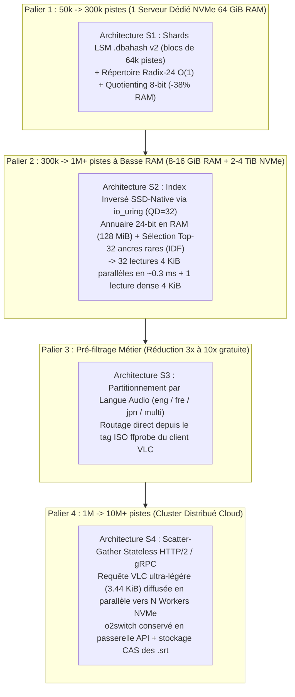

# 💡 Synthèse Comparative `aHash` vs `pHash` & Loi d'Échelle Prédictive (`5 000` $\rightarrow$ `1 000 000` Pistes)

!!! important "Classification Stricte des Faits vs Projections Analytiques"
    - **Partie 1 — Empiriquement Prouvée (`Terminal Proof`)** : toutes les métriques à **`2 490` pistes audio (`aHash`)** et **`4 974` médias vidéo (`pHash`)** ont été mesurées sur le corpus réel complet de **5 757 vidéos** (`17 268` fenêtres vidéo, `9 529` fenêtres audio, rapport `data/reports/eval_matrix_real_dbahash_v1.json`) et via `/proc/self/status` (`task bench:dbahash:rss`).
    - **Parties 2 & 3 — Modèle Analytique Prédictif & Architectures Cibles (`Non exécuté au-delà de 2 490 pistes`)** : les projections à **`5 000` $\rightarrow$ `1 000 000` pistes** sont déduites mathématiquement de la taille exacte des structures Rust (`DbahashMediaEntry = 64 B`, `Mih32Entry = 8 B`), de la durée empirique moyenne observée ($\bar{T} = 48.88\text{ min/piste}$, soit $\bar{F}_d = 252\,589$ trames denses à $86.125\text{ fps}$ et $\bar{F}_c = 7\,893.9$ trames grossières à $K = 32$), des bornes binaires `u32::MAX` du code actuel et des caractéristiques physiques NVMe (`4 KiB` `QD=1` vs `QD=32`).

---

## 1. Face-à-Face Direct sur le Catalogue Complet Actuel (`aHash` vs `pHash`)

Le tableau ci-dessous confronte sur le **même corpus de 5 757 vidéos réelles** la dernière version audio **`MmapDbahash` v1 ($K = 32$)** aux deux meilleures variantes visuelles **`pHash` (`catalog.dbphash` v2)** :

| Critère | Vidéo `pHash MIH-16` *(Meilleur Rappel Vidéo)* | Vidéo `pHash MIH-32` *(Meilleur F1 / Vitesse Vidéo)* | **Audio `aHash MmapDbahash` v1 ($K=32$)** *(Dernière version)* |
| :--- | :---: | :---: | :---: |
| **Volume indexé en catalogue** | `4 974` médias (`24.69 M` trames) | `4 974` médias (`24.69 M` trames) | **`2 490` pistes** (`628.95 M` trames denses, `19.66 M` grossières) |
| **Taille archive sur NVMe** | `376.8 MiB` (`catalog.dbphash`) | `376.8 MiB` (`catalog.dbphash`) | **`5 248.8 MiB` (`5.13 GiB`, `catalog.dbahash`)** |
| **Vidéos cibles indexées (sur `5 757`)** | `4 582` vidéos | `4 582` vidéos | **`2 541` vidéos** |
| **Ouverture / initialisation index** | `814.7 ms` (build CSR RAM) | `691.9 ms` (build MIH-32 RAM) | **`1.43 ms` (`open`) / `11.69 ms` (`AhashEngine` complet)** |
| **Latence recherche — 1 fenêtre** | `15.09 ms` (`p95 = 38.63 ms`) | **`0.90 ms`** (`p95 = 2.12 ms`) | **`2.75 ms`** sur matrice (`1.39 ms` chaud, `p95 = 5.12 ms`) |
| **Latence vidéo — 3 fenêtres** | `45.27 ms` (`p99 = 125.3 ms`/win) | **`2.70 ms`** (`p99 = 23.78 ms`/win) | **`8.25 ms`** (**`p99 = 7.02 ms`**/win — queue `3.4x` plus stable) |
| **Rappel sur 1 seul extrait (`1W`)** | `81.19 %` (`3 720 / 4 582`) | `72.94 %` (`3 342 / 4 582`) | **`98.86 %` (`2 512 / 2 541`)** |
| **Rappel sur 3 extraits (`3W`)** | `84.77 %` (`3 884 / 4 582`) | `84.40 %` (`3 867 / 4 582`) | **`99.41 %` (`2 526 / 2 541`)** |
| **Précision (`3W`, rejet faux-positifs)** | `70.95 %` (`1 590` FP) | `73.48 %` (`1 396` FP) | **`98.40 %` (`41` FP seulement sur `5 757` vidéos)** |
| **Score global `F1` (`3W`)** | `77.25 %` | `78.56 %` | **`98.90 %` (`+20.3 pts` vs `pHash`)** |
| **Précision du recalage (intra-vidéo)** | Médiane **`1 075 ms`** (`~1.1 s`) | Médiane **`500 ms`** (`0.5 s`) | Médiane **`6 ms`** (`0.0 ms` dérive vs $K=1$, `100 % <= 15 ms`) |
| **RAM tas privé (`RssAnon` non réclamable)** | **`~757.5 MiB`** | **`~753.5 MiB`** | **`4.63 MiB`** (**`160x` moins de tas privé**) |
| **RAM totale (`VmRSS` = `Anon` + `File`)** | `~758 MiB` (`0.152 MiB`/média) | `~754 MiB` (`0.152 MiB`/média) | **`307.29 MiB`** (`0.123 MiB`/piste, `98.5 %` en page-cache OS) |

### Enseignements Clés & Complémentarité Métier

1. **Supériorité statistique et temporelle d'`aHash`** : un seul extrait audio de `5.0 s` identifie **`98.86 %`** du catalogue (`99.41 %` en 3 extraits, `F1 = 98.90 %`) et cale les sous-titres à **`6 ms`** près (pas natif `11.6 ms`), contre `500–1 075 ms` pour `pHash` (cadencé à `1 fps` + cuts, sensible aux génériques communs et plans noirs).
2. **Démarrage `60x` plus rapide & RAM par média inférieure** : malgré **25 fois plus de trames** (`628.95 M` vs `24.69 M`), `MmapDbahash` ne consomme que **`0.12 MiB`/piste** de page-cache OS réclamable et **`4.63 MiB`** de tas privé (`RssAnon`), contre **`0.15 MiB`/média** de tas privé incompressible pour `pHash`.
3. **Pourquoi conserver `pHash` en binôme** : `aHash` compare la **bande-son** (une vidéo en doublage VF ne matche pas une empreinte extraite uniquement sur la piste VO anglaise tant que la piste `.a1` VF n'est pas indexée), tandis que `pHash` est **100 % agnostique à la langue audio**.

---

## 2. Équations Prédictives de Passage à l'Échelle ($N = 5\,000 \rightarrow 1\,000\,000$ Pistes)

Soit $N$ le nombre de pistes audio indexées, $K = 32$ le facteur Coarse-to-Fine nominal, $T_w$ le nombre de threads workers, et $\tau = \frac{\bar{T}_{\text{min}}}{48.88}$ le facteur de durée moyenne normalisé sur le mix empirique actuel (`48.88 min`/piste = `252 589` trames denses = `7 893.9` trames grossières ; prendre $\tau = 1.0$ pour un mix Séries/Films, $\tau \approx 2.25$ pour `100 %` de longs-métrages de `110 min`).

### 2.1. Loi d'Occupation Disque NVMe — $\mathcal{O}(N)$

Chaque piste stocke `8` octets par trame dense (`1.927 MiB`), `8` octets par trame grossière (`0.060 MiB`, évincé de la RAM), `16` octets dans les deux tables `MIH-32` (`0.1205 MiB`) et `~180` octets de métadonnées/chaînes :

$$
S_{\text{NVMe}}(N, \tau) = \left(1.9271 + \frac{5.781}{K}\right) \tau N\text{ MiB} \;\xrightarrow{K=32}\; \mathbf{2.108 \cdot \tau \cdot N\text{ MiB}} \approx \mathbf{2.059\text{ GiB pour }1\,000\text{ pistes}}
$$

**Propriété cruciale** : **`91.4 %`** de ce volume (`dense_hashes`) est **thermiquement froid** (`MADV_RANDOM`). Il n'a **jamais besoin de tenir en RAM** : seuls `3.69 KiB` (`1` à `2` pages `4 KiB`) sont lus sur NVMe par candidat vérifié.

### 2.2. Loi de Consommation RAM (`VmRSS = RssAnon + RssFile`) — $\mathcal{O}(N)$

Pour conserver une latence sub-10ms sans défauts de page aléatoires dans l'index grossier, seules les deux tables triées `MIH-32` (`upper` + `lower`) doivent résider dans le page-cache OS (`RssFile`) :

$$
\begin{aligned}
\text{RssAnon}(N, T_w) &\approx 3.0 + 0.23 \cdot T_w + \mathbf{0.00016 \cdot N}\quad [\text{MiB}] \quad \text{(tas privé Rust : offsets + index delta)} \\
\text{RssFile}_{\text{chaud}}(N, \tau) &\approx \frac{3.8544}{K} \cdot \tau \cdot N + \Delta_{\text{dense}} \;\xrightarrow{K=32}\; \mathbf{0.1205 \cdot \tau \cdot N + \Delta_{\text{dense}}}\quad [\text{MiB}] \\
\text{VmRSS}_{\text{nominal}}(N, \tau) &\approx \mathbf{4.6 + 0.1208 \cdot \tau \cdot N\text{ MiB}} \quad (\text{avec } \Delta_{\text{dense}} \text{ borné par le LRU noyau})
\end{aligned}
$$

*Vérification sur le point réel $N = 2\,490, \tau = 1$* : $4.6 + 0.1208 \times 2\,490 = \mathbf{305.4\text{ MiB}}$ vs **`307.29 MiB` mesurés** (écart `< 0.6 %`).

### 2.3. Loi Prédictive de Latence d'une Requête (`1` Fenêtre `5.0 s`, $2Q = 860$ Sondes)

Tant que `MIH-32` tient en RAM (`VmRSS_chaud <= RAM_dispo`), la latence d'une fenêtre se décompose en quatre termes physiques :

$$
L_{\text{1W}}(N) \approx \underbrace{0.15\text{ ms}}_{\text{fixe}} + \underbrace{\alpha_{\text{DRAM}} \cdot \log_2(7\,894 \cdot N)}_{\text{860 recherches dichotomiques MIH-32}} + \underbrace{\beta_{\text{coll}} \cdot N \cdot \log_2(N)}_{\text{collecte/tri des collisions 32-bit } H_1(N)} + \underbrace{C_{\text{verif}} \cdot T_{\text{NVMe, 4K}}}_{\text{raffinement fin }\pm 16\text{ trames}}
$$

où (calibré sur les tirs empiriques `1.39 ms` cache chaud et `2.75 ms` matrice complète à $N = 2\,490$) :

1. **Terme dichotomique `MIH-32`** ($\alpha_{\text{DRAM}} \approx 0.05\text{–}0.10\text{ ms/bit}$) : **logarithmique** ! Doubler le catalogue de `2 490` à `5 000` pistes n'ajoute qu'**un seul saut binaire** ($\log_2(2) = +1$, soit `+0.08 ms`).
2. **Terme de collisions 32-bit simples** ($\beta_{\text{coll}} \approx 4.5 \times 10^{-6}\text{ ms}$) : chaque fenêtre de `860` sondes génère $H_1(N) \approx 0.005 \cdot N$ votes simples à trier dans le scratchpad TLS (`< 0.3 ms` à `5 000` pistes, `~3.9 ms` à `50 000` pistes, mais dominant au-delà de `250 000` pistes).
3. **Sélectivité des faux candidats à `>= 2` votes alignés** : exiger `2` sondes 32-bit cohérentes à $\pm 8$ trames près abaisse la probabilité de faux cluster aléatoire à $\approx 1.7 \times 10^{-10} \cdot N$ (loi d'anniversaire conditionnelle spatio-temporelle). Même à $N = 1\,000\,000$, le nombre de faux candidats franchissant le seuil primaire reste $\ll 1$ par requête !
4. **Terme de vérification fine NVMe** ($C_{\text{verif}} \in [1, 4]$, $T_{\text{NVMe, 4K}} \approx 0.08\text{–}0.12\text{ ms}$) : **strictement constant $\mathcal{O}(1)$** (`~0.15 à 0.45 ms`), que `dense_hashes` pèse `5 GiB` ou `2 TiB`.

!!! warning "La Falaise (« Memory Cliff ») si `MIH-32` déborde de la RAM"
    Dès que $\text{RssFile}_{\text{chaud}}(N) > \text{RAM}_{\text{disponible}}$ (ex. $> 48\text{ GiB}$ sur le conteneur LVE `o2switch`, soit $N \gtrsim 350\,000$ pistes), les niveaux bas des `860` recherches dichotomiques provoquent **`~4 000 à 6 000` défauts de page NVMe `4 KiB` sérialisés (`QD = 1`)**, faisant bondir brutalement la latence de **`~20 ms` à `~450–600 ms` par fenêtre** !

---

### 2.4. Tableau Prédictif Consolidé : de `2 490` à `1 000 000` de Pistes ($\tau = 1.0, K = 32$)

| Échelle $N$ (Pistes) | Heures Audio | Disque `.dbahash` | `RssAnon` (Tas Privé) | **`VmRSS` Chaud (`MIH-32`)** | Latence `1W` (`3W`) | Rappel `3W` Attendu | Verdict sur `o2switch` actuel (`PMEM = 48 GiB` LVE, NVMe) |
| :--- | :---: | :---: | :---: | :---: | :---: | :---: | :--- |
| **`2 490` (Réel prouvé)** | `2 028 h` | **`5.13 GiB`** | **`4.6 MiB`** | **`307 MiB`** | **`1.4–2.8 ms`** (`8.2 ms`) | **`99.41 %`** | **Prouvé** (`0.6 %` du quota RAM LVE) |
| **`5 000` (Parité `pHash`)** | `4 073 h` | **`10.3 GiB`** | `~5.4 MiB` | **`~609 MiB`** *(vs `755 MiB` pHash)* | **`~1.6–3.1 ms`** (`~9.2 ms`) | **`~99.3–99.4 %`** | **Nominal** (`1.2 %` LVE, build `~35 s`) |
| **`10 000`** | `8 147 h` | **`20.6 GiB`** | `~6.6 MiB` | **`~1.19 GiB`** | **`~1.8–3.5 ms`** (`~10.5 ms`) | **`~99.3 %`** | **Nominal** (`2.5 %` LVE, build `~1.2 min`) |
| **`50 000`** | `40 733 h` | **`102.9 GiB`** | `~13 MiB` | **`~5.91 GiB`** | **`~4.5–7.2 ms`** (`~21 ms`) | **`~99.1 %`** | **Confortable en RAM** (`12.3 %` LVE) ; surveiller quota disque mutualisé |
| **`100 000`** | `81 467 h` | **`205.9 GiB`** | `~21 MiB` | **`~11.8 GiB`** | **`~8.5–12.5 ms`** (`~35 ms`) | **`~98.8 %`** *(1)* | **Viable en RAM** (`25 %` LVE), **limite stockage mutualisé** |
| **`250 000`** | `203 667 h` | **`514.6 GiB`** | `~45 MiB` | **`~29.5 GiB`** | **`~20–28 ms`** (`~75 ms`) | Dégradation *(1)* | **Zone rouge LVE** (`61 %` `PMEM` + écrêtage buckets `1 024`) |
| **`544 090` (Mur `u32`)** | `443 250 h` | **`1.10 TiB`** | `~92 MiB` | **`64.1 GiB`** | Falaise NVMe (`> 300 ms`) | **Impossible en v1** | **Dépassement `u32::MAX` (`frame_idx`) & `PMEM = 48 GiB`** |
| **`1 000 000` (`93 ans`)** | `814 667 h` | **`2.01 TiB`** | `~165 MiB` | **`117.6 GiB`** | Falaise NVMe (`~500 ms`) | **Refonte requise** | **Hors capacité `o2switch`** (`118 GiB` RAM + `2 TiB` NVMe) |

*(1) À partir de `100 000–250 000` pistes dans une table `MIH-32` monolithique, les motifs harmoniques courants franchissent le plafond fixe `MAX_MIH_SLICE_CANDIDATES = 1_024` (`append_mih32_slice_votes`), ce qui impose soit le sharding, soit les ancres combinées 64-bit détaillées ci-dessous.*

---

## 3. Trois Murs Physiques vers le Million de Pistes & Architectures Cibles

Pour franchir le cap des **`100 000` à `1 000 000+` pistes** (`2 TiB` d'empreintes), trois verrous structurels du monolithe `.dbahash` v1 apparaissent :

1. **Verrou binaire `u32` (`544 090` pistes max)** : `Mih32Entry { chunk: u32, frame_idx: u32 }` adresse au maximum $2^{32} - 1 = 4.29 \times 10^9$ trames grossières.
2. **Verrou mémoire `MIH-32` (`117.6 GiB` à `1M` pistes)** : dépasse les `48 GiB` LVE d'`o2switch`.
3. **Verrou d'entropie 32-bit (`MAX_MIH_SLICE_CANDIDATES = 1_024`)** : à $7.89 \times 10^9$ trames grossières, la taille moyenne d'un bucket 32-bit uniforme atteint $1.84$, et les accords musicaux fréquents dépassent `1 024` entrées.

Voici les **4 architectures progressives** permettant de passer à l'échelle industrielle sans perdre la précision de `6 ms` :

### Architecture S1 — `.dbahash` v2 Multi-Shards LSM + Quotienting Radix-24 (`1` Nœud Dédié `64–128 GiB` RAM)

- **Mécanisme** :
    1. **Découpage en shards immuables de `64 000` pistes** (`~131 GiB` et `5.05 × 10^8` trames grossières par shard, soit `16` shards pour `1 000 000` de pistes) + `1` petit shard actif pour les nouvelles ingestions. `frame_idx: u32` ne déborde plus jamais et un `pack` ne recompile que le shard courant (`~2 min` au lieu de `2 TiB`).
    2. **Index Radix-24 + Quotienting (`5 octets` au lieu de `8`)** : comme les entrées sont triées par `chunk: u32`, un tableau d'offsets `u32[2^24 + 1]` (`64 MiB`) indexe directement les `24` bits hauts en **$\mathcal{O}(1)$ (`1` accès cache-line au lieu de `25` sauts dichotomiques)**, et chaque entrée ne stocke plus que l'octet résiduel `chunk_low8: u8` + `frame_idx: u32` (`5 B`).
    3. **Ancres spectrales combinées 64-bit (*Constellation Pairing* à $K = 32$)** : au lieu d'indexer indépendamment `upper` et `lower` (`2` tables), combiner dans une clé unique les bits discriminants de la trame $t$ et de la trame $t + \Delta$ (`+4` trames = `+46 ms`) divise par **`2x`** le nombre de tables et porte l'espace de clés effectif au-delà de $2^{40}$, éliminant la saturation des buckets sur accords fréquents.
- **Empreinte à `1 000 000` de pistes** : **`~38 GiB` de RAM** (tient sur **un seul serveur dédié `64 GiB` RAM + `2×2 TiB` NVMe** type Hetzner AX / OVH Advance à `~50–70 €/mois`), latence **`~4 à 8 ms`** en parallèle Rayon sur 8–16 cœurs.

### Architecture S2 — Moteur « SSD-Native » par `io_uring` + Élagage IDF en RAM (`1 000 000` de pistes dans **`< 4 GiB` de RAM** !)

- **Pourquoi c'est la rupture la plus frugale** : si l'on refuse de louer `64–128 GiB` de RAM, il faut empêcher les `6 000` défauts de page série (`QD=1`) d'une recherche dichotomique sur SSD.
- **Mécanisme** :
    1. **En RAM (`~1 à 2 GiB` seulement)** : conserver uniquement un **répertoire d'offsets de blocs Posting Lists** (ex. `2^26` seaux compressés par préfixe 26-bit $\rightarrow$ offset NVMe + longueur `len` sur `2` octets).
    2. **Sélection *IDF-Pruning* en `0` I/O disque** : parmi les `430` trames de la requête (`5.0 s`), lire dans le répertoire RAM la taille `len` de chaque seau et **ne retenir que les `32` trames non vides les plus rares** (`1 <= len <= 32` candidats). Les trames bruyantes ou communes (`len > 1 000`) sont écartées gratuitement avant tout accès disque !
    3. **Soumission parallèle `io_uring` (`Queue Depth = 32`)** : envoyer simultanément les `32` lectures `4 KiB` au contrôleur NVMe. Un SSD NVMe PCIe 4.0 absorbe `32` lectures parallèles en **`~0.20 à 0.35 ms`** au total (`> 500k IOPS`).
    4. **Vote temporel + `1` lecture `4 KiB` dans `dense_hashes`** (`+0.10 ms`).
- **Empreinte à `1 000 000` de pistes** : **`< 4 GiB` de RAM totale**, `2.0 TiB` de NVMe, latence **`~1.5 à 3.5 ms` par fenêtre** !

### Architecture S3 — Partitionnement Linguistique Natif (`eng` / `fre` / `jpn`)

- **Mécanisme** : les sidecars `<stem>.json` et `DbahashMediaEntry::language` portent déjà le code ISO 639-2 de la piste décodée. Compiler un fichier `.dbahash` par langue majeure (`catalog.eng.dbahash`, `catalog.fre.dbahash`, `catalog.jpn.dbahash`) permet au démon de ne sonder en priorité que la langue de la piste audio active dans VLC (réduction immédiate de **`3x` à `8x`** du volume de recherche et du bruit de collision, compatible avec `o2switch` jusqu'à `~300 000` pistes si l'espace disque le permet).

### Architecture S4 — Cluster Distribué « Scatter-Gather » (`1 000 000` $\rightarrow$ `10 000 000+` Pistes)

- **Mécanisme** :
    - Une requête `aHash` de `5.0 s` envoyée par VLC ne pèse que **`3 440 octets` (`3.44 KiB`)** !
    - **`o2switch` (Front-End / Plan de Contrôle)** conserve l'API publique HTTPS, l'authentification, PostgreSQL / `couplings.json` et la distribution CAS des fichiers `.srt` (très légers), puis relaie en parallèle (`Scatter`) les `3.44 KiB` vers $M$ **Workers NVMe Stateless** portant chacun une tranche de `250k` à `1M` pistes (combinaison avec S1 ou S2).
    - Chaque worker renvoie uniquement `128` octets JSON (`best_match`, `distance_bits`, `offset_ms`) en `< 5 ms` ; la passerelle agrège le minimum global de Hamming (`Gather`).
- **Avantage décisif** : scalabilité horizontale linéaire sans limite de plafond, zéro transfert vidéo sur le réseau, et résilience par réplication de shards.
